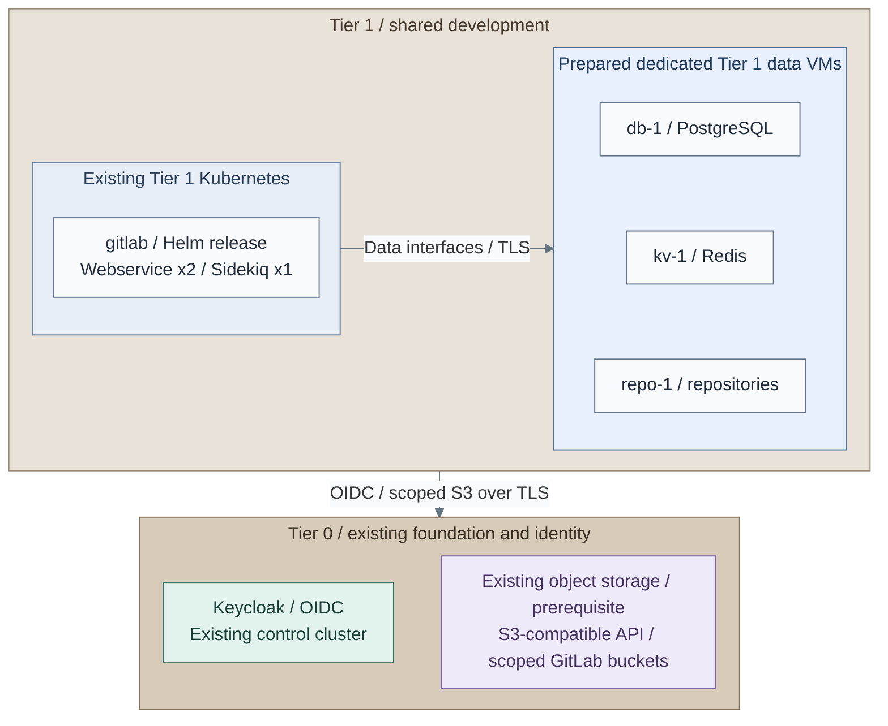
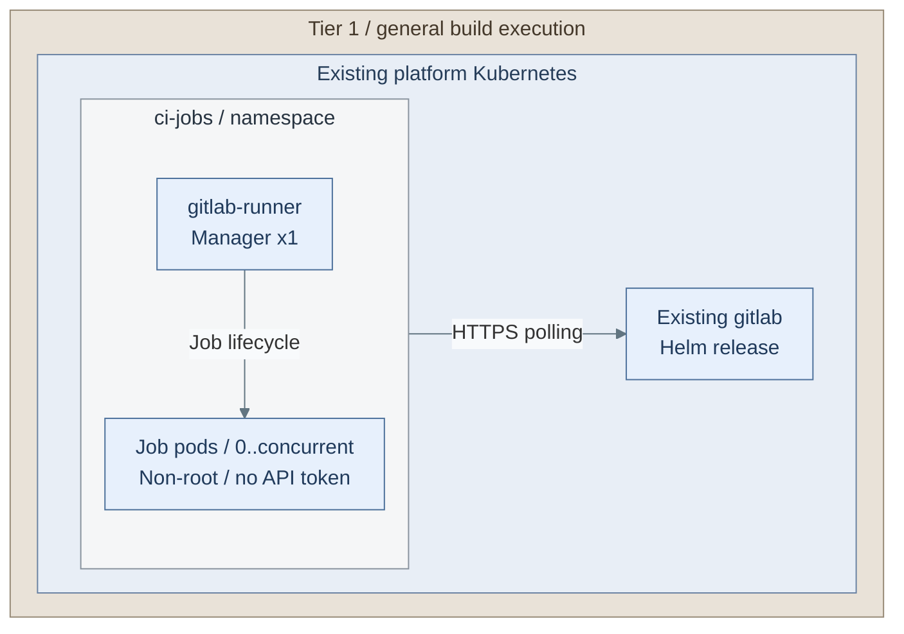
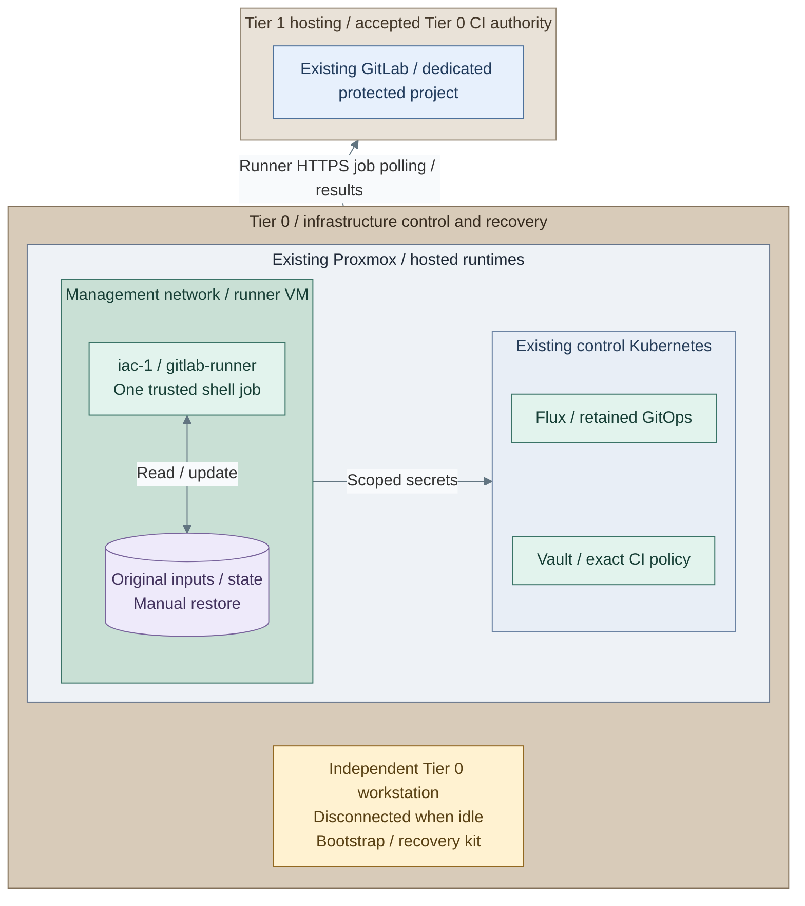

# Stage 9: Development platform

**Related:** [Architecture](../../01-architecture/10-delivery/03-development-platform.md) · [Operations](../../05-operations/05-delivery.md)

Deploy source control and CI, then transfer routine infrastructure execution from
the bootstrap workstation. The reference uses GitLab on Tier 1 Kubernetes,
on-demand Kubernetes job pods and a separate Tier 0 infrastructure runner.

<a id="figure-source-control"></a>

## Expected outcome: source control and its data



**IaC:** *Figure: GitLab uses dedicated Tier 1 data VMs and existing scoped object storage, with human login through
the existing Tier 0 identity provider.*
Tier 1 [inputs](../../../tier-1/ansible/group_vars/development_platform.yml.example),
[recipe](../../../tier-1/ansible/playbooks/deployment/development-platform.yml)
and [values template](../../../tier-1/ansible/roles/development_platform/templates/gitlab-values.yml.j2).
The GitLab box aggregates the native chart; its labels highlight web/worker scale,
not a complete pod inventory. The dedicated data VMs are prepared by the separate
[data-service recipe](procedures/data-services.md); this step then installs GitLab.
The selected object-storage service already exists and supplies tenant credentials,
never storage-admin authority. This stage deploys no storage VM or gateway.
A NAS file mount cannot replace the chart's object API requirement.
Accept SSO, scoped membership, clone/push and
backup/restore before ordinary use.

**Prerequisites:** accepted Delivery, Observability, Identity and Secrets; approved Linux images,
data-service DNS/TLS, independent backup destinations and recovery custody.
Actions 2-8 provision the GitLab data services; they are not a previous stage to find elsewhere.
**Working repositories:** `<prefix>-tier-1` for GitLab/general CI and
`<prefix>-tier-0` for Vault CI policy and the infrastructure runner.
**Automation:** native Helm installation/rendering, a runner VM/role and Vault JWT
policy and dedicated data-service installation are supplied. Storage/PKI commissioning,
live acceptance and automated lab requests remain separate; see
[coverage](../../08-reference/implementation-support.md#stage-coverage).
**Design:** [development platform](../../01-architecture/10-delivery/03-development-platform.md).

**Execution context:** `<prefix>-tier-1/`.

The source-control and general-build actions use Tier 1. Actions 16-20 explicitly switch to Tier 0.
No new guest needs an interactive login for package, disk, mount or service configuration.

<a id="main-path"></a>

## Deployment actions

| Action | Selected path | Next |
| --- | --- | --- |
| 1a | GitLab on the accepted Tier 1 Kubernetes cluster | 2-13 |
| 1b | [Dedicated source-control VM](step-1b-source-control-vm.md), instead of 1a | 14 after its backup/SSO acceptance |
| 2-8 | Provision and configure the three Kubernetes-path data VMs | 9 |
| 9-13 | Configure, render, install and accept GitLab with one release owner | 14 |
| 14a / 14b | Kubernetes job runners or Podman build runner | 15 |
| 15a / 15b | Keep mutable Linux, or add image-based Linux | 16 |
| 16-19 | Accept direct-CI trust, create exact Vault authority, install the protected runner and test jobs | 20 |
| 20 | Transfer original state and enable one protected writer | 21 |
| 21 | Verify independent recovery and record acceptance | Stage 10 |

<a id="step-1-deploy-source-control-and-sso"></a>
<a id="1-select-source-control-placement"></a>

## Step 1: Select source-control placement

For **1a**, use the Kubernetes main path below. The [source-control figure](#figure-source-control)
shows the accepted cluster plus three dedicated data VMs and an existing object endpoint.
These VMs are deployed in this stage; do not search for them in a previous stage.

For **1b**, complete the [source-control VM option](step-1b-source-control-vm.md) instead.
Its IaC owns the service and optional extra disk. After its SSO, first backup and restore checks,
skip Actions 2-13 and continue at 14. Do not run both GitLab realizations for the same service.


<a id="2-initialize-the-data-service-inputs"></a>

## Step 2: Initialize the data-service inputs

Run from **`<prefix>-tier-1/`**.

```bash
bash scripts/init-local-files.sh --setup development-data
```

**Expected:** local input copies for the dedicated `development-data` setup, without replacing existing
configuration. Existing guests need explicit import/state migration before this root can own them;
never move or replace the alternative `git-1` state implicitly.


<a id="3-configure-the-data-vms"></a>

## Step 3: Configure the data VMs

Edit these files in **`<prefix>-tier-1/`**:

| File | Set |
| --- | --- |
| `terraform/deployments/development-data/terraform.tfvars` | `db-1`, `kv-1`, `repo-1`; unused VMIDs, size/storage and an explicitly clone-tested EL9 x86_64 template |
| `ansible/inventory/hosts.yml` | All three matching hosts in `development_data` |
| `ansible/group_vars/development_data.yml` | Matching `platform_host_ips` / `development_data_hosts` and stable service endpoints |
| `.env.local` | This tier's verified API endpoint/token and local SSH public-key paths |

The native GitLab package-role integration currently supports **EL9**, even when other platform
services use EL10. A family label alone does not establish that version.
Retain all existing resource entries and the original setup state.


<a id="4-provision-only-the-data-vms"></a>

## Step 4: Provision only the data VMs

Run from **`<prefix>-tier-1/`**.

```bash
bash scripts/deploy.sh development-data --terraform-only
```

Review Terraform's inline plan and enter `yes` only for the intended VM/disk changes.
`--plan-only` previews; approved unattended runs use `--auto-approve`.
This explicit infrastructure-only pass stops before product configuration; Action 8 owns that apply gate.


<a id="5-match-the-package-and-object-storage-contract"></a>

## Step 5: Match the package and object-storage contract

On **the controller**, read the accepted GitLab chart's application version:

```bash
read -r -p 'Accepted GitLab chart version: ' GITLAB_CHART_VERSION
helm show chart gitlab --repo https://charts.gitlab.io --version "$GITLAB_CHART_VERSION"
```

In **`<prefix>-tier-1/ansible/group_vars/development_data.yml`**, set the matching signed
`appVersion-ce.0.el9` package URL/checksum and independently verified publisher-key fingerprint.
Use that chart pin again in Action 9.

Select one object-storage input path before rendering:

- **5a: existing tenant buckets/keys** - complete the [preprovisioned contract](procedures/data-services.md#4a-existing-tenant-buckets-and-keys).
- **5b: Ceph account provisioning** - complete the [account-scoped integration](procedures/data-services.md#optional-ceph-account-provisioning)
  using the storage custodian's independently authorized account profile.

Both return to 6. Neither deploys RGW or a NAS-to-object gateway. A NAS file share alone cannot
satisfy the chart's application-object API requirement.


<a id="6-prepare-data-service-tls-backups-and-private-credentials"></a>

## Step 6: Prepare data-service TLS, backups and private credentials

Complete **`<prefix>-tier-1/ansible/group_vars/development_data.yml`**:

- `development_data_endpoints` and `development_data_client_cidrs`: actual service DNS/SANs and cluster clients.
- `development_data_ca_src`, `development_data_tls` and PostgreSQL client paths: preissued public trust/leaf material.
- `development_data_backup_transport`, repository and filesystem map: commissioned independent SFTP or NAS
  area, matching source/type, UID/GID/marker and managed guest-mount settings.
- Recovery-key/transport source files and custody acceptance after independent verification.

The [field and storage contracts](procedures/data-services.md#6-match-the-chart-and-package) define the
optional settings. Ansible manages guest packages/mounts and timers; NAS-side shares, identities and
independent custody stay with the storage owner. Live data remains on VM block storage.

Create an encrypted private extra-vars file through the accepted secret workflow. The commands below
use `/absolute/private/gitlab-data-secrets.yml`; substitute its real path. It supplies independent
`development_data_postgresql_password`, `development_data_redis_password`, `development_data_gitaly_token`,
`development_data_shell_token` and `development_data_s3_keys`. Retain decryption/recovery material separately.


<a id="7-render-the-data-configuration"></a>

## Step 7: Render the data configuration

Run from **`<prefix>-tier-1/`**.

```bash
ANSIBLE_CONFIG=ansible/ansible.cfg ansible-playbook -i ansible/inventory/hosts.yml \
  ansible/playbooks/deployment/development-data.yml \
  -e @ansible/group_vars/all.yml -e @ansible/group_vars/development_data.yml \
  -e @/absolute/private/gitlab-data-secrets.yml --ask-vault-pass -e development_data_action=render
```

The playbook prepares/checks its declared collections and Python clients first; no separate Galaxy
or pip install is required on the prepared controller. Disconnected controllers pre-stage them and
select `CONTROL_NODE_COLLECTIONS_MODE=check`.

**Expected:** private `secrets/development-data/` configuration, policies, dependency Secrets and chart
handoff inputs. Render contacts no guest, cluster or object-storage endpoint.


<a id="8-review-and-apply-the-data-services"></a>

## Step 8: Review and apply the data services

Review the native configurations, verified TLS, scoped storage permissions and backup destinations
in **`<prefix>-tier-1/secrets/development-data/`**, then apply the same inputs:

Run from **`<prefix>-tier-1/`**.

```bash
ANSIBLE_CONFIG=ansible/ansible.cfg ansible-playbook -i ansible/inventory/hosts.yml \
  ansible/playbooks/deployment/development-data.yml \
  -e @ansible/group_vars/all.yml -e @ansible/group_vars/development_data.yml \
  -e @/absolute/private/gitlab-data-secrets.yml --ask-vault-pass \
  -e development_data_action=apply -e development_data_apply_confirm=true
```

The explicit confirmation flag authorizes service changes without another prompt. For approved
unattended execution, use an Ansible Vault identity instead of `--ask-vault-pass`.
Only for a new empty backup destination, also select `development_data_backup_initialize=true`.
Existing/unreachable repositories are never reinitialized.

**Expected:** verified PostgreSQL, Redis and Gitaly on the already provisioned VMs, plus their restic timers.
Retain `secrets/development-data/platform-inputs.yml` and `dependency-secrets.yml` for the chart.
No GitLab toolbox exists yet; its first backup check follows Action 12.


<a id="9-create-the-gitlab-configuration-and-sso-client"></a>

## Step 9: Create the GitLab configuration and SSO client

Run from **`<prefix>-tier-1/`**.

```bash
umask 077
cp -n ansible/group_vars/development_platform.yml.example ansible/group_vars/development_platform.yml
```

In **`<prefix>-tier-1/ansible/group_vars/development_platform.yml`**, set `[gitlab]` as
`development_platform_components`, the accepted Tier 1 kubeconfig/context, matching chart pin,
private hostname/domain, ingress class and existing OIDC issuer. Load the data-service overlay last
in each command below; it supplies the accepted endpoints, buckets and toolbox backup schedule.

In **Keycloak**, register the confidential client with callback
`https://<gitlab>/users/auth/openid_connect/callback`, stable `sub` and approved membership policy.
The [GitLab input reference](procedures/gitlab.md#prepare-dependencies) defines the exact protocol and TLS contracts.
It does not require provisioning the Action 8 data services again.


<a id="10-choose-the-gitlab-secret-owner"></a>

## Step 10: Choose the GitLab Secret owner

Choose **10a** or **10b**, then use the matching render/apply commands below.

**10a: existing Secret controller.** Keep `development_platform_manage_secrets: false`.
Provision the complete [namespace-local Secret contract](../../../tier-1/ansible/group_vars/development_platform_secrets.yml.example)
through that owner, merging the data recipe's dependency map with root, ingress and OIDC entries.

**10b: encrypted bootstrap inputs.** Create the private file:

Run from **`<prefix>-tier-1/`**.

```bash
umask 077
mkdir -p secrets
cp -n ansible/group_vars/development_platform_secrets.yml.example secrets/gitlab-secrets.yml
```

Edit **`<prefix>-tier-1/secrets/gitlab-secrets.yml`**. Keep `development_platform_manage_secrets: true`,
retain only the GitLab entries, rename the example map to `bootstrap_gitlab_secrets` and fill root,
ingress and [native OIDC values](procedures/gitlab.md#5b-encrypted-bootstrap-inputs). Add this merge:

```yaml
development_platform_secrets: "{{ bootstrap_gitlab_secrets | combine(lookup('ansible.builtin.file', 'secrets/development-data/dependency-secrets.yml') | from_yaml) }}"
```

Encrypt the completed file:

Run from **`<prefix>-tier-1/`**.

```bash
ansible-vault encrypt secrets/gitlab-secrets.yml
```

Keep one Secret owner. The data-service map alone is not a complete GitLab Secret set.
For existing independently commissioned data services without the generated map, fill the complete
original Secret map and omit the generated overlay argument from Actions 11-12.


<a id="11-render-and-review-gitlab"></a>

## Step 11: Render and review GitLab

Use the matching Action 10 Secret owner. The entry point checks/prepares declared controller
dependencies; the earlier data-service run is not another manual package-install prerequisite.

### 11a. Existing Secret controller

Run from **`<prefix>-tier-1/`**.

```bash
ANSIBLE_CONFIG=ansible/ansible.cfg ansible-playbook -i localhost, \
  ansible/playbooks/deployment/development-platform.yml \
  -e @ansible/group_vars/development_platform.yml \
  -e @secrets/development-data/platform-inputs.yml -e development_platform_action=render
```

### 11b. Encrypted bootstrap inputs

Run from **`<prefix>-tier-1/`**.

```bash
ANSIBLE_CONFIG=ansible/ansible.cfg ansible-playbook -i localhost, \
  ansible/playbooks/deployment/development-platform.yml \
  -e @ansible/group_vars/development_platform.yml \
  -e @secrets/gitlab-secrets.yml --ask-vault-pass \
  -e @secrets/development-data/platform-inputs.yml -e development_platform_action=render
```

Inspect private `secrets/development-platform/gitlab-values.yml` and `gitlab-manifests.yml`.
Check the pin, private host, data TLS, Secret names and toolbox schedule. Rendering creates no
live Secrets or chart release.


<a id="12-select-the-release-owner-and-install-gitlab"></a>

## Step 12: Select the release owner and install GitLab

Choose **12a: direct Ansible** or **12b: the accepted delivery controller** before any chart apply.
For 12a, use the same reviewed inputs and Secret owner:

### 12a. Direct Ansible ownership

With the existing Secret controller:

Run from **`<prefix>-tier-1/`**.

```bash
ANSIBLE_CONFIG=ansible/ansible.cfg ansible-playbook -i localhost, \
  ansible/playbooks/deployment/development-platform.yml \
  -e @ansible/group_vars/development_platform.yml \
  -e @secrets/development-data/platform-inputs.yml -e development_platform_action=apply
```

With encrypted bootstrap inputs instead:

Run from **`<prefix>-tier-1/`**.

```bash
ANSIBLE_CONFIG=ansible/ansible.cfg ansible-playbook -i localhost, \
  ansible/playbooks/deployment/development-platform.yml \
  -e @ansible/group_vars/development_platform.yml \
  -e @secrets/gitlab-secrets.yml --ask-vault-pass \
  -e @secrets/development-data/platform-inputs.yml -e development_platform_action=apply
```

Ansible changes the accepted cluster immediately and waits for readiness; there is no extra `yes` prompt.
Approved unattended jobs use a Vault identity instead of `--ask-vault-pass`.

### 12b. Delivery-controller ownership

Complete the [selected controller adoption/integration](procedures/gitlab.md#delivery-ownership) using
the same authoritative rendered values, support resources and independently provisioned Secrets.
Skip direct Ansible apply. Retain one release owner; never uninstall a stateful release to adopt it.
Both choices rejoin at 13.


<a id="13-verify-source-control-and-its-first-recovery-set"></a>

## Step 13: Verify source control and its first recovery set

Test accepted/denied SSO users, scoped clone/push, hooks, artifacts and protected audit delivery.
The toolbox now exists; trigger its first backup from **`<prefix>-tier-1/`**, with `KUBECONFIG`
selecting the accepted cluster (default namespace/release shown):

```bash
kubectl --kubeconfig "$KUBECONFIG" -n gitlab exec deploy/gitlab-toolbox -- backup-utility
```

Trigger the already installed data-VM backup jobs during an accepted maintenance window:

Run from **`<prefix>-tier-1/`**.

```bash
ANSIBLE_CONFIG=ansible/ansible.cfg ansible development_data --playbook-dir ansible \
  -i ansible/inventory/hosts.yml -e @ansible/group_vars/all.yml -e @ansible/group_vars/development_data.yml \
  --become -m ansible.builtin.systemd_service -a 'name=development-data-backup.service state=started'
```

Require successful jobs and retained snapshot identities. Qualify the [joint backup/restore contract](procedures/data-services.md#backups-and-recovery)
covering PostgreSQL, repositories, objects, configuration, exact versions and stable Secrets.
These independent component snapshots are not an atomic GitLab-wide recovery point; coordinate
maintenance/recovery accordingly. Keep original backups outside GitLab and normal Vault availability.

<a id="step-2-add-on-demand-build-execution"></a>
<a id="14-select-and-install-general-build-execution"></a>

## Step 14: Select and install general build execution

<a id="figure-kubernetes-runners"></a>



**IaC:** *Figure: One runner manager polls the existing GitLab service and creates bounded ephemeral job pods. General
builds receive no Tier 0 credentials.*
Tier 1 [runner values](../../../tier-1/ansible/roles/development_platform/templates/runner-values.yml.j2)
and [identity/network policy](../../../tier-1/ansible/roles/development_platform/templates/runner-support.yml.j2).
Jobs have no Tier 0 credentials. Test actual policy enforcement, denied API access
and cleanup after failure. Untrusted builds may require dedicated nodes or clusters.


Choose **14a: [Kubernetes job runners](step-14a-kubernetes-runners.md)** or
**14b: [Podman build runner](step-14b-podman-runner.md)**. Each option owns its local configuration,
registration, render/apply and bounded-job commands. Both return at 15 after isolation/cleanup checks.
Neither has infrastructure credentials; untrusted jobs may need dedicated nodes or a separate cluster.


<a id="15-select-the-linux-image-lifecycle"></a>

## Step 15: Select the Linux image lifecycle

Choose **15a: retain the existing mutable Linux images** and continue at 16, or
**15b: [image-based Linux](step-15b-image-based-linux.md)**. That option builds/publishes the selected
image through IaC and tests update/rollback before returning here. It does not install another runner.
Use the Stage 7 registry or an independently commissioned registry, not an assumed bundled GitLab one.

<a id="step-3-authorize-ci-through-vault"></a>
<a id="16-accept-protected-ci-authority-and-create-its-project"></a>

## Step 16: Accept protected-CI authority and create its project

Switch to **`<prefix>-tier-0/`** for the remaining infrastructure actions.
Record the [direct-CI trust decision](procedures/infrastructure-runner.md#step-1-accept-direct-ci-trust):
the infrastructure project, GitLab administrators and administrators able to change its hosting,
data or signing material are Tier 0 authorities. General developers and delivery controllers remain unprivileged.

In **GitLab**, create the private infrastructure project, protect its selected branch and record its
real numeric project/namespace IDs. Create a **project runner**, protected and locked to this project,
with only `tier0-iac` and untagged jobs disabled. Retain its authentication token privately.
Do not use a general build runner for the privileged authorization tests.


<a id="17-configure-exact-vault-job-authority"></a>

## Step 17: Configure exact Vault job authority

Run from **`<prefix>-tier-0/`**.

```bash
cp -n terraform/deployments/ci-auth/terraform.tfvars.example terraform/deployments/ci-auth/terraform.tfvars
```

Edit **`<prefix>-tier-0/terraform/deployments/ci-auth/terraform.tfvars`**: exact GitLab issuer,
project/namespace/protected-ref claims, audience, `iac-1` source CIDRs and one KV-v2 read path.
Set `accept_trusted_ci` only after Action 16. Use independently authorized short-lived Vault
administration with `VAULT_ADDR`, `VAULT_CACERT` and `VAULT_TOKEN` outside Git.

Run from **`<prefix>-tier-0/`**.

```bash
umask 077
mkdir -p .terraform/state/ci-auth .terraform/plans
terraform -chdir=terraform/deployments/ci-auth init -backend-config="path=$PWD/.terraform/state/ci-auth/terraform.tfstate"
terraform -chdir=terraform/deployments/ci-auth plan -out="$PWD/.terraform/plans/ci-auth.tfplan"
```

Review the saved plan's authentication backend, claims and policy. After accepting that scope,
apply only the reviewed plan from **`<prefix>-tier-0/`**:

```bash
terraform -chdir=terraform/deployments/ci-auth apply "$PWD/.terraform/plans/ci-auth.tfplan"
```

**Expected:** the exact `gitlab-ci` JWT authority and policy in the existing Vault, not Vault initialization
or secret values. Preserve this root's original state. Real job-token tests wait until Action 19.

<a id="step-4-hand-over-infrastructure-execution"></a>
<a id="18-install-the-dedicated-infrastructure-runner"></a>

## Step 18: Install the dedicated infrastructure runner

<a id="figure-infrastructure-handover"></a>



**IaC:** *Figure: The dedicated Tier 0 runner polls the explicitly trusted GitLab project, retains original state
and uses scoped Vault access. Independent workstation recovery stays inside Tier 0 custody.*
Tier 0 [runner root](../../../tier-0/terraform/deployments/infrastructure-runner),
[installation](../../../tier-0/ansible/playbooks/deployment/infrastructure-runner.yml)
and [CI example](../../../tier-0/ci/gitlab-iac.yml.example). The
[runner configuration](../../../tier-0/ansible/roles/infrastructure_runner/templates/config.toml.j2)
selects the GitLab HTTPS endpoint and one serialized shell executor.
Follow [runner preparation](procedures/infrastructure-runner.md), then
[original-state handover](procedures/handover.md). The workstation is outside the
hosted runtime, not outside Tier 0 trust; it is online while operating.

Run from **`<prefix>-tier-0/`**.

```bash
bash scripts/init-local-files.sh --setup infrastructure-runner
```

Edit these files in **`<prefix>-tier-0/`**:

- `terraform/deployments/infrastructure-runner/terraform.tfvars`: `iac-1` VMID, approved RedHat-family
  image, management attachment, size/storage and physical placement.
- `ansible/inventory/hosts.yml`: matching `iac-1` in `infrastructure_runner`.
- `ansible/group_vars/infrastructure_runner.yml`: reserved IP, actual GitLab URL, pinned Runner,
  local CA, tool packages and accepted CI-trust setting. Set approved `baseline_rpm_repositories`
  and `baseline_trust_anchors` before this apply; Ansible installs the declared tools and trust.

Supply the new protected-project token, then deploy:

Run from **`<prefix>-tier-0/`**.

```bash
read -r -s -p "Protected infrastructure runner authentication token: " INFRASTRUCTURE_RUNNER_TOKEN
export INFRASTRUCTURE_RUNNER_TOKEN
```

Run from **`<prefix>-tier-0/`**.

```bash
bash scripts/deploy.sh infrastructure-runner
unset INFRASTRUCTURE_RUNNER_TOKEN
```

Review the inline plan before `yes`; `--plan-only` previews and approved unattended jobs use
`--auto-approve` with the accepted secret source. Verify protected-job denial, CLI trust as the runner
user, one-job concurrency and protected logging. The new `/srv/iac` directory is empty; it is not restored state.


<a id="19-place-scoped-credentials-and-prove-real-job-authorization"></a>

## Step 19: Place scoped credentials and prove real job authorization

Keep infrastructure plan/apply jobs disabled during commissioning. Prepare a private JSON file with
`proxmox_api_url`, `proxmox_api_token_id`, `proxmox_api_token_secret` and `ssh_private_key` using
least-privilege automation identities. The existing KV-v2 engine must match Action 17's policy.

Run from **`<prefix>-tier-0/`**.

```bash
vault kv put kv/ci/tier0 @/absolute/private/tier0-ci.json
```

On `iac-1`, test the accepted project/ref/audience/source and denied foreign project/namespace,
unprotected branch, merge-request ref, wrong audience and wrong source address.
Verify no credential appears in job logs, artifacts or persistent checkout files. The
[Vault job contract](procedures/vault-ci.md#prove-authorization) separates these tests from human Keycloak SSO.
Only after they pass, continue to 20.


<a id="20-transfer-original-state-and-enable-one-protected-writer"></a>

## Step 20: Transfer original state and enable one protected writer

On **`boot-1`**, stop deployment writes before the final copy; keep hosted jobs disabled.
In **Tier 0 `ansible/group_vars/infrastructure_runner.yml`**, set
`infrastructure_runner_handover_source` to the original sibling-repository collection and
`infrastructure_runner_handover_writers_stopped: true` after writers stop.

Run from **`<prefix>-tier-0/` on the original bootstrap**:

```bash
bash scripts/deploy.sh infrastructure-runner --ansible-only --playbook deployment/infrastructure-handover.yml
```

**Expected:** protected transfer of original ignored inputs and state with SHA-256 checks; the runner
stays stopped. No fresh cluster state or replacement secrets are generated.
Complete [the remaining handover actions](procedures/handover.md#3-stop-bootstrap-writes-and-check-state):
configure the non-secret runner environment/public-key and known-host files, create/protect the pipeline,
start the accepted runner, review the first `iac-plan`, then authorize its exact saved-plan apply.
This reusable handover procedure covers the writer switch; do not repeat its initial transfer.
Named environments retain their original operator workflow until the CI extension preserves their overlays/state.


<a id="21-verify-independent-recovery-and-record-acceptance"></a>

## Step 21: Verify independent recovery and record acceptance

Verify audit delivery, job/key cleanup and state locking. Rehearse independent workstation recovery
with GitLab, Vault or SSO unavailable, then stop workstation writes before returning ownership to `iac-1`.
An empty checkout, successful `init` or two backups is not a tested original-state restore.

Record selected source-control, runner and image paths plus protected execution in
**`<prefix>-architecture/deployments.md`**; retain acceptance/recovery evidence separately.
Continue to [Stage 10: Lab environments](../stage-10-lab-environments/README.md).
