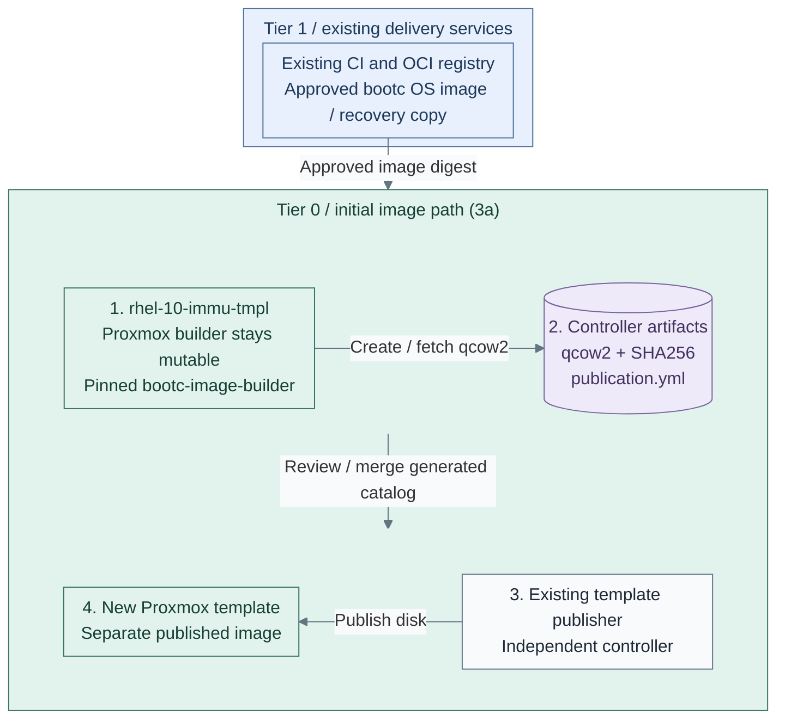

# Step 15b: Image-based Linux

**Working repository:** `<prefix>-tier-0` (source: `tier-0/`) for image builders.
Run repository scripts from this root; Tier 1 consumers keep their own workload definitions.

<a id="image-based-linux-path"></a>

**Branch from:** [Step 15](README.md#step-15-select-the-linux-image-lifecycle), after the selected general runner
and its registry destination are accepted. This adds host-image lifecycle, not another runner alternative.
**Change:** Use image-based hosts while Tier 0 retains template ownership.
**Return:** [Step 16](README.md#step-16-accept-protected-ci-authority-and-create-its-project) for secret integration before infrastructure handover.

**Design:** [guest and image lifecycle variants](../../01-architecture/04-hosting/README.md).

<a id="figure-image-publication"></a>

## Expected outcome: initial image publication (3a)



**IaC:** *Figure: The mutable builder produces a verified qcow2 for a separate template publisher. Route 3b instead
switches and finalizes its own existing bootc-native candidate.*
Tier 0 [builder inputs](../../../tier-0/terraform/deployments/immutable-template/terraform.tfvars.example)
and [image-build recipe](../../../tier-0/ansible/playbooks/deployment/bootc-image.yml), followed by the
[existing template publisher](../../../tier-0/terraform/deployments/templates/main.tf).
The builder stays mutable; reviewed controller artifacts create a separate template. Workload clones are not created here.
CI/image publication is an existing prerequisite or project integration, not installed by the builder recipe.

**Coverage:** route **3a** builds an initial qcow2 from an approved bootable OCI image with the native
`bootc-image-builder` container, fetches it to the controller and supplies the existing Terraform
publisher's catalog entry. The dedicated builder stays a mutable VM. Route **3b** retains switching
and finalizing an already bootc-native candidate. Installing the `bootc` package does not convert
an ordinary cloud OS; neither route overwrites the running builder's root. [8, 9]

## Table of contents

- [Purpose](#purpose)
- [What image-based means](#what-image-based-means)
- [Security posture](#security-posture)
- [Dependency model](#dependency-model)
- [What this deploys](#what-this-deploys)
- [Reference workflow](#reference-workflow)
- [Template conversion flow](#template-conversion-flow)
  - [3a: build the initial disk](#build-initial-disk)
  - [3b: use an existing native host](#existing-native-host)
- [Distro support](#distro-support)
- [Operating model](#operating-model)
- [Read more](#read-more)
- [References](#references)

## Purpose

Use this path to manage Linux servers from versioned
operating-system images instead of ad hoc package changes on each host.

The repository reference implementation is `bootc` for Fedora and Enterprise
Linux-like systems: build a bootable OCI image, publish it to a registry,
deploy or convert hosts to that image, and update the host by moving to a newer
image.

## What image-based means

Immutable Linux is a common shorthand, but image-based Linux is the more precise
term for this path. The whole machine is not read-only. The base operating
system comes from a versioned image and changes through image updates instead
of manual package changes on each host.

With image mode for RHEL, the root filesystem is immutable by default except
for `/etc` and `/var`, and most content comes from the container image.[1]
bootc applies the container image as the bootable host operating system; after
deployment, systemd still runs as normal and the system is not running inside an
outer container.[2]

## Security posture

Image-based Linux improves the platform security posture by reducing drift and
making the operating system an artifact.

| Benefit | Security effect | Still required |
| --- | --- | --- |
| image-based OS | every host can be traced back to a built image | image signing, scanning, and promotion rules |
| transactional updates | failed updates can roll back | maintenance windows and reboot handling |
| reduced host mutation | fewer package changes and snowflake hosts | separate handling for `/etc`, `/var`, secrets, and data |
| CI-built images | hardening changes go through review | protected branches, runners, and registry controls |
| registry-based delivery | updates can be promoted by tag or digest | registry availability, pull credentials, and retention policy |

This does not replace hardening. Identity, secrets, logging,
backup, endpoint hardening, and incident response remain necessary. Immutable hosts make the
base system easier to reproduce and reason about; they do not make runtime
compromise impossible.

## Dependency model

The `immutable-template` setup belongs to Tier 0 because it creates images
used by other systems. Its builder consumes approved images with a local
recovery copy; a live Tier 1 registry or runner must not be required to rebuild
it. General build services can prepare candidates, but acceptance and privileged
publication remain protected at Tier 0. Offline custody uses separate transfers.
See [Template lifecycle](../../05-operations/01-hosting/templates/template-lifecycle.md).

Use the accepted Stage 7 registry for this Stage 9 option. A separately commissioned GitLab registry
is another valid destination; the supplied Kubernetes GitLab chart disables its bundled registry.
Installing GitLab does not satisfy that alternative's registry prerequisite.

| Mode | Requirements | Use case |
| --- | --- | --- |
| standalone pilot | local build host and temporary registry or image source | initial evaluation of the model |
| GitLab-stage path | GitLab, a bootc runner, and an accepted registry | automated internal OS image builds |
| shared registry path | GitLab CI/CD plus Harbor registry | scanning, promotion, and private update delivery across platforms |
| hardened production path | signed images, protected tags, staged rollout, rollback tests | bootc becomes the normal server lifecycle |

Red Hat image mode docs list a container registry as a prerequisite, and bootc
docs note that private registries are common for fleets.[1][3] A local or
external registry can satisfy that prerequisite for a pilot. The accepted Stage 7
Harbor service is the reference destination here; a separately commissioned GitLab registry is also valid.

## What this deploys

This path has a dedicated template-builder setup:

The deployment setup is named `immutable-template` because it creates reusable
Proxmox templates for immutable or image-based Linux hosts. The guide keeps the
broader name "image-based Linux" because bootc is the current implementation,
not the only possible model.

| Repository | Path inside that repository | Responsibility |
| --- | --- | --- |
| Tier 0 | [terraform/deployments/immutable-template/](../../../tier-0/terraform/deployments/immutable-template); local `terraform.tfvars` | Temporary template-builder VM |
| Tier 0 | `ansible/inventory/hosts.yml` | Stable `immutable_template_builders` host group |
| Tier 0 | `ansible/group_vars/immutable_template.yml` | Mode, pinned source/product containers, registry trust/auth, build and publisher inputs |
| Tier 0 | [ansible/roles/immutable_template/](../../../tier-0/ansible/roles/immutable_template) | Native disk build/fetch or existing-host switch/finalization |
| Shared | [ansible/roles/baseline/](../../../shared/ansible/roles/baseline) | Common host preparation |
| Shared | [scripts/deploy.sh](../../../shared/scripts/deploy.sh) | Execution helper called from Tier 0's root |

The example uses one builder VM, `rhel-10-immu-tmpl`. In image mode it stays running and owns
only build workspaces. Its qcow2 is published as a **different, versioned template VMID** through
`terraform/deployments/templates`; the existing catalog accepts `image_path` and `sha256`.
In host mode only, the already bootc-native candidate itself can become a template.

## Reference workflow

| Selected route | Implementation and ownership | Rejoin |
| --- | --- | --- |
| **3a: initial disk**, `immutable_template_mode: image` | Tier 0 dedicated builder → native product container → verified qcow2 on controller → existing template publisher | Image-lifecycle acceptance below |
| **3b: existing native host**, `immutable_template_mode: host` | Original bootc-native candidate → switch/reboot → cleanup → its original Terraform owner finalizes it | Image-lifecycle acceptance below |

The [publication figure](#figure-image-publication) shows **3a**, the default initial-image path. The
[3b host-mode alternative](#existing-native-host) switches and finalizes its own already bootc-native candidate.

The [image-publication workflow](#figure-image-publication) uses GitLab CI and the accepted registry destination.
Harbor already belongs to Stage 7; it is not a later prerequisite. Other approved
sources follow the selected [artifact-supply design](../../01-architecture/10-delivery/01-artifact-supply.md).
Approval and custody transfers do not imply live access. Custody uses
offline transfer; host updates remain separate. If native Podman builds are needed, select and accept
the [Podman runner](step-14b-podman-runner.md) at Step 14b; a generic Kubernetes runner alone does not supply
that build runtime.

## Template conversion flow

Configure the selected route before running IaC. Initial disk creation (3a) and an existing native
host (3b) have different state owners; keep the builder and target VMIDs distinct. Neither a build
nor a successful host preparation run proves first boot, update or recovery acceptance.

### 1. Initialize the isolated builder inputs

Run from **`<prefix>-tier-0/`**.

```bash
bash scripts/init-local-files.sh --setup immutable-template --env test
```

### 2. Select the source and prepare the builder

In **`<prefix>-tier-0/`**, complete
[environment isolation](../../08-reference/repository-scripts.md#environment-isolation):

- `terraform/deployments/immutable-template/terraform.test.tfvars`: create the complete test map
  from the base inputs, with a unique VMID, approved source image, `template = false` and `started = true`.
  The initializer does not create this Terraform overlay.
- `ansible/inventory/hosts.yml`: the matching `immutable_template_builders` host key.
- `ansible/group_vars/immutable_template.test.yml`: its reserved IP, selected `image`/`host` mode,
  approved image reference and registry CA/auth paths. The test file overrides the base vars.
  Keep `immutable_template_apply_bootc: false` and `immutable_template_prepare_for_template: false`.

Choose the real starting state before deployment:

| Starting state | Select and continue |
| --- | --- |
| Ordinary mutable builder and accepted bootable OCI image | Configure [3a](#build-initial-disk) and run its deployment; no initial bootc guest or live-root conversion is required |
| Already installed bootc-native candidate, owned by this lifecycle | Configure [3b](#existing-native-host); its original source and lifecycle remain authoritative |

<a id="build-initial-disk"></a>

### 3a. Build the initial bootc disk — main route

**Prerequisites:** dedicated, qualified RedHat-family x86_64 builder with sufficient disk space
for rootful container storage and the image build; privilege to install native Podman, `qemu-img`
and ACL tools. Select the supported RHEL 9/10 product container or a qualified mirror. The current
upstream compatibility entry point remains supported for RHEL 10; migrate and qualify the unified
image-builder interface before changing to RHEL 11. Other architectures and image formats are not
implemented by this route. [9, 10]
Keep one build writer per dedicated builder.

#### Configure the source and build contract

Edit **`<prefix>-tier-0/ansible/group_vars/immutable_template.test.yml`** using the owning
[example](../../../tier-0/ansible/group_vars/immutable_template.yml.example):

| Input | Required selection |
| --- | --- |
| `immutable_template_mode` | `image`; keep switch, reboot and finalization flags false |
| `immutable_template_image_builder_accepted` | True only for this dedicated rootful builder; the product container requires privilege and access to its local Podman store |
| `immutable_template_bootc_image` | Approved bootable OS/application OCI artifact pinned as `registry/path@sha256:<64-hex>` |
| `immutable_template_image_builder_image` | Approved `registry.redhat.io/rhel10/bootc-image-builder@sha256:<64-hex>` or qualified compatible mirror |
| `immutable_template_image_sources_approved` | Explicit approval of both pins, source distro, builder architecture and image content |
| `immutable_template_image_revision` | New lowercase build ID; changed source/product digest, rootfs or customization requires a new ID |
| `immutable_template_image_rootfs` | Qualified `xfs` or `ext4`; no implicit filesystem fallback |
| `immutable_template_image_config` | Native builder JSON configuration mapping; default `{}` uses the accepted source's configuration |
| `immutable_template_image_artifact_dir` | Optional private absolute POSIX path on the controller; default `secrets/bootc-images/` in Tier 0 |
| `immutable_template_image_publication_key`, `immutable_template_image_publication` | New versioned key/VMID and existing publisher metadata, including UEFI `ovmf`, `q35`, agent/cloud-init support and adequate `disk_size_gb`; path/hash are generated |

Source-image authoring is an accepted application artifact: it must already contain a bootable
kernel/bootloader, `bootc`, enabled cloud-init and QEMU guest-agent services, and the intended
first-boot, identity and update behavior. The builder checks the `containers.bootc=1` label and
architecture; it does not infer these runtime guarantees from that label. Site accounts/keys come
from the normal clone configuration. Never bake registry pull credentials or machine identity into
the reusable source. [9]

Set optional `immutable_template_trust_ca_src` and `immutable_template_registry_auth_src` to private
controller files when needed. The role installs public trust and a root-only pull-auth file, uses
TLS-verified native Podman pulls and shares only the local container store, read-only build config
and revision output with the product. It does not mount the builder root or a host disk as an
installation target. RPM repository definitions, trust and any subscription needed **inside the
source image** must be valid for the build network; host DNF/proxy settings are not automatically
image-builder repository configuration. This is not an air-gap provisioning promise. [9, 10]

#### Create the disk and fetch it through Ansible

From **`<prefix>-tier-0/`**, deploy the configured builder and run the selected image mode:

```bash
bash scripts/deploy.sh immutable-template --env test
```

Review Terraform's inline plan before applying. `--plan-only` previews builder infrastructure;
`--auto-approve` supports unattended runs after supplying every input. If the dedicated builder
already exists, run the explicit image recipe from **the same Tier 0 root**:

```bash
bash scripts/deploy.sh immutable-template --env test --ansible-only --playbook deployment/bootc-image.yml
```

**Expected:** the actual disk appears on the builder at
`/var/lib/bootc-image-builder/<revision>/output/qcow2/disk.qcow2`, then on the controller at
`<artifact-dir>/<inventory-host>/<revision>/disk.qcow2`. Private `request.json` records the exact
source/product/configuration; `publication.yml` supplies its absolute controller path and SHA256.
Ansible checks standalone qcow2 format, virtual size, backing-file absence, native `qemu-img check`
and matching builder/controller SHA256 before creating that fragment. Native scoped read ACLs let
the automation connection fetch a large artifact without elevated `slurp`. [11, 12]

Rerunning unchanged inputs rechecks/reuses the completed artifact. An existing revision with
different inputs, altered disk, foreign ownership, symlink or partial output fails closed. Select
a new revision after inspecting a failed build; automation does not erase old workspaces or
overwrite earlier artifacts. The dedicated builder is **not** converted into a template.

On a native build failure, private details remain at the revision's `build-error.json`; the role
fails without publishing a completion record. Replace `<revision>` with the failed build ID and
fetch its diagnostics from **`<prefix>-tier-0/`**, using the managed Ansible connection:

```bash
umask 077
ANSIBLE_CONFIG=ansible/ansible.cfg ansible immutable_template_builders --playbook-dir ansible \
  -i ansible/inventory/hosts.yml -e @ansible/group_vars/all.yml \
  -e @ansible/group_vars/immutable_template.yml -e @ansible/group_vars/immutable_template.test.yml \
  --become -m ansible.builtin.fetch \
  -a 'src=/var/lib/bootc-image-builder/<revision>/build-error.json dest=secrets/bootc-build-errors/'
```

#### Publish the separate artifact using the existing Terraform owner

Review and merge the generated `templates:` entry from `publication.yml` into
**`<prefix>-tier-0/templates/proxmox.yml`**, retaining the existing `all:` settings and older entries.
Confirm a target VMID distinct from the builder and previous revisions, live datastore placement,
and disk capacity at least as large as the generated virtual disk. The schema remains
`terraform/modules/proxmox_templates/variables.tf`; no new Terraform input field is needed.

Preview from **`<prefix>-tier-0/`**:

```bash
bash scripts/proxmox-templates.sh plan --env-file .env.local
```

Review the complete catalog plan. Publish from **the same Tier 0 root**:

```bash
bash scripts/proxmox-templates.sh apply --env-file .env.local
```

Verify the publication from **the same Tier 0 root**:

```bash
bash scripts/proxmox-templates.sh verify --env-file .env.local
```

The publisher owns template upload/VM resources and refreshes Shared references; this builder
does not acquire a second state or mutate the catalog automatically. Continue at
[image-lifecycle acceptance](#image-lifecycle-acceptance); skip 3b's host conversion actions.

<a id="existing-native-host"></a>

### 3b. Use an existing bootc-native candidate — alternative

Set `immutable_template_mode: host`. A normal cloud OS must first use 3a or an existing accepted
native source; `bootc switch` is not an initial installer. Verify that this lifecycle already owns
the candidate. For a native immutable OS whose packages are baked into the source, set
`immutable_template_manage_packages: false` to skip baseline/package changes. Required lifecycle
tools must already exist in that accepted source. Retain independently tested recovery. [8]

#### 1. Stage and boot the accepted image

In **`<prefix>-tier-0/ansible/group_vars/immutable_template.test.yml`**, select
the approved `immutable_template_bootc_image`, set `immutable_template_apply_bootc: true` and
explicitly select `immutable_template_reboot_after_switch: true` for the accepted reboot window.
Keep cleanup disabled. Run from **`<prefix>-tier-0/`**:

```bash
bash scripts/deploy.sh immutable-template --env test --ansible-only
```

From **`<prefix>-tier-0/`**, inspect the builder's booted image through Ansible:

```bash
ANSIBLE_CONFIG=ansible/ansible.cfg ansible immutable_template_builders --playbook-dir ansible \
  -i ansible/inventory/hosts.yml -e @ansible/group_vars/all.yml \
  -e @ansible/group_vars/immutable_template.yml -e @ansible/group_vars/immutable_template.test.yml \
  --become -m ansible.builtin.command -a 'bootc status'
```

Verify SSH, cloud-init and the intended update/rollback behavior before proceeding.
The role's status output alone is not a rollback rehearsal.

#### 2. Clean the verified candidate

In **`<prefix>-tier-0/ansible/group_vars/immutable_template.test.yml`**, enable:

```yaml
immutable_template_prepare_for_template: true
```

Run from **`<prefix>-tier-0/`**, while the builder remains a running VM:

```bash
bash scripts/deploy.sh immutable-template --env test --ansible-only
```

Require successful cleanup before shutdown; it removes machine-specific cloud-init/SSH state.
Do not treat ignored probe failures as proof of a clone-ready image.

#### 3. Convert the candidate and test a clone

In **`<prefix>-tier-0/terraform/deployments/immutable-template/terraform.test.tfvars`**, set
that builder to `template = true` and `started = false`. Run only Terraform for final conversion:

Run from **`<prefix>-tier-0/`**.

```bash
bash scripts/deploy.sh immutable-template --env test --terraform-only
```

The BPG Proxmox provider supports converting a VM to a template by setting the
VM resource `template` attribute to `true`. Converting a template back to a
normal VM is not supported, so treat this as a one-way finalization step.[7]

Create a disposable clone and verify unique machine/SSH identities, intended cloud-init behavior,
image boot, update and rollback. Only then publish its actual VMID/source metadata in
**`<prefix>-shared/templates/proxmox-catalog.tfvars`** and select it for consumers.
`template_catalog_id` is metadata selection; it does not perform the bootc installation.

For private bootc registries, place pull credentials where bootc can read
them. bootc documents `/etc/ostree/auth.json` as the private registry auth
location.[3]

### Image-lifecycle acceptance

For **both routes**, create a disposable clone through its normal Terraform owner, using the published
reference and normal cloud-init inputs. Verify first boot, intended OS/image, guest agent, unique
machine/SSH identities and cloud-init behavior through managed Ansible/console checks; no manual
guest SSH setup is part of either installer. Rehearse an image update, reboot, rollback and recovery
from retained source/product/container and disk artifacts before accepting 15b.

**Return after image-lifecycle acceptance:** [Stage 9, Step 16](README.md#step-3-authorize-ci-through-vault).
Record unperformed first-boot/recovery tests separately from missing implementation. A successful
disk build, checksum, publication or `bootc status` response alone does not establish those results.

## Distro support

Do not assume every Enterprise Linux-like distro has the same image-based Linux
maturity.

| Distro family | Current guidance |
| --- | --- |
| RHEL | reference enterprise path for image mode and `rhel-bootc` images |
| Fedora | useful upstream and fast-moving bootc path, especially for testing |
| AlmaLinux | experimental bootc images exist; validate support before production |
| Rocky Linux | verify current upstream bootc image availability before use |
| CentOS Stream or SIG images | useful for experimentation when the specific SIG image matches the use case |

Keep separate templates for each OS and major release. When keeping both mutable
and image-based templates, use names such as `alma-10-tmpl` and
`alma-10-immu-tmpl` so the lifecycle is visible before a VM is cloned.

## Operating model

Use these rules for production bootc hosts:

- rebuild images on a schedule and when base image updates are published
- scan images before promotion
- promote by explicit tag or digest instead of treating `latest` as production
  policy
- stage updates with maintenance windows for critical services
- test rollback before broad rollout
- keep `/etc`, `/var`, secrets, and application data out of the base image
- keep pull credentials and registry trust material managed by the shared
  secret and PKI paths

bootc supports transactional upgrades and rollback. `bootc upgrade` queries
the image source and stages an updated image for the next boot, while rollback
keeps the previous deployment available.[4]

## Read more

- [Development platform](README.md)
- [Container registry path](../stage-7-delivery/procedures/registry.md)
- [Development platform path](step-1b-source-control-vm.md)
- [Podman image runner guide](step-14b-podman-runner.md)
- [Enterprise Linux template](../foundation/proxmox/templates.md)
- [Proxmox planning guidelines](../../02-conventions/proxmox-conventions.md)
- [Security principles](../../01-architecture/01-background/01-principles.md)

## References

1. [Red Hat image mode for RHEL](https://docs.redhat.com/en/documentation/red_hat_enterprise_linux/10/html/using_image_mode_for_rhel_to_build_deploy_and_manage_operating_systems/introducing-image-mode-for-rhel)
2. [bootc introduction](https://bootc.dev/bootc/)
3. [bootc registries and disconnected updates](https://bootc.dev/bootc/registries-and-offline.html)
4. [bootc upgrades and rollback](https://bootc.dev/bootc/upgrades.html)
5. [Fedora/CentOS bootc base images](https://fedora.gitlab.io/bootc/docs/bootc/base-images/)
6. [AlmaLinux bootc images](https://github.com/AlmaLinux/bootc-images)
7. [BPG Proxmox provider VM template conversion](https://github.com/bpg/terraform-provider-proxmox/blob/main/docs/resources/virtual_environment_vm.md)
8. [bootc image switching](https://bootc.dev/bootc/man/bootc-switch.8.html) and
   [initial installation into an existing root](https://bootc.dev/bootc/man/bootc-install-to-existing-root.8.html),
   checked 2026-11-09. Initial installation has separate destructive/storage/configuration requirements.
9. [RHEL native bootc disk creation, prerequisites and customizations, section 6.4](https://docs.redhat.com/en/documentation/red_hat_enterprise_linux/10/html-single/using_image_mode_for_rhel_to_build_deploy_and_manage_operating_systems/index).
10. [Official image-builder transition and RHEL compatibility lifecycle](https://osbuild.org/docs/bootc/deprecation-notice/).
11. [Native Ansible Podman container module](https://docs.ansible.com/projects/ansible/latest/collections/containers/podman/podman_container_module.html).
12. [Native scoped file ACLs](https://docs.ansible.com/projects/ansible/latest/collections/ansible/posix/acl_module.html).
