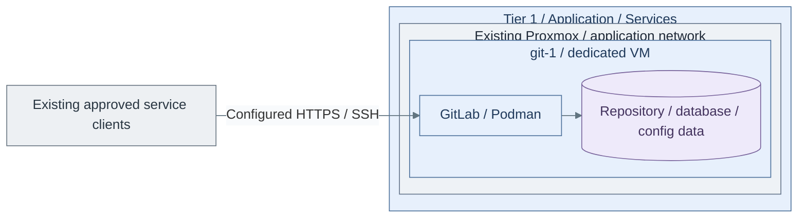

# Step 1b: Source control on a VM

**Working repository:** `<prefix>-tier-1` (source: `tier-1/`).
Run repository scripts from this root; paths below are repository-relative.

<a id="development-platform-path"></a>

**Branch from:** [Step 1](README.md#step-1-deploy-source-control-and-sso), instead of deploying source control in the Tier 1 cluster.
**Change:** Use the VM service deployment without changing runner authority.
**Return:** [Step 2 runner selection](README.md#step-2-add-on-demand-build-execution) after this VM's acceptance checks.

**Design:** [delivery service variants](../../01-architecture/10-delivery/README.md).

## Table of contents

- [Purpose](#purpose)
- [Prerequisites](#prerequisites)
- [What this deploys](#what-this-deploys)
- [IaC used for this](#iac-used-for-this)
- [Configure the deployment](#configure-the-deployment)
- [Ports and DNS](#ports-and-dns)
- [Operations](#operations)
- [Recover an isolated matching-image target](#recover-an-isolated-matching-image-target)
- [High availability direction](#high-availability-direction)
- [Read more](#read-more)
- [References](#references)

## Purpose

Use this path when the private cloud needs source control, CI/CD coordination,
and a starting point for internal software projects.

The reference implementation is GitLab on one dedicated Podman VM. This keeps
the source-control runtime separate from the existing Tier 1 cluster and Stage 7 registry.
Runner selection follows at Step 2; image builds are an optional extension there.

<a id="before-you-start"></a>

## Prerequisites

Have these in place first:

| Requirement | Why it matters |
| --- | --- |
| Identity foundation | Accepted existing Keycloak confidential client, HTTPS issuer, exact callback and private client secret. |
| PKI certificate | The default deployment expects HTTPS with a certificate from the shared PKI. |
| Linux template | Approved RedHat-family cloud-init image; the `gitlab_container` role rejects other distro families. |
| Backup target | Independently commissioned NFS/SMB share or preinitialized SFTP restic repository; retain keys/password outside GitLab, Vault and this VM. |
| Controller | Run the normal control-node setup; Shared supplies `community.general`/`ansible.posix`. Controller trust must accept the service CA. |
| Package supply | Accepted baseline repositories supplying Podman, restic >= 0.17, OpenSSH, coreutils, util-linux and findutils. The role installs them; NAS clients are selected automatically. |

## What this deploys



**IaC:** Tier 1 [VM inputs](../../../tier-1/terraform/deployments/development/terraform.tfvars.example)
and [source-control recipe](../../../tier-1/ansible/playbooks/deployment/source-control-vm.yml).
This creates one service VM; runners, registry alternatives and public edge are separate deployments.

Default deployment:

| Role | Default host | Default count | Notes |
| --- | --- | --- | --- |
| development platform | `git-1` | `1` | Podman host running the GitLab container |

Default VM shape:

| Setting | Default |
| --- | --- |
| size | `xl` |
| disk | `200 GB` |
| storage class | `shared` |
| network zone | `application` |

This path does not deploy runners by default. Use the
[Podman image runner guide](step-2b-podman-runner.md) when build jobs should run away
from the GitLab host.

## IaC used for this

| Repository | Layer | Path inside that repository |
| --- | --- | --- |
| Tier 1 | Terraform setup | [terraform/deployments/development/](../../../tier-1/terraform/deployments/development); local `terraform.tfvars` |
| Tier 1 | Ansible inventory | `ansible/inventory/hosts.yml` |
| Tier 1 | Ansible environment vars | `ansible/group_vars/all.yml` or `all.<env>.yml` |
| Tier 1 | Ansible setup vars | `ansible/group_vars/development.yml` |
| Tier 1 | Deployment recipe | [ansible/playbooks/deployment/source-control-vm.yml](../../../tier-1/ansible/playbooks/deployment/source-control-vm.yml) |
| Tier 1 | Service role | [ansible/roles/gitlab_container/](../../../tier-1/ansible/roles/gitlab_container) |
| Shared | Host baseline | [ansible/roles/baseline/](../../../shared/ansible/roles/baseline) |
| Shared | Execution helper | [scripts/deploy.sh](../../../shared/scripts/deploy.sh); called by Tier 1's `scripts/deploy.sh` |

## Configure the deployment

### 1. Create local inputs

Run from **`<prefix>-tier-1/`**.

```bash
bash scripts/init-local-files.sh --setup development
```

### 2. Edit these files

Edit in **`<prefix>-tier-1/`**.

- `terraform/deployments/development/terraform.tfvars`: `vm_instances.git-1`: unused VMID, size,
  `disk_size_gb`, `storage_class`, `network_zone_key`
- `ansible/inventory/hosts.yml`: Matching git-1 key and service group
- `ansible/group_vars/development.yml`: `platform_host_ips.git-1`, `gitlab_container_image`,
  `gitlab_hostname`, `gitlab_external_url`, `gitlab_tls_cert_src`, `gitlab_tls_key_src`,
  `gitlab_ssh_host_port`, and the SSO/backup contracts below
- `.env.local`: Tier 1 provider credentials and local SSH public-key paths

Use an approved CE image tag/digest and preissued certificate/chain/key. Prepare scoped gateway/host
rules before publishing listeners. All guest setup runs through Ansible; edit inputs on the controller.
The role's [variable definitions](../../../tier-1/ansible/roles/gitlab_container/defaults/main.yml)
own optional settings and defaults.

| Contract | Edits and expected result |
| --- | --- |
| Native SSO | Set `gitlab_oidc_enabled`, `gitlab_oidc_issuer`, `gitlab_oidc_client_id`, and `gitlab_oidc_client_accepted`. Supply `gitlab_oidc_client_secret` through private/encrypted Ansible inputs. The role renders Omnibus OIDC, discovery, code flow, PKCE and stable `sub`; new users require approval and email-based automatic linking is disabled. [5] |
| Accepted Keycloak client | Existing identity owner registers a confidential client with exact `https://<gitlab_hostname>/users/auth/openid_connect/callback`, `openid profile email`, PKCE S256 and asymmetric token signing. This recipe configures its consumer; it never creates another identity service. |
| Container trust | Put public private-CA chains in controller PEM `.crt` files and list them in `gitlab_trusted_ca_sources`. Ansible installs them into Omnibus `trusted-certs`; host baseline trust alone does not configure container trust. [8] |
| Host package/trust setup | Configure `baseline_rpm_repositories` and `baseline_trust_anchors` through the existing [baseline contract](../../08-reference/platform-inputs.md#os-baseline-boundary) when additional signed package sources or service-CA trust are needed. The baseline applies them before installing this role's declared packages. |
| Independent backup | Set `gitlab_backup_enabled`, `gitlab_backup_custody_accepted`, transport, repository, password source and schedule. A successful native export, matching configuration/secrets and exact image metadata become one encrypted restic snapshot. |
| SFTP choice | Supply `gitlab_backup_ssh_key_src` and `gitlab_backup_known_hosts_src`. The storage custodian initializes the dedicated encrypted repository with the independently retained password first. Strict host-key checking and unattended authentication are enforced. |
| NFS/SMB choice | Set `gitlab_backup_transport: filesystem` and the example's `gitlab_backup_filesystem` map. The custodian creates its private repository directory and `.development-data-backup-target` marker first. The role mounts/verifies the existing share, source, type, marker and effective UID/GID, including root squash. CIFS requires controller `credentials_src` for managed mounting. |

For a newly commissioned **empty filesystem repository** only, set `gitlab_backup_initialize: true`
for its first apply, then return it to `false`. Only restic's missing-repository status permits
initialization; unreadable, nonempty, wrong-password and damaged repositories fail closed. [7]
The client never creates a NAS server, share or independent identity marker.

The default OS disk is provisioned/resized by Terraform's `disk_size_gb`; live database and repository
data remain on that Proxmox block storage. The guest role also accepts `gitlab_data_device` for a
dedicated attached disk and uses Shared's guarded `data_volume` role before creating service files.
Select a stable SCSI by-id device, then retain its UUID in `gitlab_data_expected_uuid`.
For this optional choice, uncomment `extra_disks` under `vm_instances.git-1` in the Terraform example
and select its capacity/storage class. Set `gitlab_data_device` to
`/dev/disk/by-id/scsi-0QEMU_QEMU_HARDDISK_drive-scsi1` in the Ansible inputs before first deployment.
The same deployment command provisions that disk, verifies it is safe to initialize, formats/mounts
it by UUID and configures GitLab. Attaching a disk to a populated service root is a separate recovery
or migration; the guard refuses to hide existing files. NAS paths are backup destinations only.

### 3. Deploy and verify

Run from **`<prefix>-tier-1/`**.

```bash
bash scripts/deploy.sh development
```

Review Terraform's inline plan and enter `yes` only for the intended changes.
Add `--plan-only` for preview; approved unattended jobs use `--auto-approve`.

The installer waits for verified HTTPS readiness and commissions the backup timer. Approved unattended
jobs use `--auto-approve`; private Ansible files use `--ansible-vars /absolute/private/inputs.yml`.
For an encrypted secret-only file, first apply Terraform with `--terraform-only`, then configure with
`--ansible-only --ansible-vars /absolute/private/secrets.yml`, with the controller's private
`ANSIBLE_VAULT_PASSWORD_FILE` configured. Do not feed an encrypted Ansible file to Terraform.
See [secret handling](../../05-operations/03-cryptography/secret-handling.md).

### 4. Retrieve the initial credential from the controller

Set `gitlab_initial_password_dest` to a file in an existing controller directory outside Git with mode
`0700`. Retrieve promptly: GitLab removes its temporary file on a later restart after 24 hours. [1]

Run from **`<prefix>-tier-1/` on the deployment controller**.

```bash
bash scripts/deploy.sh development --ansible-only --playbook deployment/gitlab-vm-initial-access.yml
```

Native file modules write a `0600` controller file without printing the password or overwriting an
existing custody file. Read it privately, sign in as `root`, then rotate/store the administrator
credential independently. An absent/expired temporary file fails with recovery guidance; the recipe
never resets an existing account.

### 5. Accept SSO and the first independent recovery set

Complete the [human service SSO gate](../stage-5-identity/procedures/service-sso.md): approve the intended
GitLab account/membership, test permitted and denied users, removal, sessions and IdP outage. On existing
instances, inspect the current signup policy: Omnibus initial defaults do not change existing settings.
Retain tested local emergency access; successful configuration is not SSO acceptance.

Run from **`<prefix>-tier-1/` on the deployment controller**.

```bash
bash scripts/deploy.sh development --ansible-only --playbook deployment/gitlab-vm-backup.yml
```

Expected result: systemd reports a successful native export, independent restic snapshot and repository
check. Record its complete snapshot ID/set tag with the recovery owner. Test the isolated restore below,
HTTPS, clone/push and protected logging before accepting this option. Then return to
[Stage 9 Step 2 runner selection](README.md#step-2-add-on-demand-build-execution).

For a separate test installation, follow [environment isolation](../../08-reference/repository-scripts.md#environment-isolation)
and add `--env test` consistently to initialization/deployment. Test and production
need different VMIDs, addresses and full Terraform guest maps; omitting `--env` is
not a promotion or migration of test state.

## Ports and DNS

Publish these ports to users or to the edge proxy, depending on the network
design:

| Port | Purpose |
| --- | --- |
| `80/tcp` | HTTP redirect and GitLab internal web handling |
| `443/tcp` | HTTPS web UI and Git over HTTPS |
| `2222/tcp` | Git over SSH, mapped to container port `22` |

Use the DNS name from `gitlab_external_url`. Do not use `localhost` as the
GitLab hostname.
Apply scoped gateway and host-firewall rules through the
[firewall rollout](../foundation/network/firewall.md); container port
publication and the Shared baseline do not install those rules.

## Operations

Persistent data is mounted under `gitlab_home`, default `/srv/gitlab`:

| Host path | Container path | Purpose |
| --- | --- | --- |
| `/srv/gitlab/config` | `/etc/gitlab` | GitLab configuration and TLS files |
| `/srv/gitlab/logs` | `/var/log/gitlab` | GitLab logs |
| `/srv/gitlab/data` | `/var/opt/gitlab` | repositories, database, uploads, and runtime data |

Maintenance notes:

- Retain native GitLab backups plus independent configuration, `gitlab-secrets.json` and TLS custody
  before acceptance and upgrades. Follow the container row in
  [Tier 1 product recovery](../../05-operations/06-resilience/recovery/tier-1-products.md#select-the-authoritative-product-procedure)
  and test a matching-version clean-target restore; a raw copy of the running data directory is insufficient.
- Pin the GitLab image tag before production use.
- Keep runners on separate hosts when build workloads become noisy.
- Send OS/security/audit events to [Tier 0 protected logging](../stage-2-logging/procedures/sources.md)
  from installation; do not wait for Observability. Operational application logs
  and metrics later use [Stage 8](../stage-8-observability/README.md) under approved scopes.

`gitlab-vm-backup.timer` schedules a locked, bounded job. It exports native data with `STRATEGY=copy`,
captures configuration/secrets/TLS plus image reference, image ID and version manifest, then uploads
one set. Only a successful upload and repository check remove that exact local set. Failed/partial
sets remain for diagnosis; capacity must include native temporary copies and retained failures. [6]
The reserve check is a guard, not an estimate of sufficient export space. Monitor timer/service failures
and independent snapshot age; this option does not install an alert receiver.

Filesystem runs recheck mount identity/marker, writable UID/GID and free space and pin relative writes
to the mounted filesystem. An unavailable share cannot silently become a local backup directory.
Hard NFS kernel waits can exceed systemd timeouts. SFTP capacity is monitored by the storage owner.
The job never prunes/forgets remote history or rewrites a damaged repository. The recovery owner owns
retention, capacity, periodic full-data restic checks and independently tested restores. Source-host
write credentials can still delete backups: use independent NAS snapshots/access custody where required.

The supplied backup scope is the bundled local GitLab data and configuration. It does not capture Redis
queues, external object stores, custom hooks outside those paths or other services. Native backup is a
completed recovery point, not continuous point-in-time recovery or a globally atomic online snapshot. [6]
Quiesce writers and drain jobs through an approved maintenance window when the recovery objective
requires coordinated application consistency. The separate `development-data` recipe owns the
Kubernetes alternative's data-VM backups; it does not back up this VM.

## Recover an isolated matching-image target

1. Retain the original inputs, full snapshot ID, set tag, encryption password, SSH identity/trust and
   approved image independently. Have the recovery custodian list `restic snapshots --tag gitlab-vm`
   and select one complete set. Restore only onto an isolated fresh GitLab VM with the exact retained
   CE image and original hostname/storage names. Keep DNS, runners, outgoing notifications and users
   away until acceptance. Restore staging and native extraction need substantial spare block capacity. [9]
2. Configure/deploy that fresh target through the same controller path, including the commissioned
   backup client. Set `gitlab_restore_snapshot` to its full 64-character snapshot ID,
   `gitlab_restore_set` to the `gitlab-vm-set.<suffix>` tag and both `gitlab_restore_confirm` and
   `gitlab_restore_target_empty_accepted` to `true` in a private recovery vars file. If the original
   `gitlab_home` differed, supply it as `gitlab_restore_source_home`. These inputs authorize replacement
   of the isolated target database; they do not authorize restoring over a live instance.

Run from **`<prefix>-tier-1/` on the recovery controller**, using inventory that selects only that target.

```bash
bash scripts/deploy.sh development --ansible-only --playbook deployment/gitlab-vm-recovery.yml --ansible-vars /absolute/private/recovery.yml
```

3. The recipe disables the timer, restores into private staging, verifies image reference/actual image
   ID and set identity before replacing configuration, then runs GitLab's native matching-version
   restore with database clients stopped. Secrets/configuration come from the same encrypted set.
   It runs native integrity/decryption checks. Failure stops the play; preserve staging and keep the
   target isolated. No success path or retry automatically starts another restore or prunes history.
4. Verify HTTPS, SSO/denials, repositories, attachments, CI-secret decryption and protected logging.
   Native check commands do not prove application acceptance. Reconcile the private declarative inputs
   with the restored `gitlab.rb` before deploying again. Retain staged evidence until acceptance;
   then clear the recovery confirmation inputs and reapply the normal recipe to enable the timer.
   Cut over only after the human accepts this recovery point and its bounded data loss. [9]

## High availability direction

This alternative is a single GitLab VM, not the default Kubernetes realization.
Accept its outage limits and product-level backup/restore independently.

The [Kubernetes installer](procedures/gitlab.md) separates application compute
from managed data services. Migration requires a deliberate product-data restore
and one deployment owner; multiple pods alone do not establish HA.

Do not scale this by starting several independent GitLab containers. Moving to the
Kubernetes alternative needs shared stateful services and the GitLab cloud-native
deployment model, plus the deliberate migration above.

## Read more

- [Development platform](README.md)
- [Podman image runner guide](step-2b-podman-runner.md)
- [Container registry path](../stage-7-delivery/procedures/registry.md)
- [Kubernetes platform path](../stage-7-delivery/procedures/platform-cluster.md)
- [Shared services model](../../01-architecture/02-organization/README.md)
- [Infrastructure automation layout](../../04-development/code-layout.md)
- [Repository scripts](../../08-reference/repository-scripts.md)

## References

1. [GitLab Docker installation](https://docs.gitlab.com/install/docker/installation/)
2. [GitLab Docker configuration](https://docs.gitlab.com/ee/install/docker/configuration.html)
3. [GitLab SSL configuration](https://docs.gitlab.com/omnibus/settings/ssl/)
4. [GitLab Helm chart installation](https://docs.gitlab.com/charts/installation/)
5. [GitLab OpenID Connect provider configuration](https://docs.gitlab.com/administration/auth/oidc/).
6. [Native backup scope, copy strategy and configuration custody](https://docs.gitlab.com/administration/backup_restore/backup_gitlab/).
7. [restic repository probing and scripting exit codes](https://restic.readthedocs.io/en/stable/075_scripting.html).
8. [Omnibus trusted certificates](https://docs.gitlab.com/omnibus/settings/ssl/#install-custom-public-certificates).
9. [GitLab restore prerequisites and unattended native restore](https://docs.gitlab.com/administration/backup_restore/restore_gitlab/).

Primary product references checked 2026-11-11.
