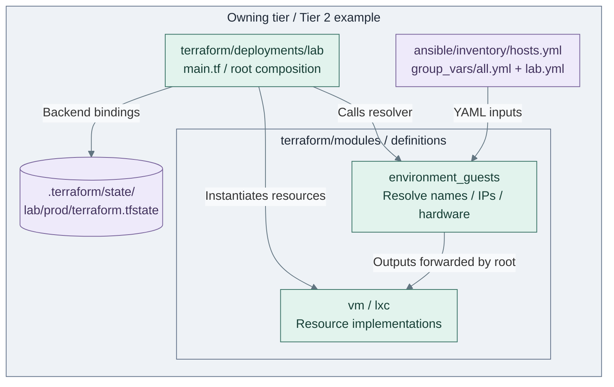
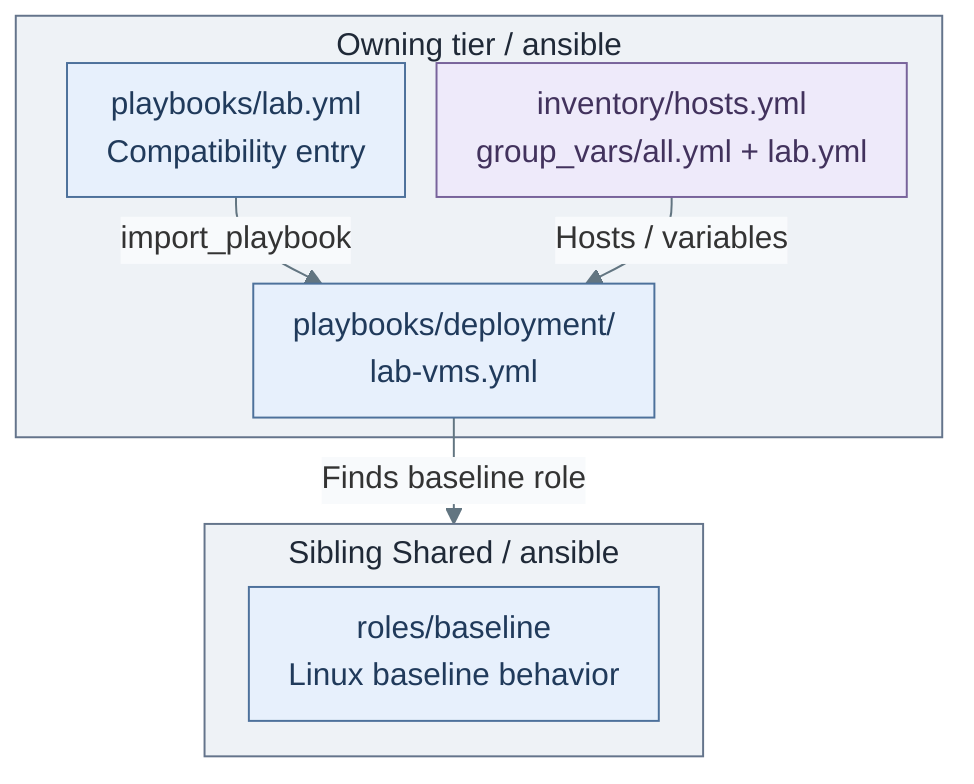

# Infrastructure automation layout

Find the file that owns a change, then follow the calls into its implementation.
The source tree mirrors generated repositories; examples are maintained upstream,
while initialized operational inputs belong to the generated project.

## Table of contents

- [Source ownership](#source-ownership)
- [Roots, modules and recipes](#roots-modules-and-recipes)
- [Linux provisioning path](#terraform-structure)
- [Ansible configuration path](#ansible-configuration-path)
- [Inputs and state](#environment-data-split)
- [Other entry points and starters](#terraform-setups)
- [Extend or maintain the code](#maintaining-the-split)
- [References](#references)

## Source ownership

| Kit source | Generated repository | Owner of changes |
| --- | --- | --- |
| `tier-0/` | `<prefix>-tier-0/` | Hardware/trust services, templates and protected execution |
| `tier-1/` | `<prefix>-tier-1/` | Shared platform services |
| `tier-2/` | `<prefix>-tier-2/` | Edge/cache, labs and application definitions |
| `shared/` | `<prefix>-shared/` | Stateless scripts/roles, size profiles and platform/image references |
| `docs/` | `<prefix>-architecture/docs/auto-docs/` | Maintained guidance; project choices remain outside auto-docs |

HomeLab is the example prefix; generated directories are lowercase.
**Each tier owns its inventory, Terraform resources and state.** Shared never owns
guest assignments, live inventory, credentials or another tier's state.

## Roots, modules and recipes

| Unit | Actual location in the owning tier | Change belongs here when |
| --- | --- | --- |
| Terraform root | `terraform/deployments/<setup>/` | Selecting/composing one independently managed resource set |
| Terraform child module | `terraform/modules/<name>/` | Changing a reusable resource or input-resolution implementation |
| Terraform inputs | `terraform/deployments/<setup>/terraform.tfvars` | Selecting guest hardware in initialized private files; `.example` is the maintained starter |
| Terraform state | Selected backend; Linux default `.terraform/state/<setup>/<env>/terraform.tfstate` | Recovering existing bindings; never use another state to test changes |
| Ansible inventory | `ansible/inventory/hosts.yml` | Adding stable host keys or group membership |
| Ansible vars | `ansible/group_vars/` | Selecting host IPs, environment identity and service inputs |
| Ansible recipe | `ansible/playbooks/deployment/` or `maintenance/` | Composing roles for a supported operation |
| Ansible role | `ansible/roles/` or sibling Shared `ansible/roles/` | Implementing that operation's configuration behavior |

A root calls child modules; it is not a whole-tier execution order. Terraform reads
the root's `.tf` files together. `main.tf`, `variables.tf`, `outputs.tf` and provider/backend
files separate responsibilities, not numbered execution steps. [1][2]

## Linux provisioning path

The figure focuses on tier-local Terraform composition. The linked entry-point
chain below supplies execution and Shared reference inputs.

**Code — Linux provisioning branch:** [Tier 2 wrapper](../../tier-2/scripts/deploy.sh) →
[Shared helper](../../shared/scripts/deploy.sh) →
[Tier 2 root](../../tier-2/terraform/deployments/lab/main.tf).
The root calls the [resolver](../../tier-2/terraform/modules/environment_guests/main.tf) and
[VM](../../tier-2/terraform/modules/vm/main.tf)/[LXC](../../tier-2/terraform/modules/lxc/main.tf)
modules separately. Resolver output arrows mean data passed by the root, not resource creation
inside `environment_guests`. VM/LXC modules also read Shared's `config/guest-sizes.json`.
Shared references are defined by the [input contract](../08-reference/platform-inputs.md).

## Ansible configuration path

**Code — same lab inputs:** Shared's helper passes the owning tier's inventory/vars to
[`playbooks/lab.yml`](../../tier-2/ansible/playbooks/lab.yml), which imports
[`deployment/lab-vms.yml`](../../tier-2/ansible/playbooks/deployment/lab-vms.yml).
The recipe runs Shared's [baseline](../../shared/ansible/roles/baseline/tasks/main.yml);
it does not install an application. [Role search paths](../../tier-2/ansible/ansible.cfg)
prefer tier-local roles. The [recipe map](../05-operations/01-hosting/ansible-recipes.md) identifies supported maintenance.

## Inputs and state

Inventory host keys join the two tools; setup vars own IPs and Terraform inputs own hardware.
Assign guest IDs using the [VMID convention](../02-conventions/vmid-convention.md).
`--env NAME` selects that environment's data/state, not another source tree.
Keep original state and keys when changing code. [Platform inputs](../08-reference/platform-inputs.md)
owns field names, credentials, precedence and SSH access; [network inputs](../08-reference/network-inputs.md)
owns attachment resolution. Avoid duplicating those defaults here.

## Other entry points and starters

| Path in the owning tier | Implementation/status |
| --- | --- |
| `scripts/kubernetes-cluster.sh`, `terraform/deployments/kubernetes/` | Shared command, tier-owned VM/Talos resources, inventory and separate state; no Linux `common.tfvars` path |
| `ansible/playbooks/deployment/cluster-platform.yml` | Native cluster installer calling Shared's [cluster_platform](../../shared/ansible/roles/cluster_platform/tasks/main.yml) role |
| Other native application recipes under `ansible/playbooks/deployment/` | Render/apply through selected product roles and private cluster inputs; not Linux setup names |
| Tier 0 `scripts/proxmox-templates.sh`, `terraform/deployments/templates/` | Tier 0 image publication/adoption; its own catalog and saved-plan contract |
| Tier 0 `terraform/deployments/ci-auth/` | Separate Vault provider/root/state, not a Linux guest setup |
| `clusters/`, `workloads/`, `packer/` | Inspect contents: empty manifests/scaffolds are adoption points, not installed services |

The [capability map](../03-deployment/README.md#iac-capability-map) and
[support map](../08-reference/implementation-support.md) own installer coverage.
Dedicated cluster/template commands retain their own credentials and plan contracts;
their state paths do not follow the Linux example above.

## Extend or maintain the code

Start with [Add a guest or service](adding-service.md) for matching input edits and setup registration.
Edit the owning tier; extract behavior to Shared only when it is reusable and stateless.
[Generation and refresh](generated-repositories.md) owns payload rules, project-owned files and upgrades.
Generated README/project templates live in `scripts/tier-repos/`; guides belong in `docs/`.

## References

1. [Terraform module composition](https://developer.hashicorp.com/terraform/language/modules/develop/composition).
2. [Terraform standard module structure](https://developer.hashicorp.com/terraform/language/modules/develop/structure).
