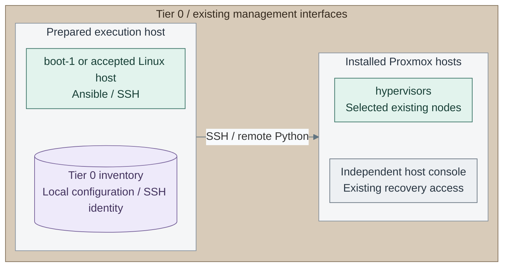

# Hosting operations

Initialize Tier 0's local files and register the installed Proxmox hosts for Ansible.
Complete this once before running host-management tasks from `boot-1` or another approved execution host.

<a id="figure-host-management"></a>



*Figure: Manual registration of the existing host-management path. Boxes group management interfaces,
not physical hosting; the SSH arrow reaches the hosts, while console recovery remains independent.*

**Owner:** `<prefix>-tier-0`; [inventory](../../../tier-0/ansible/inventory/hosts.yml.example),
[host playbook](../../../tier-0/ansible/playbooks/proxmox-hosts.yml) and
[foundation preparation](../../03-deployment/foundation/README.md). Registration provisions no resources.

**Working repository:** `<prefix>-tier-0/`, with its sibling Shared checkout.
**Prerequisites:** installed Proxmox hosts, the [prepared bootstrap tools and SSH key](../../03-deployment/foundation/bootstrap/README.md),
permitted management-network SSH access and independent host-console access.
Existing hosts are registered here; they are not created or imported into Terraform.

**Design:** [Hosting and orchestration](../../01-architecture/04-hosting/README.md).
**Install:** [Foundation](../../03-deployment/foundation/README.md).

## Already managing the hosts?

| Task | Procedure |
| --- | --- |
| Change host SSH, time, audit or firewall settings | [Linux security setup](linux-security.md), [security operations](host-security.md) |
| Configure approved host update access | [Software intake consumers](../02-software-intake/host-updates.md) |
| Import, publish or promote a template | [Template lifecycle](templates/template-lifecycle.md) |
| Replace a template disk or troubleshoot publication | [Disk replacement](templates/template-disk.md), [troubleshooting](templates/template-troubleshooting.md) |
| Refresh a template or remove clone dependencies | [Template refresh](templates/template-refresh.md), [linked clones](templates/linked-clones.md) |
| Add Kubernetes capacity or operate Lab environments | [Kubernetes and labs](kubernetes-and-labs.md) |
| Reconcile an existing VM or plan an upgrade | [Ansible recipes](ansible-recipes.md), [maintenance](maintenance.md) |
| Retire resources or correct Terraform state | [Resource retirement](provisioning.md), [state tasks](terraform-state.md) |
| Recover a host or guest | [Recovery tasks](../06-resilience/README.md) |

## Contents

1. [Initialize the local files](#1-initialize-the-local-files)
2. [Register the installed hosts](#2-register-the-installed-hosts)
3. [Authorize the bootstrap public key](#3-authorize-the-bootstrap-public-key)
4. [Verify SSH from bootstrap](#4-verify-ssh-from-bootstrap)
5. [Test the Ansible targets](#5-test-the-ansible-targets)
6. [Run the selected host task](#6-run-the-selected-host-task)

## 1. Initialize the local files

Run from **`<prefix>-tier-0/`** on **`boot-1`**:

```bash
bash scripts/init-local-files.sh --setup foundation
```

**Expected:** missing `ansible/inventory/hosts.yml`, `ansible/group_vars/all.yml`, `.env.local`
and `terraform/common.tfvars` are created. Existing files are preserved; no manual example copying is needed.

This also seeds `foundation.yml` and the foundation VM inputs. Those belong to the CA/directory
deployment, not the Proxmox hosts. Initialization runs no Ansible or Terraform.
Do not run `deploy.sh foundation` to configure hypervisors.
Host tasks below use SSH; `.env.local` and the provisioning API token are not used by them.

## 2. Register the installed hosts

Edit **`<prefix>-tier-0/ansible/inventory/hosts.yml`**. Under `all.children`, replace
the empty `hypervisors` entry with the actual host names and management addresses: [1]

```yaml
hypervisors:
  hosts:
    pve01:
      ansible_host: 10.10.10.11
    pve02:
      ansible_host: 10.10.10.12
```

Keep only hosts in the selected Proxmox cluster and retain other inventory groups.
One host is valid. Use existing Proxmox node names; inventory registration does not rename them.
Do not put hypervisors in `guests` or add them to a Terraform guest map.

Keep **Tier 0 `ansible/group_vars/all.yml`** for common configuration. Its default
`ansible_user: automation` is for cloned guests; the commands below explicitly select the host SSH account.

## 3. Authorize the bootstrap public key

On **`boot-1`**, print the approved execution account's public key:

```bash
cat "$HOME/.ssh/id_ed25519.pub"
```

Use the actual filename if different. The workstation key used to log into `boot-1` is not
automatically available for outbound connections. Keep the matching private key on bootstrap or its agent.

For the reference **`root` SSH account**, open **each Proxmox host's independent console/GUI shell**:

```bash
ls -l /root/.ssh/authorized_keys
ssh-keygen -lf /etc/ssh/ssh_host_ed25519_key.pub
```

Edit **`/root/.ssh/authorized_keys` on that Proxmox host**. Add the approved bootstrap public key
as one line, retaining existing keys; do not add it twice. Record the displayed host-key fingerprint.
Preserve Proxmox's existing symlink and permissions. On a cluster this can be a shared key file:
add the approved key once, then verify access to every selected node. [3]

An existing non-root management account is also valid: authorize the key in that account instead
and verify its approved sudo access. Use that account in the following commands.

## 4. Verify SSH from bootstrap

Run on **`boot-1`**, in the Bash session used for the next step:

```bash
read -r -p 'Proxmox host SSH user (example: root): ' PVE_SSH_USER
read -r -p 'Proxmox management address: ' PVE_HOST
ssh -o StrictHostKeyChecking=ask -o PreferredAuthentications=publickey "$PVE_SSH_USER@$PVE_HOST" true
```

Compare a new host-key prompt with the console fingerprint before accepting it.
Repeat for each registered host. **Expected:** key-based login succeeds and returns to bootstrap.
Load a passphrase-protected key into the accepted SSH agent first if needed.

## 5. Test the Ansible targets

Run from **`<prefix>-tier-0/`** on **`boot-1`**:

```bash
ANSIBLE_CONFIG=ansible/ansible.cfg ansible-inventory -i ansible/inventory/hosts.yml --graph hypervisors
```

**Expected:** only the intended Proxmox hosts appear in `hypervisors`. Then, in the same shell:

```bash
ANSIBLE_CONFIG=ansible/ansible.cfg ansible hypervisors -i ansible/inventory/hosts.yml \
  -e @ansible/group_vars/all.yml -e "ansible_user=$PVE_SSH_USER" -m ansible.builtin.ping
```

Require `pong` from every selected host. This tests SSH and remote Python, not ICMP or host configuration. [2]
Stop on an unexpected target, changed host key or failed login. Correct registration/access before applying changes.

## 6. Run the selected host task

| Task | Continue with | Scope |
| --- | --- | --- |
| Configure approved update access | [Proxmox proxy configuration, action 2](../02-software-intake/host-updates.md#2-register-the-existing-hosts-and-proxy) | Existing `proxmox-hosts.yml` manages the Datacenter/APT proxy only |
| Restrict management access | [Proxmox access and hardening](proxmox-hardening.md) | Reviewed host/gateway policy and manual acceptance |
| Collect host security events | [Protected log sources](../../03-deployment/stage-2-logging/procedures/sources.md) | Enroll each host's source identity before forwarding |
| Trust the provisioning API | [Proxmox API trust](proxmox-tls.md#step-1-trust-the-bootstrap-ca) | Separate verified HTTPS trust for API callers |

Registration alone changes no host configuration. Retain the inventory and approved SSH identity
in the independent [recovery set](../06-resilience/backups/recovery-set.md).
Use the same preparation on a replacement execution host; never copy private credentials into Git.

## References

1. [Ansible inventory groups and explicit host addresses](https://docs.ansible.com/projects/ansible/latest/inventory_guide/intro_inventory.html), checked 2026-11-09.
2. [Ansible connection/Python check](https://docs.ansible.com/projects/ansible/latest/collections/ansible/builtin/ping_module.html), checked 2026-11-09.
3. [Proxmox root SSH key setup and shared authorized-key file](https://github.com/proxmox/pve-cluster/blob/master/src/PVE/Cluster/Setup.pm), checked 2026-11-09.
