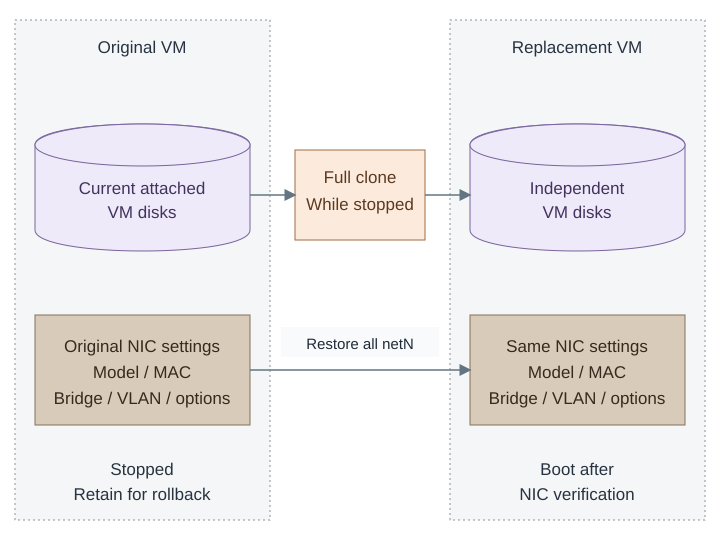

# Change a VMID with a full clone

Copy an existing VM to a new VMID, retain its original network-interface settings and
cut over with the original stopped. Keep the old VM until validation and ownership updates finish.

<a id="figure-vmid-cutover"></a>



*Figure: Manual full-clone cutover. Current disks become independent copies; the original NIC settings
are restored before first boot. Only the replacement runs with that network identity.*

**Run on:** the source Proxmox host's root Bash shell, opened from an independent workstation or console.
Do not run the host session through the VM being moved: shutting down bootstrap would disconnect it.
Keep the same host shell for Steps 1–7 and 10.
**Scope:** an existing QEMU VM, cloned on the same host; not a template or LXC.
For Terraform-managed Linux VMs, Step 8b rebinds the existing resource. Kubernetes and templates
need their own state/adoption procedures; do not apply the Linux resource recipe to those roots.

Proxmox normally assigns a new MAC during cloning. Step 6 restores the complete `netN` values,
including model, MAC, bridge/VNet, VLAN, MTU and firewall options. Firmware UUIDs still change. [1][2]

## Steps

1. [Select the VM and free destination](#1-select-the-vm-and-free-destination).
2. [Pause writers and take backups](#2-pause-writers-and-take-backups).
3. [Record the configuration](#3-record-the-configuration).
4. [Stop the original](#4-stop-the-original).
5. [Create the full clone](#5-create-the-full-clone).
6. [Restore the original NIC settings](#6-restore-the-original-nic-settings).
7. [Start and verify the replacement](#7-start-and-verify-the-replacement).
8. [Update manual or Terraform ownership](#8-update-ownership).
9. [Update jobs and records](#9-update-jobs-and-records).
10. [Retain or retire the original](#10-retain-or-retire-the-original).

## 1. Select the VM and free destination

On **the source Proxmox host**, enter the actual values:

```bash
set -euo pipefail
read -r -p 'Current VMID (example: 501): ' OLD_VMID
read -r -p 'New VMID (example: 601): ' NEW_VMID
read -r -p 'Target VM-disk storage (example: local-zfs): ' VM_STORAGE
test "$OLD_VMID" != "$NEW_VMID"
pvesh get /cluster/resources --type vm
pvesm status --content images
qm config "$OLD_VMID" --current 1
```

Confirm the original VM, a cluster-wide unused destination ID and enough VM-image storage for
every attached VM disk. Use the [VMID convention](../../02-conventions/vmid-convention.md).
Resolve pending configuration changes first. Review external mounts and passthrough devices separately.

| Illustrative move | Ownership | Order when both exist |
| --- | --- | --- |
| `boot-1`: `501 → 601` | Manual bootstrap | First; finish and retire the old `501` before reusing that ID |
| `log-1`: `401 → 501` | Tier 0 `syslog` Terraform state | Second; retain the `log-1` resource key and reconcile its state |

Other VMs follow the same steps with their own free IDs and owning repository.

## 2. Pause writers and take backups

Pause the VM's Terraform/Ansible/CI writers and scheduled application jobs. Take a verified
[independent VM and application backup](../06-resilience/backups/virtual-machines.md), including
every workspace/data disk. Preserve the owning deployment's original state and inputs.

For an **HA-managed VM**, first record its resource/rules and set its requested state to **stopped**
through [HA operations](proxmox-ha.md). Keep the old resource stopped until it is retired;
disabling guest autostart alone does not stop HA from starting it.

## 3. Record the configuration

On **the same Proxmox host**, save a private recovery record:

```bash
umask 077
VM_RECORD="/root/vmid-${OLD_VMID}-to-${NEW_VMID}-$(date -u +%Y%m%dT%H%M%SZ)"
mkdir -p "$VM_RECORD"
qm config "$OLD_VMID" --current 1 > "$VM_RECORD/original.conf"
sed -n '/^net[0-9][0-9]*: /p' "$VM_RECORD/original.conf" > "$VM_RECORD/network.conf"
VM_NAME=$(sed -n 's/^name: //p' "$VM_RECORD/original.conf")
cat "$VM_RECORD/network.conf"
```

Record the current IP/DHCP reservation and SSH host-key fingerprint too. The configuration records
original startup settings and NICs; it is not a disk backup.

## 4. Stop the original

On **the same Proxmox host**:

```bash
qm set "$OLD_VMID" --onboot 0
qm shutdown "$OLD_VMID" --timeout 180
qm status "$OLD_VMID"
```

**Expected:** `status: stopped`. If shutdown times out, diagnose it through the console;
do not continue with a running source. The original remains stopped throughout cutover.

## 5. Create the full clone

On **the same Proxmox host**:

```bash
test "$(qm status "$OLD_VMID")" = 'status: stopped'
qm clone "$OLD_VMID" "$NEW_VMID" --full 1 --name "$VM_NAME" --storage "$VM_STORAGE"
qm set "$NEW_VMID" --onboot 0
qm status "$NEW_VMID"
qm config "$NEW_VMID" --current 1
```

Wait for a successful clone task and require the replacement to remain stopped. Check every expected
disk, including EFI/Cloud-Init and extra workspace/data disks. A full clone copies current attached VM
disk contents, not snapshot history or detached `unusedN` volumes. [1][2]

## 6. Restore the original NIC settings

On **the same Proxmox host**, restore every recorded interface before first boot:

```bash
test "$(qm status "$OLD_VMID")" = 'status: stopped'
test "$(qm status "$NEW_VMID")" = 'status: stopped'
while IFS= read -r NIC_LINE; do
  NIC_NAME="${NIC_LINE%%:*}"
  NIC_CONFIG="${NIC_LINE#*: }"
  qm set "$NEW_VMID" "--$NIC_NAME" "$NIC_CONFIG"
done < "$VM_RECORD/network.conf"
qm config "$NEW_VMID" --current 1 | sed -n '/^net[0-9][0-9]*: /p' > "$VM_RECORD/replacement-network.conf"
diff -u "$VM_RECORD/network.conf" "$VM_RECORD/replacement-network.conf"
```

**Expected:** no diff. This keeps complete interface settings rather than rebuilding `net0` from
only a MAC. In **replacement VM > Firewall**, also compare VM-level rules, aliases and IP sets.

## 7. Start and verify the replacement

On **the same Proxmox host**:

```bash
test "$(qm status "$OLD_VMID")" = 'status: stopped'
qm start "$NEW_VMID"
qm status "$NEW_VMID"
```

In **the replacement's console**, verify the expected hostname, IP, NICs, disks/mounts and service.
From **an approved workstation**, verify SSH against the recorded host key and test the service endpoint.
If first-boot initialization regenerated a key, verify it through the independent console before accepting it.
DHCP clients using other identifiers can need a reservation adjustment despite an unchanged MAC.
Check any first-boot Cloud-Init behavior or hardware-bound settings before accepting the copy.

For bootstrap, verify the repositories, original state and workspace mount. For a log receiver,
verify its data-disk UUID/mount, service listener and receipt of a new test event.

## 8. Update ownership

### 8a. Manually managed VM

Update the local platform/recovery records with the new VMID. A manually created bootstrap has
no VM resource to import. Its copied Terraform states still describe the other resources it manages;
retain those files unchanged. Continue to Step 9.

### 8b. Terraform-managed Linux VM

On **the owning tier's original checkout**, follow [VM state rebinding](../06-resilience/recovery/terraform-import.md)
before any apply. That procedure backs up the original state, keeps the logical resource address and
imports the accepted clone's `node/VMID` at that same address.

For example, a logging move selects **Tier 0**, setup **`syslog`**, vars **`syslog.yml`** and address
`module.vms["log-1"].proxmox_virtual_environment_vm.this`. Change only its configured VMID from
`401` to the accepted new ID. Keep the `log-1` key, IP and disk declarations. Return here at Step 9
after a plan confirms the new binding without unexpected creation, destruction or disk replacement.
Ensure the deployment's API identity can inspect the new VMID before import; extend any old-ID-only
permission scope deliberately while leaving scheduled writers paused.

## 9. Update jobs and records

In **Proxmox and the owning configuration**, update VMID-specific selections:

- Backup jobs, monitoring targets, VM-scoped API permissions and resource-pool membership.
- Selected HA resources and affinity rules; keep the original stopped and retire its old membership.
- Recovery records and the new VM's **Start at boot** setting, using `original.conf` as the reference.

Take a new accepted independent backup and preserve the reconciled Terraform state. Resume only the
authorized writer. The MAC/IP can stay unchanged; these VMID-specific selections still need review.

## 10. Retain or retire the original

### 10a. Keep a rollback VM

Leave the original stopped, with **Start at boot** off and no HA rule able to start it.
Its VMID remains occupied. Never run both copies with the same MAC/IP.

### 10b. Release the old VMID

After validation, state rebinding and a verified independent backup, remove the original through
**Proxmox > original VM > More > Remove**. Confirm its old VMID and disks before removal.
Keep the backup; deleting the original disks ends the instant rollback path.
Only then may another VM use the released ID, as in the two illustrative moves above.

## Roll back before retiring the original

1. Pause writers again. Shut down the replacement and keep its autostart/HA membership disabled.
2. Require it to be stopped before starting the original. Restore the original's recorded startup/HA
   settings only when it is again the accepted VM.
3. For a Terraform-managed VM already rebound, restore the old configured VMID and repeat the
   [single-resource rebinding procedure](../06-resilience/recovery/terraform-import.md) with the original node/ID.
   Keep the rest of the current state; do not overwrite it with a whole-state backup.
4. Recheck service access, mounts and data; account for writes made to the replacement since cutover.
   Returning to the original does not copy those writes back. Resume one writer after its plan is accepted.

## References

Sources checked 2026-11-14.

1. [Proxmox copies and clones: independent disks, snapshots and regenerated MAC/BIOS UUID](https://github.com/proxmox/pve-docs/blob/master/qm.adoc#copies-and-clones).
2. [Proxmox clone/configuration API: full copy, NIC values, unused volumes and firewall configuration](https://github.com/proxmox/qemu-server/blob/master/src/PVE/API2/Qemu.pm).
