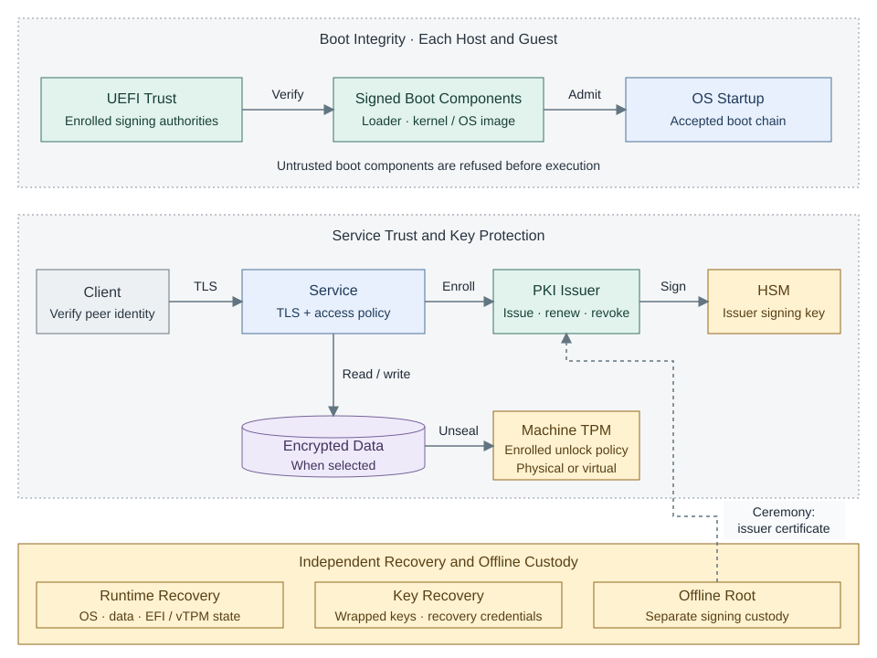

# Guest hardening and commissioning

Use signed boot on compatible permanent VMs, a unique TPM 2.0 where selected, restricted network
access, authenticated service connections and independent recovery. Apply these controls during
deployment, then use each stage's final checkpoint to verify the retained installation.

For new Rocky/Alma and Debian VMs, start with the tested vendor Secure Boot profile and add TPM
through the owning VM inputs. Talos uses its signed ISO/installer path. Existing VMs use the
explicit maintenance procedure before changing boot hardware or introducing a new key dependency.



*Figure: The selected controls protect different parts of an installation. Verify signed startup,
service access and each enrolled key consumer separately; retain recovery outside their failure domain.
The [architecture view](../../01-architecture/04-hosting/01-runtime.md#figure-boot-integrity) explains
the relationships. A vTPM remains controlled by the hypervisor; HSM integration and TPM disk unlock
are selected capabilities, not consequences of enabling Secure Boot.*

**Work from:** the owning tier's original inputs/state and the selected host or guest console.
**Before a change:** independent console access, approved artifacts, a maintenance window and a
[complete recovery set](../06-resilience/backups/recovery-set.md).
Offline custody and root ceremonies retain their own procedures and authority boundaries.

## Contents

- [Close a stage or commission a permanent guest](#stage-checkpoint)
- [Choose the layered baseline](#control-decisions)
- [What the current IaC actually controls](#iac-contract)
- [Qualify Linux Secure Boot](#linux-secure-boot)
- [Add or inspect a unique TPM 2.0](#guest-tpm)
- [Qualify Talos boot security](#talos-boot-security)
- [Preserve boot identity and recover](#boot-recovery)
- [References](#references)

<a id="stage-checkpoint"></a>

## Close a stage or commission a permanent guest

Run this checkpoint for the **selected components only**, after that stage's functional checks.
An earlier stage needs no later PKI, directory, central logging or Vault deployment to finish.
Use its accepted local credentials, local logs, independent time/DNS and recovery custody until
those later capabilities are deliberately integrated. Do not postpone access restrictions or
backup capture until the checkpoint.

1. Identify each retained VM, container, Kubernetes node and physical host. Record its owner,
   purpose, tier/setup, VMID, OS/image release, network paths and temporary/permanent status in
   `<prefix>-architecture/deployments.md` or its linked private operating record. Containers share
   their host kernel and have no independent EFI/vTPM choice. Keep original state and identities.
2. Verify the baseline appropriate to that component. Ordinary EL/Debian leaf VMs can use the
   opt-in [Linux security profile](linux-security.md); it owns key-only SSH, chrony, its selected
   firewalld zone and local audit. Proxmox uses [host hardening](proxmox-hardening.md), its own
   firewall and [TLS trust](proxmox-tls.md). Talos uses its API/machine configuration and network
   policy; never apply the leaf-host role to Proxmox or Kubernetes nodes. Confirm a fresh allowed
   administration connection, denied access from an unrelated source, working time/DNS and the
   actual service listeners. Keep the independent console usable.
3. Close deployment-only paths. Retire temporary accounts/tokens/keys after testing their permanent
   replacements, remove temporary firewall allows, eject installation ISOs and review **VM > Options
   > Boot Order**. Retain a required NoCloud/cloud-init network drive. A permanent VM stays a VM;
   converting it to a template or rebuilding it is not a hardening action. Review **Start at boot**
   and startup/shutdown dependencies, or the selected HA resource policy, before claiming unattended
   recovery. An `always-on` tag alone configures neither behavior.
4. Inspect the VM through **Tier 0's controller recipe**, selecting the VMID/name/current node from
   the owning inputs and Proxmox summary. Its read-only operation reports configured boot hardware
   and catches pending changes before maintenance. Record BIOS, machine/controller, EFI, TPM,
   storage and boot order, then verify enforcement through the guest checks below.
   [Inspect the selected VM](proxmox-guest-security.md#2-inspect-the-selected-vm)
5. Record the [layered baseline](#control-decisions). Verify signed boot and the selected TPM on each
   retained guest through the checks below. For an existing guest, complete its maintenance or
   replacement path first. Record any required control that cannot yet pass with its owner and
   review date in the deployment record.
6. Capture the original ignored inputs/state, service data and recovery credentials through the
   [backup procedure](../06-resilience/backups/virtual-machines.md). Include firmware and TPM state
   where present. Verify backup completion and recoverability using this stage's available backup
   target; do not require a future in-cluster backup controller. Run an isolated restore before
   accepting a recovery or production claim that depends on it.
7. Record results, exceptions, recovery location and the next maintenance owner. Use
   [maintenance](maintenance.md) for patch/capacity policy. Confirm currently available local audit
   records; verify central receipt only when that service is already commissioned. Return to the
   calling stage's completion gate.

| Acceptance | Required evidence |
| --- | --- |
| Stage complete | Selected functions work; applicable baseline checks pass; original inputs and recovery material are captured; deferred optional integrations are named |
| Production accepted | Required security controls are observed, supported patch/reboot policy is owned, and service capacity/access/monitoring meet the selected contract |
| Recovery accepted | An isolated restore uses independently recoverable state, artifacts, keys and service data; record measured data age and restore time |
| HA accepted, if selected | Independent placement, quorum, fencing, surviving capacity/storage and a measured failure test through [Proxmox HA](proxmox-ha.md) and the application runbook |

Boot verification does not establish any of the other acceptance results.

<a id="control-decisions"></a>

## Choose the layered baseline

Use the following baseline for new permanent installations. Keep the selected controls in the
owning configuration and record their observed state when closing a stage.

| Layer | Configuration and acceptance |
| --- | --- |
| Signed boot | Use the tested vendor-signed UEFI chain for Rocky/Alma and Debian, or the signed Talos path. Verify enforcement inside the running OS after an installed-disk cold boot |
| Per-VM TPM 2.0 | Create fresh state for each selected VM. Verify the guest detects TPM 2.0 and preserve its backing state with the VM backup. Proxmox supplies a software vTPM controlled by the hypervisor [1] |
| Protected signing keys | Select the Stage 2 USB HSM path for issuer keys and its separate offline-root custody. Retain the original wrapping/recovery material before expanding the provider pool |
| Authenticated services | Use the commissioned PKI for service TLS and validate peer names/chains. Keep certificate renewal, revocation distribution and administrative identities in the owning capability's runbook |
| Restricted access | Apply the appropriate host/guest baseline, management-source restrictions, zone policy and least-privilege accounts. Verify both an allowed transaction and denied unrelated access |
| Recoverable storage | Capture coherent OS/data/EFI/TPM state and retain usable recovery credentials independently. Talos can additionally select TPM-bound STATE/EPHEMERAL encryption through its signed installation inputs |
| Maintained software | Use approved intake sources, patch/reboot windows and service checks through the common maintenance procedure |

Physical TPMs, software vTPMs and USB HSMs have different custody. A physical TPM belongs to its
machine. A VM's TPM state resides on Proxmox storage. PicoHSM/YubiHSM devices protect the application
keys explicitly commissioned on them. Record the actual consumer and custodian for each.

TPM attachment supplies the interface. A disk or application needs its own enrollment before it
uses that interface. Keep Linux disk-key enrollment within its selected OS/storage design. Talos's
optional TPM encryption uses the explicit installation path below. Changes to firmware, EFI trust,
dbx or TPM identity can require independent recovery. [1][2][3][6]

Follow [USB HSM operations](../03-cryptography/usb-hsm.md),
[PKI operations](../03-cryptography/README.md) and the appropriate
[host access controls](proxmox-hardening.md) for the owning procedures.

<a id="iac-contract"></a>

## What the current IaC actually controls

The source contract is the same across the three tier-local generic VM modules. Template publication
and the separate Kubernetes root have different lifecycles; do not infer one from another.

| Owner and exact input | Implemented behavior / limit |
| --- | --- |
| Tier 0 `templates/proxmox.yml`, `all` / `templates.<key>`: `bios`, `machine`, `scsi_hardware`, `efi_pre_enrolled_keys`, `tpm_version` | Maps to `images` in [`proxmox_templates`](../../../tier-0/terraform/modules/proxmox_templates/variables.tf). OVMF creates a `4m` EFI disk. Optional `tpm_version: v2.0` creates TPM state on `datastore_id`; `v1.2` is also accepted. Omitted enrollment is `false`; omitted TPM is absent. These are hardware capabilities, not signed-image preparation |
| Shared `templates/proxmox-catalog.tfvars`, `proxmox_template_catalog["<VMID>"]`: `bios`, `machine`, `scsi_hardware`, `efi_pre_enrolled_keys`, `tpm_state_present` | Applied template evidence and creation profile for generic Linux clones. A fresh per-VM TPM requires the source catalog to report `tpm_state_present = false`. Republish older references through the template workflow to obtain observed evidence. See [catalog ownership](../../08-reference/template-catalog.md) |
| Owning tier `terraform/deployments/<setup>/terraform.tfvars`, `vm_instances["<host>"].template_vm_id` and optional `.firmware` | Generic Linux guests use the actual clone source's catalog profile. A `.firmware = { bios = "ovmf", machine = "q35", scsi_hardware = "virtio-scsi-single", efi_pre_enrolled_keys = true }` override replaces the whole creation profile; it does not merge missing fields |
| Same VM entry, optional `.tpm = { version = "v2.0" }` | Creates fresh TPM 2.0 state for a new VM from a TPM-free source. Optional `datastore_id` selects VM-image storage, otherwise it inherits the VM's disk storage. The module rejects a known template-borne TPM and requires explicit TPM-free evidence when creating fresh state |
| Generic [`vm` lifecycle](../../../tier-0/terraform/modules/vm/main.tf) | Preserves existing/imported BIOS, machine, SCSI controller, EFI disk, boot order and TPM state. Existing guests use the [TPM maintenance recipe](proxmox-guest-security.md) for an additive change. CPU, RAM, regular disks and networking remain managed |
| Template adoption, `scripts/proxmox-templates.sh import` | Import plans against the supplied publication catalog; its template resource does **not** use the generic VM boot-preservation rules. Enter the observed firmware/enrollment/TPM settings and review all differences before apply |
| Owning tier `terraform/deployments/kubernetes/terraform.tfvars`, `secure_boot` | Selects a fresh signed NoCloud ISO installation. Terraform verifies the local ISO hash, uploads to ISO-capable storage and provisions blank OS disks, fresh `4m` EFI variables in setup mode and per-node TPM 2.0 state. Use its [signed installation procedure](../../03-deployment/stage-04-kubernetes/procedures/secure-boot.md) |
| Same Talos object, `secure_boot.encrypt_system_disks` | Defaults to `true` when the signed installation path is selected. Adds LUKS2 `VolumeConfig` for STATE and EPHEMERAL using the node's TPM and checked Secure Boot enrollment. Preserve its coherent recovery set |
| Same Talos file, `template_vm_id`, `cluster.installer_image`, `vm_firmware` and `machine_config_patches` | The chosen media, installer, firmware and machine configuration form one installation contract. Existing clone-based nodes retain their chosen path. OS updates use the [serial maintenance procedure](maintenance.md#talos-updates) |

The generic guest's template must be TPM-free. Keep a template's `tpm_version` absent when it is a
clone source for these VMs. Each guest receives its own state through `.tpm`. Preserve that state
during VM import, migration and recovery. [4]

<a id="linux-secure-boot"></a>

## Qualify Linux Secure Boot

Use a disposable pilot on an isolated network. The ordinary vendor boot chains for Debian and
EL10 use signed shim/bootloader/kernel components. Custom kernels and out-of-tree drivers need
trusted signatures/enrollment too; an OS family label alone does not qualify the artifact. [3][5]

1. Select the service-supported distribution/release and verify its image provenance. Keep service
   constraints: a bootable EL10 image is not a substitute for a service that requires Debian 12.
   Prepare UEFI boot files and an EFI System Partition (ESP) **inside the guest disk**; this ESP is
   distinct from Proxmox's EFI variable disk. Use current signed recovery media for that image.
2. For a **new template revision**, edit Tier 0 `templates/proxmox.yml` under the selected
   `templates.<new-key>`: set `bios: ovmf`, the tested `machine`/`scsi_hardware`, and explicitly
   `efi_pre_enrolled_keys: true`. Retain all required artifact/hash/VMID/storage fields and all
   existing managed entries. Keep `tpm_version` absent in this reusable template. Proxmox
   pre-enrollment initializes vendor trust and enables verification on a
   new EFI disk; the firmware menu can subsequently change the effective state. [1]
3. Publish through the [template procedure](templates/template-lifecycle.md#how-is-a-new-template-published),
   then deploy an isolated pilot through its owning IaC. After a cold start from the installed
   disk, run the [controller-owned Linux proof](proxmox-guest-security.md#prove-the-controls-inside-a-managed-linux-guest).
   It prepares the selected native inspection packages from accepted sources and requires actual
   Secure Boot enforcement without shim bypass. Select its TPM requirement only when the pilot
   has a unique TPM. No manual guest installation is needed.
   Require working storage/network drivers, then test a kernel update, another cold start,
   backup restore and recovery-media boot before promotion.
4. Retain the tested firmware profile in Shared and select the new `template_vm_id` for **new**
   guests, following [promotion](templates/template-lifecycle.md#how-is-a-tested-image-promoted-or-rolled-back).
   The publisher synchronizes references; it does not change the default selection automatically.
   Existing guests retain their installed OS/boot hardware. Plan and review their own lifecycle.
5. For an **existing guest**, capture its recovery set and reproduce it on isolated capacity first.
   Already-UEFI guests with a compatible signed chain can be qualified using the OVMF console.
   SeaBIOS installations need an explicit boot-layout migration or replacement; changing `bios`
   alone does not create an ESP/loader. A `2m` EFI disk needs replacement to support Secure Boot;
   that resets firmware variables/boot entries/custom keys. Do not delete/recreate the production
   EFI disk as a generic recipe. Schedule only the tested change, verify through the console, then
   inspect a no-surprise IaC plan before resuming writers. [1]

Current trust also matters. Microsoft CA transitions, shim/SBAT and dbx revocations can invalidate
older boot/recovery media. Inspect actual guest trust and the installed Proxmox version's
**EFI Disk > Disk Action > Enroll Updated Certificates** support before planning an enrollment.
Retain recovery keys and test the transition on a restored guest first. Use current signed recovery
media. Alma's certificate guidance depends on its supplied shim and architecture. [1][2]

<a id="guest-tpm"></a>

## Add or inspect a unique TPM 2.0

### New Rocky/Alma or Debian VM

1. Publish the TPM-free clone source through the template workflow. Its applied Shared
   catalog entry must report `tpm_state_present = false`. Keep TPM state out of reusable templates.
2. Edit **the owning tier's `terraform/deployments/<setup>/terraform.tfvars`**. Inside the existing
   `vm_instances` entry for each selected guest, add the following object. Keep the guest's other
   settings in that same entry.

   ```hcl
   tpm = {
     version = "v2.0"
   }
   ```

   This inherits the VM's image storage. Add `datastore_id` within `tpm` only when its state needs a
   different VM-image datastore. Check that the chosen storage is available on every intended
   recovery or HA target.
3. Run the setup's normal deployment command and review the new VM's boot/TPM storage in its plan.
   The command index gives the exact command for each setup. Existing guests retain their TPM state
   through normal reconciliation. Use the additive maintenance path below for an existing VM.
   [Deployment commands](../deployment-commands.md)
4. Run the [controller-owned Linux proof](proxmox-guest-security.md#prove-the-controls-inside-a-managed-linux-guest)
   from the owning tier's setup. It requires the local device to report TPM **2.0** and verifies
   the selected Secure Boot policy. Capture a coherent VM backup with TPM/EFI state before
   enrolling any disk or application key.

### Existing Proxmox VM

Use **Tier 0's existing-VM boot inspection and TPM recipe**. It reads the selected VM through the
API, prepares a private configuration record and adds a missing TPM 2.0 during a controlled outage.
Follow its prepare, check, apply and recovery steps. [Existing-VM TPM maintenance](proxmox-guest-security.md)

After addition, record the observed TPM and its recovery location. For a generic Terraform-managed
VM, set its intended `.tpm` object once the source catalog has the required TPM-free evidence, then
review that setup's plan. Verify the guest's TPM version and service health, then capture a fresh
backup. Retain the same TPM identity across later imports and moves.

<a id="talos-boot-security"></a>

## Qualify Talos boot security

The signed installation path provisions fresh UEFI variables and TPM 2.0 for each node. Its signed
ISO enrolls the Talos key while the virtual firmware is in setup mode. The installed node uses the
matching Secure Boot installer. Keep the ISO, installer, schematic/extensions and Talos release
together in the installation record. [6]

1. For **new nodes**, follow the signed installation procedure from Stage 4. Edit the owning tier's
   `terraform/deployments/kubernetes/terraform.tfvars` and select the documented `secure_boot` inputs.
   Retain its approved local ISO/hash and matching signed installer through software intake.
   [Talos signed installation](../../03-deployment/stage-04-kubernetes/procedures/secure-boot.md)
2. Decide whether to retain `secure_boot.encrypt_system_disks = true`. This encrypts STATE and
   EPHEMERAL at first provisioning and binds their unlock to that node's TPM and signed boot policy.
   Keep original node secrets/configuration, etcd and workload backups independently. If TPM state
   is lost, the recovery path needs either the coherent original VM or a rebuilt node with recovered
   cluster/application data. [6]
3. Verify the installed nodes through their authenticated Talos APIs. From **the owning tier root**:

   ```bash
   bash scripts/kubernetes-cluster.sh verify-security
   ```

   Require the command to accept Secure Boot/UKI and, when selected, STATE/EPHEMERAL TPM unlock.
   Repeat after a controlled installed-disk cold boot. Verify API, network, storage and the real
   workloads before accepting the nodes. Initial provisioning runs the same security proof.
4. During updates, keep the signed installer family and original signing trust. Test the canary's
   next signed OS upgrade, reboot and isolated recovery before rolling to peers. Recheck boot and
   volume state. Follow the [Talos maintenance sequence](maintenance.md#talos-updates).
5. For an **existing GRUB-based Talos node**, use a fresh signed installation and the node-replacement
   procedure with quorum retained. Upstream requires fresh installation for this transition. Retain
   the original cluster identity and recover the workload data before retiring the old node. [6]

<a id="boot-recovery"></a>

## Preserve boot identity and recover

1. Before firmware, key, TPM, storage, host or VMID changes, capture the **coherent guest backup**,
   configuration and [original tier state](terraform-state.md). Include OS/data disks, Proxmox EFI
   variables (`efidisk0`), TPM state (`tpmstate0`), actual boot order/controller/machine version,
   guest ESP, enrolled custom keys and independently usable encryption recovery material.
   Proxmox includes its EFI disk in backups/snapshots; inspect the actual backup task and isolated
   restore for all required volumes. A bare OS-disk export is not this recovery set. [1]
2. Keep original approved boot/installer artifacts, working recovery media, API/client credentials
   and external data backups available without the guest. For Talos retain original machine secrets,
   per-node configuration, talosconfig, etcd snapshots and workload/PVC backups. A VM snapshot does
   not establish a coherent database or multi-member cluster recovery point.
3. Before migration/HA, verify every target can access or receive **all** required disks including
   EFI/TPM state, the same bridges/VLANs, compatible CPU/firmware and required passthrough devices.
   A host's physical TPM does not automatically become a guest's vTPM. Test a cold boot/failover;
   inspect the guest boot/encryption state after the move. Use [HA operations](proxmox-ha.md).
4. On failed verification or unlock, stop the rollout and retain console/error evidence. Use the
   last accepted complete recovery set on isolated capacity and the product's recovery procedure.
   Do not clear a TPM, reset firmware keys, reformat a volume or regenerate cluster/application
   identities to make it boot. Use the independently retained recovery method when measurements
   change. Suspected compromise follows [clean-target recovery](../06-resilience/recovery/README.md).
5. Return production ownership only after service, access, boot and backup checks pass. Import or
   reconcile recovered resources through the [state guide](terraform-state.md); never apply a
   creation plan against an unadopted recovered VM.

## References

Official constraints reviewed 2026-11-16; use documentation matching the installed release.

1. Proxmox, [VM firmware, EFI trust and TPM](https://github.com/proxmox/pve-docs/blob/master/qm.adoc#bios-and-uefi).
2. AlmaLinux, [UEFI Secure Boot certificate transition](https://wiki.almalinux.org/documentation/secure-boot-2023-certificates).
3. Red Hat, [EL10 Secure Boot and module signing](https://docs.redhat.com/pt-br/documentation/red_hat_enterprise_linux/10/html/managing_monitoring_and_updating_the_kernel/signing-a-kernel-and-modules-for-secure-boot).
4. BPG Proxmox provider 0.112.0, [VM resource and cloning notes](https://github.com/bpg/terraform-provider-proxmox/blob/v0.112.0/docs/resources/virtual_environment_vm.md).
5. Debian 13, [UEFI and Secure Boot installation constraints](https://www.debian.org/releases/trixie/amd64/ch03s06.en.html).
6. Talos 1.13, [Secure Boot, UKI installation and TPM dependencies](https://docs.siderolabs.com/talos/v1.13/platform-specific-installations/bare-metal-platforms/secureboot).
