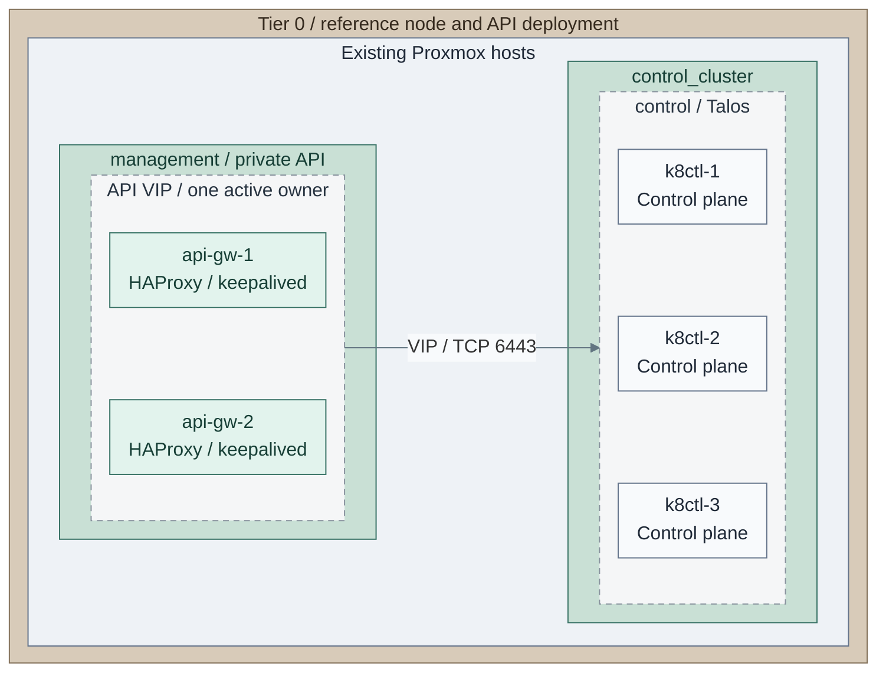

# Kubernetes and lab operations

Operate the accepted cluster and its node capacity using the original owning tier's inputs.
VM/LXC labs and a dedicated workload Kubernetes cluster remain separate selections.

<a id="figure-reference-cluster-capacity"></a>



*Figure: IaC reference for node-capacity operations: the supplied independent API pair fronts three
schedulable control-plane VMs. This starter has no workers; the group arrow is the API interface.*

**Owner:** `<prefix>-tier-0`; [endpoint inputs](../../../tier-0/terraform/deployments/cluster-endpoint/terraform.tfvars.example)
and [installer](../../../tier-0/ansible/playbooks/deployment/cluster-endpoint.yml),
[node inputs](../../../tier-0/terraform/deployments/kubernetes/terraform.tfvars.example) and
[cluster lifecycle](../../../tier-0/scripts/kubernetes-cluster.sh).
The [complete platform view](../../03-deployment/stage-4-kubernetes/README.md#figure-2-basic-platform-services)
owns the add-on inventory. An accepted external API endpoint is a separate selection;
[Tier 2 VM/LXC and Kubernetes lab views](../../03-deployment/stage-10-lab-environments/README.md#figure-workload-runtimes)
retain their own inputs and state.

**Design:** [Kubernetes](../../01-architecture/04-hosting/03-kubernetes.md) and
[Lab environments](../../01-architecture/04-hosting/04-lab-environments.md).
**Install:** [Stage 4: Kubernetes](../../03-deployment/stage-4-kubernetes/README.md) and
[Stage 10: Lab environments](../../03-deployment/stage-10-lab-environments/README.md).

| Task | Start here |
| --- | --- |
| Add or reserve workers | The worker-pool tasks below, using the owning tier's inputs and state |
| Plan cluster/node upgrades | [Upgrade gate](maintenance.md#upgrade-gate), then release-matched Talos/Kubernetes procedures |
| Operate a VM or LXC lab | [Stage 10 selected runtime](../../03-deployment/stage-10-lab-environments/README.md#main-path), [maintenance recipe scope](ansible-recipes.md#recipe-map) |
| Protect or restore a lab VM | [VM backups](../06-resilience/backups/virtual-machines.md), [VM recovery](../06-resilience/recovery/virtual-machines.md) |
| Recover original cluster identity and etcd | [Original state and etcd](../06-resilience/recovery/original-state-etcd.md) |

Application-specific lab runbooks and any bounded self-service dispatcher remain project-owned.

Use explicit node definitions for capacity and Kubernetes scheduling controls for
placement. [Topology design](../../01-architecture/04-hosting/03-kubernetes.md) defines the
boundaries; [cluster provisioning](../../03-deployment/stage-4-kubernetes/procedures/talos-terraform.md)
owns hardware, inventory and state. No autoscaler or rolling node-upgrade controller is supplied.

**Working repository:** the cluster's `<prefix>-tier-0`, `<prefix>-tier-1` or `<prefix>-tier-2` root.
**Before starting:** accepted original state, node reservations, sufficient capacity,
and that cluster's protected kubeconfig. Load the same
[provider exports](../../03-deployment/stage-4-kubernetes/procedures/talos-terraform.md#configure)
as cluster deployment; this script does not load `.env.local`. Confirm the target before every task:

Run from the selected **`<prefix>-tier-0/`**, **`<prefix>-tier-1/`** or **`<prefix>-tier-2/`** repository.

```bash
export KUBECONFIG="$PWD/secrets/talos/kubeconfig"
kubectl config current-context
kubectl get nodes -L node-pool
```

## Table of contents

- [How is a worker added?](#add-capacity)
- [How is a pool reserved or released?](#reserve-a-pool)
- [How are control planes made dedicated?](#dedicated-control-planes)
- [References](#references)

<a id="add-capacity"></a>

## How is a worker added?

1. Reserve an unused worker [VMID](../../02-conventions/vmid-convention.md), MAC
   and IP. Keep the existing cluster's endpoint, secrets and nodes.
2. Edit these files in its owning tier:

   | File | Edit |
   | --- | --- |
   | `ansible/inventory/hosts.yml` | Add the matching worker key under `talos_workers.hosts` |
   | `ansible/group_vars/talos.yml` | Add its reserved address to `platform_host_ips` |
   | `terraform/deployments/kubernetes/terraform.tfvars` | Add its `nodes` entry: VMID, host, MAC, live datastore, bridge and size; `pool = "compute"` emits `node-pool=compute` |

3. Prepare the saved plan:

   Run from the selected **`<prefix>-tier-0/`**, `<prefix>-tier-1/` or `<prefix>-tier-2/` repository.

   ```bash
   bash scripts/kubernetes-cluster.sh plan
   ```

   Require only the intended additions. **Stop** on node replacement, bootstrap,
   endpoint or secret changes; do not reset state to force the addition.
4. Apply that reviewed plan, then check node and system health:

   Run from the selected **`<prefix>-tier-0/`**, **`<prefix>-tier-1/`** or **`<prefix>-tier-2/`** repository.

   ```bash
   bash scripts/kubernetes-cluster.sh apply
   kubectl get nodes -L node-pool
   kubectl get pods -A -o wide
   ```

5. Require the new worker to become Ready with its expected pool label. Test placement
   and persistence before admitting normal work. If it fails, keep it out of scheduling
   and diagnose; do not remove other nodes or regenerate cluster secrets.

Tier 1 may use infrastructure, stateful and compute pools; Tier 2 may use development,
testing and lab pools. Names describe scheduling intent, not a permission boundary.
Keep untrusted build execution off sensitive infrastructure hosts.

<a id="reserve-a-pool"></a>

## How is a pool reserved or released?

Talos accepts node labels in machine configuration. Default worker admission policy
does not permit workers to modify their own taints; an authorized Kubernetes
administrator owns those changes. [1] Use the owning cluster's protected kubeconfig.

1. Select and inspect the node before changing scheduling:

   Run from the selected **`<prefix>-tier-0/`**, **`<prefix>-tier-1/`** or **`<prefix>-tier-2/`** repository.

   ```bash
   read -r -p "Worker node to reserve: " NODE
   kubectl describe node "$NODE"
   ```

2. Proceed only if the inspected node has no existing `dedicated:NoSchedule` reservation.
   If it already has one, retain that policy and use its owner-approved change procedure.
   Add this new reservation without overwriting another pool's value:

   Run from the selected **`<prefix>-tier-0/`**, `<prefix>-tier-1/` or `<prefix>-tier-2/` repository.

   ```bash
   kubectl taint node "$NODE" dedicated=compute:NoSchedule
   ```
3. In the project-owned workload manifest, set both the selector and toleration below.
   A toleration permits placement; the selector requests it. [2]

```yaml
spec:
  nodeSelector:
    node-pool: compute
  tolerations:
    - key: dedicated
      operator: Equal
      value: compute
      effect: NoSchedule
```

Install required CNI, storage and monitoring agents with appropriate tolerations.
`NoSchedule` does not evict existing pods. Adding a taint after node registration
also leaves an initial scheduling window; keep untrusted workloads disabled until
the reservation is verified. This is not a secure multi-tenant runner installer.

4. Check actual pod placement and system-agent health:

   Run from **the same owning tier and approved Kubernetes context**.

   ```bash
   kubectl get pods -A -o wide
   ```

   Keep the taint for normal reserved-pool operation. The next block is **rollback only**,
   not another required step: remove only the `dedicated:NoSchedule` reservation added by this task,
   then review workload selectors. Do not remove a pre-existing reservation.

   Run from the selected **`<prefix>-tier-0/`**, **`<prefix>-tier-1/`** or **`<prefix>-tier-2/`** repository.

   ```bash
   kubectl taint node "$NODE" dedicated:NoSchedule-
   kubectl get pods -A -o wide
   ```

<a id="dedicated-control-planes"></a>

## How are control planes made dedicated?

1. Add and verify sufficient workers first. Review system tolerations, workload
selectors, persistent-volume placement and remaining capacity after a node failure.
2. Change `cluster.allow_scheduling_on_control_planes` to false and review the
configuration plan, then apply the reviewed configuration through the
[owning cluster workflow](../../03-deployment/stage-4-kubernetes/procedures/talos-terraform.md#plan-and-deploy).
Configuration apply is not a health-gated rolling controller;
use the pinned Talos release's maintenance procedure where a reboot is required.

3. Cordon/drain control planes one at a time using Kubernetes disruption-budget and
storage checks; disabling scheduling alone does not move existing workloads.
4. Verify service continuity after each move. Never remove nodes, regenerate secrets
or replace state to match a newer starter example.

## References

1. [Talos machine configuration](https://docs.siderolabs.com/talos/v1.12/08-reference/configuration/v1alpha1/config).
2. [Kubernetes taints and tolerations](https://kubernetes.io/docs/concepts/scheduling-eviction/taint-and-toleration/).
