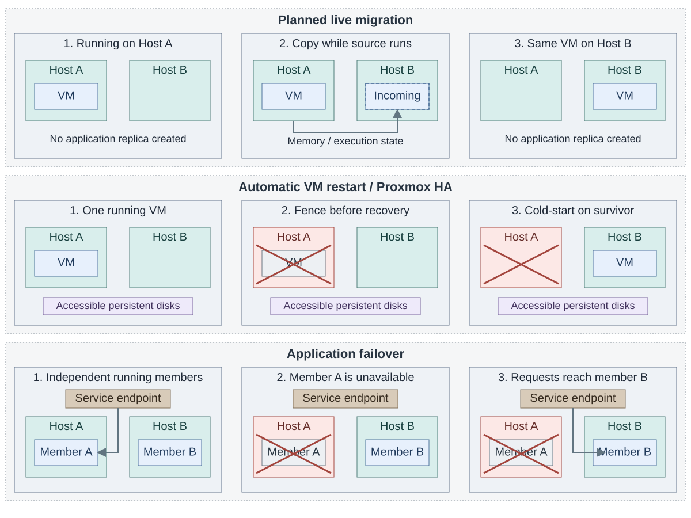
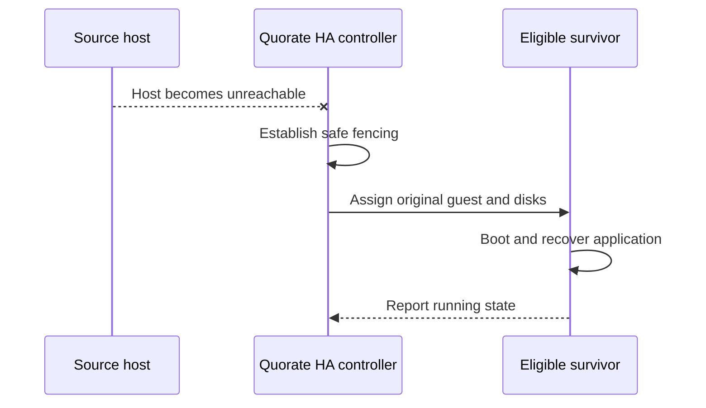
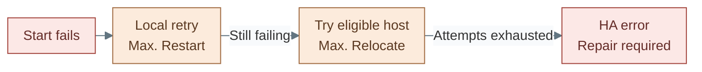
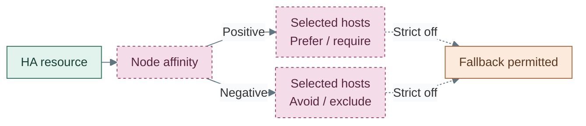
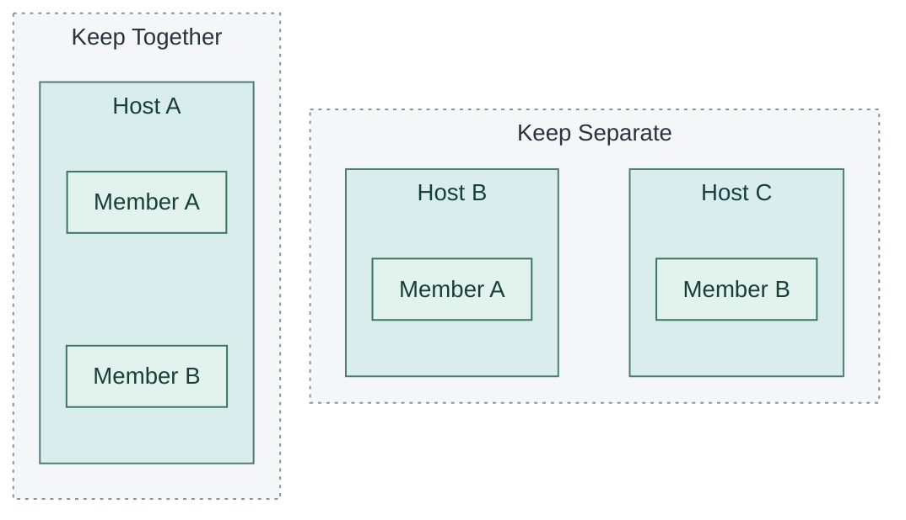
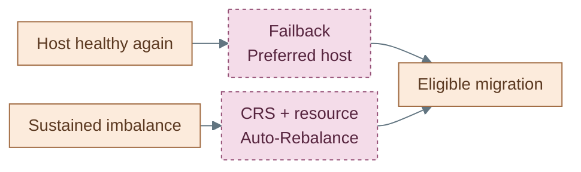
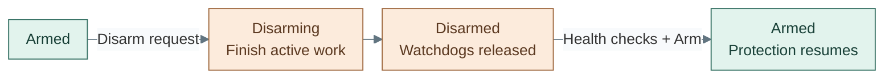

# Proxmox failover, redundancy and HA

Keep selected guests recoverable after host failure and maintain the hosts within the
service's accepted interruption target. VM-level HA automatically restarts a guest.
Application-level HA uses active-active or active-passive members and their native
failover/data protocol. Accept the measured interruption and recovery point for the service.

<a id="figure-availability-cases"></a>



**Workflow** — *Figure 1. Planned migration transfers a running VM while both hosts work.
Host failure requires safe fencing and a fresh boot. Application failover uses an already
running replica.* The strips show source and survivor hosts, with cluster quorum, accessible
storage and spare capacity supplied by the wider deployment. They omit the complete voting topology.
[Availability design](../../01-architecture/04-hosting/05-availability.md) ·
[Foundation installation](../../03-deployment/foundation/proxmox/step-1b-cluster-ha.md) ·
[Exact GUI and API fields](../../08-reference/proxmox-ha.md)

**Configuration lives in `<prefix>-tier-0/ansible/group_vars/proxmox_ha.yml`.**
Terraform inputs in each owning tier select initial VM placement. The Tier 0 HA playbook
maintains enrollment and placement rules for the existing guests.

## Find a task

- [Configure or update HA through IaC](#configure-through-iac)
- [Read quorum and fencing status](#read-status)
- [Choose retries and requested state](#resource-policy)
- [Keep guests on eligible hosts](#node-affinity)
- [Keep replicas separate](#resource-affinity)
- [Choose failback and balancing](#scheduling)
- [Move a running VM](#live-migration)
- [Maintain one host](#node-maintenance)
- [Disarm and re-arm the whole cluster](#cluster-maintenance)
- [Recover an error or waiting resource](#failed-recovery)
- [Remove a rule or HA enrollment](#undo)

<a id="configure-through-iac"></a>

## How do I configure or update HA through IaC?

Complete foundation cluster, storage and fencing qualification first. Retain independent
console access and backups. Every eligible target needs all guest disks, equivalent networks,
a compatible CPU/device configuration and room for the recovered workload.
[Preparation and mobility checks](../../03-deployment/foundation/proxmox/step-1b-cluster-ha.md#make-guests-movable)

Use the dedicated HA identity described in the API guide. HA administration uses
`Sys.Audit`, `Sys.Console` and `VM.Audit` for cluster control and VM lookup. `Sys.Console`
grants host-console authority. Keep that
credential with the approved HA controller inputs.
[HA automation identity](../../03-deployment/foundation/proxmox/api-access.md#ha-automation-identity)

### 1. Initialize the local inputs

Run from **`<prefix>-tier-0/` on the approved execution host**.

```bash
bash scripts/init-local-files.sh --setup proxmox-ha
```

### 2. Edit the selected resources and rules

Edit **Tier 0 `ansible/group_vars/proxmox_ha.yml`**. Use the shipped example for the
module's supported structure. Resource keys select exact existing Proxmox guest names.
Use `vmid` when names are ambiguous. Rule members reference those local resource keys.

For the existing **Tier 0 control-plane set**, merge this selection into **`proxmox_ha.yml`**.
Keep existing resource/rule entries. Another cluster needs its own rule and members.

```yaml
proxmox_ha_resources:
  k8ctl-1: {}
  k8ctl-2: {}
  k8ctl-3: {}

proxmox_ha_rules:
  tier0-control-plane-separate:
    type: resource-affinity
    affinity: negative
    resources: [k8ctl-1, k8ctl-2, k8ctl-3]
```

Each resource defaults to `hastate: started`, `max_restart: 1` and `max_relocate: 1`.
`state: present` manages HA membership, and `state: absent` removes it. Omitted entries
are left unmanaged. The playbook changes existing guests' HA policy and can trigger moves.

For redundant members, select **Keep Separate / negative resource affinity**. Add a
strict node rule only when a real hardware, storage or security requirement limits the hosts.
Use one equal-priority host set when combining node and resource affinity.
[Input example](../../../tier-0/ansible/group_vars/proxmox_ha.yml.example) ·
[Rule effects](#resource-affinity)

<a id="apply-ha-policy"></a>

### 3. Apply the selected policy

Run from **`<prefix>-tier-0/`** using the configured dedicated HA identity.
Enter the verified HTTPS API root, the dedicated token ID and its secret when prompted.
The subshell confines these credentials to this invocation. System CA trust or the accepted
`PROXMOX_CA_FILE` must validate that endpoint.

```bash
(
  read -r -p 'Proxmox API root (example https://pve01.example.com:8006): ' PROXMOX_API_URL
  read -r -p 'HA token ID (example ha-automation@pve!manage): ' PROXMOX_API_TOKEN_ID
  read -r -s -p 'HA token secret: ' PROXMOX_API_TOKEN_SECRET
  printf '\n'
  export PROXMOX_API_URL PROXMOX_API_TOKEN_ID PROXMOX_API_TOKEN_SECRET
  unset PROXMOX_VE_ENDPOINT PROXMOX_VE_API_TOKEN
  ANSIBLE_CONFIG=ansible/ansible.cfg ansible-playbook -i ansible/inventory/hosts.yml \
    ansible/playbooks/proxmox-ha.yml -e @ansible/group_vars/proxmox_ha.yml
)
```

Optional `--check` validates inputs, selected VM identities and existing rules. It leaves
enrollment/placement changes for the normal run, whose actual result must be checked below.

In **Tier 0 CI**, supply the same accepted HA variables through protected secret inputs
and run the playbook directly.

```bash
ANSIBLE_CONFIG=ansible/ansible.cfg ansible-playbook -i ansible/inventory/hosts.yml \
  ansible/playbooks/proxmox-ha.yml -e @ansible/group_vars/proxmox_ha.yml
```

Use one consistent credential convention if normalized `PROXMOX_VE_*` variables also exist.
[HA playbook](../../../tier-0/ansible/playbooks/proxmox-ha.yml)

### 4. Verify actual placement and service health

Open **Datacenter > HA > Resources** and **Affinity Rules**. Require the requested
guests, active conflict-free rules and the expected physical separation.

Run in **an authorized Proxmox host shell** for a read-only cluster view. [1]

```bash
pvecm status
ha-manager status
ha-manager config
ha-manager rules config
```

Test the actual service endpoint, replication/quorum and data access. Record a controlled
failure result before relying on automatic recovery. Update the owning tier's placement
record after migration and inspect its Terraform preview for unexpected replacement.
[Failure test and acceptance record](../../03-deployment/foundation/proxmox/failover.md#verify-the-result)

<a id="read-status"></a>

## What should quorum and fencing show?

1. Open **Datacenter > HA**. Require quorum and current CRM/LRM timestamps.
2. Check the fencing line and enrolled resource states. The screenshot's
   **standby / CRM watchdog standby** can appear before active HA work exists.
3. With active HA resources, investigate unexpected standby, stale status or a
   disarmed cluster before claiming host-failure protection. [2]

<a id="figure-fenced-recovery"></a>



**Workflow** — *Figure 2. Fencing prevents concurrent ownership before recovery starts.*
An unreachable host can still have storage access. Let HA establish safe ownership before
starting the original disks elsewhere. [Fencing and status implementation][2]

<a id="resource-policy"></a>

## How do retries and requested state affect recovery?

Set `hastate`, `max_restart`, `max_relocate` and `comment` in **`proxmox_ha_resources`**,
then rerun the HA playbook.
In the GUI, the equivalent controls are **Resources > Add/Edit**. Begin qualification
with `Max. Restart = 1`, `Max. Relocate = 1` and `Request State = started`.
Use **Comment** for the service owner and recovery-runbook location. [3]



**Workflow** — *Figure 3. Retry limits apply to failed starts.* Raising them can extend
the time spent on a persistent failure. [Resource schema and exact state meanings](../../08-reference/proxmox-ha.md#resources)

To stop an enrolled guest for service work, set **Request State = stopped** and wait
for observed `stopped`. Set `started` when ready. Use `disabled` during HA error repair.
Keep the IaC input aligned with any temporary GUI/CLI override before the next run. [3]

<a id="node-affinity"></a>

## How do I select preferred or permitted hosts?

1. Edit the preferred/restricted node list in **`proxmox_ha_rules`**. Set
   `type: node-affinity`, selected resource keys, `nodes` and `strict`.
2. For the GUI equivalent, open **HA > Affinity Rules > Add > Node Affinity**.
   Choose **Prefer Nodes / positive** for a preference/allow list. **Avoid Nodes / negative**
   uses the GUI with the current collection, whose node-rule module supports preferred lists.
3. Use **Strict** for a mandatory restriction. With it clear, HA can fall back when
   the preferred placement is unavailable. Higher positive-rule priority wins.
4. Apply and inspect the rule's enabled/state result. Equal priorities preserve a
   common eligible set. Negative node rules have no priorities. [4]



**Workflow** — *Figure 4. Strictness changes a preference into a placement limit.*
Use a strict rule to keep a device-bound VM on compatible hosts. If every allowed host
fails, recovery waits. [Node-affinity field reference](../../08-reference/proxmox-ha.md#affinity-rules)

<a id="resource-affinity"></a>

## How do I keep Kubernetes VMs or service replicas separate?

For Kubernetes, use the [field-by-field control-plane setup](../../03-deployment/stage-04-kubernetes/step-9b-proxmox-ha.md)
for the complete YAML and each Proxmox dialog field. Keep these as separate resource sets in
**Tier 0 `ansible/group_vars/proxmox_ha.yml`**:

| Cluster | Resource keys | Separation rule ID |
| --- | --- | --- |
| Tier 0 control | `k8ctl-1`, `k8ctl-2`, `k8ctl-3` | `tier0-control-plane-separate` |
| Tier 1 platform | `pctl-1`, `pctl-2`, `pctl-3` | `tier1-control-plane-separate` |
| Tier 2 workload | `wctl-1`, `wctl-2`, `wctl-3` | `tier2-control-plane-separate` |

These names come from the [Tier 0](../../../tier-0/terraform/deployments/kubernetes/terraform.tfvars.example),
[Tier 1](../../../tier-1/terraform/deployments/kubernetes/terraform.tfvars.example) and
[Tier 2](../../../tier-2/terraform/deployments/kubernetes/terraform.tfvars.example) starters.
Use the actual existing names; create each rule only after its cluster exists. Each cluster gets
its own rule, rather than one nine-member separation rule. Worker policies are separate selections.

For another service's replica set:

1. Set distinct physical hosts in the owning Terraform deployment for initial creation.
2. Enroll the existing VMIDs through **`proxmox_ha_resources`**.
3. Add a **resource-affinity** rule with **negative / Keep Separate** for each replica
   set whose host-failure separation must be maintained. For Kubernetes, use one rule
   per cluster's control-plane voters. Give worker sets their own policy according to
   available hosts and the intended failure budget. Check actual physical placement.
4. Retain the application's own replication, endpoint failover and quorum checks. [5]



**Workflow** — *Figure 5. Together shares a host failure domain. Separate preserves distinct hosts.*
Each inner solid frame represents a physical host. The illustrated members represent an operator-selected
rule, which can move existing guests when applied. [Resource-affinity semantics][5]

For **three control-plane VMs on three hosts**, hard separation leaves one VM waiting
after one host fails. The surviving two can maintain a healthy three-member etcd cluster's
quorum. Recovering all three while preserving separation needs a **fourth eligible host**
with usable disks, networks and resources. Record the intended degraded state before testing.
[Worked failure and capacity cases](../../03-deployment/foundation/proxmox/failover.md)

Kubernetes pod anti-affinity/topology spread controls placement across Kubernetes nodes.
Their distinct node names alone establish no physical-host separation. Proxmox resource
anti-affinity preserves physical separation of their node VMs. Maintain both levels for
the selected application's requirements. Recheck N+1 headroom when adding replicas or
increasing VM sizes. [Scaling and availability design](../../01-architecture/04-hosting/05-availability.md)

<a id="scheduling"></a>

## Should guests return or rebalance when a host comes back?

The current native module leaves **Failback**, **Auto-Rebalance** and CRS settings to
the Proxmox GUI. Record these cluster choices with the operating configuration.

1. In **Resources > Edit**, choose **Failback** when a resource should return toward
   its higher-priority node. Clear it when recovery should await operator review.
2. On 9.2+, open **HA > CRS Settings**. Qualify **Dynamic Load** with
   **Automatic Rebalance**, keeping the default threshold, duration, improvement and
   algorithm initially. Enable each movable resource's **Auto-Rebalance** flag.
3. Keep a repaired host in maintenance until its health checks pass. Review both
   priority-driven failback and load-driven moves after rejoining. [3][6]



**Workflow** — *Figure 6. Priority and measured load can independently cause placement changes.*
Each move must satisfy affinity and mobility requirements.
[CRS values and shutdown policies](../../08-reference/proxmox-ha.md#scheduling-and-maintenance)

<a id="live-migration"></a>

## How do I move a running HA VM?

1. Verify destination disks, network, CPU compatibility and capacity. Both hosts
   must be reachable for the live-memory transfer in Figure 1. [7]
2. In **VM > Migrate**, select a permitted destination and online migration.
   For HA resources, the native CLI equivalent runs in **an authorized Proxmox host shell**. [1]

   ```bash
   read -r -p 'HA VMID: ' HA_VMID
   read -r -p 'Destination Proxmox node: ' HA_TARGET
   ha-manager migrate "vm:$HA_VMID" "$HA_TARGET"
   ```

3. Require a completed task, exactly one running instance and working service/data
   access. Preserve the original VMID and tier state. Compare the owner's Terraform
   preview before its next apply.

<a id="node-maintenance"></a>

## How do I maintain one host?

1. Verify quorum, storage health, application quorum and spare eligible capacity.
   A strict three-on-three separation rule can block evacuation of one control-plane VM.
2. Run in **an authorized Proxmox host shell**. [1]

   ```bash
   read -r -p 'Proxmox node to maintain: ' HA_NODE
   ha-manager crm-command node-maintenance enable "$HA_NODE"
   ha-manager status
   ```

3. Wait for HA resources and active workers to leave that host. Check its full guest
   list and handle non-HA guests through their owner's procedure. Then perform the
   selected host-update or hardware task.
4. Verify hardware, storage and networks after return. In the **same host shell**,
   release maintenance and inspect the resulting moves.

   ```bash
   ha-manager crm-command node-maintenance disable "$HA_NODE"
   ha-manager status
   ```

5. Check replicas, service endpoints and recovery headroom before maintaining another host.
   [Host updates](../02-software-intake/host-updates.md#how-are-proxmox-updates-installed)

<a id="cluster-maintenance"></a>

## When should I disarm the whole cluster?

Use **Disarm HA** for planned cluster-wide work on Corosync or shared networks when
temporary partitions are expected. This suspends automatic fencing and recovery throughout
the cluster. Maintain independent console access for that interval. [1][2]



**Workflow** — *Figure 7. Cluster-wide maintenance suspends protection until re-arming completes.*
The observed state determines when the disarm window starts and ends.
[Arming and resource-mode contract](../../08-reference/proxmox-ha.md#scheduling-and-maintenance)

1. Select **Datacenter > HA > Disarm HA** and choose `freeze` to retain resource
   state. Choose `ignore` when the plan requires manual resource movement.
2. Wait for **disarmed** in Status. An active recovery/migration can defer the request.
3. Complete the network/cluster work and restore healthy quorum, storage and connectivity.
4. Select **Arm HA**, wait for the armed state and verify all resource/LRM states.
   Retained node-maintenance flags require their own explicit release.

The native equivalents run in **an authorized Proxmox host shell**. First request disarm
and wait for `disarmed` before beginning the maintenance work.

```bash
ha-manager crm-command disarm-ha freeze
ha-manager status
```

After completing the work and health checks, run in **the Proxmox host shell**.

```bash
ha-manager crm-command arm-ha
ha-manager status
```

<a id="failed-recovery"></a>

## Why is a resource waiting or in error?

1. Read the HA state and failed task log. Check quorum/fencing first, followed by
   every disk, network, eligible host, resource affinity and available memory.
2. If `recovery` has no eligible destination, restore that destination or explicitly
   revise the approved placement policy. Record any reduced separation.
3. For `error`, first establish a single safe guest instance. Set **Request State = disabled**,
   fix the underlying failure, then request **started** and verify application recovery. [3]
4. If guest data is unavailable, follow host/VM restore and reconcile the owning tier's
   original state. [Host recovery](../06-resilience/recovery/host.md)

<a id="undo"></a>

## How do I remove a rule or HA supervision?

1. Update the local HA inputs so the next run matches the intended result.
   Set `state: absent` on a selected rule to remove it. To remove HA membership,
   set `state: absent` on that resource and remove it from retained rule memberships.
2. For an immediate GUI change, remove the resource from affected affinity rules first.
   Remove a whole rule if its remaining membership would be invalid.
3. Select the resource in **HA > Resources > Remove**. The VM remains present and
   its current run state is retained. Future host recovery uses the chosen alternative
   until it is enrolled again. [1][3]
4. Inspect resource/rule lists and record the changed recovery coverage. Verify the
   next HA reconciliation before closing the change. Keep explicit absent entries
   until a successful run, then remove them from local inputs.

## References

Official sources checked 2026-11-14. The field reference owns exact defaults and API names.

1. [HA manager procedures and native CLI](https://github.com/proxmox/pve-ha-manager/blob/master/src/PVE/CLI/ha_manager.pm).
2. [HA fencing/status implementation](https://github.com/proxmox/pve-ha-manager/blob/master/src/PVE/API2/HA/Status.pm).
3. [Resource retry, state and failback contract](https://github.com/proxmox/pve-ha-manager/blob/master/src/PVE/HA/Resources.pm).
4. [Node-affinity constraints](https://github.com/proxmox/pve-ha-manager/blob/master/src/PVE/HA/Rules/NodeAffinity.pm).
5. [Resource-affinity constraints](https://github.com/proxmox/pve-ha-manager/blob/master/src/PVE/HA/Rules/ResourceAffinity.pm).
6. [CRS controls](https://github.com/proxmox/pve-manager/blob/master/www/manager6/form/CRSOptions.js).
7. [QEMU migration requirements](https://github.com/proxmox/pve-docs/blob/master/qm.adoc#qm_migration).

[2]: https://github.com/proxmox/pve-ha-manager/blob/master/src/PVE/API2/HA/Status.pm
[5]: https://github.com/proxmox/pve-ha-manager/blob/master/src/PVE/HA/Rules/ResourceAffinity.pm
