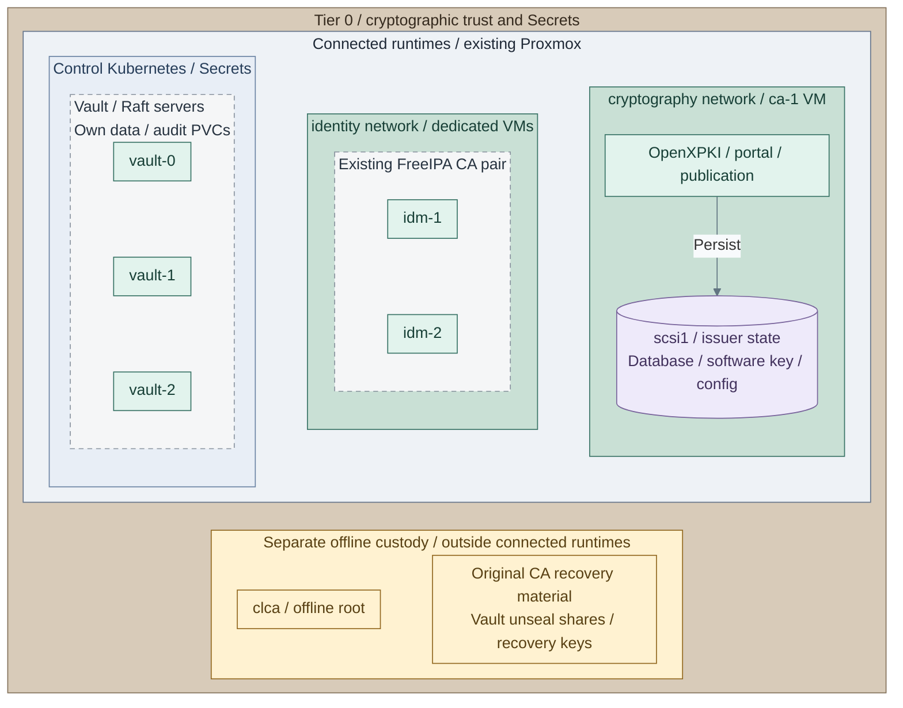

# Cryptography operations

Maintain Cryptographic trust, signing custody and Secrets using the credential-owning
tier. Keep bootstrap and recovery credentials available independently of these services.

**IaC / Manual:** *Figure: Placement of the software issuer, existing FreeIPA CA pair and Kubernetes Vault
after their respective acceptance. Offline root and recovery custody sit below the connected runtimes;
subordinate certificate transfers are manual ceremonies, not online network routes.*
Tier 0 owns the [foundation VM inputs](../../../tier-0/terraform/deployments/foundation/terraform.tfvars.example),
[issuer inputs](../../../tier-0/ansible/group_vars/issuer.yml.example) and
[issuer installer](../../../tier-0/ansible/playbooks/deployment/openxpki.yml);
the [FreeIPA procedure](../../03-deployment/stage-5-identity/procedures/freeipa.md) owns its separate CA.
[Control-application inputs](../../../tier-0/ansible/group_vars/control_applications.yml.example) and
[Vault values](../../../tier-0/ansible/roles/control_applications/templates/vault-values.yml.j2)
define the three servers and their persistence. Custody remains manual and independently recoverable.
This is the main-path reference selection; use the project's completion records for actual acceptance.
[Hardware custody](../../03-deployment/stage-3-trust/README.md#step-1-prepare-issuer-and-key-custody),
[VM Vault](../../03-deployment/stage-6-secrets/step-1b-vault-vm.md) and
[optional OpenBao signing](../../03-deployment/stage-6-secrets/step-11b-openbao.md) have separate selections.

**Design:** [Cryptography](../../01-architecture/08-cryptography/README.md),
[certificate authorities](../../01-architecture/08-cryptography/01-certificate-authority.md)
and [Secrets](../../01-architecture/08-cryptography/08-secrets.md).
**Install:** [Stage 3: Cryptographic trust](../../03-deployment/stage-3-trust/README.md)
and [Stage 6: Secrets](../../03-deployment/stage-6-secrets/README.md).

## Find the configuration

| Owner | Inputs and supported task |
| --- | --- |
| **`<prefix>-tier-0/`** | `ansible/group_vars/issuer.yml` and protected issuer inputs: [CA controls and renewal](certificate-authority.md) |
| **`<prefix>-tier-0/`** | `ansible/group_vars/hsm.yml`, provider/remoting inputs and original key records: [HSM operations](usb-hsm.md) |
| **`<prefix>-tier-0/`**, Kubernetes Vault | `ansible/group_vars/control_applications.yml`, selected Secret owner and original unseal custody: [cluster Vault](../../03-deployment/stage-6-secrets/procedures/vault-kubernetes.md) |
| **`<prefix>-tier-0/`**, VM Vault | `ansible/group_vars/vault.yml`, original inventory/state and protected API inputs: [VM audit/SSO reconciliation](../../03-deployment/stage-6-secrets/step-1b-vault-vm.md#step-4-configure-audit-and-sso) |
| **`<prefix>-tier-0/`**, optional signing environment | `ansible/group_vars/openbao_signing.yml`, `ansible/inventory/signing.yml` and independent state: [signing API reconciliation and recovery](../../03-deployment/stage-6-secrets/step-11b-openbao.md#5-register-original-hsm-keys-and-workload-clients) |
| Credential-owning tier | Secret locations, consumers and rotation authority: [credential handling](secret-handling.md) |
| Selected Ansible repository | Existing encrypted inputs and password custody: [Ansible Vault](ansible-vault.md) |

## Choose a task

| Question | Procedure |
| --- | --- |
| Is the issuer healthy; how are certificates renewed or revoked? | [Certificate authority](certificate-authority.md) |
| How is an issuer recovered? | [Issuer recovery](issuer-recovery.md) |
| How are HSM replicas maintained or signing custody changed? | [USB HSM](usb-hsm.md), [hardware migration](hardware-migration.md) |
| How are signing clients, PIN rotation and independent recovery checked? | [Signing API acceptance](../../03-deployment/stage-6-secrets/step-11b-openbao.md#6-accept-operation-and-independent-recovery); keep original key identity and snapshots separate from hardware backups |
| Which custody controls must remain in place? | [Security controls](security-controls.md) |
| How is a password, token or encrypted input rotated? | [Credential handling](secret-handling.md), [Ansible Vault](ansible-vault.md) |
| How are control-service copies scheduled and Vault snapshots authorized? | [Control backups](../06-resilience/backups/control-applications.md), [snapshot authentication](../06-resilience/recovery/vault-backup-auth.md) |
| How are Vault or NetBox restored? | [Vault recovery](../06-resilience/recovery/vault.md), [NetBox recovery](../06-resilience/recovery/netbox.md) |
| Where are Headlamp and independent monitoring checks? | [Control applications](../../03-deployment/stage-6-secrets/procedures/control-applications.md), [independent monitoring](../../03-deployment/stage-6-secrets/procedures/independent-monitoring.md) |
| How is the Proxmox API certificate trusted or rotated? | [Proxmox TLS](../01-hosting/proxmox-tls.md) |
| How is verified publication operated after trust exists? | [Software intake](../02-software-intake/verified-publication.md) |

Use the [CA acceptance matrix](certificate-authority.md#acceptance-evidence) and selected
stage's initialization, unseal and recovery checks before recording completion.
