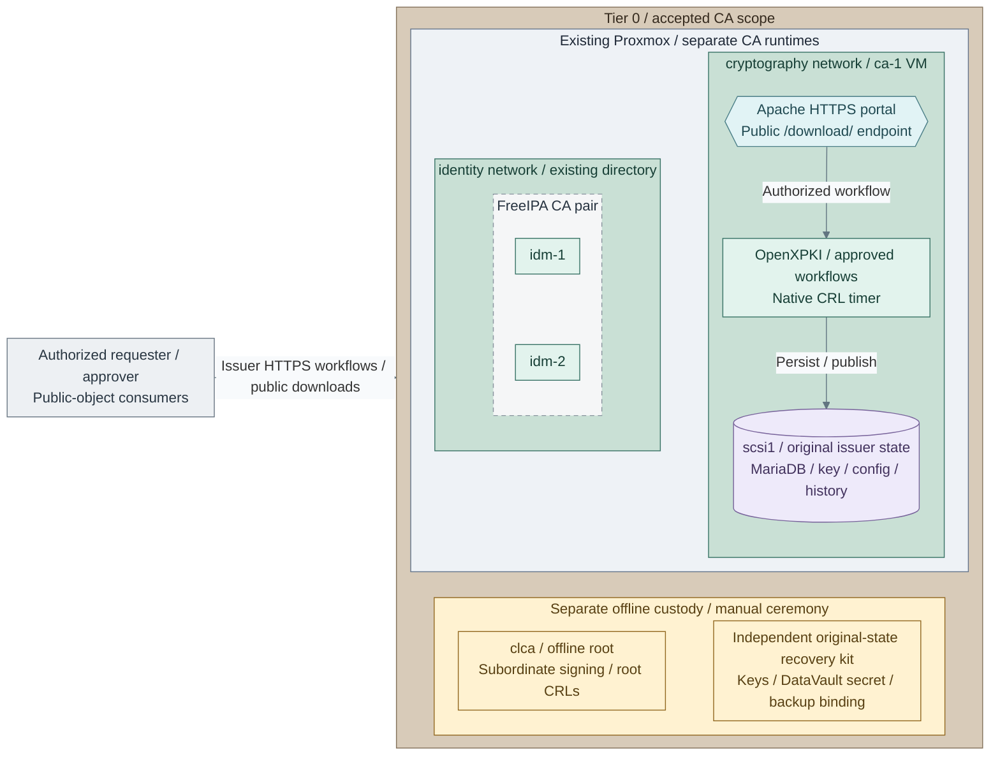

# Certificate authority operations

Maintain the infrastructure issuer, offline root and FreeIPA CA separately.
The [CA design](../../01-architecture/08-cryptography/01-certificate-authority.md) explains
trust and custody; these tasks operate an already accepted issuer.

<a id="figure-ca-operating-scope"></a>



**IaC / Manual:** *Figure: Operating view of the software-backed infrastructure issuer and the separately administered
FreeIPA CA share offline root trust. The issuer portal and public downloads are on `ca-1`;
root signing and certificate transfer remain offline ceremonies below the connected runtimes.*
Tier 0's [foundation inputs](../../../tier-0/terraform/deployments/foundation/terraform.tfvars.example),
[issuer inputs](../../../tier-0/ansible/group_vars/issuer.yml.example) and
[runtime role](../../../tier-0/ansible/roles/openxpki/tasks/main.yml) own the issuer and its attached state;
[portal configuration](../../../tier-0/ansible/roles/openxpki/tasks/portal.yml) owns its HTTPS interface.
The [offline ceremony](../../03-deployment/stage-3-trust/procedures/offline-software-root.md) and
[FreeIPA installation](../../03-deployment/stage-5-identity/procedures/freeipa.md) remain separate operations.
The figure selects software custody; [hardware options](../../03-deployment/stage-3-trust/README.md#step-1-prepare-issuer-and-key-custody)
replace that key/provider contract. Retain the [original recovery set](issuer-recovery.md#capture-a-recovery-set)
and [protected audit path](../06-resilience/protected-logging.md) for the accepted installation.

**Run from:** generated Tier 0 on the independent execution host unless a step
names the issuer or offline system. Keep credentials and private CA state outside Git.
**Before starting:** approved issuer inputs, independent access, current recovery
copies and the original package/configuration/schema binding.

<a id="contents"></a>

## Tasks

- [Is the issuer healthy?](#routine-controls)
- [How is a service certificate renewed?](#how-is-a-service-certificate-renewed)
- [How is a certificate revoked and its CRL published?](#how-is-a-certificate-revoked-and-its-crl-published)
- [How are CA keys, packages or credentials changed?](#change-and-recovery)
- [What evidence is required before closing the change?](#acceptance-evidence)
- [References](#references)

<a id="routine-controls"></a>

## Is the issuer healthy?

1. From Tier 0, with the existing `ansible/group_vars/issuer.yml` and protected
   controller credentials, run the read-only service/configuration/API checks:

   Run from **`<prefix>-tier-0/`** on the protected execution host.

   ```bash
   bash scripts/deploy.sh foundation --recipe maintenance --playbook maintenance/openxpki.yml --ansible-vars ansible/group_vars/issuer.yml
   ```

   Keep the original `--env NAME` if using a named environment. This recipe
   installs no updates and performs no issuance, backup or key initialization.
2. On the issuer, inspect scheduled CRL publication:

   Run on **the existing issuer host**.

   ```bash
   systemctl status openxpki-crl.timer --no-pager
   ```

3. Verify public certificate/CRL downloads from an authorized consumer network,
   current expiry/next-update dates, protected audit arrival and independent alerts.
   The [security checks](security-controls.md) identify required event coverage.

**Stop:** missing key, wrong identity, stale CRL or failed API/configuration checks.
Preserve diagnostics; restore the original state rather than creating another key.
A reachable portal or TCP listener alone is not signing readiness.

## How is a service certificate renewed?

The supplied `tls_server` policy accepts client-held keys and approved DNS names.
It does not provide client-auth, code-signing, subordinate-CA or automatic ACME
issuance. Use the qualified consumer procedure for those different profiles.

1. On the authorized service/recovery host, inspect the current **public** leaf: [2]

   Run on **the authorized service/certificate recovery host**.

   ```bash
   read -r -e -p 'Current service certificate PEM path: ' CURRENT_LEAF
   openssl x509 -in "$CURRENT_LEAF" -noout -subject -issuer -serial -dates -ext subjectAltName
   ```

2. For a new P-384 key/CSR under the approved server policy, use a new protected
   directory outside Git. This command prompts for key encryption; it prints no private key. [3]

   Run on **the authorized service/certificate recovery host**.

   ```bash
   umask 077
   read -r -e -p 'New absolute protected request directory: ' LEAF_WORK
   read -r -p 'Approved service DNS name: ' SERVICE_DNS
   mkdir -m 0700 "$LEAF_WORK" && openssl req -new -newkey ec -pkeyopt ec_paramgen_curve:secp384r1 -keyout "$LEAF_WORK/leaf-key.pem" -out "$LEAF_WORK/leaf.csr" -subj "/CN=$SERVICE_DNS" -addext "subjectAltName=DNS:$SERVICE_DNS"
   ```

   Stop if the directory exists or any command fails. Multiple SANs/other algorithms
   require the approved profile and consumer-specific request procedure; do not
   broaden the CA policy for convenience. Keep the key at its owning service.
3. In the existing infrastructure portal, submit **only the CSR** as the requester
   under `tls_server`; obtain the separate approver's decision. Record workflow ID,
   names, validity and issued serial. Renewal is another approved CSR workflow.
4. Verify the returned chain, SAN, validity and CSR/certificate public-key match: [2][5]

   Run on **the authorized service/certificate recovery host**.

   ```bash
   read -r -e -p 'Returned service certificate PEM path: ' NEW_LEAF
   read -r -e -p 'Approved root certificate PEM path: ' ROOT_CERT
   read -r -e -p 'Approved issuing chain PEM path: ' ISSUER_CHAIN
   openssl verify -CAfile "$ROOT_CERT" -untrusted "$ISSUER_CHAIN" -verify_hostname "$SERVICE_DNS" "$NEW_LEAF"
   openssl x509 -in "$NEW_LEAF" -noout -serial -dates -ext subjectAltName
   openssl req -in "$LEAF_WORK/leaf.csr" -pubkey -noout | openssl pkey -pubin -outform DER | openssl dgst -sha256
   openssl x509 -in "$NEW_LEAF" -pubkey -noout | openssl pkey -pubin -outform DER | openssl dgst -sha256
   ```

   The two public-key hashes must match. Stop on any mismatch or failed validation.
5. Install the leaf/key through the owning service's native certificate procedure;
   retain its key-encryption/unlock contract. Test verified TLS and protected audit
   events from a real client before retiring the old leaf.

**Rollback:** retain the old certificate/key only while still valid and uncompromised.
Use the service's native rollback if cutover fails; do not restore a revoked or
suspect credential. A file-copy or playbook success does not verify client trust.

## How is a certificate revoked and its CRL published?

1. In the issuer portal, identify the exact certificate by serial/fingerprint and
   workflow. Record the approved revocation reason; perform the authorized native
   revocation action. For suspected compromise, use the [incident path](security-controls.md#detect-and-respond).
2. On the issuer, as the authorized custodian, request native CRL publication: [1]

   Run on **the issuer host as the authorized CA custodian**.

   ```bash
   sudo -u openxpki oxi --auth-key /srv/openxpki/keys/cli.pem workflow create --realm infrastructure --type crl_issuance
   ```

   Use the actual realm when different. Inspect the workflow to completion; its
   creation ID alone does not prove publication. Keep CLI-key use audited.
3. From a consumer, download the configured public DER CRL and verify it with the
   independently approved issuer certificate: [4]

   Run on **an authorized CRL consumer**.

   ```bash
   read -r -p 'Configured issuer CRL URL: ' ISSUER_CRL_URL
   read -r -e -p 'Approved issuer certificate PEM path: ' ISSUER_CERT
   CRL_CHECK_DIR="$(mktemp -d)"
   curl --fail --show-error --output "$CRL_CHECK_DIR/issuer.crl" "$ISSUER_CRL_URL"
   openssl crl -inform DER -in "$CRL_CHECK_DIR/issuer.crl" -CAfile "$ISSUER_CERT" -verify -noout -issuer -lastupdate -nextupdate -text
   ```

4. Confirm the revoked serial and current dates, then prove an enforcing client
   rejects it. Keep independent stale-CRL alerts. Publishing a CRL does not force
   every browser/client to consult it; no OCSP service is supplied by this path.

**Stop:** wrong issuer/signature, missing serial or stale publication. Repair delivery
without undoing revocation or weakening client checks. Root CRLs are renewed only
through the [offline root ceremony](../../03-deployment/stage-3-trust/procedures/offline-software-root.md#publish-and-preserve-state),
not the online issuer command. FreeIPA's CA uses its own native administration.

<a id="change-and-recovery"></a>

## How are CA keys, packages or credentials changed?

1. [Capture a current recovery set](issuer-recovery.md#capture-a-recovery-set).
   Preserve the binding, schema receipt, DataVault secret, latest database/history,
   provider key and independent portal/TLS/controller recovery inputs.
2. Select the operation; routine convergence cannot substitute for its native lifecycle:

   | Change | Required route |
   | --- | --- |
   | Key/provider/algorithm or CA rollover | [Hardware/custody migration](hardware-migration.md), approved overlap and native token lifecycle |
   | Root key or subordinate signing | Separate authorized [offline ceremony](../../03-deployment/stage-3-trust/procedures/offline-root.md) |
   | Package/configuration/schema | Isolated restored rehearsal and product-specific migration; routine binding checks reject a new archive/package set |
   | Database/session/DataVault credentials | Separate tested product migration; changing YAML or deleting `deployment.json` is not rotation |
   | Lost/failed issuer | [Clean-target recovery](issuer-recovery.md#prepare-and-restore-a-clean-target), with the old writer fenced |

3. Accept the isolated result before cutover. Never run two copies of the same CA
   as independent writers or return to older issuance/revocation state after new writes.
   A second HSM or VIP does not establish application/database/session HA.

<a id="acceptance-evidence"></a>

## What evidence is required before closing the change?

| Exercise | Required result |
| --- | --- |
| Issue, renew and revoke | Intended roles work; self-approval, unapproved names/usages and CA requests fail |
| Publication | Correct chains and fresh issuer/root CRLs; revoked serial rejected by an enforcing client |
| Provider loss | Selected key identity, permitted mechanisms and restore work after device/host restart or loss |
| Audit and alerts | Attributable issuer events reach Tier 0; alerts work without portal, SSO or Tier 1 |
| Recovery/rollback | Latest identity, serial/revocation history and DataVault contents recovered without later-tier services |
| Optional enrollment adapter | Real issuance/renewal, denial, timeout, workflow correlation and adapter-state restoration pass |

Keep workflow IDs, public fingerprints, backup IDs, denied tests and RPO/RTO in
private project records. A running package or successful VM apply is not acceptance.

## References

Native interfaces checked 2026-11-08; qualify against the deployed package revision.

1. [OpenXPKI native CLI, token and DataVault operations](https://github.com/openxpki/openxpki-config/blob/community/QUICKSTART.md).
2. [OpenSSL certificate inspection](https://docs.openssl.org/3.5/man1/openssl-x509/).
3. [OpenSSL CSR and encrypted key generation](https://docs.openssl.org/3.5/man1/openssl-req/).
4. [OpenSSL CRL verification](https://docs.openssl.org/3.5/man1/openssl-crl/).
5. [OpenSSL chain and hostname verification](https://docs.openssl.org/3.5/man1/openssl-verify/).
