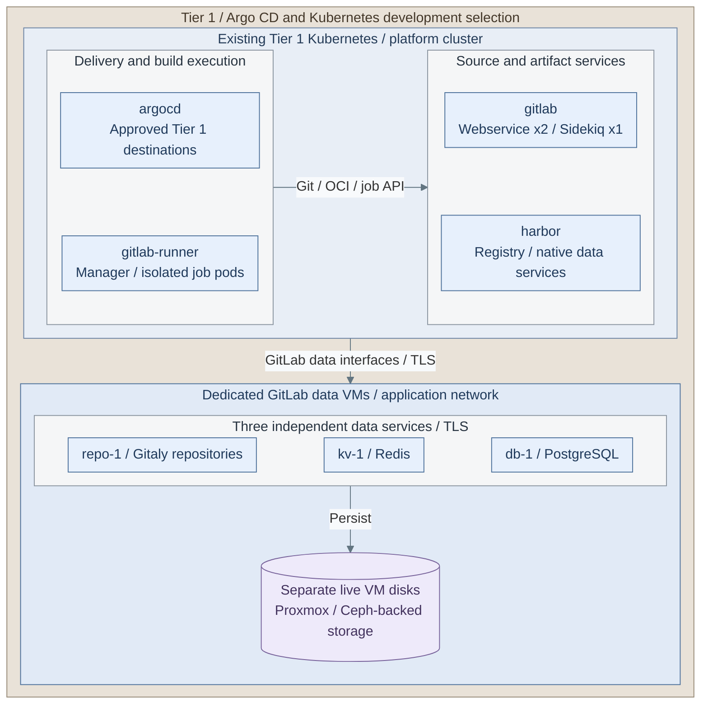

# Delivery and development operations

Maintain the selected controller, approved artifact interfaces, source control and runners.
Use the existing installation inputs; changing a release pin also requires the product's
version-specific migration and rollback procedure.

**IaC / Integration:** *Figure: Operating view of the selected Argo CD, Harbor and Kubernetes GitLab/build services,
including GitLab's dedicated data VMs. Chart boxes aggregate their native component sets;
each of the three data VMs retains its own live disk.*
In **`<prefix>-tier-1/`**, [delivery inputs](../../tier-1/ansible/group_vars/delivery_platform.yml.example)
and the [delivery installer](../../tier-1/ansible/playbooks/deployment/delivery-platform.yml) own Argo CD/Harbor;
[development inputs](../../tier-1/ansible/group_vars/development_platform.yml.example) and the
[development installer](../../tier-1/ansible/playbooks/deployment/development-platform.yml) own GitLab/runners.
The [data VM inputs](../../tier-1/terraform/deployments/development-data/terraform.tfvars.example) and
[data installer](../../tier-1/ansible/playbooks/deployment/development-data.yml) own the three data guests.
Existing identity, object storage and backup services retain their own custody.
[Spinnaker](../03-deployment/stage-7-delivery/step-2b-spinnaker.md),
[standalone GitLab](../03-deployment/stage-9-development/step-1b-source-control-vm.md) and
[Podman builds](../03-deployment/stage-9-development/step-14b-podman-runner.md) are replacement selections.
Protected Tier 0 infrastructure execution has its own
[runtime and explicit CI-trust boundary](../03-deployment/stage-9-development/README.md#figure-infrastructure-handover).

**Design:** [Delivery](../01-architecture/10-delivery/README.md) and the
[Development platform](../01-architecture/10-delivery/03-development-platform.md).
**Install:** [Stage 7: Delivery](../03-deployment/stage-7-delivery/README.md) and
[Stage 9: Development platform](../03-deployment/stage-9-development/README.md).

## Find the configuration

In **`<prefix>-tier-1/`**, retain the accepted cluster context and protected inputs:

| Service | Configuration | Implementing playbook |
| --- | --- | --- |
| Harbor and selected Argo CD or Spinnaker | `ansible/group_vars/delivery_platform.yml` and its selected secret inputs | [`deployment/delivery-platform.yml`](../../tier-1/ansible/playbooks/deployment/delivery-platform.yml) |
| GitLab and Kubernetes build runners | `ansible/group_vars/development_platform.yml` and `development_platform_secrets.yml` | [`deployment/development-platform.yml`](../../tier-1/ansible/playbooks/deployment/development-platform.yml) |
| Standalone GitLab VM | `ansible/group_vars/development.yml` and its protected SSO/backup inputs | [`deployment/source-control-vm.yml`](../../tier-1/ansible/playbooks/deployment/source-control-vm.yml) |
| Kubernetes GitLab's data VMs | `ansible/group_vars/development_data.yml` and its protected credentials | [`deployment/development-data.yml`](../../tier-1/ansible/playbooks/deployment/development-data.yml) |
| Podman build runner | `ansible/group_vars/podman_runner.yml` and protected runner credentials | [`deployment/podman-runner.yml`](../../tier-1/ansible/playbooks/deployment/podman-runner.yml) |

Tier 0's protected infrastructure runner has separate ownership and credentials:
use the [infrastructure-runner procedure](../03-deployment/stage-9-development/procedures/infrastructure-runner.md).
Cluster integration directories are separate from these native Ansible installers.

## Choose a task

| Question | Procedure |
| --- | --- |
| How is an accepted installation reconciled? | Repeat the selected [Stage 7](../03-deployment/stage-7-delivery/README.md#main-path) or [Stage 9](../03-deployment/stage-9-development/README.md#main-path) procedure with its existing inputs and render/apply review |
| How are upgrades and rollback prepared? | [Upgrade gate](01-hosting/maintenance.md#upgrade-gate) |
| Which VM or edge maintenance recipe applies? | [Recipe map](01-hosting/ansible-recipes.md#recipe-map) |
| How are GitLab data VMs backed up? | [GitLab data backups](06-resilience/backups/gitlab-data.md) |
| How is the standalone GitLab VM backed up or restored? | [Run its commissioned backup](../03-deployment/stage-9-development/step-1b-source-control-vm.md#5-accept-sso-and-the-first-independent-recovery-set), then [restore an isolated matching-image target](../03-deployment/stage-9-development/step-1b-source-control-vm.md#recover-an-isolated-matching-image-target) |
| How are registry, controller or GitLab data recovered? | [Tier 1 product recovery](06-resilience/recovery/tier-1-products.md) |
| How are shared credentials rotated? | [Credential handling](03-cryptography/secret-handling.md) |
| How are user and administrator rights changed? | [Identity operations](04-identity.md) |

The standalone GitLab recipe owns native OIDC configuration, scheduled encrypted backups and
controller-driven recovery. Its bundled data is separate from the Kubernetes alternative's data VMs;
use the recovery procedure for the selected realization. These recipes reconcile configuration;
product upgrades still require their version-specific migration and rollback checks.
Record access, supply and restore evidence in the project deployment record.
