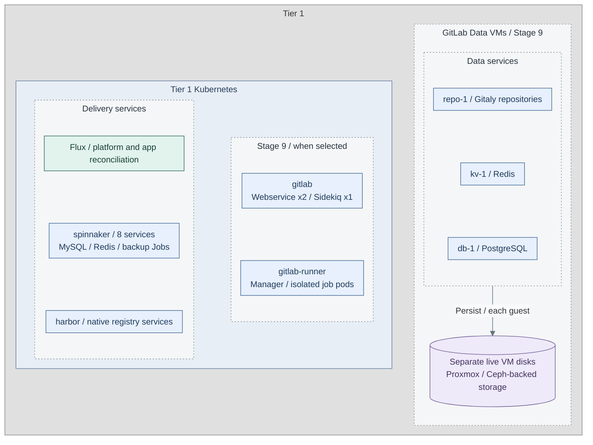

# Delivery and development operations

**Related:** [Architecture](../01-architecture/10-delivery/README.md) ·
[Delivery deployment](../03-deployment/stage-07-delivery/README.md) ·
[Development deployment](../03-deployment/stage-09-development/README.md)

[Development platform design](../01-architecture/10-delivery/03-development-platform.md) covers source
control, data services and runner responsibilities shared by this operating guide.

Tier 1 Flux owns selected Kubernetes platform services and application reconciliation. Spinnaker
approves/promotes application Git; external authorized maintenance advances platform revisions and
repairs Flux independently. Terraform/Ansible retain infrastructure and non-Kubernetes services.

<a id="figure-delivery-operating-scope"></a>



*Figure: Selected Tier 1 delivery realization with optional later GitLab/build services and their
three external data VMs. Each data guest retains its own disk; the disk aggregate does not imply
replication or a joint recovery point. Observability retains its separate Stage 8 operating view.*
[Source mapping and design](../01-architecture/10-delivery/flux-ownership.md),
[render record](../08-reference/diagrams/tier1-flux-ownership-render.md),
[delivery inputs](../../tier-1/ansible/group_vars/delivery_platform.yml.example),
[development inputs](../../tier-1/ansible/group_vars/development_platform.yml.example),
[data-VM inputs](../../tier-1/terraform/deployments/development-data/terraform.tfvars.example),
[bootstrap role](../../shared/ansible/roles/cluster_platform),
[external maintenance role](../../shared/ansible/roles/flux_maintenance).
The [ownership flow](../01-architecture/10-delivery/flux-ownership.md#figure-tier1-flux-ownership)
shows bootstrap, separate source permissions and independent recovery. Tier 0 retains its own Flux
and infrastructure authority; Argo CD/direct Spinnaker and standalone GitLab remain explicit alternatives.

## Contents

- [Find the owner](#find-the-owner)
- [Inspect accepted revisions](#inspect-accepted-revisions)
- [Prepare independent custody](#prepare-independent-custody)
- [Serve accepted recovery sources](#serve-accepted-recovery-sources)
- [Advance an approved platform revision](#advance-an-approved-platform-revision)
- [Operate promotions and pipeline definitions](#operate-promotions-and-pipeline-definitions)
- [Suspend and recover applications](#suspend-and-recover-applications)
- [Choose another task](#choose-another-task)

## Find the owner

| Scope | Inputs / owner |
| --- | --- |
| Bootstrap/platform sources and initial Flux | Tier 1 `cluster_platform.yml` / encrypted `cluster_platform_secrets.yml`; shared bootstrap role |
| Authorized source maintenance | Tier 1 `flux_maintenance.yml`; shared `flux_maintenance` role on an independent execution host |
| Spinnaker/Harbor payload | `delivery_platform.yml` and private secrets; native render/export, then platform Flux |
| Observability payload | `observability_platform.yml` and private secrets; Stage 8 native render/export, then platform Flux |
| GitLab/runner payload | `development_platform.yml` and private secrets; Stage 9 native render/export, then platform Flux |
| Application promotion and pipeline import | `delivery_promotion.yml`; versioned pipeline/worker and repeatable Gate import |
| GitLab data VMs / standalone GitLab / Podman runner | Existing infrastructure/product recipes; no ownership transfer to Kubernetes Flux |

All paths are in **`<prefix>-tier-1/`**. Role defaults retain legacy Ansible ownership; fresh selected
inputs explicitly choose Flux. [Adoption](../03-deployment/stage-07-delivery/procedures/flux-adoption.md)
disables old writers/tokens before reconciliation. Argo CD/direct Spinnaker remain explicit alternatives.
Do not repeat direct Ansible apply against Flux-owned components.

<a id="figure-delivery-data-interfaces"></a>

GitLab's PostgreSQL, Redis and Gitaly endpoints remain owned by
[the data-VM procedure](../03-deployment/stage-09-development/procedures/data-services.md).
GitLab consumes them over verified TLS; runner pods use GitLab/job interfaces. Flux deployment
does not move those data services into Kubernetes or recover their contents.

## Inspect accepted revisions

On **the independent authorized execution host**, from **`<prefix>-tier-1/`**, initialize local inputs:

```bash
bash scripts/init-local-files.sh --setup flux-maintenance
```

Set the exact Tier 1 kubeconfig/context in `ansible/group_vars/flux_maintenance.yml`.
For inspection select `flux_maintenance_operation: inspect` and run:

```bash
ANSIBLE_CONFIG=ansible/ansible.cfg ansible-playbook -i localhost, \
  ansible/playbooks/deployment/flux-maintenance.yml \
  -e @ansible/group_vars/flux_maintenance.yml -e flux_maintenance_action=apply
```

Inspect is read-only to the cluster and exports private
`secrets/flux-maintenance/accepted-revisions.json`. Record source URLs, exact accepted commits,
application suspension and intended workload health. Render mode alone writes the proposed operation
without reading cluster state. Do not mistake that proposal for accepted revisions.

## Prepare independent custody

Before source advancement, retain actual Git commits and pinned artifacts outside the recovering
services. Use the accepted revision record above and three independently checked-out repositories.
The artifact lock binds all three approved source commits and names actual retained files; export
copies/checksums them. Its independently retained digest protects configuration as well as artifacts.
Protect packages containing encrypted inputs and retain decryption keys separately.

The reviewed `lock.json` uses paths relative to its own directory, for example:

```json
{
  "sources": {
    "platform": "REPLACE_WITH_APPROVED_BOOTSTRAP_COMMIT",
    "tier1-platform": "REPLACE_WITH_APPROVED_PLATFORM_COMMIT",
    "tier1-applications": "REPLACE_WITH_APPROVED_APPLICATION_COMMIT"
  },
  "files": [{"path": "charts/accepted-chart.tgz", "sha256": "REPLACE_WITH_APPROVED_64_HEX_SHA256"}]
}
```

Include all needed chart/image/tool archives, not just metadata. Keep its independently approved
SHA-256 as `flux_maintenance_artifact_lock_sha256` and retain it separately from the package.

From **`<prefix>-tier-1/`** on the external host, fill the paths and approved commit as environment
variables before executing this example. `RECOVERY_PACKAGE_NEW` names a new independent destination;
`ARTIFACT_LOCK` names the reviewed JSON artifact lock:

```bash
python3 scripts/flux-recovery.py export \
  --record secrets/flux-maintenance/accepted-revisions.json \
  --repository "platform=$BOOTSTRAP_REPOSITORY" \
  --repository "tier1-platform=$PLATFORM_REPOSITORY" \
  --repository "tier1-applications=$APPLICATION_REPOSITORY" \
  --replace "tier1-platform=$APPROVED_PLATFORM_COMMIT" \
  --artifacts "$ARTIFACT_LOCK" --output "$RECOVERY_PACKAGE_NEW"
```

Export bundles the actual source commits and copies/checksums every selected artifact file. Retain
the receipt, custodians, artifact lock, independent source URLs and a clean-host retrieval/verification
result. A successful local export does not prove the independent storage or outage retrieval works.
For a bootstrap update replace `platform` explicitly; never repoint an application promotion credential.

## Serve accepted recovery sources

On **the recovered independent bootstrap host**, from **`<prefix>-tier-1/`**:

```bash
bash scripts/init-local-files.sh --setup flux-recovery-git
```

Edit `ansible/group_vars/flux_recovery_git.yml`: retained package path, independently approved
artifact-lock SHA-256, original application branch and three distinct source SSH public keys.
Verify the host's private SSH identity through independent custody and retain its `known_hosts` pin.
Run the native local recovery server recipe; it uses become on this host:

```bash
ANSIBLE_CONFIG=ansible/ansible.cfg ansible-playbook -i localhost, \
  ansible/playbooks/deployment/flux-recovery-git.yml \
  -e @ansible/group_vars/flux_recovery_git.yml
```

The role verifies/restores root-owned bare bundles and serves each key only its selected
`git-upload-pack`, with forced commands, `git-shell` and no forwarding. It replaces that recovery
account's authorized keys and preserves existing SSH/firewall policy. Commission permitted Tier 1
node/API connectivity explicitly; no broad firewall rule is added.
Existing SSH `AllowUsers` / `AllowGroups` restrictions may require adding the `flux-recovery` service
identity through the owning bootstrap/host-security configuration. Qualify that specific identity and
firewall path there; the recovery role intentionally does not weaken SSH or network policy.

Use `ssh://flux-recovery@<bootstrap>/srv/flux-recovery/platform.git`, `tier1-platform.git` and
`tier1-applications.git` as the three independent source URLs, with separate read-only private keys
and pinned host trust. Bootstrap/platform remain exact accepted commits. This works before GitLab,
Harbor, Spinnaker or Kubernetes exists. The package's artifact files still need accepted offline
intake/registry loading before node pulls; serving Git does not serve container images.
Private keys, Terraform state and service-data backups retain their independent custody paths.

## Advance an approved platform revision

1. Render the selected native payload and review its actual diff, lifecycle Job revisions and pins.
   Follow the manual signed-commit/push policy and retain a product-compatible rollback plan.
2. Export the candidate custody package above. Set `flux_maintenance_operation: advance`,
   `flux_maintenance_source: tier1-platform`, the exact `flux_maintenance_revision`,
   `flux_maintenance_recovery_directory`, independently approved artifact-lock SHA-256, and only then
   set approval/custody acknowledgements.
3. Populate `flux_maintenance_health_checks` with affected Kustomizations/HelmReleases and required
   conditions. Unrelated Ready resources do not establish this update's health.
4. Run the maintenance playbook with `flux_maintenance_action=render`, inspect
   `secrets/flux-maintenance/proposed-change.json`, then run the same inputs with
   `flux_maintenance_action=apply`.

The role verifies the package before updating the source and waits for exact source/root revision
and explicit affected health. Bootstrap `platform` stays immutable unless separately approved;
Flux's `flux2` HelmRelease upgrades through `platform-base` in the platform source.
This route requires no Spinnaker. It still requires independently reachable approved Git/artifacts.

On failure, keep the affected source/consumers fenced and inspect the actual revision/conditions.
Do not advance another revision to hide a failed migration. A Git revert cannot reverse database
schema changes; follow [the upgrade gate](01-hosting/maintenance.md#upgrade-gate).

## Operate promotions and pipeline definitions

From **`<prefix>-tier-1/`**, initialize `--setup delivery-promotions`; edit
`ansible/group_vars/delivery_promotion.yml` using its exact schema. Retain a real digest-pinned
worker image independently, a bot credential limited to the separate application project and a
separate signing key. The Run Job account is confined to `delivery-promotion`; application status
is read-only and direct application/platform writes are denied.

Render with `ansible/playbooks/deployment/delivery-promotions.yml` and
`delivery_promotion_action=render`. Review the private resource/pipeline artifacts and publish the
promotion resources through platform Flux. With authenticated private Gate headers, rerun the same
playbook with `delivery_promotion_action=import` to create/update stable pipeline IDs repeatably.
Keep credentials encrypted in private inputs; never publish Gate headers or Git/signing Secrets.

Run **from `<prefix>-tier-1/`**, with encrypted private Gate headers supplied through an approved Vault
identity when importing:

```bash
ANSIBLE_CONFIG=ansible/ansible.cfg ansible-playbook -i localhost, \
  ansible/playbooks/deployment/delivery-promotions.yml \
  -e @ansible/group_vars/delivery_promotion.yml -e delivery_promotion_action=render
```

For direct Flux export set `delivery_promotion_flux_output`,
`delivery_promotion_flux_sops_age_recipients` and component dependencies in the same inputs. Provision
`delivery-promotion-git` (`username`, `password`) and `delivery-promotion-signing` (`key`, SSH Ed25519)
through the selected encrypted Secret owner before Jobs start. The resource renderer does not invent
those credentials. Keep their public signing key and independent private recovery copy.

Request an exact image digest, immutable application configuration revision, target and expected
delivery-branch head. Review the proposed change, give the authorized manual judgment, then require
the intended Flux revision and relevant workload/Helm health. A stale head requires a fresh approval;
retrying an already published exact candidate observes it, while a superseded revision cannot succeed.
Rollback uses a new approved signed Git change and application/data compatibility evidence.

[Approval controls](../01-architecture/10-delivery/approval-controls.md) document role/API/Git bypasses,
one judgment, possible self-approval and administrator authority. The executor can create arbitrary
Jobs in its permitted namespace and access their mounted promotion credentials: treat that identity
as trusted promotion authority, not an unbypassable independent approval service.
Pipeline imports manage database configuration; Flux managing Spinnaker's pods does not do that import.

## Suspend and recover applications

Set maintenance operation `suspend` for `tier1-applications` and review/apply from the external host.
Fence webhooks, runners, bot credentials and stale Orca executions separately.
For application recovery, select `recover` with the accepted exact application commit: this pins the
source and keeps reconciliation suspended. Perform actual
[product restoration](06-resilience/recovery/tier-1-products.md) before resuming.

Operation `resume` requires the independently accepted application head revision,
`flux_maintenance_data_restored: true` and
`flux_maintenance_executions_fenced: true` after actual checks. Resume returns application delivery
to its protected branch while still suspended, waits for the exact approved head SHA, then unfences
only after data and execution fencing are accepted. Reimport reviewed pipeline
definitions before enabling new triggers; restoration must not replay stale promotions.

## Choose another task

| Task | Procedure |
| --- | --- |
| Fresh platform/bootstrap | [Flux installation](../03-deployment/stage-07-delivery/procedures/flux-platform.md) |
| Existing-resource transfer | [Flux adoption](../03-deployment/stage-07-delivery/procedures/flux-adoption.md) |
| Live acceptance and outage tests | [Acceptance matrix](../03-deployment/stage-07-delivery/procedures/flux-platform.md#promotion-and-acceptance) |
| Product data and total Tier 1 recovery | [Tier 1 recovery](06-resilience/recovery/tier-1-products.md) |
| GitLab data backups | [GitLab data](06-resilience/backups/gitlab-data.md) |
| Standalone GitLab | [VM backup/restore](../03-deployment/stage-09-development/step-1b-source-control-vm.md) |
| Credentials / identities | [Secret handling](03-cryptography/secret-handling.md) / [Identity](04-identity.md) |

Record accepted revisions, custody receipt, checks and measured recovery results in the project
deployment record. Source/render checks are distinct from live authorization, data recovery and HA.
