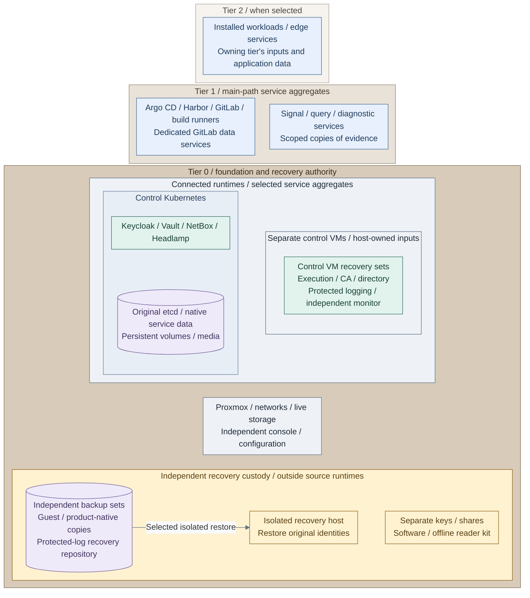

# Operations and resilience

Recover Tier 0 independently, preserve evidence before rebuilding, then restore
platform services and workloads. Offline investigation does not require a running platform.
The [service-boundary design](../../01-architecture/02-organization/README.md) explains this recovery independence.

**Design:** [Operations and resilience](../../01-architecture/11-operations/README.md).

**IaC / Manual:** *Figure: Recovery coverage of the completed main paths, grouped by owning tier and runtime.
The only traffic arrow is an isolated restore; placement and shared custody imply no administrative access.*
The selected reference uses NAS file backups and the separate protected-log recovery path.
The owning [Tier 0 foundation inputs](../../../tier-0/terraform/deployments/foundation/terraform.tfvars.example),
[control-service inputs](../../../tier-0/ansible/group_vars/control_applications.yml.example),
[Tier 1 delivery/development view](../05-delivery.md#figure-delivery-operating-scope) and
[observability view](observability.md#figure-observability-operating-scope) define the named aggregates.
The [guest backup contract](backups/virtual-machines.md#nas-file-target),
[control-copy job](../../../tier-0/ansible/playbooks/maintenance/control-backup.yml),
[control-copy inputs](../../../tier-0/ansible/group_vars/control_backup.yml.example) and
[logging pipeline](protected-logging.md#figure-protected-logging-operations) own the selected capture paths.
Guest backup/storage commissioning and native product captures retain their documented owners;
the [recovery-set record](backups/recovery-set.md) identifies actual coverage, independent locations and acceptance.
[PBS](backups/virtual-machines.md#pbs-reference) is an alternative guest-backup target.

## Keep the system healthy

| Task | Procedure |
| --- | --- |
| Check Protected logging, retention and offline evidence | [Logging operations](protected-logging.md), [fault and recovery drill](logging-drill.md) |
| Reconcile Observability and verify telemetry sources | [Observability operations](observability.md) |
| Plan service or host maintenance | [Maintenance gate](../01-hosting/maintenance.md) |

## Protect recovery copies

| Task | Procedure |
| --- | --- |
| Capture everything needed outside the platform | [Recovery set](backups/recovery-set.md) |
| Schedule and verify guest backups | [VM backups](backups/virtual-machines.md) |
| Protect CA, Vault and control-service data | [Control backups](backups/control-applications.md) |
| Back up PostgreSQL or GitLab data VMs | [PostgreSQL](backups/postgresql.md), [GitLab data](backups/gitlab-data.md) |

The remaining tasks start from a failure. Keep backup age, copy independence and actual
restore results in the project recovery record.

## Find a task

| Failure or task | Start here |
| --- | --- |
| Bootstrap execution host is lost | [Restore the bootstrap VM and original workspace](recovery/bootstrap.md) |
| One VM is lost or needs an older recovery point | [Restore a VM, validate data and reconcile IaC](recovery/virtual-machines.md) |
| Host died; no HA recovered its guests | [Host recovery](recovery/host.md) |
| All hypervisors/storage were recreated | [Whole-platform recovery](recovery/platform.md) |
| Service-native data or identity restore | [Product procedures](recovery/README.md#service-data-and-identities) |

- [What must survive outside the platform?](#recovery-inputs)
- [What is the first action after total loss?](#first-action)
- [In what order are services restored?](#recovery-order)
- [Which restore procedure applies?](#product-procedures)

## What must survive outside the platform?

Use the [recovery-set checklist and capture routine](backups/recovery-set.md). It owns the
required bootstrap disks, original inputs/state, software, host/network/storage records,
service data and independent credentials/keys. The [backup schedule](backups/virtual-machines.md#schedule-and-run)
and [product backup jobs](backups/control-applications.md) must protect those selected datasets.
Record actual backup IDs/age and restore results in project records; a job definition alone is insufficient.

## What is the first action after total loss?

**Work from:** a trusted isolated recovery host and the independently held recovery kit.
**Prerequisites:** authorized custody, readable backups and original keys/state. Do not depend on hosted SSO or CI.

1. Stop competing workstation/runner writers. Preserve surviving disks and logs before rebuilding.
2. Prepare independent network/console/backup access and the minimum replacement host using
   [platform recovery](recovery/platform.md). A bootstrap VM cannot restore its own missing hypervisor.
3. [Restore the bootstrap VM](recovery/bootstrap.md), including every required disk, then recover the latest
   coherent original state/inputs. Keep the tier/Shared sibling layout and recorded revisions.
4. Follow [original-state recovery](recovery/original-state-etcd.md#recover-original-state) before any apply.
   Verify backup IDs, key availability, state lineage and resource addresses. Restore the selected
   guests/services before committing a refresh that would forget resources still awaiting recovery.

**Expected:** the original deployment identity is recovered before provisioning resumes.
**Stop:** on missing state/keys, unexplained resource differences or evidence of compromise.
Do not substitute empty state, initialize new CA/Vault keys or bootstrap a new cluster identity to hide missing recovery data.

## In what order are services restored?

| Order | Action | Acceptance |
| --- | --- | --- |
| 1 | Isolate affected systems and preserve surviving logs/disks before rebuilding | Authorized [offline investigation](protected-logging.md#offline-investigation) works from a protected copy; original evidence is unchanged |
| 2 | Recover Tier 0 console/network/storage access and bootstrap tools | Independent local credentials, recovery keys and backup access work without SSO or Tier 1/2 |
| 3 | Restore approved software supply and Tier 0 protected evidence storage | Retained artifacts can satisfy initial supply; new recovery events are retained separately and buffered sources replay with gaps accounted for |
| 4 | Restore Tier 0 trust, identity and control services in prerequisite order | Selected PKI, directory and cluster functions verified before dependent consumers |
| 5 | Restore Tier 1 platform and scoped analytics | Search indexes rebuilt from approved copies; no delete authority over Tier 0 evidence |
| 6 | Restore Tier 2 workloads and their integrations | Service data, access scopes and collection verified |

For hardware-only outages, preserve evidence without unnecessarily delaying safe
intake restoration. Suspected compromise requires a clean recovery environment;
reconnecting old disks or credentials must not reintroduce the compromised authority.
Use the [deployment stages](../../03-deployment/README.md) for service-specific prerequisites,
the [backup guide](backups/virtual-machines.md) for recovery objectives and restore validation, and
[secret strategy](../03-cryptography/secret-handling.md) for protected recovery material.
For the software issuer, follow the [clean-target restore procedure](../03-cryptography/issuer-recovery.md),
not fresh key creation or initial token activation.

## Which restore procedure applies?

The [product recovery index](recovery/README.md) provides clean-target procedures for original
inputs/state and etcd, FreeIPA/CA, Vault, CNPG databases, Keycloak, NetBox/media and Tier 1 data.
Install [scheduled control backup transport](backups/control-applications.md) before accepting
the dependent services. Preserve the selected database/media recovery points and independent keys;
a fresh bootstrap or an empty application deployment is not a restore.

1. Select the affected product in that index and match the backup to its original version/configuration.
2. Restore on isolated capacity; keep duplicate guest identities and credentials off live networks.
3. Verify data, permitted/denied access, logs and a measured recovery point/time before reconnecting consumers.

**Stop/rollback:** keep failed restores isolated and preserve their diagnostics. Return to the retained
backup and a fresh clean target; never overwrite the only surviving evidence or recovery set.
