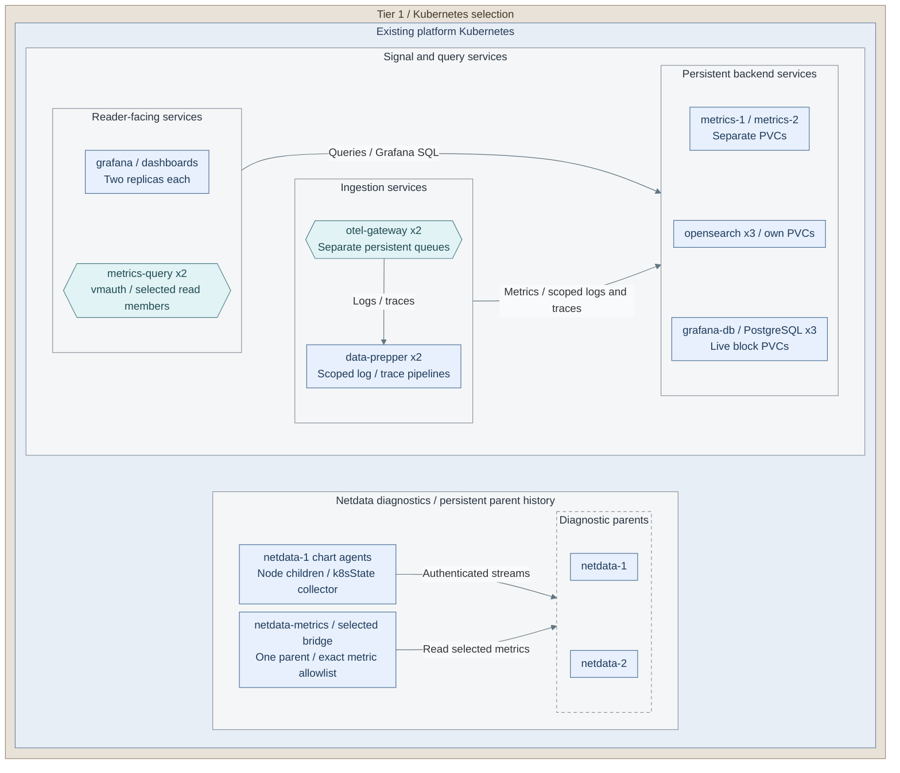
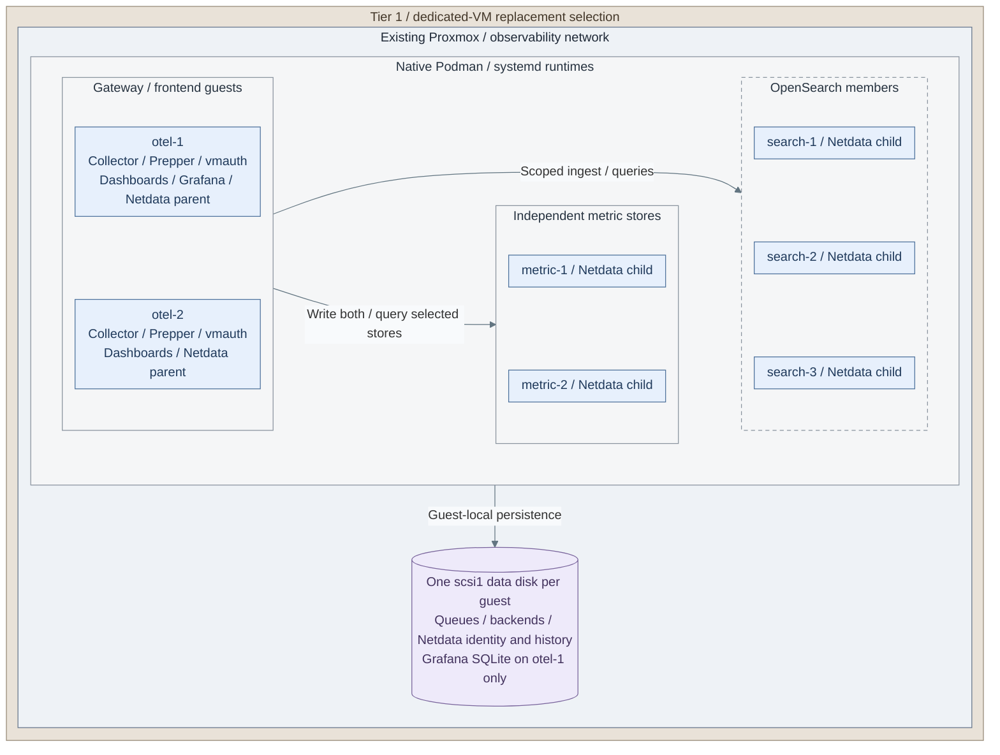

# Observability operations

Operate diagnostics, infrastructure health and scoped telemetry. Protected originals
remain under [protected logging](protected-logging.md); search projections have separate retention.

<a id="figure-observability-operating-scope"></a>



**IaC / Integration:** *Figure: The Kubernetes main-path signal, query, database and diagnostic workload set.
Backend boxes aggregate native members and their attached persistence; replica counts alone are not availability evidence.
The diagnostic bridge supplies allowlisted metrics to the ingestion group; the overview separates their placement.*
In **`<prefix>-tier-1/`**, [platform inputs](../../../tier-1/ansible/group_vars/observability_platform.yml.example),
[release composition](../../../tier-1/ansible/roles/observability_platform/templates/releases.yml.j2),
[database resources](../../../tier-1/ansible/roles/observability_platform/templates/grafana-database.yml.j2) and the
[installer](../../../tier-1/ansible/playbooks/deployment/observability-platform.yml) own this scope.
[Netdata values](../../../tier-1/ansible/roles/observability_platform/templates/netdata-values.yml.j2)
enable node/state collection only in the `netdata-1` release; the metric bridge is selected by its allowlist.
The [VM selection](#figure-observability-vm-operations) replaces these Kubernetes workloads.
[Tier 0 infrastructure collection](../../03-deployment/stage-8-observability/step-13-infrastructure-monitoring.md),
[optional protected-log projections](../../03-deployment/stage-8-observability/step-14b-protected-log-search.md) and
[database backups](backups/postgresql.md) retain separate inputs and acceptance.

**Design:** [Observability](../../01-architecture/11-operations/03-observability.md).
**Install and acceptance:** [Stage 8](../../03-deployment/stage-8-observability/README.md).

## Table of contents

- [Find the configuration](#find-the-configuration)
- [Reconcile dedicated VMs](#how-are-dedicated-vms-reconciled)
- [Maintain VM diagnostics](#how-are-vm-diagnostics-maintained)
- [Render and apply Kubernetes configuration](#how-is-accepted-configuration-reapplied)
- [Choose maintenance or recovery](#which-maintenance-or-recovery-task-applies)

## Find the configuration

In **`<prefix>-tier-1/`**, edit the inputs for the selected runtime:

| Runtime | File | Purpose |
| --- | --- | --- |
| Kubernetes | `ansible/group_vars/observability_platform.yml` | Cluster/context, source scopes, chart pins, storage, access and recovery |
| Kubernetes | `ansible/group_vars/observability_platform_secrets.yml` | Protected credentials, service identities and Netdata stream keys |
| Kubernetes | [Platform defaults](../../../tier-1/ansible/roles/observability_platform/defaults/main.yml) | Available settings |
| Dedicated VMs | `ansible/group_vars/observability.yml` | Guest endpoints, image pins, source scopes, diagnostic access and metric-bridge selection |
| Dedicated VMs | Protected file selected by `observability_vm_private_vars_file` | Credentials, SSO secrets and separate Netdata child/peer stream keys |
| Dedicated VMs | [VM defaults](../../../tier-1/ansible/roles/observability_vm/defaults/main.yml) | Available settings, resource ceilings and history budgets |

The [native Ansible installer](../../../tier-1/ansible/playbooks/deployment/observability-platform.yml)
renders and applies the selected stack. The cluster directory is a separate integration
starter. The [dedicated-VM installer](../../../tier-1/ansible/playbooks/deployment/telemetry-hosts.yml)
owns the alternative Podman/systemd products and their guarded persistent disks.
It also installs two Netdata parents on `otel-1/2` and children on the five metrics/search guests.

## How are dedicated VMs reconciled?

<a id="figure-observability-vm-operations"></a>



**IaC:** *Figure: All seven guests in the VM selection, with co-located processing, query and diagnostic services.
The data-disk shape aggregates seven separate local disks; it is not shared backend storage.*
Tier 1's [VM inputs](../../../tier-1/terraform/deployments/observability/terraform.tfvars.example),
[service inputs](../../../tier-1/ansible/group_vars/observability.yml.example),
[service composition](../../../tier-1/ansible/roles/observability_vm/tasks/main.yml) and
[Netdata installer](../../../tier-1/ansible/roles/observability_vm/tasks/netdata.yml) own this alternative.
Children stream to the two parents, parents peer-stream, and only the selected parent supplies bridge metrics.
The single Grafana/SQLite instance and per-store metrics copies retain their documented recovery limits.

Review the existing VM inputs and private file; keep `observability_vm_search_bootstrap: false`
after commissioning. Supply the accepted Vault password through the controller secret owner.

Run from **`<prefix>-tier-1/` on the controller**:

```bash
bash scripts/deploy.sh observability --ansible-only
```

Use the complete seven-host inventory. The recipe configures all members, starts the Netdata
parents and children, then reconciles backends, search policy and gateways/frontends. It checks
verified TLS, seven reachable identities on each parent and samples for selected bridge metrics.
Repeat the [VM acceptance checks](../../03-deployment/stage-8-observability/step-1b-dedicated-vms.md#step-4-integrate-and-accept-the-services)
and retained-data recovery tests; installation checks do not establish catch-up completeness or HA.

## How are VM diagnostics maintained?

1. Keep diagnostics on the selected administrator network. Native Netdata reads use HTTPS on
   `observability_vm_netdata_diagnostics_port` (default `20000`), restricted by
   `observability_vm_netdata_admin_allow_from`. Parent port `19999` accepts authenticated TLS
   streams only. Keep these endpoints outside tenant Grafana/Dashboards routes.
2. Preserve the distinct child and peer stream keys and each guest's issued TLS identity.
   Children list both parents; each parent streams to its peer. Review image pins and shared
   gateway capacity with the [VM installation inputs](../../03-deployment/stage-8-observability/step-1b-dedicated-vms.md#step-1-configure-the-hosts)
   before reconciliation. The [native Netdata installer](../../../tier-1/ansible/roles/observability_vm/tasks/netdata.yml)
   owns configuration and the [Quadlet](../../../tier-1/ansible/roles/observability_vm/templates/netdata.container.j2)
   generating `obs-netdata.service` on all seven guests.
3. Keep one collection owner: `observability_vm_netdata_scrape_parent` selects the parent whose
   native Prometheus export enters the existing Collector pipeline. Change it only after checking
   catch-up; `observability_vm_netdata_scrape_metrics` remains an exact metric-name allowlist.
   Reconcile the VM recipe after changing these inputs. Do not scrape both parents in parallel.
4. Back up and restore both VM disks and original inputs. Preserve the per-guest Netdata identity
   in `/srv/observability/netdata/lib` and history in `/srv/observability/netdata/cache`; never clone
   another guest's identity directory. Follow the [VM backup procedure](backups/virtual-machines.md)
   and test streaming reconnection, retained history and administrator-versus-tenant denial.

Tier 1 diagnostic health notifications are disabled. Independent Tier 0 alerts and hardware/API
collection remain separately owned; the VM installer receives no Tier 0 collector credentials.

## How is accepted configuration reapplied?

For the **Kubernetes runtime**, use its render/review/apply workflow:

1. Review the existing context, source allowlists, access policy and recovery copies using
   the [configuration procedure](../../03-deployment/stage-8-observability/procedures/observability-platform.md).
   Keep `observability_search_bootstrap: false` on an established search cluster.
2. In **`<prefix>-tier-1/`**, render the selected inputs. Supply the existing Vault password:

   ```bash
   ANSIBLE_CONFIG=ansible/ansible.cfg ansible-playbook -i localhost, \
     ansible/playbooks/deployment/observability-platform.yml \
     -e @ansible/group_vars/observability_platform.yml \
     -e @ansible/group_vars/observability_platform_secrets.yml --ask-vault-pass \
     -e observability_action=render
   ```

3. Review the output, then apply from **`<prefix>-tier-1/`**:

   ```bash
   ANSIBLE_CONFIG=ansible/ansible.cfg ansible-playbook -i localhost, \
     ansible/playbooks/deployment/observability-platform.yml \
     -e @ansible/group_vars/observability_platform.yml \
     -e @ansible/group_vars/observability_platform_secrets.yml --ask-vault-pass \
     -e observability_action=apply
   ```

   Repeat Stage 8's readiness, source-to-query and scoped-access checks before recording completion.

## Which maintenance or recovery task applies?

| Task | Procedure |
| --- | --- |
| Plan a product upgrade | [Upgrade gate](../01-hosting/maintenance.md#upgrade-gate) |
| Check VM maintenance scope | [Recipe map](../01-hosting/ansible-recipes.md#recipe-map) |
| Protect PostgreSQL data | [PostgreSQL backups](backups/postgresql.md) |
| Restore shared product data | [Tier 1 recovery](recovery/tier-1-products.md) |
| Check node, Proxmox, IPMI and Netdata source coverage | [Stage 8 checks](../../03-deployment/stage-8-observability/README.md#main-path) |

Configuration reconciliation does not replace version-specific database or search migrations.
