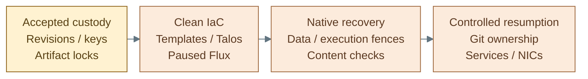

# Run an accepted platform recovery plan

Use the Tier 1 recovery entry point on an independent Linux bootstrap or execution host.
The [platform sequence](platform.md#recovery-sequence) shows the dependency order.
The retained package supplies Git bundles and artifacts. Native backups supply the selected data.

<a id="figure-automated-platform-recovery"></a>



*Figure. The accepted-plan automation reconstructs clean clusters on surviving Proxmox, restores
selected native datasets and verifies normal service before network cutover. The separate
[complete-host-loss procedure](platform.md) establishes the host and bootstrap foundation.*

## Contents

- [Prepare the retained recovery inputs](#1-prepare-the-retained-recovery-inputs)
- [Select backups and isolated targets](#2-select-backups-and-isolated-targets)
- [Run restoration](#3-run-restoration)
- [Resume the accepted scope](#4-resume-the-accepted-scope)
- [Retry an interrupted operation](#5-retry-an-interrupted-operation)
- [Native product contracts](#native-product-contracts)
- [Qualification and implementation limits](#qualification-and-implementation-limits)

## 1. Prepare the retained recovery inputs

In **the independently retained `<prefix>-tier-1/` repository**, copy
`ansible/group_vars/platform_recovery.json.example` to `secrets/platform-recovery.json`.
Edit the JSON fields using the independent recovery catalog. Keep credentials in separately retained
private files and list each file and SHA-256 in `automation.<repository>.private_files`.

| Input | Enter |
| --- | --- |
| `scope` | `tier1` when Tier 0 survives, or `all-vms` when recovering Tier 0 before Tier 1 |
| `recovery_id` | One stable target/attempt label such as `restore-2026-01` |
| `package` | Retained package directory, accepted manifest/lock SHA-256 and all three exact Flux commits |
| `automation` | Independently held tier and Shared Git roots at the accepted commits |
| `private_files` | Original Terraform state, inventory, cluster credentials, bootstrap inputs and product keys |
| `recovery_git_inputs` | Retained inputs for the existing read-only recovery Git recipe |
| `artifact_supply` | Locked OCI archives/Helm packages, accepted digests and independent publication destinations |

Include original `ansible/inventory/hosts.yml`, `ansible/group_vars/talos.yml`, Kubernetes
`terraform.tfvars`, Shared template references and the original Talos state in `private_files`.
The sample lists recovery inputs. Add every site-owned input consumed by the selected native entry points.

The entry point verifies those inputs before invoking Ansible. It copies accepted automation and
private inputs into a new workspace. Original Terraform state remains in custody. Kubernetes
reconstruction retains the original Talos secret resource and uses the existing Terraform/Talos
plan, apply and credential-export entry points. Runtime bindings are removed only from its working
state copy. The saved plan must select the accepted VMIDs/nodes and isolated recovery network.

The control-node precheck prepares declared collections and checks Git, kubectl, restic, Helm and
SOPS before target mutation. A disconnected controller can use `CONTROL_NODE_COLLECTIONS_MODE=check`
with the [retained bootstrap supply](../../../03-deployment/foundation/bootstrap/step-3e-bootstrap-offline.md).

## 2. Select backups and isolated targets

For **each prerequisite service VM restored from backup**, enter its original `vmid`, owning `node`, exact `backup` volume ID,
native backup configuration checksum, destination storage and complete NIC configurations.
Select `role` as `prerequisite`. Kubernetes VM-backup entries are rejected before restoration.

Every recovery NIC must use the selected `recovery_bridge`. Commission that isolated bridge and its
independent administration route on surviving Proxmox before execution. Retain original MAC addresses.
The plan must account for every node disk, external volume and service dependency in the selected set.

For **each cluster**, select `mode` as `clean`, its stable private API endpoint, original node
names/VMIDs and `previous_namespace_uid` from the retained original `kube-system` record.
The runner refuses existing target VMIDs before creating its reconstruction checkpoint.
It bootstraps an empty Kubernetes state with the original Talos identity. A newly observed
`kube-system` UID is retained and checked on every retry. Old etcd is rejected.

For **`all-vms`**, the Tier 0 cluster requires its own `package`, `recovery_git_inputs` and `cutover`.
Its package has the same export format with three retained source refs. Its `platform` ref belongs
to Tier 0. Its other two refs are retained format entries and are unused by the Tier 0 bootstrap.
Use distinct `flux_recovery_git_root` directories and `flux_recovery_git_user` identities for the
two independently served packages. Bind each bootstrap's `cluster_platform_flux_commit` to its
own accepted `platform` commit. Tier 1 also binds `cluster_platform_flux_platform_commit`.

| Tier 0 field | Enter |
| --- | --- |
| `clusters[].package` | Its independently retained directory, manifest/lock hashes and three source commits |
| `clusters[].recovery_git_inputs` | Checksum-bound file selecting its separate read-only Git root and SSH identity |
| `clusters[].cutover.sources.platform` | Normal Tier 0 Git URL/ref, source Secret and retained SSH trust/keys |
| `clusters[].cutover.resume_roots` | `["platform"]` |
| `clusters[].cutover.health_checks` | Actual Tier 0 prerequisite workload gates |
| `template_rebuild.catalog` | Retained Tier 0 `templates/proxmox.yml` |
| `template_rebuild.provider_environment` | Retained publisher `.env.local` |
| `template_rebuild.assets` | Catalog template keys mapped to exact paths in the verified artifact lock |

Retain Tier 0 template publication state in `.terraform/state/proxmox-templates/terraform.tfstate`.
The workflow rebuilds templates through the existing publication script before cloning clean nodes.
`artifact_supply[].tier` selects the owning package and defaults to `1`.

Provide checksum-bound `bootstrap_inputs`, `provider_environment` and `restore_resources` files.
Native bootstrap installs all reconciliation roots suspended before product resources are created.
The accepted Spinnaker source uses the operating `adopt` lifecycle. Set its
`products[].operating_component` to the generated component directory in `tier1-platform`, such as
`clusters/tier1/delivery`. Native Kustomize must render `adopt` network guards, SQL verification,
running consumers and normal ingress from that exact retained commit before target mutation.
`restore_resources` may establish namespaces, Secrets, claims and stopped workload templates.
It cannot start initializer Jobs, active consumers, active reconciliations or a fresh CNPG database.
The native restore adapter creates the database after staging its selected backup.

For Velero products, `restore_engines` supplies its retained pinned native manifests and credentials.
Ansible installs them and checks the declared `restore_engine_health` Deployment generations before
waiting for native backup catalog synchronization. This engine runs in the new cluster using the
independent artifact supply. Original hosted registries and Git services can remain unavailable.

### Retain the native source and chart checks

The preflight builds the actual bootstrap paths with native Kustomize and follows their Flux source
references. Unreferenced repository files do not form the recovery scope. Native SOPS decrypts values
using `clusters[].source_age_keys`, whose files must appear in `automation.*.private_files`.
Additional Flux runtime transformations are rejected rather than silently omitted from inspection.

Every active HelmRelease needs an entry in `clusters[].helm_releases`. The preflight checks its actual
specification, decrypted values, locked chart archive and complete native Helm/Kustomize output.
Stateless platform charts retain this check too. Stateful chart claims must belong to a selected
product's `data_claims`; unknown claims, databases and initializer Jobs block resumption.

In **the independently retained `<prefix>-tier-1/` repository**, prepare the contract locally from
the retained native HelmRelease and decrypted values objects. Protect those input files as secrets.
This command only renders a chart; it does not contact Kubernetes or deploy resources.

```bash
read -r -p 'Accepted Kubernetes version (for example 1.33.0): ' RECOVERY_KUBE_VERSION
python3 scripts/recovery_helm.py \
  --release secrets/recovery/harbor-helmrelease.yml \
  --objects secrets/recovery/harbor-values-objects.yml \
  --package /srv/custody/tier1-package \
  --archive charts/harbor-1.18.0.tgz \
  --source tier1-platform \
  --kube-version "$RECOVERY_KUBE_VERSION" \
  --product harbor --product-kind harbor \
  --output secrets/recovery/harbor-render.json
```

Copy the resulting JSON object into `clusters[].helm_releases`. Use `--platform-chart` instead of
the product arguments for a supported platform chart. Retain selected native API versions with
`--api-version` and Helm upgrade rendering with `--is-upgrade` when those are the accepted chart
conditions. Approve the completed recovery plan only after these contracts and artifact locks agree.
The preparation command does not authorize execution or skip verification during recovery.

| Image input | Required correspondence |
| --- | --- |
| `bootstrap_images` | Exact images in every resolved Talos machine configuration; include the installer and Kubernetes images |
| `artifact_supply` | Every reachable workload, restore/verification worker and restore-engine image has one locked OCI archive/digest |
| `source_image` and `tag` | Preserve an original tagged image reference through the same tag on independent supply |
| `registry_mirrors` | Original registry mapped to its independent registry host; the native Talos saved plan must resolve only that verified HTTPS endpoint with original-registry fallback disabled |

An image already using the independently supplied repository and digest needs no mirror mapping.
For an original registry reference, preserve its repository path at the mirror. Native Skopeo publishes
with digest preservation and verifies the published tag/digest before infrastructure reconstruction.
Missing images, incompatible chart renders or mismatched native mirrors stop the affected operation.

In **each recovered tier's `terraform/deployments/kubernetes/terraform.tfvars`**, append native mirror
documents to the existing `machine_config_patches`, retaining other patches. For example: [9]

```yaml
apiVersion: v1alpha1
kind: RegistryMirrorConfig
name: ghcr.io
endpoints:
  - url: https://recovery.internal.example.com
skipFallback: true
```

Repeat for the original registries declared in `registry_mirrors`. Supply the approved CA through
`RegistryTLSConfig` where required; keep TLS verification enabled. The preflight also recognizes
retained legacy `machine.registries` inputs, requiring the same endpoint and fallback constraints. [10]

## 3. Run restoration

Approve the exact plan checksum through the independent custody process. The example checksum below
is a prompt value from that approval record. Enter the actual 64-character value.

Run from **`<prefix>-tier-1/` on the independent recovery host**.

```bash
read -r -p 'Accepted recovery-plan SHA-256: ' RECOVERY_PLAN_SHA256
python3 scripts/flux-recovery.py run \
  --plan secrets/platform-recovery.json \
  --expect-plan "$RECOVERY_PLAN_SHA256" \
  --workspace /srv/recovery/restore-2026-01
```

The [automated sequence](#figure-automated-platform-recovery) publishes locked OCI/Helm artifacts to the independent recovery supply, restores prerequisite
VMs, serves retained Git bundles, reconstructs and verifies clean cluster identity,
applies reconciliation/writer fences and invokes each native product restore. Each product must
pass a retained-content check and a denied-access check. A Kubernetes verification Job repeats those
checks and supplies its actual UID to the Flux resumption gate.
Surviving Proxmox HA entries for the selected guests are retained and set to native `ignored` state.
The runner waits for manager release before restoring or cloning guests, and restores the original
active supervision after verified network cutover. Unselected guests retain their supervision. [6]

Spinnaker restoration uses separate MySQL and Redis Jobs. Each mounts its own data claim. The SQL
restore checks all five schemas. The Redis restore checks the RDB before installation. Both write
the matching `.delivery-restored` identity only after native restore checks pass.

Recovery starts Orca with `KEIKO_QUEUE_ENABLED=false`. A read-only SQL inventory enumerates every
restored pipeline/task ID, including orphaned application histories. A recovery Job invokes native
`/admin/forceCancelExecution`, then verifies terminal status twice. Echo and requester ingress stay
fenced. Promotion authority recovery installs a separately retained replacement ticket key and waits
for a new ready Deployment generation before requester access can resume.

Expected completion is `receipts/data-verified.json`. Production NICs and Flux scope remain fenced
until the selected resume phase.

## 4. Resume the accepted scope

The same accepted plan must include `cutover`, exact restored-VM NIC mappings, native health checks
and selected Flux roots. Spinnaker uses the accepted operating `adopt` payload throughout recovery.
Native roots remain paused during restoration. MySQL and Redis remain running for the adopt guards'
network checks. The separate lifecycle `recover` supports volume guards and deliberately holds
application Deployments at zero. It cannot complete this workflow's operating cutover.

Run from **the same retained Tier 1 repository and workspace**.

```bash
python3 scripts/flux-recovery.py run \
  --plan secrets/platform-recovery.json \
  --expect-plan "$RECOVERY_PLAN_SHA256" \
  --workspace /srv/recovery/restore-2026-01 \
  --phase resume
```

The runner reobserves native results and content checks and requires the actual verification Job UIDs
from the owning cluster. It verifies or restores the accepted refs at normal Git ownership while
roots remain paused. `cutover.sources.*.ensure_ref` defaults to `verify`. The optional
`restore-with-lease` also requires `expected_remote_head` and uses the retained administrative SSH
identity to publish the exact bundle commit with native Git lease protection.

Each cluster resumes its own `platform` root and canary before service roots. Spinnaker cancellation
and new ticket identity precede consumer activation. The runner verifies all consumer generations,
accepted images, normal ingress and normal Git source artifacts, then repeats content/denial checks.
Only then does it apply the accepted NIC mappings. Tier 0 and Tier 1 use separate package revisions,
source credentials and UID-bound verification receipts.
Completion creates `receipts/cutover.json`. GitLab runner registrations, schedules and webhook events
remain paused. Native Runner managers must remain at zero replicas in the accepted source; reopening
CI requires a separate accepted operating change after recovery.

## 5. Retry an interrupted operation

Repeat the same command with the same plan and workspace. Source/configuration hashes, target
identities and actual native results are checked again. An existing completed restore Job is
reobserved. A running Job is awaited. A failed Job or different body blocks resumption.

Keep failed Jobs, partial volumes and native restore logs. Select new clean claims and a new
approved target/plan after a destructive restore failure. An unmarked partially restored VM is
preserved and rejected. Diagnose its native Proxmox task before selecting a new recovery target.

## Native product contracts

| `kind` | Native operation and additional retained inputs |
| --- | --- |
| `spinnaker` | One exact restic snapshot, per-file SHA-256, original MySQL/Redis image digests, separate clean PVC UIDs, retained service/keystore/OIDC credentials, independent admin headers and replacement promotion authority key |
| `gitlab` | Exact CE Toolbox image/template, native backup ID, complete matching Rails secrets and external PostgreSQL/Redis/Gitaly/object datasets; independent administrator API headers and exact isolated Sidekiq workloads for native trigger/execution fencing |
| `harbor` | Complete native Velero CSI-snapshot set, exact backup identity, clean target claims and retained registry/database secrets; ordered verification starts database, Redis, registry, portal and core |
| `victoriametrics` | Native `vmbackup` URI per actual instance, pinned `vmrestore` image, stopped instance and selected isolated claim |
| `cnpg-files` | Existing guarded PostgreSQL NAS-file recovery inputs, completed set ID, original system identifier, exact `cnpg_cluster` and new block claims |
| `vault-raft` | Tier 0 Kubernetes integrated-Raft/Shamir recovery using the original control-backup snapshot, controller-only token/share custody, exact cluster/version/tool identities and data/audit PVC bindings. [Prepare native inputs](control-product-inputs.md#4a-add-the-vault-product) |
| `netbox-media` | Tier 0 single-media-claim restore from the original control-backup/restic set, marker, known-file checksum and runtime UID/GID; pair its separate `cnpg-files` database entry. [Prepare native inputs](control-product-inputs.md#4b-add-the-netbox-media-product) |
| `opensearch` | Selected search StatefulSets, owned data-claim identities, retained readonly repository specification, exact snapshot name/UUID, application indices and administrator TLS identity |
| `argocd`, `netdata` | Complete qualified Velero CSI snapshot set and original service/streaming credentials |

Each product also declares exact writer resources, retained Secrets, isolated verification consumers,
an independently available Python image digest and TLS/auth Secrets for native verification Jobs.
Keep deployment triggers and executors out of `verification_workloads`.

Prepare control-product records and private files before an outage. Vault's general verification
uses an empty headers Secret, known unauthenticated seal status and denial; original token/share
custody and the stronger original-secret proof stay on the independent controller. Attending
custodians collect the original quorum before plan approval; the approved automated phases then
run unattended.
[Control-product preparation and JSON examples](control-product-inputs.md).

For **Harbor**, list the chart's actual database, Redis, registry, portal and core names in
`verification_workloads`, in that order. The native scale operation waits for each entry before
starting the next. Include those consumers and jobservice in `writers`. Jobservice remains fenced
during isolated verification. If database or Redis is external, its accepted prerequisite readiness
gate replaces that local workload entry.

For **CNPG**, `cnpg_cluster` must equal `postgresql_file_backup_target.cluster` in the retained
`inputs` file. The adapter also checks namespace, completed set ID and original system identifier
before rendering or applying the native physical recovery resources.

### GitLab native delivery fences

Add `gitlab_recovery` to the GitLab product entry. Obtain workload names from the retained chart
render, not a new chart version. Include every selected Sidekiq workload in `writers`; start only the
isolated webservice in `verification_workloads`. Sidekiq must retain its native `app: sidekiq` Pod
label. The recovery bridge must prevent contact with production consumers and external integrations.

```json
{
  "gitlab_recovery": {
    "api_url": "https://git.internal.example.com",
    "ca_file": "tier-1/secrets/gitlab-ca.pem",
    "ca_sha256": "REPLACE_WITH_SHA256",
    "admin_headers_file": "tier-1/secrets/gitlab-admin.json",
    "admin_headers_sha256": "REPLACE_WITH_SHA256",
    "sidekiq_workloads": [{"kind": "Deployment", "name": "gitlab-sidekiq-all-in-1-v2"}],
    "cancel_attempts": 120,
    "poll_seconds": 2
  }
}
```

Retain both files and matching hashes in `automation.tier-1.private_files`. The owner-only `0600`
headers file contains `{"PRIVATE-TOKEN":"RETAINED_INSTANCE_ADMINISTRATOR_API_TOKEN"}`. Retain the
original administrator token independently before the outage, including its required admin-mode
scope where enabled. This credential stays on the controller and is never mounted in verification Jobs.

The native fence supports GitLab CE 17.0–19.5. After native restoration, the coordinator enumerates
the whole restored instance, pauses runners,
disables schedules and webhook event flags, then temporarily starts isolated Sidekiq workers.
It cancels stale pipelines, child pipelines, jobs and manual/delayed work and waits for actual terminal
states. Those workers are stopped and their Pods drained on both success and failure. A private receipt
retains original API-visible intent and binds the verified fence to the plan, backup and namespace UID.
Completed audits recheck the native fence through GET requests. [11–15]

An API cancellation response does not prove that a disconnected external executor process has stopped.
Surviving executors outside the lost cluster require independent power/network fencing before recovery.
System hooks have unconditional events without a complete native pause flag; a restored instance with
such hooks is rejected before cutover. The supplied default does not configure system hooks.

For **OpenSearch**, retain these additional fields in the selected product entry.

```json
{
  "restore_workloads": [{"kind": "StatefulSet", "name": "search-data", "replicas": 1}],
  "data_claims": ["data-search-data-0"],
  "claim_uids": {"data-search-data-0": "new"},
  "repository_spec_file": "tier-1/secrets/search-repository.json"
}
```

Every selected StatefulSet must also appear in `writers`. `data_claims` must match its actual PVC
references and ordinal claim names. A `new` claim must carry this plan's native ownership annotation.
The adapter records its observed UID before startup and rejects changed claim generations on retry.

Add the repository file and SHA-256 to `automation.<repository>.private_files`. A native S3 example
uses the following contents. Configure the release-matched repository plugin and its original
keystore/Secret credentials in the retained stopped node templates.

```json
{
  "type": "s3",
  "settings": {
    "bucket": "accepted-search-backups",
    "base_path": "search",
    "readonly": true
  }
}
```

The adapter verifies claim ownership, starts only the declared search StatefulSets, waits for their
current generations and authenticated HTTPS health, then registers this readonly repository before
reading the selected snapshot. Native primary-shard provenance establishes the initial restoration.
A completed checkpoint retains index UUIDs and claim identities so later node restarts can be
verified without replaying restoration. A lost completion receipt with changed native provenance
blocks automatic adoption and preserves the existing data. [7][8]

### Tier 0 restoration coverage

| Selected deployment path | Implemented orchestration and remaining gap |
| --- | --- |
| Dedicated Vault VM | Native prerequisite VM backup restores all included disks and original configuration. Its readiness gate requires an operational original auto-unseal path. Automated Shamir unsealing is absent. |
| FreeIPA or OpenXPKI issuer VM | Native prerequisite VM backup restores included identity/data disks. Retained credentials, original hardware keys and native readiness gates remain required for the selected placement. |
| Keycloak CNPG database | `cnpg-files` restores the selected physical database and verifies its original system identifier. Retained Keycloak/OIDC/TLS Secrets and configured verification consumers provide application checks. |
| NetBox database and media | `cnpg-files` restores the selected database; `netbox-media` restores the paired native media subtree into one plan-bound claim and verifies marker/content identity. Retain both recovery points and original application credentials. [Input contract](control-product-inputs.md#4b-add-the-netbox-media-product) |
| Kubernetes Vault Raft with Shamir | `vault-raft` verifies the independent snapshot/tool versions, guards data/audit claims, restores an isolated first member, uses controller-held original shares/token, verifies original cluster/secret identity and joins selected voters. Human quorum collection precedes unattended execution. [Input contract](control-product-inputs.md#4a-add-the-vault-product) |
| Kubernetes Vault with another seal | Transit, PKCS#11 and other seal variants require the original working seal and a separate adapter; hardware/provider recovery remains explicitly qualified per target. |

## Qualification and implementation limits

The runner reconstructs clean Talos clusters using retained identity and native product backups.
The selected Talos template assets, independent publication registry, Proxmox recovery bridge and external
storage must be available through independent custody. Automatic creation of the independent OCI
publication registry and reconstruction of external storage providers remain unimplemented.
CSI-native Velero restore requires clean target claims and complete snapshot support. Its pod
filesystem-backup alternative remains unimplemented. Control-product automation covers Kubernetes
Vault Raft with its original Shamir quorum and paired NetBox media. Other Vault seals and automated
Shamir unsealing of the dedicated-VM variant remain outside the supplied adapters.

Source tests exercise plan rejection, native Git staging, native Ansible Job checkpoint behavior and
simulated product API failures. Full runner-to-hypervisor-to-product-to-cutover integration remains
unqualified. These checks do not establish live Proxmox restore, CSI attachment, product
restore correctness, outage duration or full disaster-recovery acceptance. Retain measured RPO/RTO
and live qualification evidence separately from the recovery receipts.

## References

1. [Pinned native Orca force-cancel endpoint](https://github.com/spinnaker/spinnaker/blob/42da7f83e7db090429bfa3f2fddeff34f0b124a7/orca/orca-web/src/main/groovy/com/netflix/spinnaker/orca/controllers/AdminController.groovy)
2. [Pinned native Orca cancellation persistence](https://github.com/spinnaker/spinnaker/blob/42da7f83e7db090429bfa3f2fddeff34f0b124a7/orca/orca-core/src/main/java/com/netflix/spinnaker/orca/commands/ForceExecutionCancellationCommand.kt)
3. [GitLab Helm native restore](https://docs.gitlab.com/charts/backup-restore/restore/)
4. [Harbor native Velero recovery](https://goharbor.io/docs/main/administration/backup-restore/)
5. [VictoriaMetrics native resumable restoration](https://docs.victoriametrics.com/victoriametrics/vmrestore/)
6. [Native Proxmox HA supervision states](https://github.com/proxmox/pve-docs/blob/master/ha-manager.adoc#service-states)
7. [OpenSearch snapshot repository and restoration](https://docs.opensearch.org/latest/tuning-your-cluster/availability-and-recovery/snapshots/snapshot-restore/)
8. [OpenSearch native shard recovery evidence](https://docs.opensearch.org/latest/api-reference/index-apis/recover/)
9. [Talos 1.13 native registry mirrors and fallback](https://docs.siderolabs.com/talos/v1.13/reference/configuration/cri/registrymirrorconfig) (checked 2026-11-15)
10. [Talos 1.13 native registry TLS](https://docs.siderolabs.com/talos/v1.13/reference/configuration/cri/registrytlsconfig) (checked 2026-11-15)
11. [GitLab native runner pause](https://docs.gitlab.com/api/runners/)
12. [GitLab native pipeline schedules](https://docs.gitlab.com/api/pipeline_schedules/)
13. [GitLab native project webhook events](https://docs.gitlab.com/api/project_webhooks/)
14. [GitLab native pipeline and child-pipeline APIs](https://docs.gitlab.com/api/pipelines/)
15. [GitLab native job cancellation](https://docs.gitlab.com/api/jobs/)
