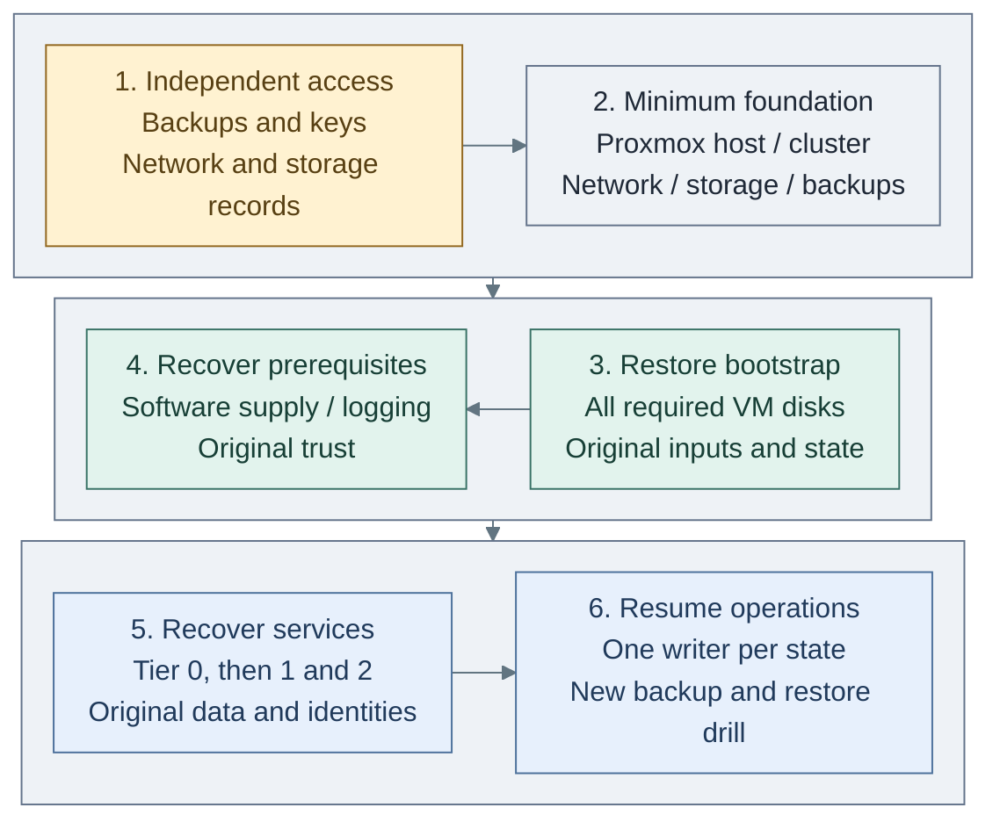

# Recover after complete platform loss

Rebuild the minimum host foundation, restore the bootstrap from independent backup, then recover
the original services and data. The backup set defines what can be recovered and how old it will be.

**Run on:** an independent privileged workstation and replacement Proxmox capacity.
**Prerequisites:** accessible [recovery set](../backups/recovery-set.md), approved installation
media, independently held keys/credentials and a recorded network/storage plan.
**Design:** [recovery boundaries](../../01-architecture/24-operations/04-backup-recovery.md#recovery-boundaries).

## Steps

1. [Establish independent access](#1-establish-independent-access).
2. [Recreate the minimum host foundation](#2-recreate-the-minimum-host-foundation).
3. [Restore the bootstrap and original records](#3-restore-the-bootstrap-and-original-records).
4. [Recover the early prerequisites](#4-recover-the-early-prerequisites).
5. [Recover services and their data](#5-recover-services-and-their-data).
6. [Resume operations and prove the next recovery point](#6-resume-operations-and-prove-the-next-recovery-point).

## Recovery sequence

**Manual recovery workflow:** these are ordered operations, not six deployed resources.
Read the first row left to right, the second right to left, then the last left to right.
The host and backup target are manual prerequisites; the bootstrap is restored from backup.
Tier-local original state and the [product procedures](README.md) control subsequent recovery.

## 1. Establish independent access

1. Fence former hosts and automation. Preserve surviving media/evidence before reuse.
2. Obtain the backup catalog, chosen recovery sets, decryption/unseal keys and local recovery credentials.
   Read the backups without GitLab, FreeIPA, Vault or any original Proxmox node being online.
3. Confirm what survives: VM backups, latest input/state copies, application data, etcd and storage-system
   configuration have different recovery scopes. Missing data must be declared before rebuilding it empty.

## 2. Recreate the minimum host foundation

1. Follow [host/network foundation](../../03-deployment/foundation/proxmox/README.md#first-deployment-order)
   for one accepted recovery host. Restore the necessary gateway/switch configuration first if it was lost too.
2. Prepare live disks and reconnect the existing [NAS/PBS backup target](../backups/virtual-machines.md#quick-steps).
   Do not initialize an old Ceph pool or overwrite surviving storage while creating the replacement platform.
3. Apply the recorded bridge/VNet/VLAN and recovery-network mapping. Establish the intended cluster
   membership before restoring guests onto joining nodes: join operations replace node cluster
   configuration, and joining nodes must not already contain guests. [1] Add later nodes empty;
   qualify quorum, storage and placement before adding HA.

## 3. Restore the bootstrap and original records

Follow [bootstrap recovery](bootstrap.md), restoring every disk required by its recorded layout.
Recover the latest coherent original state/inputs even if the VM backup contains an older copy.
If no bootstrap VM backup exists, use an independent trusted execution host or the
[manual bootstrap foundation](../../03-deployment/foundation/bootstrap/README.md), then recover the
original private repositories/inputs/state; do not substitute generated starter values.

Verify the replacement Proxmox CA and API access independently. Old API tokens and host credentials
are not automatically recreated by restoring a guest VM. Do not apply old saved plans.

## 4. Recover the early prerequisites

1. Establish approved software supply from the retained offline artifacts or surviving mirrors;
   the cache itself may need prepared package repositories before its installation can run.
2. Restore protected logging and its data/reader keys. Preserve old evidence separately from new
   recovery events. Use [logging recovery](../security-logging.md#offline-investigation).
3. Recover original CA/HSM/signing identities and their databases/custody using the selected
   [issuer procedure](../cryptography/issuer-recovery.md). Do not create replacement trust roots
   under an existing identity simply to make deployments pass.

## 5. Recover services and their data

Use the [tier recovery order](../recovery.md#recovery-order) and the [product procedures](README.md):

| Recover | Required acceptance before dependants |
| --- | --- |
| Tier 0 Kubernetes, directory, identity and secrets | Original cluster/key/domain identities, database/PVC data, independent administration and audit |
| Tier 1 delivery, observability and development services | Product data, scoped SSO, artifact access and recovery without authority over Tier 0 evidence |
| Tier 2 applications and labs | Accepted application recovery point, isolation, access and telemetry |

Restore VMs from their selected backups using [VM recovery](virtual-machines.md).
For Kubernetes, follow [original-state/etcd recovery](original-state-etcd.md) and the separate
application-volume procedures. A fresh Terraform apply creates infrastructure; it does not restore
application data, etcd history, CA keys or Vault contents. Reconcile surviving/restored resources
before deciding which explicitly rebuildable units to provision again.

## 6. Resume operations and prove the next recovery point

1. Compare actual resources with original inventory/state and review plans per owning tier.
   Resolve missing-resource, replacement and storage changes before resuming automation.
2. Enable one approved writer per state. Re-establish scheduled backups and independent input/state copies.
3. Test operator/user access, negative permissions, logs and service content at the accepted recovery point.
4. Record actual RPO/RTO, unavailable data and remaining limitations. Back up the recovered bootstrap and
   services, then run an isolated restore drill from the new copies before retiring the old recovery sets.

**Stop/rollback:** retain original backups, extracted inputs and keys throughout. On failed integrity,
identity or storage checks, keep the replacement isolated and correct that prerequisite. Use another
clean target for a retry; an installer success is not evidence of recovered data.

## References

1. [Proxmox cluster formation and joining](https://github.com/proxmox/pve-docs/blob/master/pvecm.adoc#adding-nodes-to-the-cluster).
