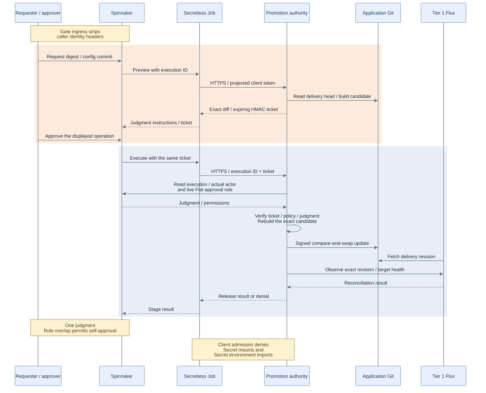

# Selected Spinnaker approval implementation

Spinnaker runs release requests and manual judgment. A separate promotion authority verifies the
approved operation and holds the application Git and signing credentials. Fiat, Kubernetes admission
and restricted Flux identities bound that path. The selected controls use self-hosted open-source
components and GitLab CE. [D-041](../07-decisions/README.md#d-041) defines ownership.

The [logical approval boundary](../01-architecture/10-delivery/04-approval-controls.md) defines the
required behavior independently of products. This reference describes its selected realization
within the [Tier 1 delivery implementation](tier-1-delivery.md), including version-specific bypasses,
license evidence and qualification requirements.

*Figure — The authority checks the authenticated judgment and exact preview before writing the
application branch, then observes its reconciliation. Git and signing credentials reside in the
authority namespace.*
[Pipeline](../../tier-1/pipelines/flux-promotion.yml.j2),
[authority](../../tier-1/scripts/promotion_authority.py),
[client and admission resources](../../tier-1/ansible/roles/delivery_promotion/templates/resources.yml.j2).

## Contents

- [Authority and bypasses](#authority-and-bypasses)
- [What judgment actually enforces](#what-judgment-actually-enforces)
- [Free editions and version evidence](#free-editions-and-version-evidence)
- [Required denial tests](#required-denial-tests)
- [References](#references)

## Authority and bypasses

| Actor | Authorized action | Limit or bypass to record |
| --- | --- | --- |
| Release requester | Application `EXECUTE` and requester-role access to the secretless Job account | Can request preview/execution; the authority checks judgment before any application write |
| Judgment role member | Continue/stop the exact pending change presented by the pipeline | One authorized judgment; overlapping requester/approver membership permits self-approval |
| Promotion Job identity | Call authority HTTPS with a projected audience-bound service-account token | Admission requires `delivery-promoter` and denies Secret volumes, projected Secret sources and Secret environment imports |
| Promotion authority | Rebuild/publish the approved change and observe the exact release | Holds Git/signing/ticket credentials only in `delivery-promotion-authority`; Git write is limited to the application project |
| Spinnaker Run Job account | Create/observe Jobs only in `delivery-promotion` | Its native account permissions grant no access to authority Secrets, application workloads or Flux objects |
| Pipeline/permission administrator | Import/update pipeline definitions, Fiat rules and execution identities | Can bypass/replace the gate; separate and record this privileged group |
| GitLab project/group/instance administrator | Manage protected branches, memberships, credentials and repository contents | Can grant direct writes or alter protection; CE is not immutable approval enforcement |
| Platform/recovery administrator | Advance approved source pins, suspend/resume applications, repair/reinstall Flux | Explicit independent path; retain custody receipt and operation evidence |
| Cluster/infrastructure or identity administrator | Change runtime/identities below the release gate | Can bypass controls; follow protected authority and evidence procedures |

GitLab CE branch protection uses role-based permissions. Use a dedicated bot account whose membership
is limited to the separate application project; do not grant ordinary developers its delivery-branch
write role. Disable force push and inspect overlapping protection rules. Maintainer-or-higher actors
retain administrative bypasses. Direct Git writes do not traverse Spinnaker judgment. [1][2]

The authority authenticates client tokens using Kubernetes `TokenReview` for audience
`delivery-promotion-authority` and the exact `delivery-promotion/delivery-promoter` identity. Its
namespace contains the Git, signing and authority Secrets. The client receives public CA material and
a short-lived projected token. A fail-closed `ValidatingAdmissionPolicy` and binding enforce the
client Pod restrictions. Default-deny network policies permit the declared authority/API/Git/Gate/
Fiat/DNS paths. The authority reads Gate through retained service credentials and verified HTTPS,
and reads Fiat through its native HTTPS service. The Gate service identity belongs to
`delivery_promotion_reader_role`, matching the native reader group (`tier1-delivery-readers` by
default). The promotion application grants that group only `READ`. [14][15]

Policy and credential hashes form part of the authority Pod template. Its single-replica `Recreate`
rollout replaces the running process on either change, and adoption requires the observed generation
with exactly one total, updated and available replica. HTTPS JSON clients reject redirects to keep
authentication material on the configured endpoint.

Native service Pod templates set `delivery.homelab/config-sha256` from common/service configuration,
so configuration changes automatically roll the Pods. Flux Orca also carries
`delivery.homelab/request-http-profile: deny-user-http-v1`. Adoption waits for that hardened Orca
generation with all desired replicas updated and available and the total replica count converged
before old-token retirement and reopening execution.

Gate's authenticated identity is an ingress trust boundary. At the pinned revision, `GateConfig`
registers `AuthenticatedRequestFilter(true, true, false, false)`. The filter collects caller
`X-Spinnaker-*` headers and applies them after the Spring-authenticated user, allowing supplied user
or account headers to override the forwarded identity. The rendered Traefik middleware
`spinnaker-authenticated-identity` strips User, Accounts, User-Origin and Anonymous headers at the
Gate Ingress. Gate access follows the selected ingress controller and private Spinnaker service policies.
Keep direct Gate Pod/Service access restricted to trusted callers, including the authority's scoped
read service. Qualify every accepted ingress route with forged-header requests. [18][19][20]

Requester-controlled HTTP must also be bounded inside Orca. The selected native Flux profile sets
`webhook.stage.enabled: false`, enables `webhook.allowedRequestsEnabled` with an empty
`webhook.allowedRequests`, and sets `user-configured-url-restrictions.allowed-hostnames-regex: ''`.
The pinned URL guard rejects an empty allowlist before DNS or HTTP. This covers `fromUrl`,
`jsonFromUrl`, `yamlFromUrl` and `propertiesFromUrl`, including their use in expression preconditions.
Promotion uses native Jobs and local expressions. Private Fiat role-management and execution APIs
remain trusted-service interfaces. Enabling requester HTTP needs a separately reviewed destination
policy and bypass tests. [21][22][23]

During adoption, the `adopt` action first fences ordinary execution through actual Gate application
permissions. It requires the new authority resources, revokes the old bot personal access token via
GitLab CE's administrator API, verifies revocation, stops legacy Jobs and orphan Pods, then removes
their Git/signing Secrets from the client namespace before reopening execution. Failures retain the
fence. Retain independent copies of the replacement credentials and the operation evidence. [16]

Generated refresh preserves the project-owned pipeline template. Existing projects merge the current
secretless client contract before rendering/adoption, retaining their integration stages and stable
IDs. An old credential-bearing pipeline fails the new boundary until it is adapted.
[Pipeline comparison and adoption](../03-deployment/stage-07-delivery/procedures/flux-platform.md#1a-adopt-the-current-pipeline-template-after-refresh).

## What judgment actually enforces

The pinned Spinnaker `2026.3.2` source revision is
`42da7f83e7db090429bfa3f2fddeff34f0b124a7`, from the
[software manifest](../../tier-1/ansible/roles/delivery_platform/files/software.yml).
Its `ManualJudgmentStage` checks `requiredJudgmentRoles` (falling back to `selectedStageRoles`) against
the last modifying user. `ManualJudgmentAuthorization` accepts a user with any required role or a Fiat
administrator. Disabled Fiat or an empty required-role list bypasses that role check. [3][4]

The same revision's Orca `TaskController.updatePipelineStage` accepts stage-context patches with
application `EXECUTE`, and `retryPipelineStage` accepts restarts with that permission. The patch
stores `lastModified.user` from `AuthenticatedRequest` after applying the supplied context. Those
mutable contexts and restart APIs require an independent check at the credential holder. [17]

The authority checks the saved pipeline/application and active execution against its platform policy.
Its HMAC preview ticket binds execution ID, expiry, the full policy hash, image digest, configuration
revision, destination, release identity, exact diff and base/candidate commits. Execution rereads Orca's
top-level judgment `lastModified.user`, verifies that actor's current Fiat approval role or admin
status, and requires a completed continuation with the matching ticket and instructions. Client-supplied
context usernames and roles cannot establish that authority. The exact candidate is rebuilt before
Git compare-and-swap. A changed branch head or expired/changed ticket requires a fresh preview and
judgment. Retrying the same published candidate observes it, while a superseded candidate fails.

Keep Fiat enabled and judgment roles nonempty. This contract authorizes one judgment. Overlapping
requester/approver membership permits self-approval, and Fiat administrators can judge. Pipeline,
GitLab, platform, cluster and identity administrators retain privileged bypass authority. Retain the
pipeline/policy revision, proposed diff, ticket identity, actor, execution ID, Git commit and exact
reconciliation result in the commissioned evidence destination. Mutable execution records require
independent evidence custody. Manual judgment also requires Echo. [3][5]

## Free editions and version evidence

| Component | Evidence and scope |
| --- | --- |
| Spinnaker OSS | Pinned source's Apache-2.0 license permits internal/company use without subscription; native Fiat/manual judgment code is in that revision [3][4][6] |
| GitLab CE | MIT-licensed CE code and free protected-branch permissions; no paid approval-count, CODEOWNERS enforcement or protected-environment approval dependency [1][2][7] |
| Flux | Apache-2.0 controllers; native reconciliation/impersonation/drift settings provide the selected deployment mechanism [8] |
| Harbor / chart `1.18.0` | Harbor `2.14.0` is Apache-2.0 [9] |
| MySQL Community `8.4.11` | GPLv2 community server with the published additional permissions [10] |
| Redis `8.2.9` | Select the available AGPLv3 license for this design; retain its license/source obligations, including modified network-service use [11] |
| Envoy `1.39.5` / restic `0.19.1` | Apache-2.0 / BSD-2-Clause respectively [12][13] |

Checked 2026-11-15. Spinnaker pinned source was inspected in the local upstream checkout at that exact
revision; web retrieval of its commit URLs was unavailable. Current GitLab feature documentation was
checked online. GitLab/Flux chart versions remain exact site inputs rather than a universal kit pin:
retain each accepted chart's app version, source/license revision and branch/API denial results in the
deployment record. Do not label an unspecified site version verified. Recheck when upgrading.
The pinned supporting-product license files above were checked online on 2026-11-15. The selected
community components require no commercial subscription for the supplied functions; preserve their
actual license and redistribution/source obligations when building retained images and recovery media.

Operational costs remain: native source upgrades, chart/Job compatibility, credential rotation,
pipeline import review, CE membership/branch audits and independent evidence/backup custody.
Stronger separation of duties or immutable approval evidence requires another explicit control decision.

## Required denial tests

Offline tests use mocked execution/Fiat responses with real local Git compare-and-swap. Manifest
checks inspect admission, credential placement and RBAC. Live authorization and API-server admission
remain unqualified until the following checks pass through the installed system.

| Attempt | Required outcome |
| --- | --- |
| Ordinary requester runs the saved pipeline and authorized approver judges | Exact accepted candidate reconciles |
| Direct execution, skipped judgment, patched role/context username or stage restart | Authority denies publication without the actual authorized judgment |
| Supply forged `X-Spinnaker-User`, `X-Spinnaker-Accounts`, `X-Spinnaker-User-Origin` or `X-Spinnaker-Anonymous` through Gate ingress | Middleware removes the caller identity override; unauthenticated/unauthorized caller cannot judge or gain the forged role |
| Request a webhook or URL-helper expression targeting Fiat `/roles`, Orca/Gate execution APIs, loopback or metadata URLs | Native Orca HTTP restrictions reject the request; requester permissions cannot be enlarged through private-service calls |
| Change digest/configuration/destination/diff, execution ID, policy or expired ticket | Authority denies the changed operation |
| Reuse approval after another delivery-head change | Git compare-and-swap fails; a fresh judgment is required |
| Retry the exact published candidate | Observation resumes without another release commit; supersession fails |
| Client Job selects an authority identity or mounts/imports a Secret | Kubernetes admission/RBAC denies the request |
| Requester omits or changes client Job labels | Namespace-wide network policy still confines egress to accepted destinations |
| Requester selects a different privileged account or writes another namespace/project | Native account/RBAC/Git authorization denies access |
| Adoption stops before hardened Orca/authority rollout or credential retirement | Ordinary releases stay fenced; all replicas must match the accepted rollout before reopening; retired token fails after successful adoption |

Also test direct branch/force pushes, bot access to platform/bootstrap projects, application RBAC/CRD
writes, self-approval role overlap and explicit administrator recovery authority. Record site API and
network-policy results with the accepted revisions.
[Live acceptance](../03-deployment/stage-07-delivery/procedures/flux-platform.md#promotion-and-acceptance).

## References

1. [GitLab branch protection permissions](https://docs.gitlab.com/user/project/repository/branches/protection_rules/).
2. [GitLab merge request approvals and Free limitations](https://docs.gitlab.com/user/project/merge_requests/approvals/).
3. [Pinned ManualJudgmentStage source](https://github.com/spinnaker/spinnaker/blob/42da7f83e7db090429bfa3f2fddeff34f0b124a7/orca/orca-echo/src/main/groovy/com/netflix/spinnaker/orca/echo/pipeline/ManualJudgmentStage.groovy).
4. [Pinned ManualJudgmentAuthorization source](https://github.com/spinnaker/spinnaker/blob/42da7f83e7db090429bfa3f2fddeff34f0b124a7/orca/orca-echo/src/main/java/com/netflix/spinnaker/orca/echo/util/ManualJudgmentAuthorization.java).
5. [Spinnaker manual judgment stage](https://spinnaker.io/docs/reference/pipeline/stages/#manual-judgment).
6. [Pinned Spinnaker Apache-2.0 license](https://github.com/spinnaker/spinnaker/blob/42da7f83e7db090429bfa3f2fddeff34f0b124a7/LICENSE).
7. [GitLab CE license](https://gitlab.com/gitlab-org/gitlab-foss/-/blob/master/LICENSE).
8. [Flux license](https://github.com/fluxcd/flux2/blob/main/LICENSE) and [HelmRelease permissions/drift](https://fluxcd.io/flux/components/helm/helmreleases/).
9. [Harbor 2.14.0 license](https://github.com/goharbor/harbor/blob/v2.14.0/LICENSE).
10. [MySQL Community 8.4.11 license](https://github.com/mysql/mysql-server/blob/mysql-8.4.11/LICENSE).
11. [Redis 8.2.9 license options](https://github.com/redis/redis/blob/8.2.9/LICENSE.txt).
12. [Envoy 1.39.5 license](https://github.com/envoyproxy/envoy/blob/v1.39.5/LICENSE).
13. [restic 0.19.1 license](https://github.com/restic/restic/blob/v0.19.1/LICENSE).
14. [Kubernetes TokenReview and audience validation](https://kubernetes.io/docs/reference/access-authn-authz/authentication/#tokenreview-api).
15. [Kubernetes ValidatingAdmissionPolicy and bindings](https://kubernetes.io/docs/reference/access-authn-authz/validating-admission-policy/).
16. [GitLab CE personal access token inspection and revocation](https://docs.gitlab.com/api/personal_access_tokens/).
17. [Pinned Orca TaskController context patch and restart authorization](https://github.com/spinnaker/spinnaker/blob/42da7f83e7db090429bfa3f2fddeff34f0b124a7/orca/orca-web/src/main/groovy/com/netflix/spinnaker/orca/controllers/TaskController.groovy#L623-L655).
18. [Pinned Gate authenticated request filter configuration](https://github.com/spinnaker/spinnaker/blob/42da7f83e7db090429bfa3f2fddeff34f0b124a7/gate/gate-web/src/main/groovy/com/netflix/spinnaker/gate/config/GateConfig.groovy).
19. [Pinned Kork authenticated request filter](https://github.com/spinnaker/spinnaker/blob/42da7f83e7db090429bfa3f2fddeff34f0b124a7/kork/kork-web/src/main/groovy/com/netflix/spinnaker/filters/AuthenticatedRequestFilter.groovy).
20. [Traefik request-header removal](https://doc.traefik.io/traefik/reference/routing-configuration/http/middlewares/headers/).
21. [Pinned native webhook registration condition](https://github.com/spinnaker/spinnaker/blob/42da7f83e7db090429bfa3f2fddeff34f0b124a7/orca/orca-webhook/src/main/java/com/netflix/spinnaker/orca/webhook/config/WebhookConfiguration.java).
22. [Pinned user-configured URL restrictions](https://github.com/spinnaker/spinnaker/blob/42da7f83e7db090429bfa3f2fddeff34f0b124a7/orca/orca-core/src/main/java/com/netflix/spinnaker/orca/config/UserConfiguredUrlRestrictions.java).
23. [Pinned URL-expression helper validation](https://github.com/spinnaker/spinnaker/blob/42da7f83e7db090429bfa3f2fddeff34f0b124a7/orca/orca-core/src/main/java/com/netflix/spinnaker/orca/pipeline/expressions/functions/UrlExpressionFunctionProvider.java).
