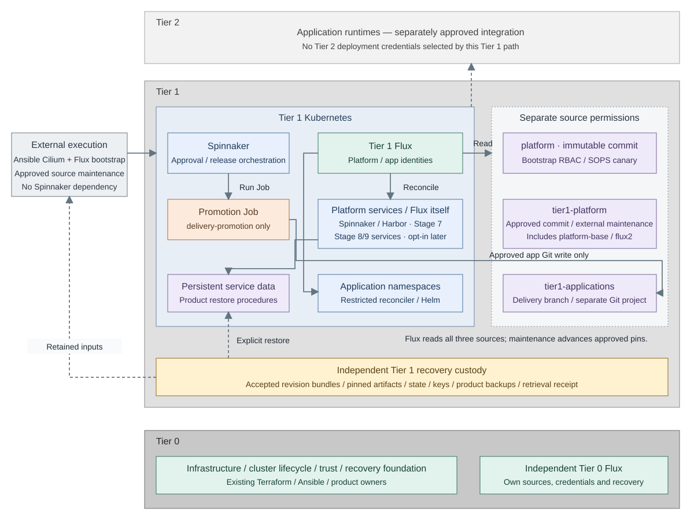

# Selected Tier 1 delivery implementation

Tier 1 selects independent Flux reconciliation for Kubernetes platform services and application
deployment. Spinnaker approves and promotes application release intent. Infrastructure lifecycle and
product data recovery keep their existing owners. [D-041](../07-decisions/README.md#d-041),
accepted 2026-11-14, records this choice. Implementation coverage and live qualification are tracked
separately in the [support map](./implementation-support.md#tier-1-flux-evidence).

The [logical controller design](../01-architecture/10-delivery/02-controllers.md) defines the
responsibilities independently of these products. The
[logical approval boundary](../01-architecture/10-delivery/approval-controls.md) defines the required
authorization behavior; [Spinnaker approval implementation](spinnaker-approval.md) records how the
selected composition enforces it.

*Figure: Selected ownership and control flow. Solid arrows name operations; dashed arrows show
independent recovery inputs or the unselected Tier 2 integration. Tier 0 keeps separate Flux,
credentials and recovery. Stage 8/9 services are later, explicit selections.*
[Editable SVG and render record](./diagrams/tier1-flux-ownership-render.md).
[Cluster bootstrap](../../shared/ansible/roles/cluster_platform),
[native delivery renderer](../../tier-1/ansible/roles/delivery_platform), and
[project-owned cluster configuration](../../tier-1/clusters/tier1) implement the selected boundary.
This is a selected technical view, not a live deployment inventory or acceptance record.

## Contents

- [Capability allocation](#capability-allocation)
- [Owners](#owners)
- [Three source contracts](#three-source-contracts)
- [Reconciliation and service lifecycle](#reconciliation-and-service-lifecycle)
- [Promotion authority](#promotion-authority)
- [Maintenance and recovery](#maintenance-and-recovery)
- [Alternatives and qualification](#alternatives-and-qualification)
- [References](#references)

## Capability allocation

| Required role | Selected implementation |
| --- | --- |
| Release workflows, requests, judgment and promotion coordination | Spinnaker [4] |
| Continuous desired-state reconciliation, dependency readiness and drift correction | Flux Kustomizations and HelmReleases; this is not a general release-workflow engine [2][3] |
| Enforcement of the approved operation at the credential boundary | Isolated promotion authority, with native identity, admission, network, Git and reconciliation boundaries; Spinnaker judgment alone is insufficient |
| Infrastructure lifecycle and initial cluster bootstrap | Terraform and Ansible |
| Independent reconstruction and persistent-data recovery | External bootstrap automation and native product restore tools using independently retained inputs |

The roles remain distinct if products change. D-041 selects this implementation; its source contracts,
permissions, lifecycle gates and qualification requirements follow below.

Spinnaker's staged release workflow coordinates the decision to promote. Flux continuously maintains
the resulting accepted state and checks component dependencies. Git is the handoff between them,
so the release workflow does not compete with the reconciler for runtime ownership. [2][3][4]

## Owners

| Scope | Ongoing owner |
| --- | --- |
| Proxmox, VMs, cluster lifecycle and services outside Kubernetes | Existing Terraform/Ansible and product owners |
| Minimum networking, trust, source credentials, decryption material and initial Flux installation | Ansible bootstrap |
| All selected Tier 1 Kubernetes platform components, including Cilium and Flux after bootstrap | Tier 1 Flux, using platform-approved configuration |
| Release requests, manual judgment and application promotion orchestration | Spinnaker |
| Application resources and drift correction in approved namespaces | Flux with restricted application reconciliation |
| Persistent service contents and compatibility after migrations | Product-specific backup/restore owners |

Ansible role defaults remain `ansible` for compatibility. Fresh Tier 1 inputs explicitly select
`cluster_platform_management: flux` and `cluster_platform_tier: 1`. Initial Cilium and Flux are
bootstrap prerequisites; storage CSI, cert-manager, ingress, CloudNativePG, optional Barman plugin
and their configuration move to Flux. Cilium and Flux themselves have one post-bootstrap Flux owner.
Tier 1 node security collectors retain early Talos patch preparation, then publish their retained
per-node chart identities and credentials through `platform/security-logging` under the same Flux owner.
The initial Helm release is `flux2` in `flux-system`; its self-management HelmRelease
`platform-base-flux2` lives in `flux-system`, rendered under `platform/base`. Its `releaseName`
remains `flux2`, with target/storage namespace `flux-system`. The child health Kustomization is
`platform-base-flux2-release`. Ansible stops upgrading that release after adoption.

## Three source contracts

| Flux source | Revision and contents | Who can advance it |
| --- | --- | --- |
| `platform` | Exact immutable bootstrap commit; `./clusters/tier1/bootstrap`; RBAC and SOPS canary only | External authorized bootstrap/recovery maintenance |
| `tier1-platform` | Separate exact approved commit; platform dependencies, Flux2 self-management and selected services | External authorized platform maintenance, independently of Spinnaker |
| `tier1-applications` | Protected delivery branch in an entirely separate application Git project | Restricted promotion identity after approval; platform/recovery administrators retain bypass authority |

Bootstrap contains no moving source refs and no duplicate Flux HelmRelease. Source refs and accepted
bootstrap/platform revisions are managed externally. An immutable bootstrap pin does not follow new
commits: platform maintenance must explicitly advance `tier1-platform`, then observe that exact revision.
The application writer has no membership, deploy key or token granting platform/bootstrap project writes.
Directory separation in one GitLab CE project cannot provide this boundary. [1]

Platform HelmRelease objects live in `flux-system`; preserve each original `releaseName`,
`targetNamespace` and `storageNamespace`. The platform `platform-reconciler` ServiceAccount lives in
`flux-system`. `application-reconciler` receives only the approved application namespace permissions;
application HelmReleases live in those namespaces and use restricted reconciliation identities.
An application source must never supply platform RBAC, namespaces, CRDs, source credentials or Flux
controller configuration. Explicit impersonation is required for Kustomizations and HelmReleases. [2][3]

## Reconciliation and service lifecycle

Use pinned native HelmRelease definitions for chart-managed products and Flux Kustomizations for
maintained manifests. Existing pinned native renderers produce reviewable service payloads; empty
`clusters/` starters are not installers. Generated SOPS exports carry encrypted Secrets, while public
configuration contains no plaintext values, private certificates, tokens or Helm release secrets.

Controller readiness precedes custom resources; Secrets/certificates and persistent data readiness
precede consumers. Use `dependsOn`, workload health and Job completion gates, not file-list order.
Helm drift correction is explicitly `enabled`. Pruning is disabled for sensitive namespace/storage
boundaries; retained PVs/PVCs and Helm retention settings require their own deletion review. [2][3]

Spinnaker retains stable credentials, ten leaf identities, native SQL/Redis persistence and bounded
versioned lifecycle Jobs. Fresh/recovery claim guards run before persistence, schema and consumers.

| Lifecycle | Data and publication boundary |
| --- | --- |
| Fresh | One read-only guard per RWO claim requires empty data; native initialization follows. Repository commissioning, service readiness and verified first backup precede ingress publication |
| Adopt | Authenticated SQL/Redis checks use running services through accepted TLS/SAN endpoints; retained data and service/migration users are verified |
| Upgrade | The accepted current runtime supplies backup tooling/credentials. Quiesced export, isolated SQL import, Redis integrity and independent snapshot read-back establish the recovery receipt before the source advances |
| Recover | Each claim guard requires the exact recovery marker and product data identity/integrity; application Deployments remain at zero replicas and ingress absent until controlled cutover |

MySQL and Redis claim guards schedule independently, including across different attachment nodes.
Adoption/upgrade checks connect to running products. Redis uses the retained Envoy TLS/SAN path.
The upgrade gate precedes changed prerequisites, database runtimes, schema and application workloads.
The upgrade controller pauses `tier1-platform` source-wide and stops the selected Spinnaker writers,
retains original suspension states, then stages the accepted graph paused before verified resumption.
Source/target-bound receipts and exact Job/resource UIDs support interrupted retries.

Automated database transitions cover nondecreasing MySQL 8.4 LTS and Redis 8.2 patch versions.
Other series require a separately implemented native migration. Git rollback does not reverse schema
changes. Native runtime, multi-node CSI and recovery usability require measured qualification.
[Upgrade runbook](../05-operations/05-delivery.md#upgrade-spinnaker),
[product recovery](../05-operations/06-resilience/recovery/tier-1-products.md).

Harbor remains Stage 7. Observability, including its controllers and backup configuration, remains
opt-in Stage 8. GitLab CE and general Kubernetes runners remain opt-in Stage 9; external GitLab data
VMs retain their existing owner. Rancher remains unselected and has no supplied installer. A future
selection would put its Kubernetes installation under Flux while keeping cluster management distinct
and preventing another deployment controller from writing Flux-owned objects.

## Promotion authority

Spinnaker's native account runs secretless client Jobs in `delivery-promotion`. A fail-closed native
admission policy confines their identity and denies Secret mounts/environment imports. The separate
`delivery-promotion-authority` namespace holds the Git, signing and ticket credentials. Its HTTPS
service authenticates projected client tokens through Kubernetes `TokenReview` and reads actual
executions and live approval permissions through Gate and Fiat. The Gate ingress strips caller-supplied
identity/account headers, and native network policy restricts direct service access. Only the authority
writes the separate application project and observes the selected Flux/application resources.

Preview produces an expiring HMAC ticket bound to the execution, full platform policy, exact digest,
configuration, target, diff and base/candidate commits. After judgment, the authority verifies Orca's
authenticated judgment actor and matching instructions/ticket, rebuilds the candidate, then publishes
with Git compare-and-swap. It waits for the exact Flux source/Kustomization revision and target health.
A changed delivery head requires a fresh judgment. Retrying the published candidate observes it, and
superseded candidates fail. Rollback follows the same approval path with data-compatibility evidence.

The `adopt` action fences ordinary execution through Gate, verifies converged authority/hardened Orca rollouts,
revokes the retired GitLab CE personal access token, stops old Jobs/orphan Pods and removes client-namespace
Git/signing Secrets before reopening execution. Direct-deploy RoleBindings/token revocation remains
part of the existing platform handoff. Failures keep releases fenced. Credential supply is encrypted
through the platform SOPS renderer and retained independently for recovery.

Pipeline definitions and stable identifiers are versioned and imported repeatably through Spinnaker's
API. The approval contract explains the pinned native stage-context/restart limitation, the authority's
checks, one-judgment/self-approval limits, administrator bypasses and live acceptance requirements.
Mocked authorization responses and local Git tests remain distinct from installed admission/API proof.
[Approval contract](spinnaker-approval.md).

The installation and adoption procedure owns the ordered inputs, encrypted credential publication,
pipeline import and release acceptance.
[Installation and adoption](../03-deployment/stage-07-delivery/procedures/flux-platform.md#promotion-and-acceptance).

## Maintenance and recovery

External maintenance owns source advancement, application suspend/resume and accepted-revision custody
receipts/bundles. Before advancing a source, retain an independently accessible approved configuration
bundle, pinned charts/images, original Terraform state, credentials, SOPS decryption material and
product backups. Record revision/digest, custody destination, custodian and a retrieval check.
The accepted recovery copy must advance with approved configuration; a presumed mirror is insufficient.

Restore Tier 0 prerequisites first after total VM/cluster loss with Proxmox intact. Then rebuild Tier 1
through existing infrastructure automation, bootstrap from independent supply, reconcile dependencies,
restore product data explicitly and verify services before resuming applications, webhooks or runners.
Recovery bootstrap verifies all three root Kustomizations paused before data work. Immutable bootstrap
fetch precedes controlled root resumption and the accepted canary check.
Retain independent Git/OCI supply, pinned artifacts, keys and configuration before hosting GitLab or
Harbor. GitLab, Harbor, Spinnaker and ordinary runners cannot be prerequisites for restoring themselves.
The [accepted-plan recovery coordinator](../05-operations/06-resilience/recovery/platform-recovery-contract.md)
uses native restore adapters and reobserved target identities. Tier 0 and Tier 1 retain separate source
packages. Its Spinnaker operating payload uses native `adopt` checks after restoration; paused roots,
execution cancellation and ticket rotation precede activation. Service/source checks precede network cutover.
The [product runbooks](../05-operations/06-resilience/recovery/tier-1-products.md#rebuild-tier-1-without-its-services)
own backup contracts and variant limits. Neither supplied automation nor offline fixtures establish live recovery.

## Alternatives and qualification

[Argo CD](../03-deployment/stage-07-delivery/step-2a-argocd.md) and explicitly selected direct
Spinnaker deployment remain supported alternatives. Existing downstream inputs and project-owned
cluster/CI content are preserved; refresh never transfers live ownership. Each object has one writer.
D-036 originally left the Tier 1 product selection open. D-041 selects this composition while retaining
D-036's independent Tier 0 recovery boundary. Tier 2 integration is a separate approved scope.
Kargo is excluded. Flagger/Rollouts progressive delivery requires a separate decision.

The selected controls use free self-hostable components; their permissions, bypasses and version-specific
limits are recorded in [the approval contract](spinnaker-approval.md). Maintaining two independently
recoverable Flux installations, encrypted exports, native renderer compatibility, ordered lifecycle Jobs,
pipeline imports and independent custody is an ongoing operating cost. The
[support map](./implementation-support.md#tier-1-flux-evidence) records implementation
coverage and outstanding fresh-install, adoption, authorization, drift, upgrade, outage and recovery
qualification. Accepted architecture, supplied automation and measured live results are separate records.
Review the decision when product versions change these contracts or approval, tenancy, recovery or
availability requirements exceed the demonstrated controls.

## References

Primary documentation checked 2026-11-14; exact software pins remain in the owning inputs/manifests.

1. [GitLab protected branch permissions](https://docs.gitlab.com/user/project/repository/branches/protection_rules/).
2. [Flux Kustomizations: dependencies, impersonation, decryption and deletion](https://fluxcd.io/flux/components/kustomize/kustomizations/).
3. [Flux HelmReleases: identity, dependencies, permissions and drift correction](https://fluxcd.io/flux/components/helm/helmreleases/).
4. [Spinnaker release pipelines](https://spinnaker.io/docs/concepts/pipelines/).
