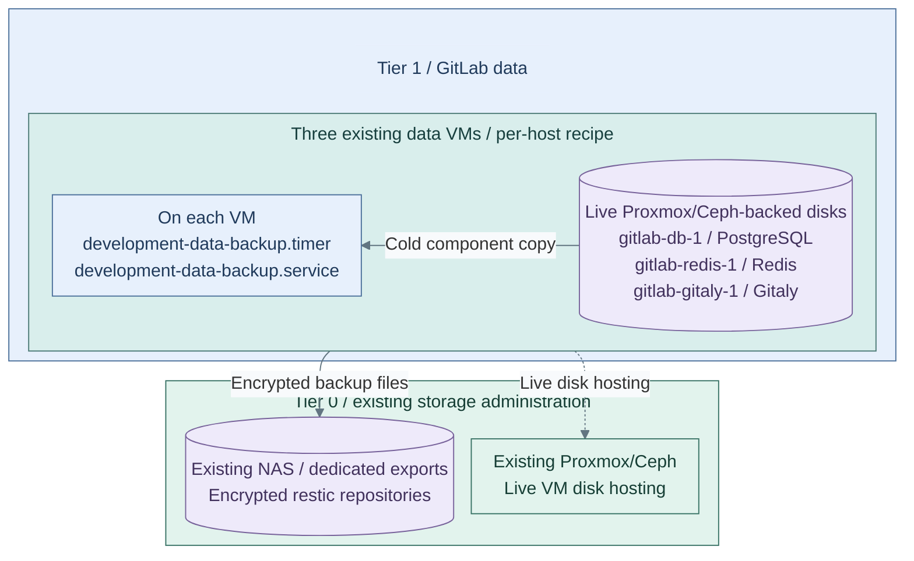

# GitLab data-VM backups

Back up PostgreSQL, Redis and Gitaly from live Proxmox/Ceph VM disks to encrypted restic repositories.
These cold component copies are separate from GitLab Toolbox backups and application object storage.

**Working repository:** generated Tier 1.
**Run configuration on:** the deployment host. **Run checks on:** each existing data VM.
**Prerequisites:** commissioned storage/mounts or SFTP service, independent encryption passwords,
approved restic 0.17+ and [accepted data services](../../deployment/stage-9-development/procedures/data-services.md#render-and-apply).
**Design:** [backup and recovery](../../architecture/operations/backup-recovery.md).

<a id="contents"></a>

## Operator tasks

- [How to select a destination and schedule?](#select-the-file-destination)
- [How to commission a NAS mount?](#commission-a-nas-mount)
- [How to run, inspect and restore a component copy?](#run-and-restore)
- [When to stop, roll back or prune?](#failure-limits)
- [References](#references)

<a id="select-the-file-destination"></a>

## How to select a destination and schedule?

1. Edit **Tier 1 `ansible/group_vars/development_data.yml`**, using the
   [existing example](../../../tier-1/ansible/group_vars/development_data.yml.example).
   Keep private passwords/keys in the referenced protected files.

   | Field | Set to |
   | --- | --- |
   | `development_data_backup_transport` | `filesystem` for NAS mount, or `sftp` for a qualified SSH file service |
   | `development_data_backup_repository` | A distinct repository per data VM, matching the selected transport |
   | `development_data_backup_filesystem` | NAS mode: exact mount/source/type, marker and effective write UID/GID per VM |
   | `development_data_backup_password_src` | Independently retained encryption-password file |
   | `development_data_backup_ssh_key_src`, `development_data_backup_known_hosts_src` | SFTP mode: scoped private key and independently verified host keys |
   | `development_data_backup_calendar` | Native systemd expression; default `"*-*-* 02:00:00"`, plus up to 15 minutes random delay |
   | `development_data_backup_initialize` | `true` only for explicit one-time initialization of a genuinely empty repository; return to `false` afterwards |
   | `development_data_backup_custody_accepted` | `true` only after independent copy/access/retention responsibilities are accepted |
   | `development_data_backup_timeout_seconds` | Failure deadline; not a guarantee that blocked NFS I/O terminates |

2. For NAS, complete the next task before applying. For SFTP, qualify scoped credentials and
   repository access through the existing service; retain the selected transport on existing projects.
3. Apply via the [data-service installer](../../deployment/stage-9-development/procedures/data-services.md#render-and-apply).
   It probes repository/mount identity before scheduling. It installs no NAS server, export or mount.



**IaC + commissioned storage:** Tier 1 [backup tasks](../../../tier-1/ansible/roles/development_data/tasks/backup.yml),
[job](../../../tier-1/ansible/roles/development_data/templates/backup.sh.j2) and
[inputs](../../../tier-1/ansible/group_vars/development_data.yml.example) install one
timer/service per existing data VM. Scope: selected `filesystem` recovery copies,
not GitLab application objects or the SFTP alternative. Proxmox disks, NAS exports,
mounts and independent retention are prerequisites, not installed storage services.

<a id="commission-a-nas-mount"></a>

## How to commission a NAS mount?

**Storage custodian + each data VM administrator:**

1. Prepare a private export/share and capacity budget per host; retain snapshot/pruning
   administration separately. Keep NFS root-squash and qualify UID/GID mapping, or use scoped SMB.
2. Persistently mount it **outside `/var/opt/gitlab` and `/etc/gitlab`**. Read the actual mount identity:

   ```bash
   read -r -p "Commissioned backup mount: " BACKUP_MOUNT
   findmnt -rn -M "$BACKUP_MOUNT" -o TARGET,SOURCE,FSTYPE
   ```

3. Have the custodian create the private repository directory and
   `.development-data-backup-target` at the mount root with the recorded unique host marker.
   Set those exact values in the per-host filesystem contract.
4. Apply configuration and require mount, marker, capacity and create/read/sync/rename/delete
   checks to pass before stopping any component. Every backup repeats the mount contract.

**Stop on mismatch.** Do not enable `no_root_squash`, replace a marker or redirect the job into
a local directory to force success. The role does not change export permissions.

<a id="run-and-restore"></a>

## How to run, inspect and restore a component copy?

### 1: Start and check a backup

**On each data VM**, during the approved service-interruption window:

```bash
sudo systemctl list-timers --all development-data-backup.timer
sudo systemctl cat development-data-backup.timer
sudo systemctl start development-data-backup.service
sudo systemctl status development-data-backup.service --no-pager
sudo journalctl -u development-data-backup.service -n 80 --no-pager
sudo /opt/gitlab/bin/gitlab-ctl status
```

The job stops its single component, copies it cold, requests restart and runs a repository check.
Verify actual source readiness; a logged restart request is not proof. Three successful component
copies are not an atomic GitLab recovery point. Coordinate them with Toolbox, Secrets and object
buckets in the [product recovery plan](../recovery/tier-1-products.md). [2]

### 2: List and verify retained points

On the selected VM, enter an authorized root shell. Load only the installed root-owned profile:

```bash
sudo -i
set -a
source /etc/development-data/backup.env
set +a
```

For **NAS/filesystem** repositories:

```bash
restic snapshots --json
restic check --read-data
```

For **SFTP**, use the same qualified key/host-key options as the installed job:

```bash
RESTIC_SFTP_ARGS='-i /etc/development-data/backup.key -o IdentitiesOnly=yes -o BatchMode=yes -o StrictHostKeyChecking=yes -o UserKnownHostsFile=/etc/development-data/known_hosts'
restic -o "sftp.args=$RESTIC_SFTP_ARGS" snapshots --json
restic -o "sftp.args=$RESTIC_SFTP_ARGS" check --read-data
```

### 3: Extract onto a new isolated target

On an independent recovery host, configure the same repository/password from independent custody;
for SFTP also supply its authorized key and verified host keys. Preserve incident/source data.

```bash
set -euo pipefail
read -r -p "Full recorded component snapshot ID: " RECOVERY_SNAPSHOT
read -r -p "NEW absolute extraction directory on encrypted recovery storage: " RECOVERY_TARGET
read -r -p "Target isolation verified (yes): " RECOVERY_ISOLATED
test "$RECOVERY_ISOLATED" = yes
[[ "$RECOVERY_SNAPSHOT" =~ ^[a-f0-9]{64}$ ]]
case "$RECOVERY_TARGET" in /*) ;; *) exit 1 ;; esac
umask 077
mkdir -m 0700 "$RECOVERY_TARGET"
```

Choose the configured transport. For NAS/filesystem:

```bash
restic restore "$RECOVERY_SNAPSHOT" --target "$RECOVERY_TARGET" --verify
```

For SFTP, after configuring that recovery host's credential paths:

```bash
restic -o "sftp.args=$RESTIC_SFTP_ARGS" restore "$RECOVERY_SNAPSHOT" --target "$RECOVERY_TARGET" --verify
```

`mkdir` must succeed on a new path. Never overwrite running PostgreSQL files.
Inspect/decrypt the extracted set before the matching-version
[GitLab native recovery](../recovery/tier-1-products.md). [1][2]

<a id="failure-limits"></a>

## When to stop, roll back or prune?

| Condition | Required action |
| --- | --- |
| NAS/SFTP loss, full storage, wrong mount or marker | Fail closed; no local fallback or automatic deletion |
| Cold backup blocks past its deadline | Investigate actual source readiness; hard NFS I/O can remain blocked despite termination |
| Schedule must pause | `sudo systemctl stop development-data-backup.timer`; an active service is separate |
| Invalid changed schedule or credentials | Restore accepted input values, reapply the installer and prove repository access before resuming |
| Restore/consistency check fails | Preserve failed target and retry on another clean isolated target after diagnosis |
| History or credentials require retirement | Separate backup/storage custodian reviews independent copies and holds first |

Use the [custodian retention review](control-applications.md#custodian-retention) with this
repository's environment and explicit snapshot ID. The installed job performs **no forget/prune**.
A repository password protects confidentiality, not retention: writable backup credentials,
host root or NAS administrators may still alter/delete history despite the job's lack of pruning.
Record actual schedule/outage behavior, accepted RPO/RTO and independently retained copies.

## References

1. [Restic mounted-file and SFTP repositories](https://restic.readthedocs.io/en/stable/030_preparing_a_new_repo.html).
2. [GitLab backup/restore requirements](https://docs.gitlab.com/administration/backup_restore/).
3. [Restic native restore verification](https://restic.readthedocs.io/en/stable/050_restore.html).
