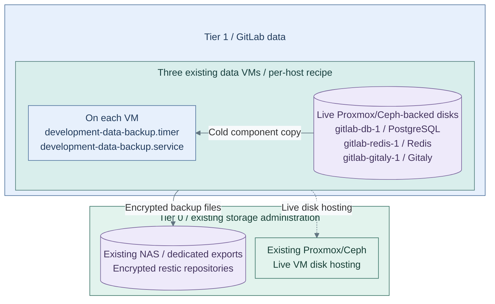

# GitLab data-VM backups

Back up PostgreSQL, Redis and Gitaly from their Proxmox/Ceph-backed VM disks to
encrypted file repositories. A NAS mount is a backup destination, never a replacement
for live `/var/opt/gitlab` data. GitLab's chart uses separate object storage for
application objects; changing VM backup transport does not change that requirement.

**Working repository:** `<prefix>-tier-1`; upstream `tier-1/`.
**Prerequisites:** prepared data VMs, commissioned backup storage, independent
encryption passwords and approved restic. Use the existing
[data-service recipe](../../deployment/stage-9-development/procedures/data-services.md#render-and-apply).

## Contents

- [Select the file destination](#select-the-file-destination)
- [Commission a NAS mount](#commission-a-nas-mount)
- [Run and restore](#run-and-restore)
- [Failure limits](#failure-limits)
- [References](#references)

## Select the file destination

The [input example](../../../tier-1/ansible/group_vars/development_data.yml.example)
contains both paths. Select one; existing configurations retain SFTP behavior.

| Input | Contract |
| --- | --- |
| `development_data_backup_transport` | `filesystem` for a direct NAS mount; `sftp` for an existing scoped SSH file service |
| `development_data_backup_repository` | Per-host absolute repository below the commissioned NAS mount, or per-host SFTP URL |
| `development_data_backup_filesystem` | Filesystem mode: per-host exact mount/source/type, unique marker and effective NAS write UID/GID |
| `development_data_backup_password_src` | Private controller-side path to the independently retained restic encryption password |
| `development_data_backup_initialize` | Explicit one-time initialization of a genuinely empty repository; never a damaged/inaccessible one |
| `development_data_backup_custody_accepted` | Set only after independently retained copies and access/retention responsibilities are commissioned |
| `development_data_backup_timeout_seconds` | Failure deadline, not a guarantee that a blocked NFS operation can terminate |

The role installs backup jobs, not a NAS server, export, storage gateway or mount.
No object API is used for these VM recovery copies.

**IaC + commissioned storage:** Tier 1 [backup tasks](../../../tier-1/ansible/roles/development_data/tasks/backup.yml),
[job](../../../tier-1/ansible/roles/development_data/templates/backup.sh.j2) and
[inputs](../../../tier-1/ansible/group_vars/development_data.yml.example) install one
timer/service per existing data VM. Scope: selected `filesystem` recovery copies,
not GitLab application objects or the SFTP alternative. Proxmox disks, NAS exports,
mounts and independent retention are prerequisites, not installed storage services.

## Commission a NAS mount

1. Create a dedicated export/share for each host's backups, with private directories
   and an adequate capacity budget. Grant the mapped backup identity only its area;
   retain NAS snapshot/pruning administration separately. Keep NFS root-squash and
   qualify the mapped UID/GID, or use a scoped authenticated SMB identity.
2. Persistently mount the export on that VM outside `/var/opt/gitlab` and `/etc/gitlab`.
   Record exact `findmnt -rn -M <mount> -o TARGET,SOURCE,FSTYPE` output in the host's
   input contract. Precreate its repository directory; do not use a symlink.
3. Have the storage custodian create `.development-data-backup-target` at the mount
   root with that host's independently generated marker. Configure the matching
   marker and effective write UID/GID. The installer checks mount identity, marker,
   available capacity and actual create/read/sync/rename/delete behavior before
   stopping a component. Each scheduled run rechecks the contract.

The recipe neither changes export permissions nor enables `no_root_squash` to make
a failed write test pass. Wrong paths, absent mounts or marker mismatches stop the job.
Data, local inputs and repository passwords remain outside source control.

## Run and restore

Apply through the [data-service installer](../../deployment/stage-9-development/procedures/data-services.md#render-and-apply),
then start `development-data-backup.service` on each VM in a change window. Inspect
the timer, journal, source-service readiness, restic snapshots and repository check.
No forget/prune policy runs from this job.

The job stops its single component, makes a cold encrypted restic copy, requests
source restart and checks the repository. These component copies need a coordinated
GitLab recovery point; three successful backups are not an atomic application backup.
Keep GitLab's toolbox backup, application objects and Kubernetes Secrets in the
[product recovery plan](../recovery/tier-1-products.md).

Restore with the retained password and `restic restore <snapshot> --target /restore`
on an isolated clean target. Inspect that copy before the matching-version product
restore; never overwrite running PostgreSQL files. Verify database, repositories,
hooks, SSO, jobs and application objects together before accepting recovery.

## Failure limits

NAS loss or full storage fails the job; it does not trigger local fallback or
retention deletion. A cold copy causes a maintenance outage. Restart is requested
on handled failures, but hard NFS I/O can remain blocked past termination deadlines.
Measure actual source readiness during NAS-loss/ENOSPC tests, not just a logged
restart command. Qualify the configured schedule and maximum outage locally.

A restic password protects repository contents, not availability or retention from
NAS administrators. Protect independent/offsite copies and record the accepted
[RPO/RTO and custody](../compute/backup-restore.md#backup-policy).

## References

1. [Restic local, mounted-file and SFTP repositories](https://restic.readthedocs.io/en/stable/030_preparing_a_new_repo.html).
2. [GitLab backup and restore requirements](https://docs.gitlab.com/administration/backup_restore/).
