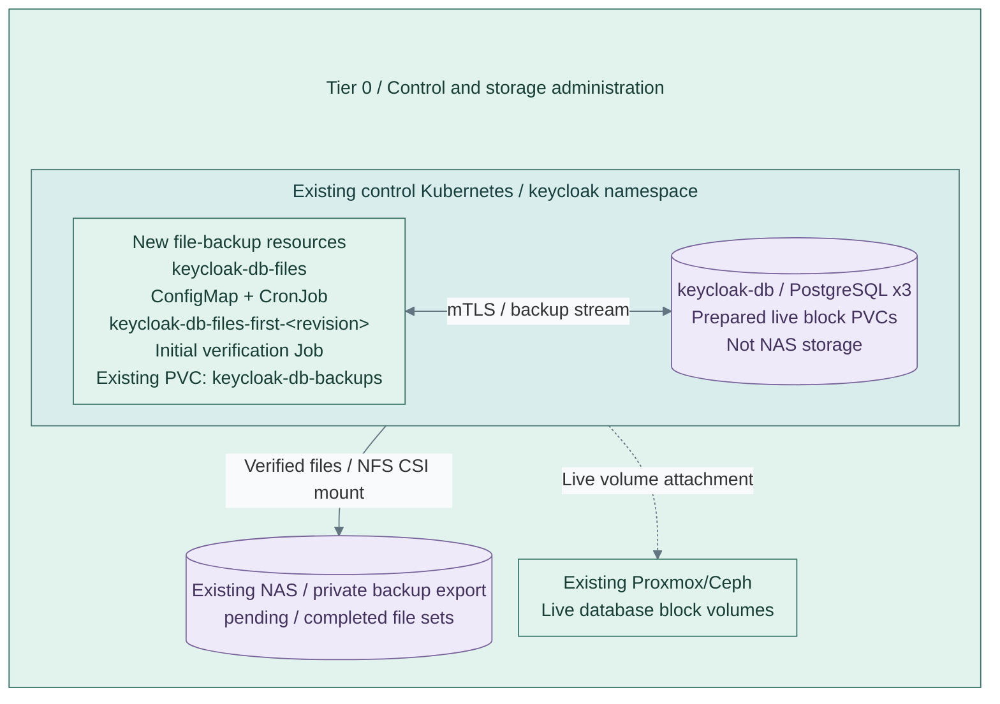

# PostgreSQL backups to NAS

Push verified full physical backups of `keycloak-db`, `netbox-db` and `grafana-db` to private NAS file
areas. Live database data/WAL stay on commissioned Proxmox CSI or Ceph RBD disks. Short-lived native
Jobs use PostgreSQL's replication protocol; no object gateway or permanent backup server is installed.
This option provides scheduled recovery points, **not continuous WAL archiving or PITR**. [1][2]

**Prerequisites:** accepted CNPG operator, PostgreSQL 17 image/tools, independently retained credentials,
commissioned database block CSI class, NFS CSI for separate backup-only claims, and NAS custodian access.
The source fixtures use CNPG chart `0.26.0` / operator `1.27.0` and PostgreSQL image `17.6`. Production
operator versions remain explicit inputs; CNPG 1.27 is outside current community support. Qualify current
supported pins separately. The file job deliberately supports PostgreSQL 17 and no additional tablespaces.

## Contents

- [Storage and credentials](#storage-and-credentials)
- [Selected realization](#selected-realization)
- [Prepare the database](#prepare-the-database)
- [Commission the NAS](#commission-the-nas)
- [Enable and operate](#enable-and-operate)
- [Recovery limits and mode changes](#recovery-limits-and-mode-changes)
- [References](#references)

## Storage and credentials

| Input | Contract |
| --- | --- |
| `control_applications_database_storage_class` | Explicit commissioned Proxmox/Ceph RBD class for live Keycloak/NetBox; no NAS class |
| `observability_database_storage_class` | Explicit commissioned Proxmox/Ceph RBD class for live Grafana |
| `control_applications_storage_class` | Other persistent services such as Vault/cache; retain qualified block storage |
| `control_applications_netbox_media_storage_class` | Separate commissioned RWX media class, such as CephFS |
| `*_backup_mode` | `files` in fresh examples; absent input defaults to legacy `object` with Barman/WAL |
| `*_backup_files_phase` | `prepare` creates only database resources; `backup` installs consumers and backup jobs |
| `*_database_storage_accepted` | False until actual block-storage durability, permissions and recovery are qualified |
| `*_backup_files_accepted` | False until per-database NAS privacy, permissions, identity, capacity and custody are commissioned |
| `control_applications_backup_files` | Map keyed by `keycloak` / `netbox` |
| `observability_backup_files` | Single Grafana destination map |

Empty database/media class overrides fall back to the old common class for legacy object-mode inputs.
Fresh files-mode deployments require explicit database classes; NetBox also requires a distinct media class.
The runtime gate checks the database provisioner and the backup PV's exact NFS CSI volume handle.
Neither class names nor CSI metadata alone establish physical backing, isolation or durability.

The backup certificate's CN is `<cluster>-file-backup`, with `clientAuth` usage, signed by that database's
client CA. Its Secret contains `tls.crt`, `tls.key` and `ca.crt`; the latter trusts the **server** CA.
The database user is `streaming_replica`; `cnpg_streaming_replica` is the certificate-name mapping,
not a role. CNPG 1.27's fixed rules permit certificate-authenticated replication and `postgres` database
connections. Jobs use `sslmode=verify-full`; the DB server leaf must cover the `<cluster>-rw` DNS name. [3][4]

Tier 0 uses existing `*-db-ca` / `*-db-replication` and adds `*-db-file-backup`. Grafana files mode uses
external `grafana-db-client-ca`, `grafana-db-replication` and `grafana-db-file-backup`; ordinary object
mode retains its existing certificate ownership. Rotate leaves through their owner; Jobs mount current
Secrets read-only with no Kubernetes API token. Never distribute client CA private keys to Jobs.

Commission pod-to-DNS and pod-to-DB TCP 5432 access. The conditional observability policy permits the
labelled backup pod to reach DNS and Grafana DB only; existing same-namespace DB ingress admits it.
Tier 0 adds no new database-selecting policy. **NFS CSI node/controller-to-NAS access is an underlay
prerequisite**, typically TCP 2049 for the commissioned NFSv4 export, not pod TLS or an object endpoint.
Validate actual routed CIDRs, root-squash behavior and CNI enforcement locally.

## Selected realization

Scope: Keycloak's files-mode backup after database-only preparation. NetBox and
Grafana reuse the same code with their owning tier's inputs; they are not extra
databases created by this figure. Storage is commissioned independently.



**IaC + commissioned storage:** Tier 0 [product inputs](../../../tier-0/ansible/group_vars/control_applications.yml.example)
and [backup invocation](../../../tier-0/ansible/roles/control_applications/tasks/database-files.yml)
call Shared's [resource template](../../../shared/ansible/roles/postgresql_file_backup/templates/resources.yml.j2).
The configured database has three instances; this is not an HA acceptance claim.
The existing NAS claim is mounted only by backup jobs, never by database pods.
The initial Job suffix is a code-derived revision, not an operator-assigned host name.

## Prepare the database

Work from the owning generated Tier 0 or Tier 1 repository. Fill the existing private product inputs
and DB certificate/credential Secrets first. Select `files`, `prepare`, the explicit database block
class and `*_database_storage_accepted: true`. Leave NAS system identifiers/markers empty and backup
acceptance false. No application chart, file Job or NAS marker is created in this phase.

Tier 0, from its repository root:

```bash
ANSIBLE_CONFIG=ansible/ansible.cfg ansible-playbook -i localhost, \
  ansible/playbooks/deployment/control-applications.yml \
  -e @ansible/group_vars/control_applications.yml -e @ansible/group_vars/control_applications_secrets.yml \
  -e control_applications_action=apply
```

Tier 1 uses `ansible/playbooks/deployment/observability-platform.yml`, the corresponding
`observability_platform*.yml` input files and `-e observability_action=apply`.
Render first with `action=render` to inspect `*-database-prepare.yml`. All ordinary product
configuration prerequisites still apply; render outputs contain private configuration.

After Ready, preparation reports the real `status.systemID`. Independently confirm it:

```bash
kubectl --context "$SOURCE_CONTEXT" -n "$PRODUCT_NAMESPACE" get cluster "$CLUSTER" \
  -o jsonpath='{.status.systemID}{"\n"}'
```

## Commission the NAS

The custodian creates a private, retained, **backup-only** NFS CSI PV/PVC in each product namespace.
Use separate exports/credentials or enforce equivalent server-side per-database isolation; a claim name
or NFS AUTH_SYS UID alone is not a security boundary. No NAS administrator credential enters the Job.
Prepare ownership for container UID/GID `26:26`, restrictive directory permissions and qualified
root-squash/fsGroup behavior. The role never provisions a NAS, changes live DB storage or initializes
an arbitrary destination. Existing CNPG-labelled claims are rejected as destinations. [5]

For each destination map, set:

| Key | Value |
| --- | --- |
| `claim` | Existing namespace-local backup PVC, e.g. `keycloak-db-backups` |
| `volume_handle` | Exact bound PV `spec.csi.volumeHandle`; provisioner must be `nfs.csi.k8s.io`, reclaim policy `Retain` |
| `system_identifier` | Actual source `status.systemID`, quoted as a string |
| `marker` | Independently generated random 24-128 character alphanumeric/underscore/hyphen token |
| `schedule` | Five-field native CronJob schedule in UTC, e.g. `0 2 * * *`; not CNPG's six-field object schedule |

On the verified **new empty authorized NAS directory**, as its custodian, create `pending/`, `completed/`
and `.postgresql-backup-source`. The marker is exactly three LF-terminated lines:

```text
tier-0/keycloak/keycloak-db
ACTUAL_SYSTEM_IDENTIFIER
ACTUAL_RANDOM_MARKER
```

Source IDs are `tier-0/keycloak/keycloak-db`, `tier-0/netbox/netbox-db` and
`tier-1/<observability_namespace>/grafana-db`. For example, with reviewed custodian variables:

```bash
test -d "$NAS_DIRECTORY" && test ! -L "$NAS_DIRECTORY"
test -z "$(find "$NAS_DIRECTORY" -mindepth 1 -maxdepth 1 -print -quit)"
umask 077
mkdir "$NAS_DIRECTORY/pending" "$NAS_DIRECTORY/completed"
(set -o noclobber; printf '%s\n%s\n%s\n' "$SOURCE_ID" "$SYSTEM_IDENTIFIER" "$MARKER" \
  > "$NAS_DIRECTORY/.postgresql-backup-source")
```

Never replace a mismatching marker to make a Job pass. Diagnose the source/PV/custody mismatch first.

## Enable and operate

Set `*_backup_files_phase: backup` and `*_backup_files_accepted: true`, then render/apply the same
product workflow. Shared renders `<cluster>-files.yml`: ConfigMap/CronJob `<cluster>-files` and initial
Job `<cluster>-files-first-<revision>`. The revision hashes the native Job spec, backup script and
destination handle. Apply waits for that configuration's Job; image, identity or script changes create
a new verification Job without pruning older Jobs. Identical convergence reuses that revision's result;
use a manually named Job for a fresh run without configuration changes.

```bash
kubectl --context "$SOURCE_CONTEXT" -n "$PRODUCT_NAMESPACE" create job \
  "$CLUSTER-files-$(date -u +%Y%m%d%H%M%S)" --from="cronjob/$CLUSTER-files"
kubectl --context "$SOURCE_CONTEXT" -n "$PRODUCT_NAMESPACE" get jobs
```

Each attempt checks the exact persistent marker and source system identifier before streaming a full
backup plus WAL to `pending/<pod-uid>/pgdata`. Matching-major `pg_verifybackup` validates files and
required WAL before a no-clobber rename publishes `completed/<pod-uid>`. The set records image,
source identity, server version and completion time. No dumps, live PGDATA copies, fallback, deletion,
pruning or automatic marker creation occur. Failed sets remain pending; monitor them and free capacity. [1][6]

Monitor failed/missed Jobs **and age of the newest completed set** outside the failed cluster's
dependency chain. The one-hour Job deadline requests termination; hard NFS I/O can outlast it.
Streaming backups temporarily retain WAL on the live database. The job rejects a disabled
`wal_sender_timeout`; qualify the finite timeout, source WAL capacity and NAS-outage behavior
so a stalled copy cannot exhaust production storage unnoticed. [1]
The initial Job proves transport and
verification only; qualify [clean-target CNPG recovery](../recovery/cnpg-files.md) before acceptance.

## Recovery limits and mode changes

Backups are plaintext physical files on NAS. TLS does not encrypt them at rest. Commission protected
NAS access and storage encryption separately, and retain a separately encrypted offsite copy through
an existing approved recovery transport. NAS admin access or a writable backup identity can affect
history; no immutability or independent encryption is supplied by this role.

RPO is bounded by the last **successful completed set**, not the nominal schedule. There is no PITR
between sets. RTO includes staging, WAL recovery and a second physical copy into fresh CNPG claims.
Preserve the exact compatible image/extensions, app Secrets, certificates and non-database product
state separately. `pg_verifybackup` does not replace application restore drills. [2][6]

Mode selection is not an automatic migration. The files precheck rejects an existing object archiver
or a different live storage class. For an approved object-to-files change, first preserve the last
accepted object backup/WAL coverage, explicitly suspend the old owned `ScheduledBackup`, and review
the native Cluster/plugin transition separately. Retain the ObjectStore, bucket/prefix and recovery
credentials. Files-to-object likewise needs explicit suspension of `<cluster>-files`, qualification
of the object/WAL path and preservation of all NAS sets. Neither selection deletes old schedulers,
PVCs, backup sets or recovery history.

## References

Official source/API contracts reviewed 2026-10-27; native/live qualification is recorded separately.

1. [PostgreSQL 17 pg_basebackup](https://www.postgresql.org/docs/17/app-pgbasebackup.html)
2. [PostgreSQL standalone hot backups](https://www.postgresql.org/docs/17/continuous-archiving.html#BACKUP-STANDALONE)
3. [CNPG 1.27 certificate identities and mappings](https://cloudnative-pg.io/docs/1.27/certificates/)
4. [CNPG 1.27.0 fixed authentication rules](https://github.com/cloudnative-pg/cloudnative-pg/blob/v1.27.0/pkg/postgres/configuration.go)
5. [NFS CSI storage contracts and permissions](https://github.com/kubernetes-csi/csi-driver-nfs/blob/master/docs/driver-parameters.md)
6. [PostgreSQL 17 pg_verifybackup](https://www.postgresql.org/docs/17/app-pgverifybackup.html)
