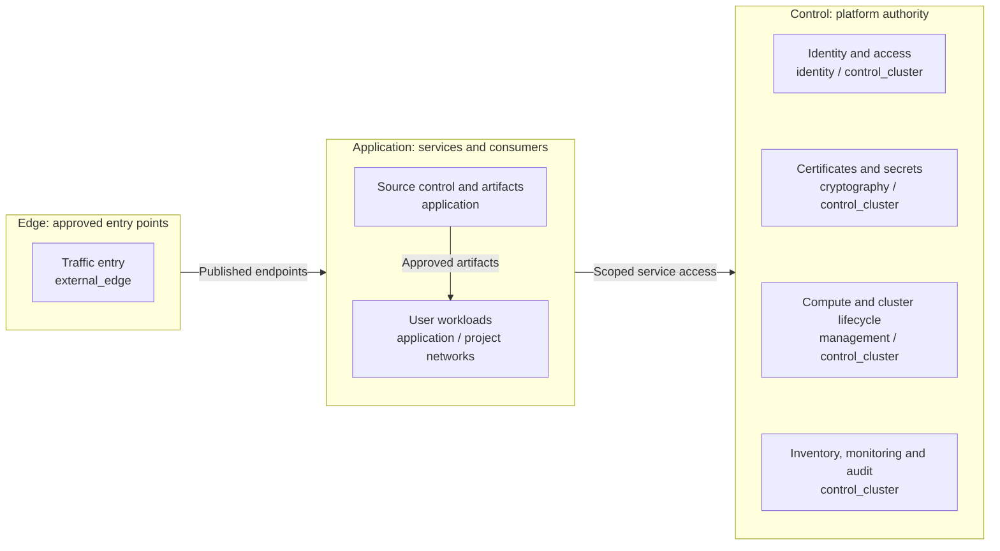
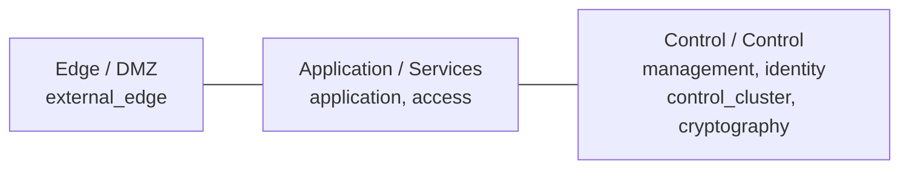
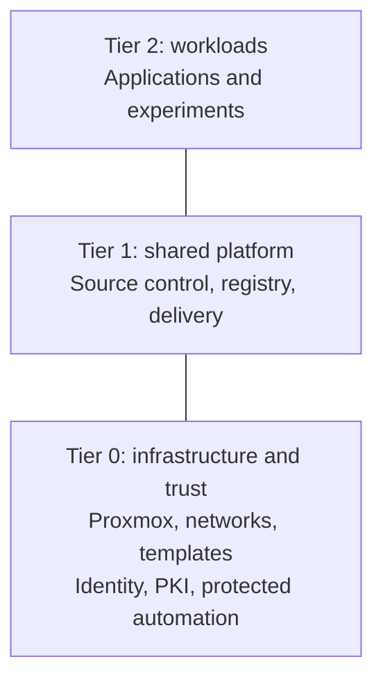

# Platform architecture

A private cloud built from Proxmox, purpose-based networks, and repeatable
automation. The system separates workload access from platform authority, and
retains independent recovery of the infrastructure and trust services.

This is the intended design. Deployment stages and readiness are recorded
separately in [deployment](../deployment/README.md).

## Table of contents

- [Functional structure](#functional-structure)
- [Technical domains](#technical-domains)
- [Layered model](#layered-model)
- [Tiered model](#tiered-model)
- [Tier and zone view](#tier-and-zone-view)
- [Automation responsibilities](#automation-responsibilities)
- [Continue reading](#continue-reading)

## Functional structure

The platform connects compute, networking, identity, cryptography, delivery and
operations. Network layers describe exposure; tiers identify the owner of each
component according to its privileges.

Arrows identify relationships, not firewall rules or a complete dependency graph.
Offline root custody is outside the routed platform. The
[network map](networking/README.md) defines attachments and zones; the
[firewall policy](networking/firewall-policy.md) defines permitted flows.

For example, FreeIPA supplies the directory component of **identity and access**;
an identity broker and service authorization complete the authentication path.
The [reference platform](reference-platform.md) shows one target allocation
of those components to VMs, clusters, and offline custody.

## Technical domains

Each domain describes its purpose, components, interfaces, design choices and
constraints. A domain is a reading topic, not another repository or ownership boundary.

| Domain | Design responsibility |
| --- | --- |
| [Networking](networking/README.md) | Attachments, zones and permitted traffic |
| [Compute](compute/README.md) | Hypervisors, images, cluster runtime and protected provisioning |
| [Identity](identity/README.md) | Directory authority, authentication and service authorization |
| [Cryptography](cryptography/README.md) | Trust anchors, key custody, certificate issuance and secrets |
| [Delivery](delivery/README.md) | Published endpoints, software supply, source control and artifacts |
| [Operations](operations/README.md) | Visibility, inventory documentation, recovery and workload governance |

[Principles](principles.md), [tier ownership](tier-ownership.md) and
[service boundaries](service-boundaries.md) apply across these domains.
Option labels identify alternatives within a decision, not deployment stages
or generator flags. Procedures realize the selected design; they do not redefine it.

## Layered model

Network protection runs **left to right**, from exposed entry points to control
systems. The network names describe what runs there; firewall zones group
networks with similar policy.

Lines show placement, not allowed traffic. Only named service connections are
permitted. Control is a layer; `management` is one network within it.
Host storage/quorum fabrics and offline `ceremony` are separate from this
routed service path. The [network map](networking/README.md) owns VLANs and attachments.

## Tiered model

Repositories divide responsibility by potential impact. **Tier 2 is at the
top; Tier 0 is at the bottom**, supporting the systems above it.

These are ownership boundaries, not network routes. Each tier owns its
inventory, Terraform resources, and state. Shared holds reusable automation,
size data, and common platform references, never resource ownership or host
inventory. See [tier ownership](tier-ownership.md) for the contract.

## Tier and zone view

| Service | Repository | Network | Firewall zone |
| --- | --- | --- | --- |
| Shared reverse proxy | Tier 1 | `external_edge` | DMZ |
| Source control | Tier 1 | `application` | Services |
| Project application | Tier 2 | `application` or a project subnet | Services or a dedicated policy |
| Directory authority | Tier 0 | `identity` | Control |
| Protected infrastructure runner | Tier 0 | `management` | Control |
| Offline root CA | Tier 0 | isolated `ceremony` fabric | none |

A repository split does not require new network names or one VLAN per tier.
A shared zone does not permit unrestricted traffic between its subnets.
Classify by actual privileges: an ordinary runner and a runner holding
hypervisor credentials do not have the same owner.

## Automation responsibilities

| Tool or workflow | Responsibility |
| --- | --- |
| Template publication; optional Packer builds | Tier 0 prepares approved images before VMs exist |
| Terraform / OpenTofu design | Provision resources from tier-owned definitions and inputs |
| Ansible | Configure supported Linux hosts from the same tier-local inventory |
| Kubernetes bootstrap | Create the cluster; Talos is the current OS implementation |
| GitOps | Reconcile services inside a running cluster |

The current wrappers execute Terraform. A protected workstation and protected
runner are alternative execution contexts within Tier 0's authority. Source
control coordinates changes; Tier 0 retains authorization and independent recovery.

## Continue reading

| Question | Authoritative guide |
| --- | --- |
| Which networks, VLANs, and firewall rules? | [Network map](networking/README.md), [firewall policy](networking/firewall-policy.md) |
| What belongs in each repo? | [Tier ownership](tier-ownership.md) |
| Which implementation choices are available? | [Technical domains](#technical-domains) |
| What does the complete control platform look like? | [Control platform design](reference-platform.md) |
| What is deployed first? | [Deployment checklist](../paths/tier-0/README.md) |
| How are privileged changes accepted? | [Infrastructure control](compute/provisioning.md) |
| What is the wider platform scope? | [Private cloud](private-cloud.md), [shared services](service-boundaries.md) |

Routing, switching, and firewall rules remain operator-managed prerequisites.
The generator creates repositories, not running infrastructure.
