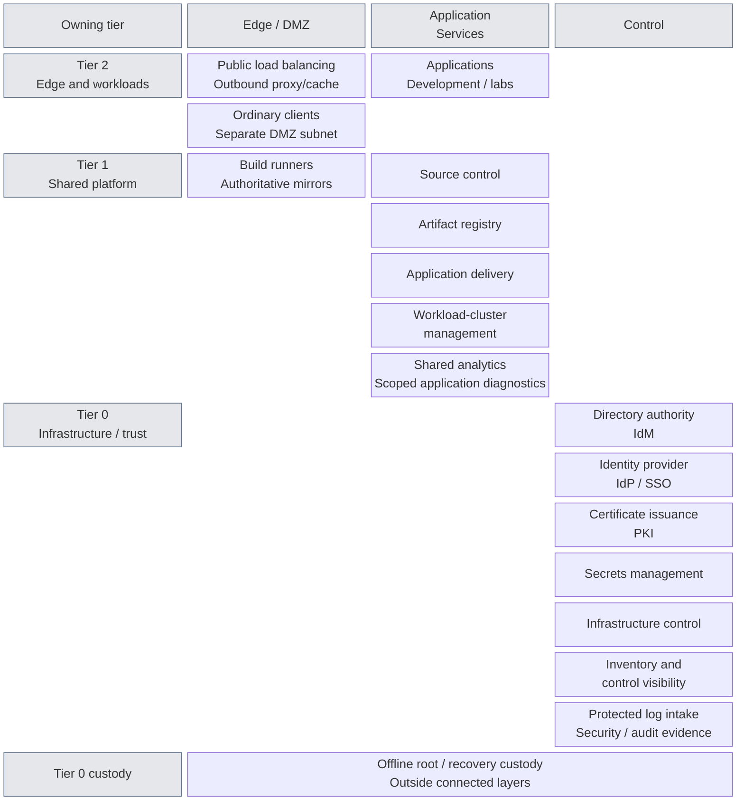
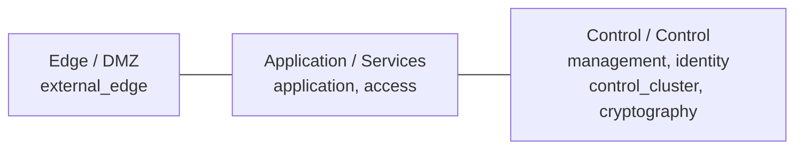
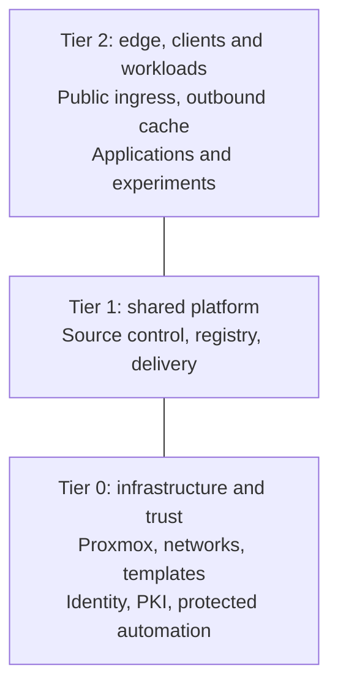

# Platform architecture

The private cloud provides shared services and isolated project runtimes on a
locally controlled infrastructure and trust foundation. Users consume published
applications; teams deliver reviewed changes; platform operators retain control
of infrastructure, identity, keys and recovery.

This page shows the completed intended system. The
[integrated reference design](reference-platform.md) assigns its functions to
components and hosting boundaries. Each [technical domain](#technical-domains)
then expands part of the same system into detailed designs and alternatives.
Selected site designs belong in project-owned architecture records; actual
deployment and acceptance evidence belong in [deployment](../deployment/README.md).

## Table of contents

- [Read from overview to detail](#read-from-overview-to-detail)
- [Functional structure](#functional-structure)
- [How the platform works together](#how-the-platform-works-together)
- [Technical domains](#technical-domains)
- [Layered model](#layered-model)
- [Tiered model](#tiered-model)
- [Tier and zone view](#tier-and-zone-view)
- [Automation responsibilities](#automation-responsibilities)
- [Continue reading](#continue-reading)

## Read from overview to detail

| View | Question answered | Design |
| --- | --- | --- |
| Whole platform | Which capabilities form the environment, and where do they belong by tier and layer? | This page |
| Integrated reference | What components coexist in one complete realization, and where do they run? | [Reference platform](reference-platform.md) |
| System interactions | How do access, changes, certificates, data and recovery cross domain boundaries? | [Runtime relationships](runtime-flows.md) |
| Domain | What is inside one platform function, and what does it consume and provide? | [Technical domains](#technical-domains) |
| Detailed design | How does a component or alternative fulfill that domain's contract? | Detail pages linked from each domain |
| Selected instance | Which alternatives are combined for a particular site or environment? | [Variant selection](variants.md) and project-owned designs |

Depth follows composition rather than installation order. A child diagram expands
a named part of its parent and keeps the same outward interfaces. Networking,
ownership and runtime placement are complementary views of those components.
Only designs with meaningful internal differences need another page or diagram.

## Functional structure

The capability map places services by **owning tier** vertically and **security
layer** horizontally. Boxes name capabilities, not products, VMs or clusters.
Domain views expand those boxes into their components and hosting arrangements.

Empty cells do not require additional services or networks. The map shows the
reference placement; project services and isolated variants retain their actual
owner and exposure. Infrastructure control owns the hosts, networks and storage
supporting every layer, not only services in its own cell.

**Identity and access management (IAM)** spans directory authority, the identity
provider and service-local authorization. It is not one VM. The
[identity view](identity/README.md) defines the terms and shows IdM on dedicated
VMs and the IdP in the Tier 0 cluster, consumed by services in all three tiers.

Both identity services remain in Control in this reference. An application-facing
login endpoint is a permitted service interface, not a move into the Services
zone. Control is a security layer; `management` is one network within it.
Offline custody is outside the connected layers, not another routed zone.

| Capability | Consumer-facing function | Expanded design |
| --- | --- | --- |
| Client access | Tier 2 endpoints consume named services without administrative or peer trust | [Network placement](networking/README.md#zone-assignment) |
| Directory authority (IdM) | Identity lifecycle, groups, host enrollment, DNS and Kerberos | [Identity](identity/README.md) |
| Identity provider (IdP / SSO) | Application authentication and identity claims | [Identity](identity/README.md) |
| Certificate issuance (PKI) | Trusted service certificates under approved policy | [Cryptography](cryptography/README.md) |
| Secrets management | Scoped credential delivery and independent recovery | [Cryptography](cryptography/README.md) |
| Infrastructure control | Authorized compute, network, storage and image lifecycle | [Compute](compute/README.md), [networking](networking/README.md) |
| Inventory and control visibility | Infrastructure records, health, audit and recovery evidence | [Operations](operations/README.md) |
| Protected security logging | All tiers submit; restricted raw-evidence reads and enforced retention remain Tier 0-owned | [Security logging](operations/security-logging.md) |
| Shared analytics | Tier 1 investigates approved copies; developers query only their application scope | [Telemetry](operations/telemetry.md) |
| Source control | Reviewed definitions and change proposals | [Delivery](delivery/README.md) |
| Artifact registry | Approved versions and scoped artifact access | [Artifact supply](delivery/artifact-supply.md) |
| Build execution | Tier 1 DMZ runners produce candidate artifacts with scoped credentials | [Delivery](delivery/README.md) |
| Authoritative mirrors | Tier 1 retains approved software sources separately from ordinary caches | [Software supply](delivery/README.md) |
| Application delivery | Authorized releases or reconciliation within approved application scope | [Delivery controllers](delivery/controllers.md) |
| Workload-cluster management | Scoped operation of approved workload clusters | [Kubernetes topology](compute/kubernetes.md) |
| Service publication and controlled egress | Tier 2 public entry points and ordinary outbound proxy/cache | [Delivery](delivery/README.md), [network policy](networking/firewall-policy.md) |
| Applications and project runtimes | User services, development and experiments | [Runtime design](compute/runtime.md) |

Ordinary clients belong to Tier 2 / Edge, on their own DMZ subnet. Protected
operator workstations belong to the tier they administer, not the ordinary client
network. Approved software sources and offsite recovery targets are external peers.
Existing services can fulfill a capability through explicit consumer, ownership
and recovery contracts. The
[runtime views](runtime-flows.md) show interactions; the
[reference platform](reference-platform.md) shows hosting; the
[network map](networking/README.md) owns attachments and firewall zones.

## How the platform works together

| Relationship | Completed behavior | Expanded view |
| --- | --- | --- |
| Service access | Clients reach named endpoints; the IdP uses directory authority; each service applies its own authorization | [Access](runtime-flows.md#service-access) |
| Application delivery | General builds produce candidates; approved source and artifacts are delivered into the owning runtime | [Application delivery](runtime-flows.md#application-delivery) |
| Infrastructure change | Proposed resource changes pass Tier 0 acceptance before protected execution; inventory and state remain tier-owned | [Infrastructure changes](runtime-flows.md#infrastructure-changes) |
| Certificate trust | An offline root authorizes intermediates; online issuers serve routine certificate consumers | [Trust](reference-platform.md#certificate-trust) |
| Data and recovery | Each stateful service owns its data and restoration contract; recovery inputs and failure detection survive hosted-service loss | [Data and recovery](runtime-flows.md#data-visibility-and-recovery) |

These relationships coexist after deployment. A deployment stage may contribute
to several functions, and one function may be realized across several stages.

## Technical domains

Each domain opens with its completed design and boundary interfaces, then links
to internal components and variants. A domain is a reading topic, not another
repository or ownership boundary.

| Domain view | Detail available below it |
| --- | --- |
| [Networking](networking/README.md) | Attachments, network catalog and [permitted traffic](networking/firewall-policy.md) |
| [Compute](compute/README.md) | [VM/cluster placement](compute/runtime.md), [three-cluster topology](compute/kubernetes.md) and [protected provisioning](compute/provisioning.md) |
| [Identity](identity/README.md) | IdM, IdP and authorization relationships; [Windows integration](identity/windows-integration.md) |
| [Cryptography](cryptography/README.md) | [Key custody](cryptography/hsm-selection.md), [USB gateways](cryptography/usb-hsm.md), [network HSM](cryptography/network-hsm.md) and [service seals](cryptography/vault-seal.md) |
| [Delivery](delivery/README.md) | Endpoints, [controller choices](delivery/controllers.md), [artifact authority and distribution](delivery/artifact-supply.md) |
| [Operations](operations/README.md) | Inventory/recovery relationships and [telemetry composition](operations/telemetry.md) |

[Principles](principles.md), [tier ownership](tier-ownership.md) and
[service boundaries](service-boundaries.md) apply across these domains.
The [variant contract](variants.md) explains which local substitutions preserve
the parent design and which changes require review of that design. Procedures
realize the selected design; they do not redefine it.

## Layered model

Network protection runs **left to right**, from exposed entry points to control
systems. The network names describe what runs there; firewall zones group
networks with similar policy.

Lines show placement, not allowed traffic. Only named service connections are
permitted. Control is a layer; `management` is one network within it.
Host storage/quorum fabrics and offline `ceremony` are separate from this
routed service path. The [network map](networking/README.md) owns VLANs and attachments.

## Tiered model

Repositories divide responsibility by potential impact. **Tier 2 is at the
top; Tier 0 is at the bottom**, supporting the systems above it.

These are ownership boundaries, not network routes. Each tier owns its
inventory, Terraform resources, and state. Shared holds reusable automation,
size data, and common platform references, never resource ownership or host
inventory. See [tier ownership](tier-ownership.md) for the contract.

## Tier and zone view

| Service | Repository | Network | Firewall zone |
| --- | --- | --- | --- |
| Public edge load balancer and ordinary cache | Tier 2 | `external_edge` | DMZ |
| Ordinary clients | Tier 2 | separate `client` subnet | DMZ |
| General build runner / authoritative mirror | Tier 1 | `delivery_edge` | DMZ |
| Source control | Tier 1 | `application` | Services |
| Project application | Tier 2 | `application` or a project subnet | Services or a dedicated policy |
| Directory authority | Tier 0 | `identity` | Control |
| Protected infrastructure runner | Tier 0 | `management` | Control |
| Offline root CA | Tier 0 | isolated `ceremony` fabric | none |

A repository split does not require new network names or one VLAN per tier.
A shared zone does not permit unrestricted traffic between its subnets.
Classify by actual privileges: an ordinary runner and a runner holding
hypervisor credentials do not have the same owner.

## Automation responsibilities

| Tool or workflow | Responsibility |
| --- | --- |
| Template publication; optional Packer builds | Tier 0 prepares approved images before VMs exist |
| Terraform / OpenTofu design | Provision resources from tier-owned definitions and inputs |
| Ansible | Configure supported Linux hosts from the same tier-local inventory |
| Kubernetes bootstrap | Create the cluster; Talos is the current OS implementation |
| Application delivery | Tier 0 uses Flux; Tier 1 selects GitOps or release-pipeline orchestration separately |

The current wrappers execute Terraform. A protected workstation and protected
runner are alternative execution contexts within Tier 0's authority. Source
control coordinates changes; Tier 0 retains authorization and independent recovery.

## Continue reading

| Question | Authoritative guide |
| --- | --- |
| Which networks, VLANs, and firewall rules? | [Network map](networking/README.md), [firewall policy](networking/firewall-policy.md) |
| What belongs in each repo? | [Tier ownership](tier-ownership.md) |
| Which implementation choices are available? | [Technical domains](#technical-domains), [variant selection](variants.md) |
| What does the complete platform look like? | [Integrated reference design](reference-platform.md) |
| How do its parts cooperate? | [Runtime relationships](runtime-flows.md) |
| What is deployed first? | [Deployment checklist](../paths/tier-0/README.md) |
| How are privileged changes accepted? | [Infrastructure control](compute/provisioning.md) |
| What is the wider platform scope? | [Private cloud](private-cloud.md), [shared services](service-boundaries.md) |

Routing, switching, and firewall rules remain operator-managed prerequisites.
The generator creates repositories, not running infrastructure.
