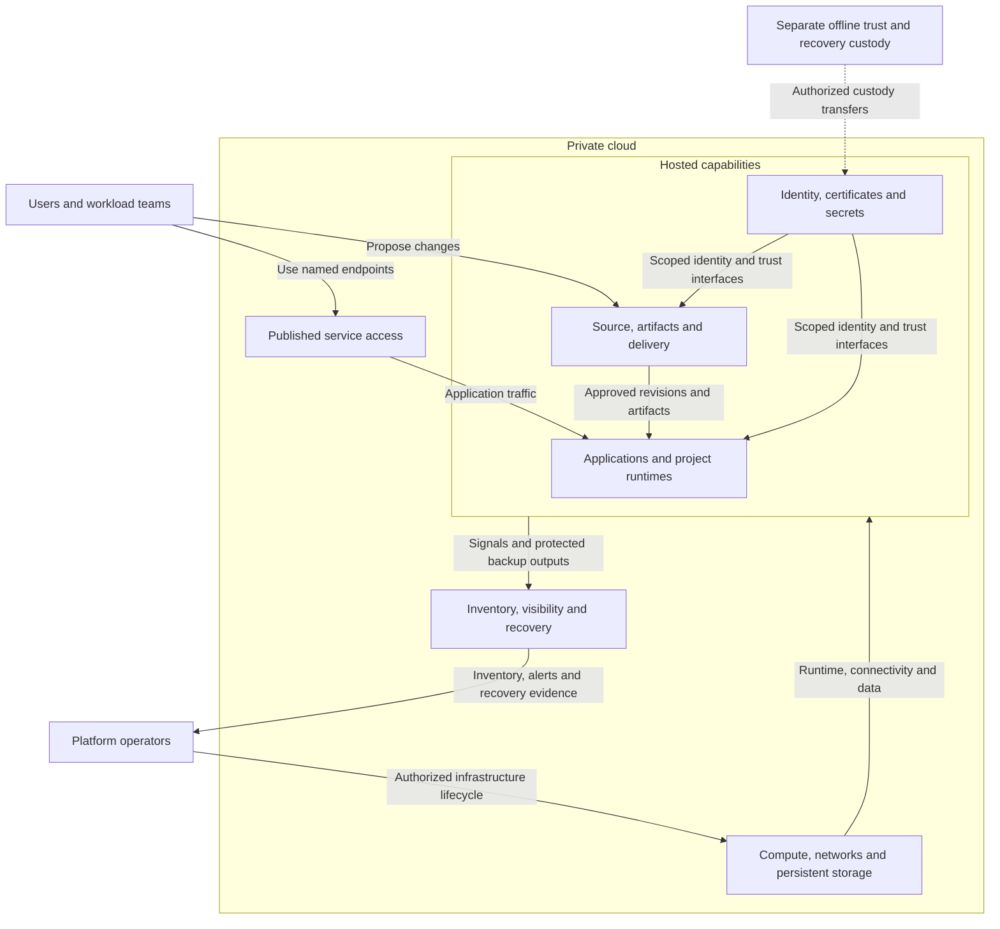
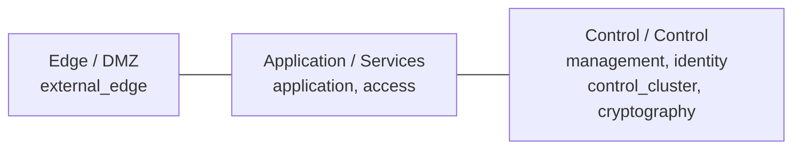
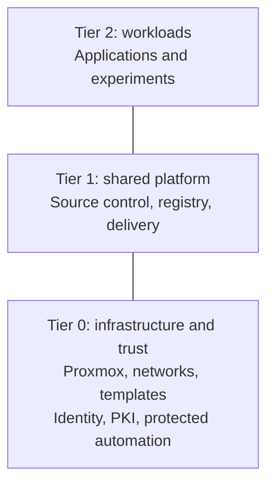

# Platform architecture

The private cloud provides shared services and isolated project runtimes on a
locally controlled infrastructure and trust foundation. Users consume published
applications; teams deliver reviewed changes; platform operators retain control
of infrastructure, identity, keys and recovery.

This page shows the completed intended system. The
[integrated reference design](reference-platform.md) assigns its functions to
components and hosting boundaries. Each [technical domain](#technical-domains)
then expands part of the same system into detailed designs and alternatives.
Selected site designs belong in project-owned architecture records; actual
deployment and acceptance evidence belong in [deployment](../deployment/README.md).

## Table of contents

- [Read from overview to detail](#read-from-overview-to-detail)
- [Functional structure](#functional-structure)
- [How the platform works together](#how-the-platform-works-together)
- [Technical domains](#technical-domains)
- [Layered model](#layered-model)
- [Tiered model](#tiered-model)
- [Tier and zone view](#tier-and-zone-view)
- [Automation responsibilities](#automation-responsibilities)
- [Continue reading](#continue-reading)

## Read from overview to detail

| View | Question answered | Design |
| --- | --- | --- |
| Whole platform | What does the environment provide, and how do its major functions connect? | This page |
| Integrated reference | What components coexist in one complete realization, and where do they run? | [Reference platform](reference-platform.md) |
| System interactions | How do access, changes, certificates, data and recovery cross domain boundaries? | [Runtime relationships](runtime-flows.md) |
| Domain | What is inside one platform function, and what does it consume and provide? | [Technical domains](#technical-domains) |
| Detailed design | How does a component or alternative fulfill that domain's contract? | Detail pages linked from each domain |
| Selected instance | Which alternatives are combined for a particular site or environment? | [Variant selection](variants.md) and project-owned designs |

Depth follows composition rather than installation order. A child diagram expands
a named part of its parent and keeps the same outward interfaces. Networking,
ownership and runtime placement are complementary views of those components.
Only designs with meaningful internal differences need another page or diagram.

## Functional structure

The diagram shows supplied capabilities in the completed platform. The trust
function expands into identity and cryptography; the foundation expands into
compute and networking. Operations covers all hosted capabilities. Edge publication
and software delivery are two interfaces of the delivery domain.

Solid arrows name functional relationships, not blanket network permissions.
The custody arrow is an authorized transfer, not a network route. The
[interaction views](runtime-flows.md) expand the consequential connections;
the [firewall policy](networking/firewall-policy.md) owns allowed listeners.
Recovery copies and external failure detection remain available beyond the
hosted services they protect.

| Function | Result available to consumers | Place in the complete system |
| --- | --- | --- |
| Workload execution | Project applications, development environments and experiments | Tier 2 consumes approved runtime and shared service interfaces |
| Networking | Named entry points and purpose-based, enforced connectivity | Connects clients, services and infrastructure without granting administrative authority |
| Compute and data | VM/cluster capacity, approved images, persistent storage and controlled lifecycle | Supports every hosted capability; hardware authority remains Tier 0 |
| Identity and access | Directory, DNS, authentication federation and scoped service authorization | Supplies identity to applications, delivery and operators |
| Cryptography and secrets | Certificate trust, online issuance and controlled credential delivery | Keeps routine service access separate from root-key custody |
| Delivery | Published endpoints, reviewed source, approved artifacts and application delivery | Connects teams and software supply to services and workloads |
| Operations | Inventory documentation, health/audit visibility and independent recovery | Covers each function according to its owner, sensitivity and recovery needs |

External peers are clients, approved software sources, existing contracted
services, and optional offsite recovery targets. Existing identity, PKI or other
services can fulfill a function through explicit ownership and recovery
contracts. Their placement changes; the consumed interface remains visible.

## How the platform works together

| Relationship | Completed behavior | Expanded view |
| --- | --- | --- |
| Service access | Clients reach named endpoints; a broker uses the directory; each service applies its own authorization | [Access](runtime-flows.md#service-access) |
| Application delivery | General builds produce candidates; approved source and artifacts are delivered into the owning runtime | [Application delivery](runtime-flows.md#application-delivery) |
| Infrastructure change | Proposed resource changes pass Tier 0 acceptance before protected execution; inventory and state remain tier-owned | [Infrastructure changes](runtime-flows.md#infrastructure-changes) |
| Certificate trust | An offline root authorizes intermediates; online issuers serve routine certificate consumers | [Trust](reference-platform.md#certificate-trust) |
| Data and recovery | Each stateful service owns its data and restoration contract; recovery inputs and failure detection survive hosted-service loss | [Data and recovery](runtime-flows.md#data-visibility-and-recovery) |

These relationships coexist after deployment. A deployment stage may contribute
to several functions, and one function may be realized across several stages.

## Technical domains

Each domain opens with its completed design and boundary interfaces, then links
to internal components and variants. A domain is a reading topic, not another
repository or ownership boundary.

| Domain view | Detail available below it |
| --- | --- |
| [Networking](networking/README.md) | Attachments, network catalog and [permitted traffic](networking/firewall-policy.md) |
| [Compute](compute/README.md) | [VM/cluster placement](compute/runtime.md), [three-cluster topology](compute/kubernetes.md) and [protected provisioning](compute/provisioning.md) |
| [Identity](identity/README.md) | Directory/broker/authorization relationships and [Windows integration](identity/windows-integration.md) |
| [Cryptography](cryptography/README.md) | [Key custody](cryptography/hsm-selection.md), [USB gateways](cryptography/usb-hsm.md), [network HSM](cryptography/network-hsm.md) and [service seals](cryptography/vault-seal.md) |
| [Delivery](delivery/README.md) | Endpoints, [controller choices](delivery/controllers.md), [artifact authority and distribution](delivery/artifact-supply.md) |
| [Operations](operations/README.md) | Inventory/recovery relationships and [telemetry composition](operations/telemetry.md) |

[Principles](principles.md), [tier ownership](tier-ownership.md) and
[service boundaries](service-boundaries.md) apply across these domains.
The [variant contract](variants.md) explains which local substitutions preserve
the parent design and which changes require review of that design. Procedures
realize the selected design; they do not redefine it.

## Layered model

Network protection runs **left to right**, from exposed entry points to control
systems. The network names describe what runs there; firewall zones group
networks with similar policy.

Lines show placement, not allowed traffic. Only named service connections are
permitted. Control is a layer; `management` is one network within it.
Host storage/quorum fabrics and offline `ceremony` are separate from this
routed service path. The [network map](networking/README.md) owns VLANs and attachments.

## Tiered model

Repositories divide responsibility by potential impact. **Tier 2 is at the
top; Tier 0 is at the bottom**, supporting the systems above it.

These are ownership boundaries, not network routes. Each tier owns its
inventory, Terraform resources, and state. Shared holds reusable automation,
size data, and common platform references, never resource ownership or host
inventory. See [tier ownership](tier-ownership.md) for the contract.

## Tier and zone view

| Service | Repository | Network | Firewall zone |
| --- | --- | --- | --- |
| Shared reverse proxy | Tier 1 | `external_edge` | DMZ |
| Source control | Tier 1 | `application` | Services |
| Project application | Tier 2 | `application` or a project subnet | Services or a dedicated policy |
| Directory authority | Tier 0 | `identity` | Control |
| Protected infrastructure runner | Tier 0 | `management` | Control |
| Offline root CA | Tier 0 | isolated `ceremony` fabric | none |

A repository split does not require new network names or one VLAN per tier.
A shared zone does not permit unrestricted traffic between its subnets.
Classify by actual privileges: an ordinary runner and a runner holding
hypervisor credentials do not have the same owner.

## Automation responsibilities

| Tool or workflow | Responsibility |
| --- | --- |
| Template publication; optional Packer builds | Tier 0 prepares approved images before VMs exist |
| Terraform / OpenTofu design | Provision resources from tier-owned definitions and inputs |
| Ansible | Configure supported Linux hosts from the same tier-local inventory |
| Kubernetes bootstrap | Create the cluster; Talos is the current OS implementation |
| Application delivery | Tier 0 uses Flux; Tier 1 selects GitOps or release-pipeline orchestration separately |

The current wrappers execute Terraform. A protected workstation and protected
runner are alternative execution contexts within Tier 0's authority. Source
control coordinates changes; Tier 0 retains authorization and independent recovery.

## Continue reading

| Question | Authoritative guide |
| --- | --- |
| Which networks, VLANs, and firewall rules? | [Network map](networking/README.md), [firewall policy](networking/firewall-policy.md) |
| What belongs in each repo? | [Tier ownership](tier-ownership.md) |
| Which implementation choices are available? | [Technical domains](#technical-domains), [variant selection](variants.md) |
| What does the complete platform look like? | [Integrated reference design](reference-platform.md) |
| How do its parts cooperate? | [Runtime relationships](runtime-flows.md) |
| What is deployed first? | [Deployment checklist](../paths/tier-0/README.md) |
| How are privileged changes accepted? | [Infrastructure control](compute/provisioning.md) |
| What is the wider platform scope? | [Private cloud](private-cloud.md), [shared services](service-boundaries.md) |

Routing, switching, and firewall rules remain operator-managed prerequisites.
The generator creates repositories, not running infrastructure.
