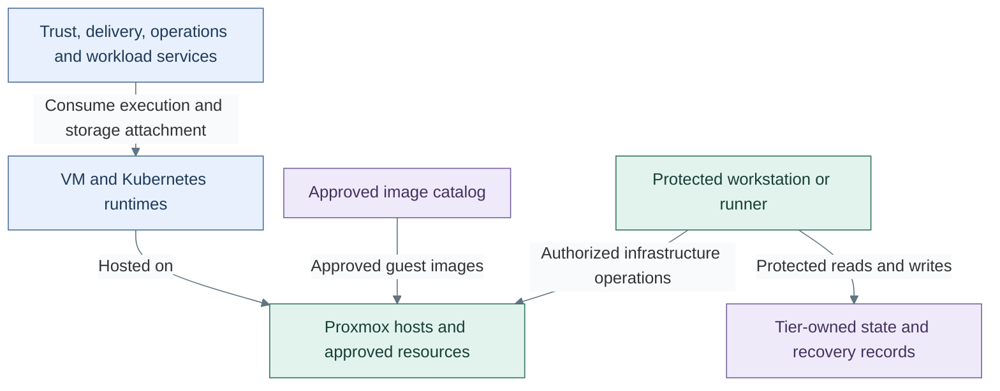

# Compute and cluster platform

Compute supplies execution, storage attachment and recovery beneath every service.
Proxmox is the chosen hypervisor. Tier 0 owns hardware control and image publication;
resource definitions, inventory and state remain in the consuming tier.

This domain expands the compute function in the [platform overview](../README.md#technical-domains).
The [reference platform](../reference-platform.md) places its consumers; the
[runtime design](runtime.md) shows the completed hosting and persistence model.

## Table of contents

- [Components and interfaces](#components-and-interfaces)
- [Supplied and consumed interfaces](#supplied-and-consumed-interfaces)
- [Design choices](#design-choices)
- [Design constraints](#design-constraints)
- [Realization](#realization)

## Components and interfaces

The compute domain has a runtime side that hosts services and a protected
control side that maintains their infrastructure. Both operate over the same
approved resource model; consuming a runtime does not grant control of its hosts.

Arrows describe hosting and control relationships. They are not network rules or
installation steps. The catalog supplies image inputs; each deployed VM or cluster
also has its own configuration, identity, owner and lifecycle.

| Component | Function and boundary |
| --- | --- |
| Hypervisor and host fabrics | Run guests; separate management, quorum and storage transport from guest traffic |
| Image publication | Supply approved, recoverable templates; consumer references do not own the build lifecycle |
| Cluster runtime | Supply a Kubernetes API, scheduling, networking and storage for platform services |
| Infrastructure execution | Accept authorized changes without granting workload users hardware administration |
| State and recovery | Retain resource ownership and bootstrap independently of hosted tooling |

The [provisioning design](provisioning.md) defines the privileged execution boundary.
A VM template is an input to provisioning, not a configured cluster or application.
[Kubernetes topology](kubernetes.md) defines the three independent tier clusters,
compact control planes and optional worker pools.

## Supplied and consumed interfaces

| Direction | Interface | Connected function | Required contract |
| --- | --- | --- | --- |
| Provides | VM or cluster runtime | Identity, cryptography, delivery, operations and workloads | Explicit owner, placement, capacity, persistence and recovery |
| Provides | Authorized infrastructure operations | Tier-owned resource definitions | Protected acceptance, credentials and state access; no implicit hardware administration for consumers |
| Provides | Approved image references | Guest provisioning and lifecycle | Known image identity and retained build or publication inputs |
| Consumes | Guest attachments and host fabrics | [Networking](../networking/README.md) | Approved bridges or VNets, addressing and enforcement; host fabrics remain separate from guest access |
| Consumes | Administrative identity and trust | [Identity](../identity/README.md) and [cryptography](../cryptography/README.md) | Scoped credentials and authenticated endpoints, with independent bootstrap and recovery access |
| Exchanges | Inventory, health, audit and recovery records | [Operations](../operations/README.md) | Resource identity and retained evidence remain usable when hosted tooling is unavailable |

The [runtime flows](../runtime-flows.md) connect these interfaces to ordinary
delivery, privileged changes and recovery across the whole platform.

## Design choices

Choices are independent; they do not form a mandatory upgrade ladder.

| Decision | Option A | Option B | Consequence |
| --- | --- | --- | --- |
| Host availability | Single Proxmox host | Cluster with selected HA/storage design | B adds failure-domain, quorum and storage obligations; cluster membership alone is not HA |
| Guest network attachment | VLAN-aware bridge | SDN VNet over the host underlay | Both implement the same purpose-based network and firewall design |
| Linux lifecycle | Configured mutable guest | Image-based Linux/bootc | Image promotion replaces some in-place configuration; builds need an approved artifact source |
| Cluster OS | Talos reference | Another suitable OS or existing cluster | Kubernetes interfaces remain stable; the alternative needs validated bootstrap and lifecycle code |
| Service runtime | Dedicated VMs | Kubernetes workloads | Availability, persistence and recovery must be defined for either placement |

Single-switch/dual-uplink and separate storage-fabric arrangements are physical
variants beneath the same logical model. Exact cabling and host configuration
belong in deployment procedures. Image-based Linux is an independent lifecycle
choice, not a requirement to replace the current cluster OS.

The [runtime design](runtime.md) expands VM and cluster placement independently
of the selected cluster topology. The [variant model](../variants.md) records
selected realizations and the interfaces and guarantees that each must preserve.

## Design constraints

| Concern | Required property |
| --- | --- |
| Availability | Explicit host, storage and cluster failure domains; node count alone is not HA |
| Placement | Guest mobility must preserve storage, network and resource ownership contracts |
| Images | Approved templates and bootstrap artifacts remain recoverable independently of hosted delivery |
| Recovery | Higher-tier source control must not be required to recover Tier 0 |

## Realization

Architecture drill-down: [service runtimes and infrastructure](runtime.md),
[protected provisioning](provisioning.md), and the
[complete reference platform](../reference-platform.md).

Implementation procedures: [host/image foundation](../../deployment/foundation/README.md#step-1-prepare-compute-and-templates)
and the [Kubernetes capability](../../deployment/stage-4-kubernetes/README.md).
The current cluster installer uses Talos; each cluster has its own owner and state.
