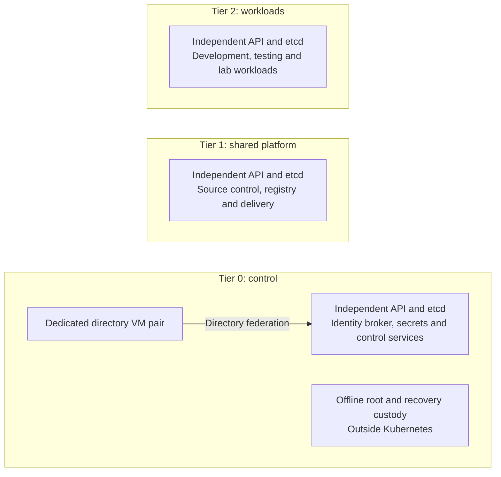

# Kubernetes topology

Each tier has an independent Kubernetes API, etcd quorum, administrative
credentials and lifecycle state. Tiers separate authority; worker pools organize
capacity within that authority. Talos is the supplied node OS, not the design goal.

## Table of contents

- [Cluster boundaries](#cluster-boundaries)
- [Scheduling and capacity](#scheduling-and-capacity)
- [Availability and recovery](#availability-and-recovery)
- [Implementation](#implementation)
- [References](#references)

## Cluster boundaries

Network attachments follow purpose and exposure, not tier numbers. The examples
use Control for Tier 0, application/Services for Tier 1, and lab for Tier 2;
the [network map](../networking/README.md) owns VLAN and firewall design.
Sharing Proxmox hosts does not create physical isolation between tiers.

FreeIPA remains on two dedicated Tier 0 VMs. Offline root keys remain outside
the clusters. The protected infrastructure runner is a Tier 0 execution host,
not a general build pod or a Tier 1 delivery controller.

## Scheduling and capacity

| Cluster | Compact reference | Optional worker pools |
| --- | --- | --- |
| Tier 0 | Three schedulable control planes; no initial workers | Additional trusted control-service capacity |
| Tier 1 | Three control planes; scheduling enabled for the compact start | Infrastructure, stateful, compute; observability when justified |
| Tier 2 | Three control planes; scheduling enabled for the compact start | Development, testing and lab |

Tier 1/2 can instead use dedicated workers with control-plane scheduling disabled.
This is an explicit capacity choice, not an automatic transition. Tier 0 remains
compact unless its trusted services justify additional workers.

Pools use labels and workload selectors/affinity. Taints with matching tolerations
reserve nodes; a toleration alone does not force a workload onto that pool. [1]
Pools share the API, cluster-wide resources and administrative boundary. Namespaces,
RBAC, quotas and network policy add workload controls, not independent clusters. [2]

General CI must not run untrusted code alongside sensitive infrastructure on the
same hosts. Use isolated execution capacity and ephemeral environments; Tier 2
is a suitable scope for untrusted project builds. Disruptive CNI, CRD, privileged
or cluster-upgrade experiments require a separately owned disposable cluster,
not merely another namespace in the long-lived workload cluster.

## Availability and recovery

Three control planes are an initial quorum topology, not an application HA guarantee.
Separate physical placement, resilient API access, adequate capacity after failure,
storage availability, application replicas and restore tests remain obligations.
Proxmox HA membership must preserve the selected physical failure domains after moves.

Tier 0 bootstrap and recovery cannot depend on Tier 1 delivery or normal identity
login. Every cluster retains its own state, node secrets, administrator credentials,
etcd recovery material and workload backups outside that cluster.

## Implementation

Each tier owns `terraform/deployments/kubernetes/`, its Ansible inventory host keys
and IP reservations, and `clusters/tierN/` manifests. Shared owns the stateless
command and approved image/sizing references, never cluster resources or inventory.

The supplied roots support explicit node definitions and a `node-pool` label.
They do not install an autoscaler, self-service controller, add-ons or applications.
Delivery selection is independent: [controller patterns](../delivery/controllers.md).
Installation: [common Kubernetes procedure](../../deployment/stage-3-identity-runtime/procedures/kubernetes.md).

## References

1. [Kubernetes taints and tolerations](https://kubernetes.io/docs/concepts/scheduling-eviction/taint-and-toleration/).
2. [Kubernetes multi-tenancy](https://kubernetes.io/docs/concepts/security/multi-tenancy/).
