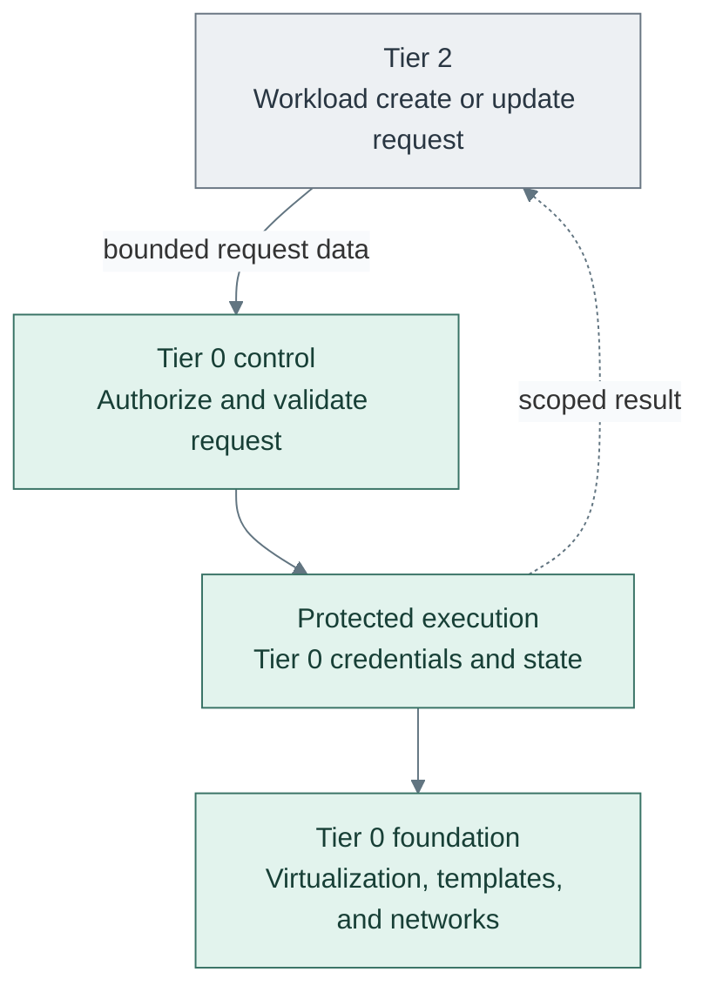

# Infrastructure control

Tier 0 owns the hardware-facing control plane. Workload owners describe what
they need; Tier 0 controls how infrastructure operations are authorized and run.
This applies across all tiers, not only to the machines hosting Tier 0 itself.

## Table of contents

- [Ownership](#ownership)
- [Execution contexts](#execution-contexts)
- [Delegated provisioning](#delegated-provisioning)
- [Request boundary](#request-boundary)
- [Independent operation](#independent-operation)
- [Implementation boundary](#implementation-boundary)

## Ownership

[Tier ownership](../tier-ownership.md#repository-role) defines the repository split.
Tier 0 controls hardware, networks, templates, credentials, and privileged
execution. Other tiers retain their workload definitions and state roots.

A workload VM does not become Tier 0 just because it runs on a hypervisor.
Conversely, a provisioning controller remains Tier 0 even when every VM it
manages belongs to Tier 2. Guest network attachments consume approved networks;
they do not grant permission to administer the underlying fabric.

Keep the existing tier-local definitions, inventory, and separate state roots.
Workload ownership does not imply access to infrastructure credentials or raw
state. Under delegated execution, Tier 0 must protect the state backend and
serialize writes for each existing root; never create a second state owner.

## Execution contexts

Protected workstations and protected runner VMs are Tier 0 execution contexts.
Both use the owning tier's definitions and state. Template publication remains
possible without hosted CI or the guests built from those templates.

A runner belongs in the management network with separately controlled credentials
and accepted code. Tier 1 source control coordinates requests, but Tier 0 independently
authorizes changes. Protecting a Tier 1 branch alone does not protect Tier 0 from
compromise of that service. [Deployment](../../deployment/README.md) defines the
bootstrap and runner handover sequence.

## Delegated provisioning

The target capability is **Tier 2 self-service through Tier 0-owned automation**.
Tier 0 operators enable and configure the provisioning service in their own
GitOps definitions. Tier 2 users may then request approved VM creation and
updates without administering the infrastructure or changing the controller.

Arrows show the request contract, not a dependency on Tier 2 for control-plane
operation. No implementation or request API is shipped yet.

## Request boundary

Tier 0 defines the permitted request fields and operations. The controller contract is:

| Function | Required guarantee |
| --- | --- |
| Admission | Authenticated requester with verified project/resource ownership |
| Policy | Approved size, quota, image revision, storage and network |
| Planning | Accepted request revision and plan produced with Tier 0-reviewed code |
| Execution | Scoped credentials, state locking and sanitized result |

Preapproved operations may run automatically. Destructive, privileged, or
out-of-policy changes require a separate approval or rejection. A request is
data, not permission to run arbitrary Terraform, providers, provisioners,
Ansible tasks, shell commands, or cluster manifests with Tier 0 credentials.
Do not execute untrusted repository hooks or workload-controlled CI definitions.

| Requested change | Required boundary |
| --- | --- |
| Create or resize a workload VM | approved image/size, project quota, and assigned network/storage |
| Update a guest OS or application | workload-scoped configuration/credentials and maintenance policy |
| Rebuild or replace a VM | explicit lifecycle action, data protection, and rollback/recovery plan |
| Publish a new base template | separate Tier 0 image lifecycle, never a workload user's publish right |
| Alter hosts, networks, policy, or controller permissions | Tier 0 administration, not workload self-service |

A new template version does not update running VMs. Guest patching, rebuilding,
and infrastructure changes remain distinct operations with recorded outcomes.
Return project-scoped status, not infrastructure tokens, raw plans, or state.

## Independent operation

Tier 0 must start, operate, update, and recover without Tier 2 services.
Requests are optional inputs, not runtime or bootstrap dependencies.

- Keep controller definitions, policy, credentials, approved code, and recovery material under Tier 0 control.
- Retain accepted intent and resource records independently of the request source.
- An unavailable request source pauses new requests; it does not stop Tier 0 or delete workloads.
- Missing request files are not deletion approval; require an explicit authorized lifecycle operation.
- Keep local administrative execution available when the controller or hosted tooling is unavailable.

Normal request delivery can use a higher-tier service, but Tier 0 recovery and
existing-resource control must not require that service. Do not let its users
edit the privileged controller, acceptance policy, or shared execution revision.

## Implementation boundary

Today, the kit provides Tier 0 template publication, control-cluster bootstrap,
and operator-run, per-tier Terraform/Ansible workflows. Those workflows are not
a safe self-service API. Host/network administration still includes manual work;
cluster-service directories remain starters. No provisioning controller is enabled by generation.

Retain these roots while developing delegation; do not relocate live inputs or
state as part of a documentation or generator refresh. Before enabling a
controller, choose the request schema, native execution integration, authorization,
state handoff, and outage tests. Validate tenant isolation and reject arbitrary
code before admitting Tier 2 requests. See [Tier 0 bootstrap](../../deployment/README.md).
