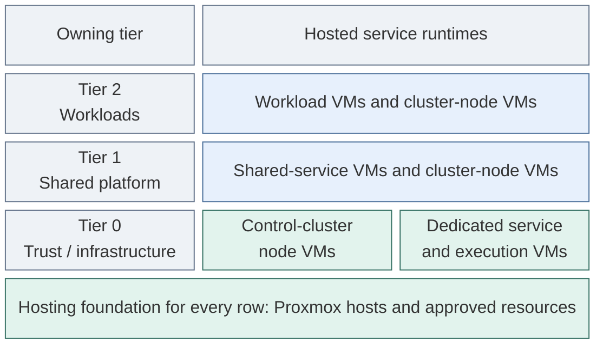
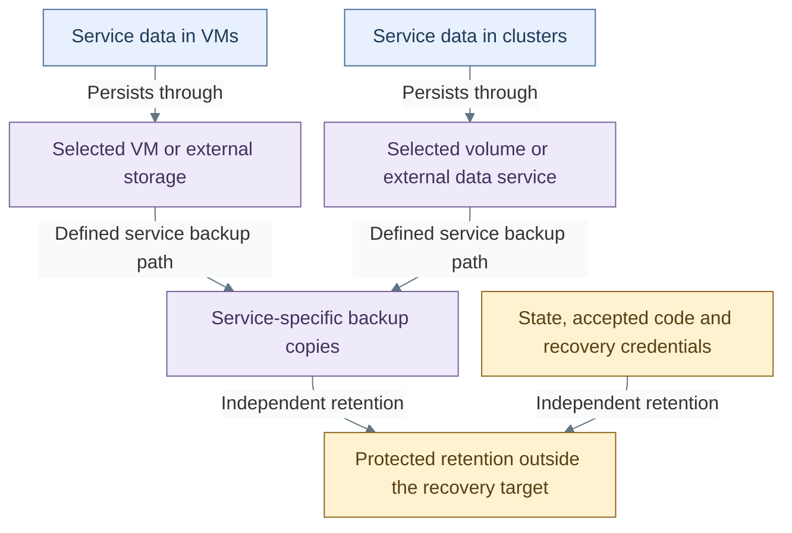

# Service runtimes and infrastructure

This design expands the [compute domain](README.md). It shows how completed
service runtimes relate to their hosts, persistence and recovery. The
[reference platform](../reference-platform.md) selects the service products and
placements; the hosting relationships below apply across its local variants.

## Table of contents

- [Completed hosting model](#completed-hosting-model)
- [Runtime realizations](#runtime-realizations)
- [Persistence and recovery](#persistence-and-recovery)
- [Failure domains](#failure-domains)
- [Related designs and procedures](#related-designs-and-procedures)

## Completed hosting model

Proxmox supplies connected VM execution across the tiers. A service can run in a
dedicated VM or in a Kubernetes cluster whose nodes are VMs. The hosting layer
does not change the service's authority classification or transfer its resource
definitions and state to another tier.

The rows describe placement and ownership, not network connectivity or a shared
control plane. The [Kubernetes topology](kubernetes.md) selects three independent
tier clusters, each with its own API, inventory, state and credentials. Dedicated
VMs remain available alongside them. Host placement and failure-domain separation
remain explicit project decisions.

In the reference allocation, the directory pair and protected execution VM are
dedicated Tier 0 guests, while selected control services use the Tier 0 cluster.
Tier 1 cluster management is scoped to Tier 2 workload clusters and has no
authority over Tier 0. Offline root keys and their ceremony environment remain
outside this connected hosting model.

## Runtime realizations

Both realizations expose the service's agreed client interface. Their deployment,
storage and recovery mechanisms differ and require a recorded service design.

| Concern | Dedicated VM realization | Kubernetes realization |
| --- | --- | --- |
| Execution | Service processes in an owned guest OS | Workloads on the selected cluster's node VMs |
| Client interface | Published service endpoint with service authentication and authorization | Published service endpoint with service authentication and authorization |
| Administration | Guest and service access, separate from hypervisor authority | Cluster and workload access, separate from hypervisor authority |
| Persistent data | Explicit guest disks, external services or storage attachments | Explicit persistent volumes or external data services; node replacement must preserve required data |
| Lifecycle | Approved images plus the selected configuration/update model | Cluster lifecycle plus service reconciliation and data lifecycle |
| Recovery inputs | Guest definitions, configuration, service data and scoped credentials | Cluster definitions and state, service manifests, service data and scoped credentials |

The directory pair's dedicated-VM placement is part of the reference design.
A runtime alternative for another service does not imply migration of that pair
or of any existing service. Moving a service requires an explicit data and
lifecycle design, even when its client interface remains unchanged.

## Persistence and recovery

Runtime availability, data persistence and recovery are separate responsibilities.
Each service identifies its authoritative data, storage owner and backup path.
No single storage backend is implied for every VM, cluster or service.

These are logical data responsibilities, not a prescribed backup product or a
claim that volume snapshots supply every service's restore requirements.
Application consistency, retention, restore credentials and recovery validation
belong to the service-specific design. Data replication alone does not establish
an independent recovery path.

Keycloak and NetBox consume the reference database service. Vault has its own
storage and recovery design; it does not use that database by implication.
Cluster state, Terraform state and application data are distinct recovery inputs.
The [operations design](../operations/README.md) connects their retention and
recovery responsibilities across the platform.

## Failure domains

An availability claim includes the resources and dependencies that can fail
together. Tier separation, multiple VM names and a cluster label do not establish
independent failure domains by themselves.

| Domain | Required design property |
| --- | --- |
| Physical hosts | Placement identifies which guests fail together and which surviving capacity can run the required services |
| Cluster control | The selected node and quorum design identifies the failures it can tolerate and its independent recovery inputs |
| Service replicas | Replicas have a deliberate placement and data design rather than an assumed benefit from their count |
| Storage | Data placement, access paths and restore material support the declared host and service failure scenarios |
| Networking | Uplinks, switches, routing and host fabrics have recorded shared dependencies and reachable recovery paths |
| Hosted management | Loss of source control, registry, identity or inventory tooling leaves the required lower-tier recovery inputs available |

Tier 0 recovery does not require Tier 1 or Tier 2 services; Tier 1 recovery does
not require Tier 2 workloads. Normal consumption of higher-tier source or
artifact services is compatible with this rule only when protected recovery
copies and local administrative execution remain available.

## Related designs and procedures

- Parent: [compute and cluster platform](README.md).
- Whole system: [reference platform](../reference-platform.md), [runtime flows](../runtime-flows.md) and [variant model](../variants.md).
- Interfaces: [networking](../networking/README.md), [infrastructure control](provisioning.md) and [tier ownership](../tier-ownership.md).
- Realization: [host/image foundation](../../deployment/foundation/README.md#step-1-prepare-compute-and-templates) and [cluster foundation](../../deployment/stage-3-identity/README.md#step-2-create-the-kubernetes-cluster).
- Acceptance and implementation coverage: [deployment readiness](../../deployment/readiness.md).
