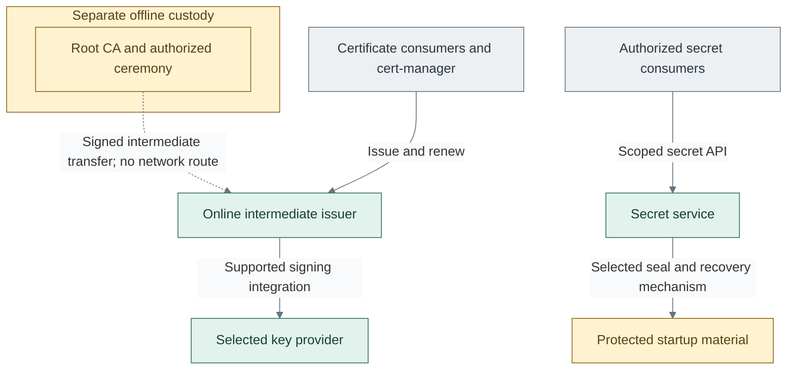

# Cryptography and secrets

Cryptography establishes trust, protects key custody and delivers credentials.
Root custody, online issuance, signing and secret storage are separate functions;
one product need not implement all of them. Together they provide the certificate
trust and secret interfaces of the [platform architecture](../README.md).

## Table of contents

- [Completed design](#completed-design)
- [Components and interfaces](#components-and-interfaces)
- [Independent choices](#independent-choices)
- [Design constraints](#design-constraints)
- [Detailed views](#detailed-views)
- [Realization](#realization)

## Completed design

Routine consumers depend on the online issuer and secret service. Root custody
remains separately controlled, and signing and secret-service startup protection
retain independent provider choices.

This view separates functions; a selected product can implement more than one.
The reference allocation uses OpenXPKI as the permanent infrastructure issuer,
FreeIPA's sibling identity CA under the same offline root, and Vault as the secret
service. The [CA design](certificate-authority.md) expands policy, portal, enrollment
and publication without merging those responsibilities.
Root and online keys can use different custody providers, while the secret-service
seal remains a separate integration.

## Components and interfaces

| Component | Function and boundary |
| --- | --- |
| Offline root | Signs intermediate CA certificates during authorized ceremonies; no normal network service |
| Online issuer | Issues and renews certificates under approved policy without access to the root key |
| Key provider | Performs permitted cryptographic operations using software or hardware custody |
| Secret service | Stores/delivers credentials with scoped authorization, audit and independent recovery |
| Seal/unseal mechanism | Protects secret-service startup material; distinct from the certificate-signing backend |

The [certificate design](../reference-platform.md#certificate-trust) shows
consumer-to-issuer relationships. A gateway cannot become a signing backend merely
by being reachable; the application needs supported provider integration.

| Boundary | Interface and connected function |
| --- | --- |
| Supplied to identity and services | Public trust material and policy-scoped certificate issuance, renewal and revocation |
| Supplied to authorized clients | Scoped secret retrieval or delivery with audit and independent recovery |
| Consumed from compute | Issuer and secret-service runtime, persistent storage and approved network access |
| Consumed from access policy | Authorized service identities, consumer roles and separately controlled custodian authority |
| Consumed from recovery arrangements | Protected backups, recovery credentials and startup material independent of the affected service |

## Independent choices

| Decision | Alternatives | Design |
| --- | --- | --- |
| Key custody | A: software; B: single USB; C: replicated USB gateways; D: network HSM | [Key-protection options](hsm-selection.md) |
| Issuer location | Existing authority; dedicated VM; cluster service | Same offline-root/online-issuer boundary; no self-bootstrap dependency |
| Issuer implementation | OpenXPKI Community reference; existing qualified CA or Enterprise alternative | [CA and enrollment design](certificate-authority.md); no assumed native Community ACME or OCSP |
| Secret-service placement | Dedicated VM; Kubernetes service; existing approved service | Same access and recovery contract; migration needs explicit data/state ownership |
| Secret-service seal | Shamir; independent Transit service; supported native PKCS#11 | [Seal patterns](vault-seal.md), independent of A-D |

Root and online keys may select different providers. None of the options requires
passing through every other option first. Hardware can be selected initially or
introduced later without changing its purpose.

## Design constraints

| Concern | Required property |
| --- | --- |
| Custody | Key purpose, authorized operations and custodians are explicit for each provider |
| Isolation | Offline root material is not available to online issuers or ordinary consumers |
| Lifecycle | Rotation and revocation preserve the intended trust and consumer compatibility |
| Recovery | Device/provider loss cannot require the unavailable secret service to restore its own keys |
| Foundational path | Tier 0 issuance/signing and recovery do not depend on Tier 1/2 runtimes; private endpoints share the capacity-sized USB service pool |

Software custody can satisfy an accepted threat model. Hardware presence alone
does not establish the required isolation, recovery or compliance properties.

## Detailed views

- [Algorithm selection](algorithm-selection.md) separates hashes, signatures, encryption and practical key sizes.
- [Post-quantum readiness](post-quantum.md) distinguishes migration planning from qualified PQC deployment.
- [Hardware migration](hardware-migration.md) defines software-to-HSM rollover and recovery.
- [YubiHSM performance](../../reference/yubihsm-performance.md) records vendor benchmark timings and limits.
- [Runtime flows](../runtime-flows.md#certificate-and-secret-consumption) connects certificate and secret consumers across domains.
- [Certificate hierarchy](../reference-platform.md#certificate-trust) connects issuing services to tier-local consumers.
- [Certificate authority](certificate-authority.md) expands the sibling issuers, portal, enrollment and publication.
- [Key-protection options A-D](hsm-selection.md) compares custody boundaries and supported interfaces.
- [Replicated USB gateways](usb-hsm.md) and [network HSMs](network-hsm.md) expand the selected hardware arrangement.
- [Secret-service seal patterns](vault-seal.md) details startup protection independently of signing.

## Realization

Implementation procedures: [trust and custody](../../deployment/stage-2-trust/README.md#step-1-prepare-issuer-and-key-custody)
and [secret-service integration](../../deployment/stage-4-control-services/README.md#step-2-deploy-operational-services).
Device operations remain authorized procedures; the existing hsm automation supplies
hosts and baseline only.
