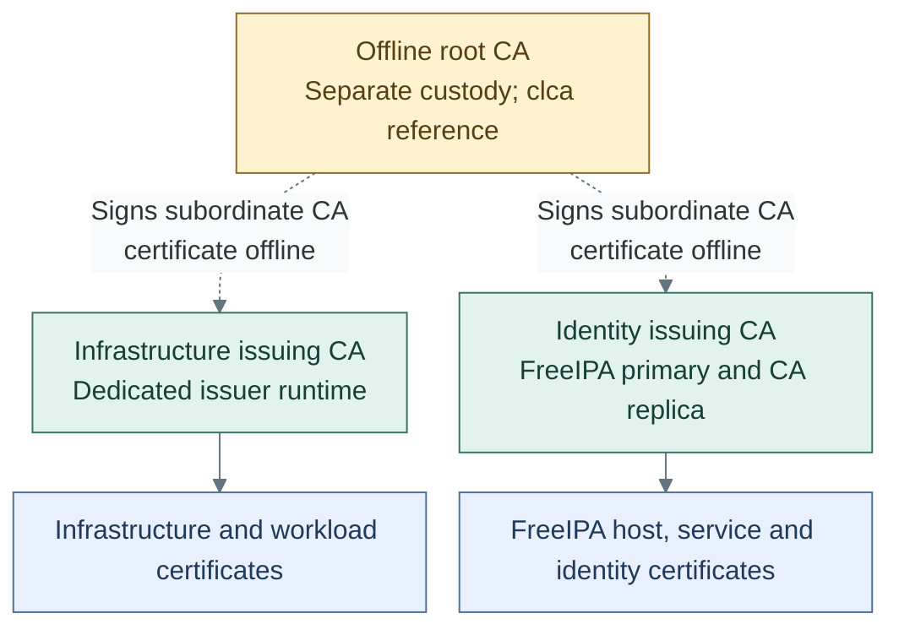
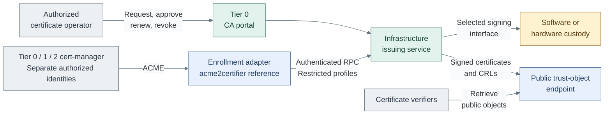

# Certificate authority design

The infrastructure CA supplies certificate policy, issuance history, renewal and
revocation independently of identity, Kubernetes and the secret service. The reference
uses OpenXPKI Community on Tier 0 `ca-1` as the permanent infrastructure issuer and
certificate portal. A separately controlled offline root establishes the hierarchy;
FreeIPA retains its own identity CA. Vault remains a secret service, not the intended
replacement for this issuer.

## Contents

- [Trust hierarchy](#trust-hierarchy)
- [Service boundaries](#service-boundaries)
- [Enrollment and publication](#enrollment-and-publication)
- [Custody and recovery](#custody-and-recovery)
- [Alternatives and realization](#alternatives-and-realization)
- [References](#references)

## Trust hierarchy

These arrows represent certificate signing, not network connections. The directory
pair replicates one identity CA; it does not create an unrelated issuer per host.
External signing uses FreeIPA's two-phase CA installation interface. [1]
The infrastructure portal manages infrastructure-issuer records; sharing a root
does not combine FreeIPA's certificate inventory or administration with that portal.

## Service boundaries

| Function | Reference placement | Boundary |
| --- | --- | --- |
| Offline trust | Separately controlled ceremony system; clca | Root key, CA database, subordinate signing and root CRLs; no routine online service [2] |
| Infrastructure issuance | OpenXPKI backend and portal on Tier 0 `ca-1` / Control | Approved profiles, requests, approvals and certificate lifecycle |
| Application state | Local MariaDB and protected configuration on `ca-1` | Issuance/workflow history and sessions are recoverable with the signing identity |
| Identity issuance | FreeIPA on dedicated Tier 0 `idm-1` / `idm-2` VMs | Its own supported CA custody and replication, separate from OpenXPKI |
| Enrollment adapter | Separate service on `ca-1` when selected | ACME-to-authenticated-RPC translation; no CA policy or root authority |
| Public trust objects | Stable Tier 0 publication endpoint, optionally independently mirrored | Signed CA certificates and fresh CRLs only; no signing key or portal administration |

OpenXPKI starts and recovers using local database/configuration, bootstrap resolution,
independent administration and its selected key provider. It does not require FreeIPA,
Keycloak, Vault, cluster ingress or Tier 1/2 services. Optional federated portal login
retains independently tested recovery access.

## Enrollment and publication

Community enrollment includes SCEP, EST and RPC; native ACME is Enterprise-only. [3]
The acme2certifier OpenXPKI handler supplies a possible Community ACME adapter, not
an automatic guarantee of compatible authorization, renewal or recovery. [4]
Portal approval and automated enrollment are separate workflows. Backend policy binds
the authenticated identity to allowed names, SANs, leaf profiles, usages and validity;
submitted profile names or ACME External Account Binding alone do not grant issuance.
OpenXPKI's enrollment policy supports signer authorization and profile mapping. [5]

CA administration and subordinate-CA signing are never normal enrollment permissions.
Publication remains reachable during the required outage envelope without portal login;
clients verify signed objects. Publishing revocation data and enforcing it at a client
are separate responsibilities. No OCSP responder is implied by the Community CA;
that is a separately selected component when required. [6]

## Custody and recovery

The root, infrastructure issuer, FreeIPA CA and Vault seal have separate key purposes.
Each can select its own [A-D custody variant](hsm-selection.md). A reachable USB gateway
or network HSM is not an OpenXPKI provider until the exact runtime, module, mechanisms,
key attributes and permissions have been qualified together.

One active issuer with rehearsed recovery is the initial availability model. More HSMs
can improve the selected key-provider service, but do not replicate the CA database,
sessions or workflows. An application-HA variant must cover all those state boundaries.

The recovery set includes database, approved configuration, signing-provider recovery,
administrative access and OpenXPKI DataVault material. DataVault protects application
data and is unrelated to HashiCorp Vault; losing its material can prevent recovery. [7]
Routine reconciliation must fail on a missing signing identity, never generate a new
CA or overwrite issuance/revocation state. Image rollback is not database rollback.

## Alternatives and realization

An existing independently operated CA, another qualified issuer or Enterprise native
ACME can satisfy the same outward contract. Selecting one changes the integration,
not tier ownership or root custody. The reference OS/package exception and Community
boundaries belong to the [issuer deployment contract](../../deployment/stage-2-trust/procedures/issuer.md).
The [support map](../../reference/implementation-support.md) records installer coverage;
[CA operations](../../administration/cryptography/certificate-authority.md) owns maintenance evidence.

## References

Sources checked 2026-10-17.

1. [FreeIPA Ansible server role: externally signed CA](https://github.com/freeipa/ansible-freeipa/blob/master/roles/ipaserver/README.md)
2. [clca: offline CA state and supported key interfaces](https://github.com/openxpki/clca/blob/master/README.md)
3. [OpenXPKI endpoint and edition boundaries](https://openxpki.readthedocs.io/en/master/frontend/endpoints.html)
4. [acme2certifier OpenXPKI handler](https://github.com/grindsa/acme2certifier/blob/master/docs/openxpki.md)
5. [OpenXPKI enrollment authorization and profiles](https://openxpki.readthedocs.io/en/master/lifecycle/enrollment.html)
6. [OpenXPKI maintainer clarification: separate OCSP responder](https://sourceforge.net/p/openxpki/mailman/openxpki-users/thread/1193537499.1054529.1632739794972%40mail.yahoo.com/)
7. [OpenXPKI configuration and DataVault recovery material](https://github.com/openxpki/openxpki-config/blob/community/QUICKSTART.md)
