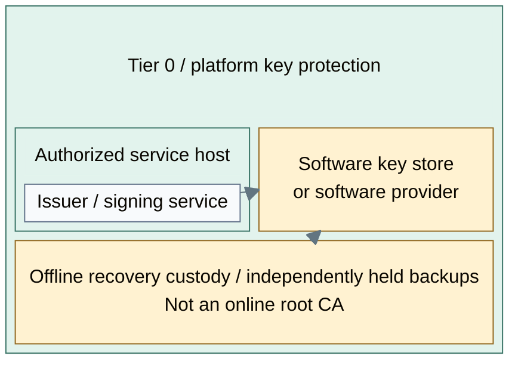
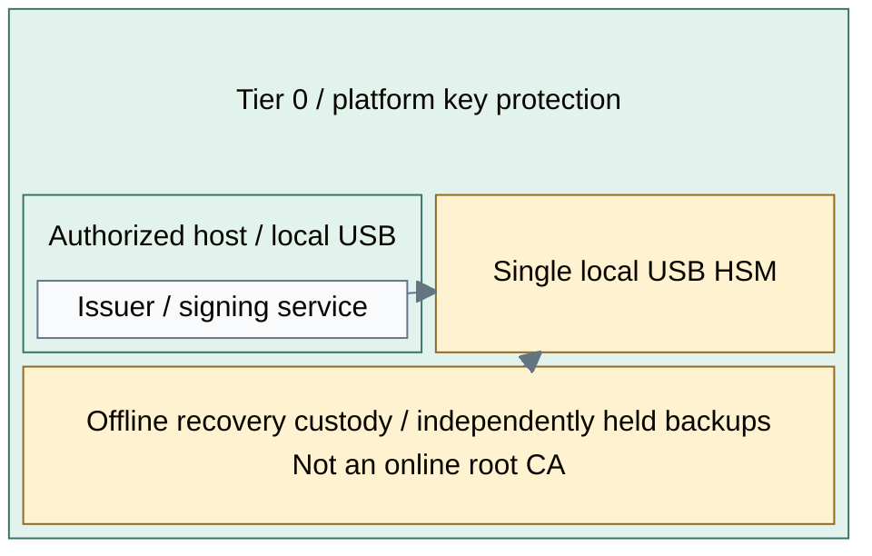
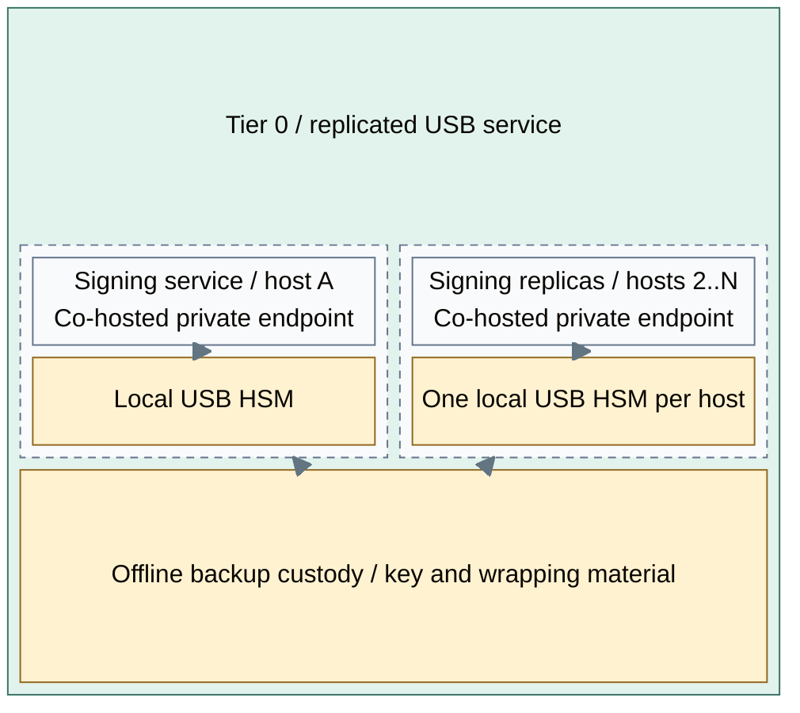
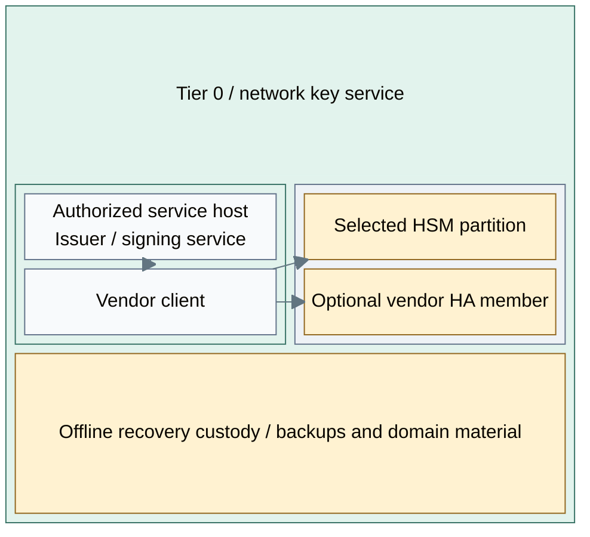

# Key-protection options

The choice is the key-custody boundary, not a compulsory sequence of products.
Software providers, USB devices and network HSMs can expose cryptographic functions
to an issuer or signing service, but provide different isolation and recovery properties.
The parent [cryptography design](README.md) defines the supplied services;
the [variant map](../variants.md) relates this choice to other independent decisions.

## Table of contents

- [Options A-D](#options-a-d)
- [Completed designs](#completed-designs)
- [Selection criteria](#selection-criteria)
- [Assurance requirements](#assurance-requirements)
- [Interfaces and limits](#interfaces-and-limits)
- [References](#references)

## Options A-D

| Option | Design shape | Suitable purpose | Limit and operating responsibility |
| --- | --- | --- | --- |
| A: Software | Application keystore or software PKCS#11 provider; SoftHSM is an example [1] | Accepted software-custody deployment or interface rehearsal | Host access can expose key material; not hardware isolation |
| B: Single USB | One authorized host and one local device, with a separate recovery arrangement | Offline custody, low-concurrency issuer or signing service | Host/device loss interrupts service; availability depends on restore |
| C: Replicated USB gateways | Capacity-sized service pool with independent local tokens and separately governed backups; two-host starter | Service-level failover and measured horizontal capacity | Application routing and approved key replication are operator responsibilities, not a native HSM cluster |
| D: Network HSM | Authorized clients use appliance partitions through the vendor client/HA model | Shared hardware service with product-supported partitions and resilience | Separate management, client trust, backup and vendor compatibility obligations |

B and C are both hardware-backed options. Pico HSM and YubiHSM 2 are device
examples, not interchangeable security or certification claims. Their documented
PKCS#11 and backup capabilities require validation against the selected firmware,
mechanisms and consumer. [2][3]

[USB gateway design](usb-hsm.md) details C. [Network HSM design](network-hsm.md)
details D. An existing approved provider can satisfy any applicable option.

## Completed designs

Each view places a selected online-key provider behind the same consumer-facing
issuer or signing interface. Offline root custody remains a separate choice under
the [certificate hierarchy](../reference-platform.md#certificate-trust). Dashed
connections represent separately authorized recovery transfers, not normal network
dependencies. Application-state backups accompany the selected key-recovery method.

### A: Software

Key custody shares the host's compromise boundary. This arrangement has one
application/provider path; recovery from host loss uses independently retained
key and application backups. Software interface rehearsal does not establish
hardware isolation. [1]

### B: Single USB

The local token supplies the key-custody boundary; the host still owns application
state and permitted requests. Host or device loss interrupts this single path.
Recovery depends on the selected device's supported backup policy and retained
application state, not on the presence of a replacement device alone. [2][3]

### C: Replicated USB gateways

The service routes operations through a supported application integration; each
gateway accesses only its local token. Service-level failover depends on validated
routing, compatible key material and surviving capacity. Key replication is
separately governed: the tokens provide no native cluster or automatic key-state
synchronization. Recovery custody remains independent of all active hosts.
The [service detail](usb-hsm.md) places private failover on these same hosts and
compares client failover, VIP and co-hosted proxy variants. Separate frontend VMs
or Tier 1/2 runtimes are not prerequisites.

### D: Network HSM

Custody resides in the selected appliance partitions, with client authorization
and management permissions separated. A second member is optional; replication
and failover follow the selected product's supported HA model. Independent backup
and recovery material remain necessary for loss beyond the active members. [4]
The [network HSM detail](network-hsm.md) defines the client, partition and failure
contracts.

## Selection criteria

| Requirement | Architectural implication |
| --- | --- |
| Which key is protected? | Root, issuing, code-signing and seal keys have different consumers and custody requirements |
| Host compromise | A hardware boundary may reduce extraction risk; an authorized compromised client can still misuse allowed operations |
| Availability | Define the tolerated outage and failure domains; two devices alone do not establish HA |
| Scale | Measure the actual algorithms, request concurrency and client path; developer count is not a throughput guarantee |
| Recovery | Supported export/backup policy, wrapping material, custodians and independent restore must match the selected product |
| Compliance | Verify the exact model, firmware, operating mode and required certification; price or product family is not evidence |

Historical price and team-size estimates are not design guarantees.
The simplest variant meeting the selected risk and availability requirements is valid.

## Assurance requirements

The selected design defines permitted operations, key-extraction boundaries,
failure tolerance and independent recovery. A change of provider requires review
of those properties and consumer compatibility; A-D are not an upgrade ladder.
Software rehearsal can validate protocols but cannot demonstrate hardware isolation.

## Interfaces and limits

PKCS#11 compatibility does not establish support for every algorithm, key attribute,
backup mechanism or application integration. C uses application-level failover;
D follows the selected vendor's client/partition model. For example, Luna's HA
model groups compatible partitions; this is not equivalent to a generic HTTP proxy. [4]

Certificate signing and secret-service unseal are separate integrations:
[seal design](vault-seal.md). Procedure selection belongs in
[the trust-stage decision](../../deployment/stage-3-trust/README.md#step-1-prepare-issuer-and-key-custody).

## References

Sources checked 2026-10-09.

1. [SoftHSM project](https://www.softhsm.org/)
2. [Pico HSM capability map](https://docs.picokeys.com/picohsm/features/)
3. [YubiHSM PKCS#11 module](https://developers.yubico.com/yubihsm-shell/yubihsm-pkcs11.html)
4. [Thales Luna redundancy and reliability](https://thalesdocs.com/gphsm/luna/7/docs/network/Content/Product_Overview/redundancy_and_reliability.htm)
