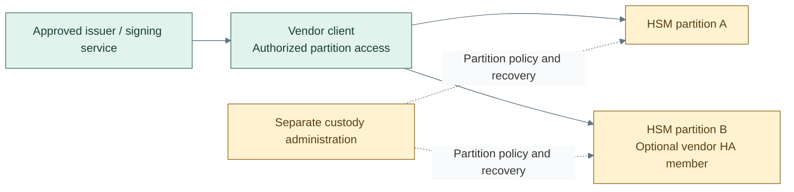

# Network HSM design

Option D from [key protection](hsm-selection.md) separates the cryptographic
provider from issuer/signing hosts. Authorized clients access selected appliance
partitions through the vendor's supported client and transport.

## Components and boundaries

This is not the USB gateway service with different hardware. A network appliance
can change client libraries, connection trust, partition ownership, recovery media
and the failover mechanism. Luna, for example, provides client HA groups over
compatible partitions; synchronization has product-specific conditions. [1]

| Design concern | Required property |
| --- | --- |
| Consumer access | Only approved clients and key operations; network reachability is not authorization |
| Administration | Separate management and custody permissions, owned by Tier 0 for platform-wide keys |
| Availability | Selected failure domains and vendor-supported replication/HA behavior |
| Recovery | Independent approved backups and wrapping/domain material; HA is not backup |
| Offline root | Separate custody; an online partition is not an air-gapped root |

An existing enterprise HSM can satisfy this design without creating USB gateway
VMs. Physical/network appliance provisioning is not implemented by the repository.
Cloud-hosted providers require the separately assessed
[external key-custody boundary](../service-boundaries.md#key-custody-and-cloud-boundaries).

## Failure and recovery contract

The selected application must support its partition's mechanisms and access model.
The design specifies behavior for member/client loss, rejected operations and
independent restore. No certification is inferred from the word HSM.

The [network HSM procedure](../../deployment/stage-2-trust/step-1c-network-hsm.md)
owns installation and acceptance steps.

## References

1. [Thales Luna redundancy and reliability](https://thalesdocs.com/gphsm/luna/7/docs/network/Content/Product_Overview/redundancy_and_reliability.htm) (checked 2026-10-08)
