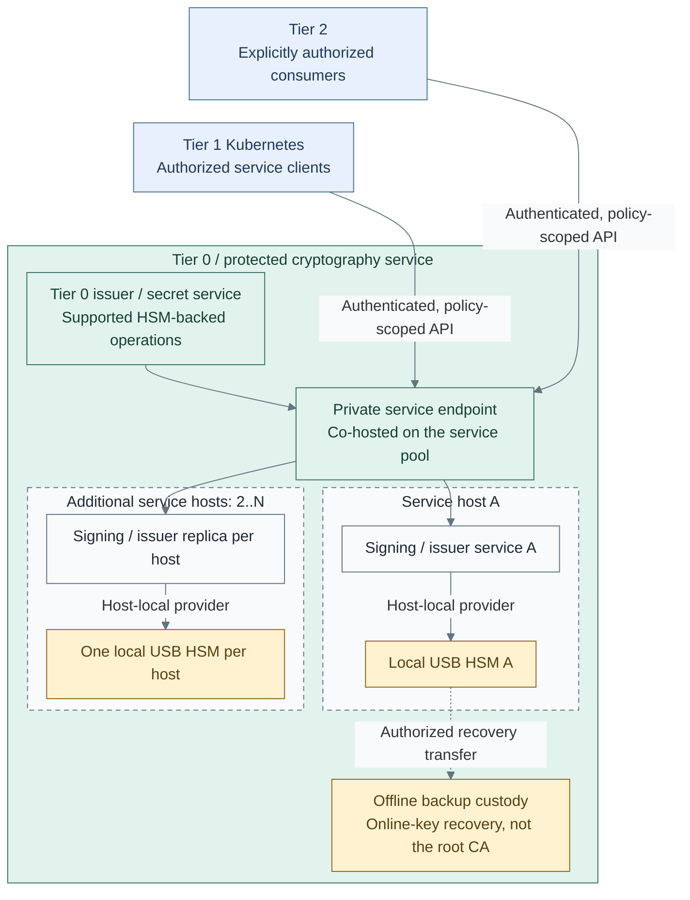

# Replicated USB HSM services

Option C of the [key-protection design](hsm-selection.md) uses a capacity-sized pool
of Tier 0 service hosts, one local HSM per host and a private endpoint operated
by those same hosts. Tier 1/2 consume permitted APIs; their runtimes are not
required for foundational Tier 0 operations or recovery. Offline root custody
and backups of online keys remain separate.

Vault and other selected services are consumers of HSM-backed key operations,
not prerequisites for bringing up the HSM service. Higher consumer availability
requirements justify this replicated variant; a single-device design remains
valid where its outage and recovery contract is sufficient.

## Table of contents

- [Topology](#topology)
- [Endpoint variants](#endpoint-variants)
- [Capacity and replica count](#capacity-and-replica-count)
- [Authority and transport](#authority-and-transport)
- [State and failure boundaries](#state-and-failure-boundaries)
- [Kubernetes consumers and hosting](#kubernetes-consumers-and-hosting)
- [HSM mode](#hsm-mode)
- [Implementation](#implementation)
- [References](#references)

## Topology

The endpoint is a **logical address/failover function, not dedicated frontend VMs**.
The pool contains `hsm-1` through `hsm-N` on `cryptography` in Control, with
separate physical failure domains and explicit USB-device affinity. The public
Tier 2 edge and Tier 1 Kubernetes are outside the foundational traffic path.
VIP ownership, health checks and any balancing run on these same service hosts,
not inside the USB devices and not on dedicated frontend VMs.

## Endpoint variants

These choices refine custody option C; they do not change key ownership.

| Variant | Arrangement on the existing hosts | Selection condition |
| --- | --- | --- |
| E1: Client failover | Pool member addresses; no VIP or proxy | The application supports endpoint selection, reconnection and safe failure handling |
| E2: Private VIP | Keepalived on the selected service hosts; one service address | Supported active/standby application operation is sufficient |
| E3: Private VIP and proxies | Keepalived and HAProxy co-hosted on the service pool | The signing application supports concurrent replicas and validated routing |

**E3 is the active-active reference when the application supports it.** One
host owns the VIP at a time; its proxy can route connections to healthy service
replicas. Active/standby VIP ownership is distinct from active-active service
use. Keepalived manages VIP failover; HAProxy manages backend selection. [6][7]

VIP/network support, frontend/backend listener separation, health tracking,
partition behavior and client reconnection are explicit requirements. Existing
connections are not assumed to survive a VIP move. E1 or E2 remains valid when
the application cannot meet E3's state and session requirements.

## Capacity and replica count

Two hosts are the starter example, not a fixed limit. The replicated pool has
at least two members; choose N from measured traffic and the required surviving
capacity during failures or maintenance. A single-device option remains valid
when its outage and recovery contract is sufficient.

| Sizing input | Required decision |
| --- | --- |
| Operation mix and concurrency | Measure the selected algorithms, key sizes, sessions, sustained load, bursts and latency targets |
| Failure headroom | Retained capacity must meet the accepted demand after the selected host/device losses or maintenance drain |
| Key and application compatibility | Each routed replica supports the permitted keys, policy, state and session behavior for that pool |
| Frontend and network capacity | Measure the VIP owner/proxy path separately; additional HSMs do not remove a frontend bottleneck |

Larger pools retain co-hosted endpoint functions. If one VIP becomes a bottleneck,
review client-side distribution or separately scoped endpoints/pools rather than
assuming additional HSMs provide linear scaling. No autoscaler or automatic key
replication is implied by pool membership.

## Authority and transport

TLS passthrough is the reference transport: terminate TLS and enforce client
authentication and operation/key policy at the signing or issuing service.
The proxy forwards connections, not unrestricted signing authority. The reference
relays TLS streams in TCP mode without terminating application authentication. [8]

Lower-tier clients receive scoped issuance/signing rights, never HSM administration
or unrestricted use of infrastructure keys. A supported issuer can access its
local HSM directly; a separate generic gateway is not required when the issuer
already supplies the needed policy and HA interfaces.

Vault's managed-key integration can delegate key generation and private-key
operations to a compatible HSM provider. [12] This is separate from its
[seal/unseal mechanism](vault-seal.md). The diagram shows the dependency direction,
not a claim that an arbitrary signing API or VIP implements Vault's PKCS#11 interface.
Registry signing workflows can also consume an approved signer; registry use alone
does not imply a direct HSM integration or a requirement to deploy replicated custody.

An optional consumer-facing publishing path can be separately approved. It is
not the Tier 0 internal or recovery path, must preserve service-side authorization,
and never publishes device connectors, custody administration or offline root
material. It does not add proxy authority merely through network reachability.

## State and failure boundaries

| Concern | Required property |
| --- | --- |
| Keys and policy | Every routed replica has compatible authorized keys and permissions; approved wrapped-key replication and independent backup remain separate operations [3] |
| Application state | The application's HA model covers its issuance records, revocation, policy, jobs and replay handling; duplicate keys alone are insufficient |
| Sessions | Routing preserves the selected protocol's session requirements; raw device connectors are not interchangeable stateless signing APIs [5] |
| Readiness | Service, expected local device, usable key/session and a policy-safe operation are valid; device loss removes that replica from routing |
| VIP availability | Ownership follows usable frontend/backend capacity, not only local VM or proxy process health; partition behavior is defined |
| Physical placement | Each VM reaches its expected local HSM; migration and host HA must not silently move it away from that device |
| Recovery | Provider startup does not require an unavailable cluster or a sealed secret service that depends on that provider |

HAProxy's basic TCP check proves connection acceptance, not signing readiness. [7]
Readiness integration is application-specific; a proxy cannot create a supported
HA model, replicate CA state or make unsafe request retries safe.

## Kubernetes consumers and hosting

Tier 1 applications normally use the private Tier 0 service DNS name. An optional
selectorless Service with EndpointSlices can provide a cluster-local alias, but
its owning integration must maintain endpoint readiness. Kubernetes does not
probe external HSM/key state through that representation. Only those consumers
depend on this optional cluster-local path. [9][10]

A higher-level issuer may run in Tier 0 Kubernetes while device-facing services
remain on VMs. Moving device access into Tier 0 Kubernetes requires a separately
validated placement, USB access, upgrade and recovery design. A Tier 1 namespace
or worker pool does not isolate a foundational signer from that cluster's
administrative authority. [11]

## HSM mode

| Mode | Boundary and integration |
| --- | --- |
| Pico HSM | Host-local device; supported initialization, wrapping and restore policy [2][3] |
| SoftHSM | Software token per host for an accepted software-custody design or rehearsal; not hardware isolation [1] |
| YubiHSM 2 | Product-specific provider, connector, backup and authenticated session requirements [4][5] |

PKCS#11 support or network reachability does not prove compatibility with the
selected issuer, seal mechanism or HA model. Device certification and supported
algorithms remain separate acceptance requirements.

## Implementation

The [deployment branch](../../deployment/stage-2-trust/step-1b-usb-hsm.md) provisions
the selected VMs and OS baseline; two are enabled in the starter. It does not
install signing software, configure USB passthrough, replicate keys or install
a VIP. Optional `ingress.yml` renders an
opt-in co-hosted backend scaffold only, after explicit HA/readiness acknowledgements;
it supplies neither a frontend nor complete runtime validation.

Deployment owns integration and failure acceptance; the
[administration guide](../../administration/cryptography/usb-hsm.md) owns recurring
health, rotation and restore checks. The hardware branch remains optional.

## References

Sources checked 2026-10-14.

1. [SoftHSM](https://www.softhsm.org/)
2. [Pico HSM capability map](https://docs.picokeys.com/picohsm/features/)
3. [Pico HSM backup and restore](https://docs.picokeys.com/picohsm/backup-restore/)
4. [YubiHSM PKCS#11 module](https://developers.yubico.com/yubihsm-shell/yubihsm-pkcs11.html)
5. [YubiHSM quick start and authenticated sessions](https://docs.yubico.com/hardware/yubihsm-2/hsm-2-user-guide/hsm2-quick-start.html)
6. [Keepalived configuration](https://www.keepalived.org/documentation/keepalived-conf/)
7. [HAProxy health checks](https://www.haproxy.com/documentation/haproxy-configuration-tutorials/reliability/health-checks/)
8. [HAProxy TCP proxying](https://www.haproxy.com/documentation/haproxy-configuration-tutorials/protocol-support/tcp/)
9. [Kubernetes Services without selectors](https://kubernetes.io/docs/concepts/services-networking/service/#services-without-selectors)
10. [Kubernetes EndpointSlices](https://kubernetes.io/docs/concepts/services-networking/endpoint-slices/)
11. [Kubernetes multi-tenancy](https://kubernetes.io/docs/concepts/security/multi-tenancy/)
12. [Vault managed-key integration](https://developer.hashicorp.com/vault/docs/enterprise/managed-keys)
