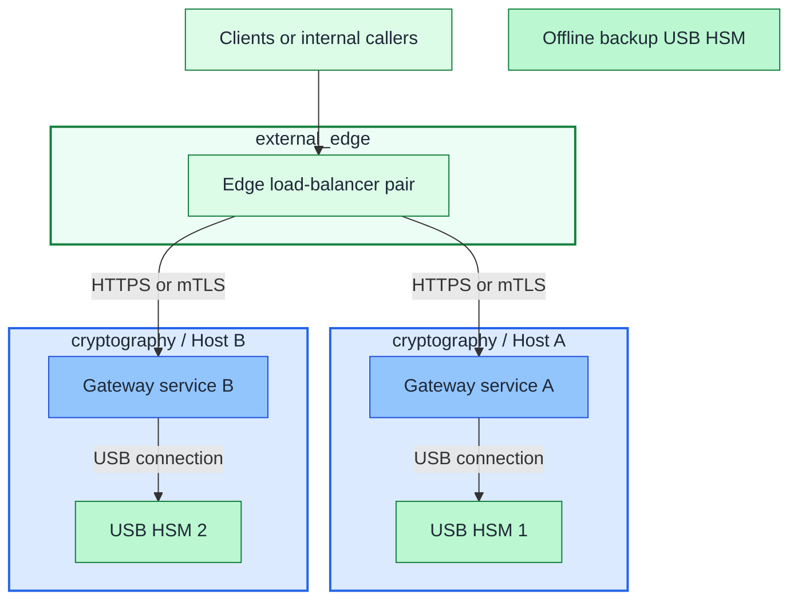

# USB HSM gateway option

Option C of the [key-protection design](hsm-selection.md), within the [cryptography domain](README.md).
The published-gateway variant uses an existing edge service; internal issuer
integration can be selected independently. Gateway hosts with high-impact keys
remain Tier 0, and root-key custody stays offline.

## Table of contents

- [Topology](#topology)
- [HSM mode](#hsm-mode)
- [Implementation](#implementation)
- [References](#references)

## Topology

The default shape in this repo is:

- the deployed edge load-balancer set from the `edge` setup
- `2` gateway hosts on the `cryptography` network in the Control zone
- `1` local USB HSM or software token per gateway host
- `0-1` helper or recovery VM in `ceremony`
- `1` offline backup device or equivalent recovery artifact

Figure: the default path is the deployed shared-service edge load-balancer in
front of two gateway hosts, one local USB HSM per host, and one offline backup
device.

Keep these boundaries:

- one gateway service talks only to one local token
- the deployed edge load balancer stays in the shared-service layer and is a
  prerequisite here
- active devices are independent replicas, not a native HSM cluster
- copied key objects do not imply synchronized rotations, counters, or sessions
- the offline backup of an online key is not the offline root CA
- USB or PKCS#11 access stays host-local

## HSM mode

Device examples for the hardware variant and its software-only rehearsal:

| Mode | What changes |
| --- | --- |
| `Pico HSM` | hardware attach, device initialization, backup or restore ceremony [2][3] |
| `SoftHSM` | no USB device, software token per host [1] |
| `YubiHSM 2` | same host pattern, but connector or product-specific runtime details may differ [4][5] |

The host topology can remain the same, but software rehearsal does not provide
the hardware-custody guarantee. Device-specific compatibility and backup policy
remain independent of service-level failover.

## Implementation

Follow the [gateway deployment guide](../../deployment/stage-2-trust/step-1b-usb-hsm.md)
for prerequisites, guest inputs and integration work. The shipped setup creates
hosts and applies a baseline; it does not install a complete signing service,
replicate keys, or perform ceremonies. The hardware branch is optional and can be deferred.

## References

1. [SoftHSM](https://www.softhsm.org/) (accessed 2026-09-19)
2. [PicoKeys Documentation: Capability map](https://docs.picokeys.com/picohsm/features/) (accessed 2026-09-19)
3. [PicoKeys Documentation: Backup and restore](https://docs.picokeys.com/picohsm/backup-restore/) (accessed 2026-09-19)
4. [Yubico: YubiHSM PKCS#11 Module](https://developers.yubico.com/yubihsm-shell/yubihsm-pkcs11.html) (accessed 2026-09-19)
5. [Yubico: yubihsm-connector](https://developers.yubico.com/yubihsm-connector/) (accessed 2026-09-19)
