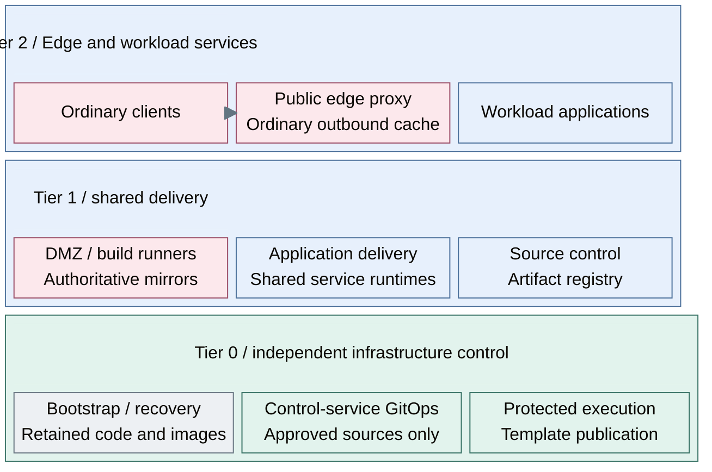

# Traffic and delivery

Delivery supplies approved service endpoints, software sources, code and
artifacts. Public ingress and ordinary outbound caches belong to Tier 2; source
control, authoritative mirrors and general build runners belong to Tier 1. Privileged
infrastructure execution and image publication remain Tier 0 responsibilities.
These interfaces connect software producers and consumers in the
[platform architecture](../README.md).

## Table of contents

- [Completed design](#completed-design)
- [Components and interfaces](#components-and-interfaces)
- [Design choices](#design-choices)
- [Design constraints](#design-constraints)
- [Detailed views](#detailed-views)
- [Realization](#realization)

## Completed design

Code, artifact delivery and published application access coexist in the completed
platform. General builds supply candidate artifacts; the selected promotion policy
controls approved versions. Infrastructure proposals cross a separate Tier 0
authorization boundary.

The Tier 1 source authority sits to the right of its delivery consumers. This view
shows placement and client entry; [controller patterns](controllers.md)
shows the separate approved-input and scoped-change flows.

Registry interfaces also supply approved OS images and template inputs to host
consumers. Tier 0 retains independent recovery copies and controls trusted template
publication. Named application listeners follow the network policy of the selected
service instance.

## Components and interfaces

| Component | Function and boundary |
| --- | --- |
| Public edge proxy (Tier 2 / DMZ) | Publish named application listeners; never Tier 0 administration or the foundational signing/recovery path |
| Outbound proxy/cache (Tier 2 / DMZ) | Forward approved outbound requests; no unsolicited WAN listener or artifact promotion authority |
| Authoritative mirrors (Tier 1 / DMZ) | Retain approved software sources; separate subnet and publication credentials |
| Source control | Retain reviewed definitions and coordinate changes; not a source of Tier 0 authority |
| Registry | Own approved artifact versions and consumer access |
| Distribution layer | Accelerate artifact delivery without becoming the artifact authority |
| Build runners (Tier 1 / DMZ) | Produce candidate artifacts with scoped credentials; no Tier 0 access |

| Boundary | Interface and connected function |
| --- | --- |
| Supplied to runtimes | Approved Git revisions, scoped artifact pulls and retained software inputs |
| Supplied to clients | Named application endpoints through the selected edge or ingress service |
| Supplied to infrastructure control | Proposed changes and candidate artifacts subject to Tier 0 authorization |
| Consumed from compute | Service runtime, build capacity, persistent storage and approved template references |
| Consumed from identity and cryptography | Supported OIDC integration, service roles, TLS and scoped service credentials |
| Consumed from networking and operations | Approved egress/publication routes, visibility and independent recovery targets |

## Design choices

| Decision | Alternatives | Consequence |
| --- | --- | --- |
| Software supply | A: existing approved egress; B: caching proxy; C: mirrors/offline content | A cache is not an offline mirror and cannot fetch unreachable content |
| Endpoint resilience | Existing ingress; proxy pair/set with owned VIPs | Failover and backend health require separate evidence; VIP count does not imply load balancing |
| Source-control runtime | Dedicated VM; cluster service; existing platform | Lifecycle and data recovery differ, while source/approval interfaces remain |
| Artifact service | A: integrated registry; B: independent registry; C: registry plus distribution acceleration | [Artifact supply design](artifact-supply.md) separates authority from delivery |
| Build environment | General container runner; image-based OS builder | Builds cannot publish trusted Tier 0 templates without Tier 0 approval |
| Trust boundary | Shared services; isolated project service | Separate policy, credentials, storage and recovery when isolation requires it |

The cache reference is a pair with one active VIP, not active-active balancing.
Bootstrap software supply is independent of hosted delivery services.
Recovery retains approved artifacts outside the platform that consumes them.

[Delivery controller patterns](controllers.md) separates Tier 0 Flux from the
unselected Tier 1 choice of Argo CD or Spinnaker. Tier 1 can deliver into Tier 2
only within an approved application scope; it does not control Tier 0.

## Design constraints

| Concern | Required property |
| --- | --- |
| Publication | Named listeners and scoped artifact publishers; no blanket administrative access |
| Artifact authority | Approved versions and promotion policy remain independent of distribution caches |
| Isolation | Build credentials cannot authorize privileged infrastructure changes |
| Recovery | Required code and images survive loss of the hosted delivery platform |

An integrated registry can remain the final choice. Distribution acceleration
is justified by capacity requirements, not by an assumed product progression.

## Detailed views

- [Controller patterns](controllers.md) compares GitOps reconciliation and release-pipeline orchestration.
- [Artifact supply](artifact-supply.md) expands integrated, independent and accelerated registry designs.
- [Infrastructure execution](../compute/provisioning.md) details the Tier 0 acceptance, credential and state boundary.
- [Network policy](../networking/firewall-policy.md) defines permitted publication and software-supply routes.
- [Runtime flows](../runtime-flows.md) follows changes from their source to running workloads.

## Realization

Implementation procedures: [independent software supply](../../deployment/foundation/README.md#step-2-protect-provisioning-access-and-state)
and [hosted delivery](../../deployment/stage-5-delivery/README.md#step-1-deploy-shared-delivery-services).
Procedure reuse does not transfer service ownership between tiers.
