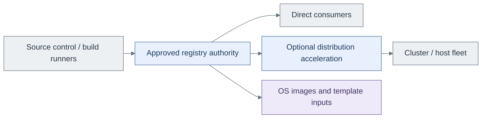

# Artifact supply design

Source control owns definitions and proposed changes. The registry owns promoted
artifacts. A distribution layer accelerates pulls but is not the authority for
which artifact is approved.

## Components and variants

| Option | Design | Reference example | Trade-off |
| --- | --- | --- | --- |
| A | Registry integrated with source control | GitLab registry [1] | Simple project-local ownership; coupled service lifecycle |
| B | Independent platform registry | Harbor [2] | Separate artifact policy and recovery; another stateful service |
| C | B plus distribution acceleration | Harbor plus Dragonfly [3] | Additional capacity/distribution function and operating responsibility |

An existing registry is valid for any compatible consumer. The reference products
are examples, not required stages. C does not replace B's artifact authority.
Kubernetes and image-based Linux can consume all suitable variants.

## Availability and dependencies

Every variant needs scoped push/pull, approved promotion, retention and recovery.
Independent bootstrap needs approved artifact availability, not a specific hosted
registry. Distribution acceleration is justified by measured pull demand.

Harbor's cluster HA pattern depends on external ingress, database/cache and artifact
storage readiness; increasing application replicas alone is insufficient. [2]
Recovery copies for Tier 0 remain independent of the delivery platform.

[Registry integration](../../deployment/stage-5-delivery/procedures/registry.md)
owns implementation and acceptance.

## References

Sources checked 2026-10-08.

1. [GitLab container registry](https://docs.gitlab.com/user/packages/container_registry/)
2. [Harbor HA deployment](https://goharbor.io/docs/main/install-config/harbor-ha-helm/)
3. [Dragonfly project documentation](https://d7y.io/docs/)
