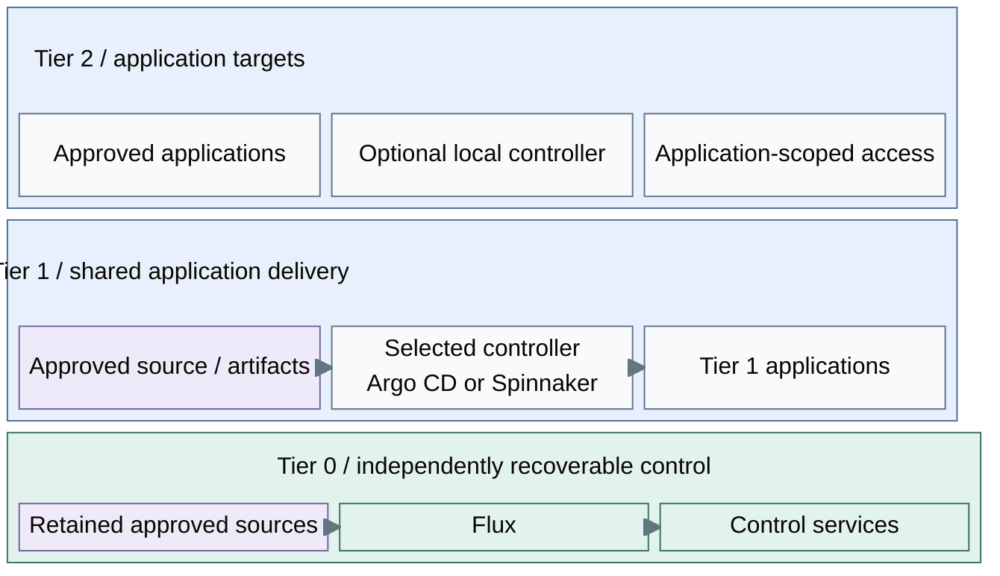

# Delivery controller patterns

Tier 0 uses Flux for its independently recoverable control-service deployment.
Tier 1 selects its own delivery platform for shared services and approved Tier 2
applications. Its controller is not selected by this kit.

## Table of contents

- [Choices](#choices)
- [Authority and ownership](#authority-and-ownership)
- [Selection criteria](#selection-criteria)
- [Realization](#realization)
- [References](#references)

## Choices

| Scope or option | Design role | Consequence |
| --- | --- | --- |
| Tier 0: Flux | Reconcile approved control-service definitions | Independent source credentials, decryption keys and recovery copies |
| Tier 1 A: Argo CD | Application-centric Kubernetes GitOps | Projects scope sources, destinations, resource kinds and application roles [1] |
| Tier 1 B: Spinnaker | Release orchestration through deployment pipelines | Pipeline stages express promotion, approval and deployment actions [2] |
| Tier 2 | Application target with scoped delivery access | May consume Tier 1 delivery or a separately selected local controller |

These are different operating models, not small versus large editions of the
same product. Tier 0 favors a focused reconciliation path. Tier 1 evaluates
application ownership, promotion workflows and multi-team operation. Cluster
size alone does not select the controller.

## Authority and ownership

Tier 1 delivery has no Tier 0 Kubernetes credentials, Proxmox credentials or
authority over infrastructure state. Infrastructure requests use the separate
[protected execution contract](../compute/provisioning.md). Read-only source
retrieval by Tier 0 Flux does not transfer that authority to the source service.

Each Kubernetes object has one reconciler or pipeline owner. Multiple tools must
not independently control the same application resources. Tier 2 cluster lifecycle
remains distinct from scoped application deployment to that cluster.

## Selection criteria

Record the selected controller, application ownership, source/revision policy,
destination credentials, RBAC/OIDC, secret handling, promotion/rollback and recovery
in the generated project's architecture record before enabling delivery.

For Argo CD, restrict projects instead of using permissive default destinations;
protect the controller namespace and privileged projects. For Spinnaker, define
account permissions and approved pipeline actions; pipeline approval is not a
replacement for target authorization. [1][2]

## Realization

[Stage 5](../../deployment/stage-5-delivery/README.md) provisions the platform runtime
and integrates the selected delivery option. [Cluster foundation](../../deployment/stage-3-identity-runtime/procedures/kubernetes.md#cluster-foundation)
defines the shared readiness gates. Tier 1/2 manifests remain project-owned starters;
neither Argo CD nor Spinnaker installation is supplied.

## References

1. [Argo CD projects](https://argo-cd.readthedocs.io/en/stable/user-guide/projects/).
2. [Spinnaker pipelines](https://spinnaker.io/docs/concepts/pipelines/).
