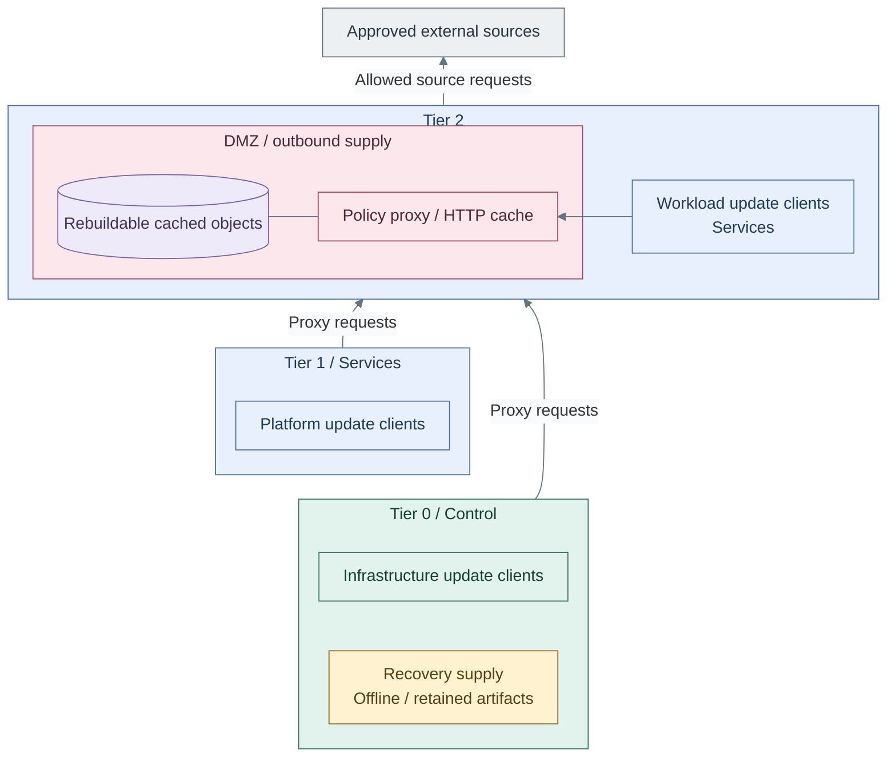

# Controlled software intake

Software intake gives connected hosts in every tier a controlled route to package
repositories, images and update sources. A policy proxy restricts destinations;
an HTTP cache reduces eligible repeated downloads. Neither function approves an
artifact or replaces a retained repository mirror.

## Contents

- [Connected proxy design](#connected-proxy-design)
- [Supply choices](#supply-choices)
- [Transport and integrity](#transport-and-integrity)
- [Authority and recovery](#authority-and-recovery)
- [Realization](#realization)
- [References](#references)

## Connected proxy design

**Architecture (A):** arrows are client-initiated requests, not software push or
administrative access. Replies carry the requested software. The proxy-to-data
line means cache storage; independent recovery supply has no implied network route.
Tier-boundary connections target the proxy interface, not other Tier 2 services.
The view shows capabilities, not guest counts or physical placement.

Firewall rules allow selected consumers to the proxy listener, deny direct WAN
bypass, and restrict the proxy's upstream access. Proxy ACLs combine source CIDRs,
destination domains and permitted ports. The reference is one common policy for
all permitted clients; a stricter Tier 0 policy needs a separately scoped endpoint
or approved mirror-only route, not a claim that one broad allow-list varies by tier.
Domain access is not repository-path, package or version approval. [1]

## Supply choices

| Option | Function | Availability and approval boundary |
| --- | --- | --- |
| A: Policy proxy with HTTP cache | Restricted clients pull from selected reachable sources | Simple initial path; cache misses and HTTPS tunnels need the upstream source |
| B: Retained repository mirrors | Clients pull selected content from internal repositories; mirror synchronization can use A | Retention, signature checks and promotion belong to the mirror owner; Tier 1 owns authoritative shared mirrors |
| C: Offline distribution | Approved content is transferred into an isolated custody boundary | No proxy route across the air gap; content and verification material must already be present |

B is the stronger fit when Tier 0 must consume only retained, approved releases
without depending on live public repositories. Synchronization and promotion are
separate operations; downloading into a mirror does not itself approve a release.
An existing mirror is valid. The repository supplies A, not a generic mirror
synchronizer, promotion service or offline-content installer.

## Transport and integrity

| Path | Design choice and limit |
| --- | --- |
| Explicit HTTP proxy to a public HTTPS source | CONNECT preserves client-to-source TLS; Squid cannot cache or inspect the encrypted payload [2] |
| Plain HTTP repository through the proxy | Eligible responses can be cached; freshness, metadata and package verification still apply |
| Internal HTTP mirror | An explicit option for isolated distribution of signed, non-sensitive content; no plaintext credentials, tokens or private artifacts |
| Transparent HTTP interception | A distinct routing/proxy mode, not supplied by the current explicit-proxy recipe |
| Transparent HTTPS interception | Requires a reviewed TLS-interception design and client trust changes to inspect/cache payloads; transparency alone does not decrypt TLS [2] |

Internal HTTP requires signature and trusted-metadata verification, controlled
network access and an accepted tampering/replay risk. Keep public-source TLS and
release verification; do not downgrade downloads merely to obtain cache hits.
Artifacts without adequate independent verification need protected transport.
Repository HTTP is not permission to disable TLS for Proxmox APIs, identity,
secrets or security-log submission.

## Authority and recovery

- Tier 2 owns the ordinary proxy/cache and its rebuildable data, not Tier 0 credentials.
- Tier 1 owns authoritative shared mirrors and artifact services, with scoped publication rights.
- Tier 0 authorizes and executes its updates. Lower tiers may supply approved bytes,
  never initiate privileged installations or gain management access through this path.
- A proxy setting is client configuration, not firewall enforcement or an update scheduler.
- Bootstrap and recovery retain approved tools, packages/images and verification material
  independent of the cache, mirrors, hosted identity and registries. Missing supply must
  fail closed, not silently enable direct Internet access.

## Realization

[Software intake](../../deployment/stage-1-software-intake/README.md) deploys the
Tier 2 Squid/keepalived reference. Each consuming tier owns its local proxy inputs;
Shared supplies reusable package-manager and shell configuration.
[Proxmox update access](../../administration/compute/update-access.md) covers the
Tier 0 host integration. [Artifact supply](artifact-supply.md) covers registry
authority and distribution, not HTTP cache behavior.

## References

Sources checked 2026-10-22.

1. [Squid access controls](https://www.squid-cache.org/Doc/config/acl/)
2. [Squid HTTPS and CONNECT behavior](https://wiki.squid-cache.org/Features/HTTPS)
