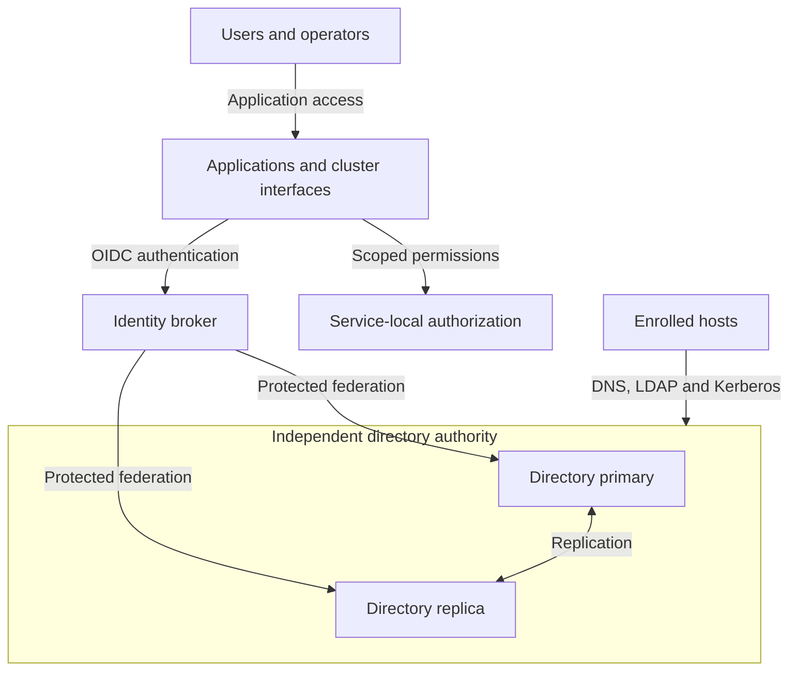

# Identity and access

Identity establishes subjects and exposes authentication interfaces. Authorization
remains local to each service: a successful login is not permission to administer
the platform. This domain supplies directory authority and federated access to the
[platform architecture](../README.md).

## Table of contents

- [Completed design](#completed-design)
- [Components and interfaces](#components-and-interfaces)
- [Design choices](#design-choices)
- [Design constraints](#design-constraints)
- [Detailed views](#detailed-views)
- [Realization](#realization)

## Completed design

The directory pair and identity broker provide different interfaces in the completed
environment. Enrolled hosts use directory services directly; applications use the
broker and enforce their own roles. These relationships remain stable when an
approved existing authority replaces the reference directory pair.

In the reference allocation, FreeIPA runs on dedicated Tier 0 VMs and Keycloak
runs in Tier 0 Kubernetes. Broker database, TLS and recovery dependencies remain
explicit even when a different runtime supplies the broker.

## Components and interfaces

| Component | Function and boundary |
| --- | --- |
| Directory authority | Users, groups, hosts, DNS and Kerberos; independent of the control cluster |
| Identity broker | Federate the authority and provide OIDC to applications |
| Service authorization | Translate identity into scoped application or cluster permissions |
| Operator credentials | Normal strong authentication plus separately protected recovery access |

The directory implements one part of identity and access, not the whole design.
Inventory, source control, dashboards and cluster interfaces consume OIDC only
after their broker integration exists.

| Boundary | Interface and connected function |
| --- | --- |
| Supplied to hosts | Directory enrollment, DNS, LDAP and Kerberos within the selected authority scope |
| Supplied to applications | Federated OIDC identity and group claims; each service owns its permission mappings |
| Consumed from compute | Dedicated directory runtime; broker runtime, persistent database and storage |
| Consumed from cryptography | Certificate trust, service TLS and supported operator credential integration |
| Consumed from operations | Independent recovery records, backup targets and access/audit visibility |

## Design choices

| Decision | Variants | Consequence |
| --- | --- | --- |
| Authority | A: new dedicated directory pair; B: existing approved authority | B replaces installation with an interface, ownership and recovery contract |
| Normal operator access | Bootstrap credentials; hardware-backed OTP/PIV or appropriate phishing-resistant mechanisms | Credential capability and application support must be verified separately |
| Windows clients | Selected service interoperability; optional [AD-compatible extension](windows-integration.md) | An extension does not silently replace the primary identity authority |
| Instance boundary | Shared identity; isolated project/domain authority where justified | Isolation adds enrollment, trust and recovery responsibilities |

User authentication devices and server HSMs have different purposes.
A server's key custody does not by itself provide strong user authentication.

## Design constraints

| Concern | Required property |
| --- | --- |
| Authority | Defined namespaces and replication boundaries; one owner for each identity source |
| Authorization | Each consumer maps identity to its own scoped permissions |
| Availability | Directory replication and broker persistence have separate failure and recovery contracts |
| Recovery | The broker cannot be the only means to recover itself or replace lost operator credentials |

## Detailed views

- [Windows and AD-compatible integration](windows-integration.md) details the optional client extension.
- [Service boundaries](../service-boundaries.md) defines shared and isolated authority consumption.
- [Component allocation](../reference-platform.md#service-placement) locates the directory, broker and database.
- [Runtime flows](../runtime-flows.md) connects authentication to complete service access.

## Realization

Implementation procedures: [directory authority](../../deployment/stage-3-identity-runtime/procedures/freeipa.md)
and [broker integration](../../deployment/stage-4-control-services/README.md#step-1-deploy-identity-federation).
Windows integration is an explicit project option, not a supplied domain installer.
