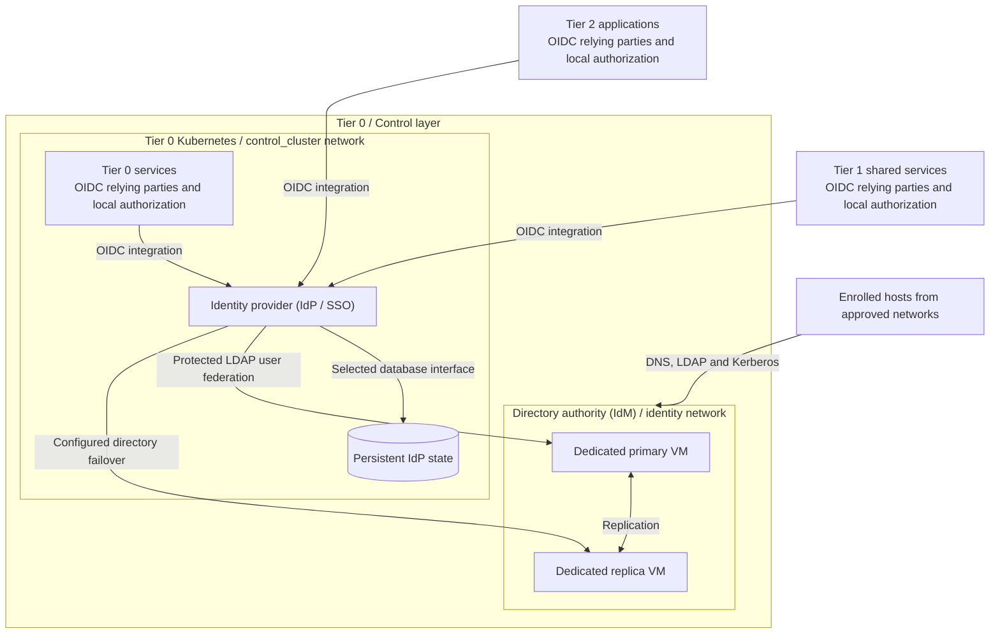

# Identity and access

Identity establishes subjects and exposes authentication interfaces. Authorization
remains local to each service: a successful login is not permission to administer
the platform. This domain supplies directory authority and federated access to the
[platform architecture](../README.md).

## Table of contents

- [Terminology](#terminology)
- [Completed design](#completed-design)
- [Components and interfaces](#components-and-interfaces)
- [Design choices](#design-choices)
- [Design constraints](#design-constraints)
- [Detailed views](#detailed-views)
- [Realization](#realization)

## Terminology

Identity and access management (IAM) is the overall capability, not the name of
one VM or product. It includes identity lifecycle, authentication and access
policy. [1] The reference separates these responsibilities:

| Term | Meaning in this design | Reference realization |
| --- | --- | --- |
| Identity management (IdM) / directory authority | Maintain users, groups and enrolled hosts; supply directory, DNS and Kerberos services | FreeIPA primary and replica on dedicated VMs [3] |
| Identity provider (IdP) | Authenticate subjects and provide identity information to relying applications [2] | Keycloak in Tier 0 Kubernetes [4] |
| Single sign-on (SSO) | Reuse a sign-in session across participating services | IdP sessions and configured application integrations [4] |
| Service authorization | Decide which actions an authenticated identity may perform | Each application or cluster's roles and policies |

Keycloak acts as the IdP for the applications. Its connection to the directory is
**LDAP user federation**. **Identity brokering** is a different integration:
delegating authentication to another IdP, such as an upstream OIDC or SAML
provider. [4] The terms are not interchangeable.

## Completed design

This view expands **directory authority (IdM)** and **identity provider (IdP / SSO)**
from the [capability map](../README.md#functional-structure). Ownership, runtime
and service consumption are shown separately.

In the reference allocation, FreeIPA implements IdM on two dedicated Tier 0 VMs;
Keycloak implements the IdP in the Tier 0 cluster. Their hosting and recovery
remain separate. The IdP's database, TLS and directory failover are explicit
integration requirements, not implied by a replica count or installed by this diagram.

FreeIPA retains one replicated identity CA under the offline root, as a sibling of
the infrastructure issuer. Its certificate inventory and custody remain separate
from the OpenXPKI portal; see the [CA design](../cryptography/certificate-authority.md).

Arrows identify logical consumers and dependencies, not every browser redirect
or token exchange. [Service access](../runtime-flows.md#service-access) expands
the login interaction. Enrolled hosts consume directory services directly;
applications consume the IdP and retain their own authorization.

## Components and interfaces

| Capability | Reference placement | Supplied interface |
| --- | --- | --- |
| Directory authority (IdM) | Tier 0 / Control; dedicated VMs on `identity` | Host enrollment, directory, DNS and Kerberos |
| Identity provider (IdP / SSO) | Tier 0 / Control; Kubernetes on `control_cluster` | Approved application-facing OIDC endpoints |
| Service authorization | Consuming service and its owning tier | Scoped application or cluster permissions |
| Operator access | Protected administration and independent recovery arrangements | Separately authorized control interfaces |

An IdP is an application-facing service with high-impact identity authority.
Its login endpoint can be consumed from Tier 1 and Tier 2 without exposing its
administration or moving its runtime into the Services zone. The `access`
network can host a deliberately selected front end; it is not the reference
placement of the IdP. A published front end does not bridge networks or grant
directory administration.

| Boundary | Interface and connected function |
| --- | --- |
| Supplied to hosts | Directory enrollment, DNS, LDAP and Kerberos within the selected authority scope |
| Supplied to applications | OIDC identity and group claims; each service owns its permission mappings |
| Consumed from compute | Dedicated directory runtime; IdP runtime, persistent database and storage |
| Consumed from cryptography | Certificate trust, service TLS and supported operator credential integration |
| Consumed from operations | Independent recovery records, backup targets and access/audit visibility |

## Design choices

| Decision | Variants | Consequence |
| --- | --- | --- |
| Authority | A: new dedicated directory pair; B: existing approved authority | B replaces installation with an interface, ownership and recovery contract |
| Normal operator access | Bootstrap credentials; hardware-backed OTP/PIV or appropriate phishing-resistant mechanisms | Credential capability and application support must be verified separately |
| Windows clients | Selected service interoperability; optional [AD-compatible extension](windows-integration.md) | An extension does not silently replace the primary identity authority |
| Instance boundary | Shared identity; isolated project/domain authority where justified | Isolation adds enrollment, trust and recovery responsibilities |

User authentication devices and server HSMs have different purposes.
A server's key custody does not by itself provide strong user authentication.

## Design constraints

| Concern | Required property |
| --- | --- |
| Authority | Defined namespaces and replication boundaries; one owner for each identity source |
| Authorization | Each consumer maps identity to its own scoped permissions |
| Availability | Directory replication and IdP persistence have separate failure and recovery contracts |
| Recovery | The IdP cannot be the only means to recover itself or replace lost operator credentials |

## Detailed views

- [Windows and AD-compatible integration](windows-integration.md) details the optional client extension.
- [Service boundaries](../service-boundaries.md) defines shared and isolated authority consumption.
- [Component allocation](../reference-platform.md#service-placement) locates IdM, the IdP and its database.
- [Runtime flows](../runtime-flows.md) connects authentication to complete service access.

## Realization

Implementation procedures: [directory authority](../../deployment/stage-3-identity-runtime/procedures/freeipa.md)
and [IdP integration](../../deployment/stage-4-control-services/README.md#step-1-deploy-identity-federation).
Windows integration is an explicit project option, not a supplied domain installer.

## References

Sources checked 2026-10-09.

1. [NIST: Identity and access management](https://csrc.nist.gov/glossary/term/Identity_and_access_management)
2. [NIST: Identity provider](https://csrc.nist.gov/glossary/term/Identity_Provider)
3. [FreeIPA: About](https://www.freeipa.org/page/About)
4. [Keycloak: Server administration](https://www.keycloak.org/docs/latest/server_admin/index.html)
