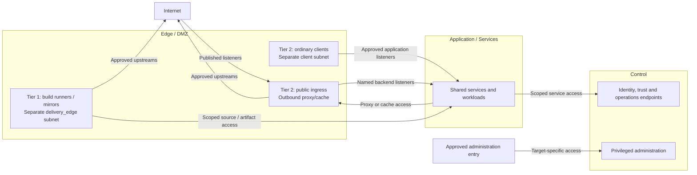

# Network zones and IaC mapping

Networking connects the platform's services through approved entry points,
scoped service interfaces and protected administration. A stable network map
connects that design to Proxmox, Terraform and firewall policy. Names describe
purpose: `management`, `identity`, `application`, `cryptography`, and so on.

This domain expands networking in the [platform overview](../README.md#technical-domains).
The [reference platform](../reference-platform.md) supplies service placement;
the [firewall policy](firewall-policy.md) supplies the detailed traffic contract.

## Table of contents

- [Completed connectivity](#completed-connectivity)
- [Supplied and consumed interfaces](#supplied-and-consumed-interfaces)
- [Zone assignment](#zone-assignment)
- [Design choices](#design-choices)
- [Network catalog](#network-catalog)
- [VLAN ID strategy](#vlan-id-strategy)
- [Automation mapping](#automation-mapping)
- [Attachment constraints](#attachment-constraints)
- [Continue reading](#continue-reading)
- [References](#references)

## Completed connectivity

The connected platform distinguishes published application traffic, service
dependencies, controlled egress and privileged administration. Each connection
below represents a named endpoint contract, not access to an entire zone.

Ingress and egress are distinct functions, not necessarily one gateway service.
Application entry and administrative entry have separate policy and credentials.
The diagram shows the main service relationships; exact listeners, same-zone
dependencies, telemetry, backup and return traffic are defined by the
[firewall rule contracts](firewall-policy.md#rule-contracts). The
[runtime flows](../runtime-flows.md) explain the service interactions behind them.

Infrastructure also has attachments outside this routed service view:

| Attachment | Completed role | Boundary |
| --- | --- | --- |
| Guest bridge or VNet | Connect selected VM and cluster-node interfaces to their approved purpose networks | Guest attachment does not grant switch, gateway or hypervisor administration |
| Host management | Reach protected infrastructure administration endpoints | Approved administration sources and target-specific credentials |
| Host quorum and storage transport | Carry the selected cluster and storage fabric traffic | Restricted membership; no general routed guest access |
| Offline ceremony fabric | Support separately controlled custody and authorized transfers | Physically separate from connected hosts and networks; no routed gateway |

The [compute runtime design](../compute/runtime.md) shows the guests and hosts
that consume these attachments. The physical underlay can support multiple
logical networks without making their policies or failure domains identical.

## Supplied and consumed interfaces

| Direction | Interface | Connected function | Required contract |
| --- | --- | --- | --- |
| Provides | Approved guest and host attachments | [Compute](../compute/README.md) | Purpose network, address identity, tagging owner and permitted transport |
| Provides | Published and internal application paths | [Delivery](../delivery/README.md) and workloads | Named frontend/backend listeners and controlled egress |
| Provides | Scoped service and administrative paths | Identity, cryptography and operations | Service consumption stays separate from administration |
| Consumes | Service listeners and dependency requirements | Each service design | Explicit source, destination, protocol, enforcement point and owner |
| Consumes | Tier and authority classification | [Tier ownership](../tier-ownership.md) | Protection follows actual privileges, independently of subnet names |
| Exchanges | Network inventory and policy evidence | [Operations](../operations/README.md) | Complete site assignments and evidence for intended access and isolation |

## Zone assignment

The [layered view](../README.md#layered-model) reads left to right:

| Layer | Firewall zone | Network purposes |
| --- | --- | --- |
| Edge | `DMZ` | public ingress, ordinary clients, outbound caches, Internet-facing build/supply services |
| Application | `Services` | shared services, access front ends, workloads |
| Control | `Control` | administration, directory authority, control cluster, cryptography |
| Offline custody | none | root keys and authorized recovery ceremonies |

A tier selects the owning repo, not a VLAN or zone. One subnet belongs to one
firewall zone; group subnets only when their baseline policy matches. Add
`Lab`, `Storage`, or another zone when the required policy differs, not
because another repository exists.

Zone membership does not allow traffic. Use [named service rules](firewall-policy.md)
between subnets, including subnets in the same zone. Same-subnet traffic needs
host, switch, or workload enforcement. WAN and VPN entry remain boundary peers;
ordinary clients are Tier 2 members of a separate DMZ subnet. VPN membership
alone grants no control authority.

| Instance | Tier | Network / zone | Authority boundary |
| --- | --- | --- | --- |
| Public edge load balancer | 2 | `external_edge` / DMZ | Named application backends; no Tier 0 administration or foundational signing dependency |
| Ordinary outbound proxy/cache | 2 | `external_edge` or isolated egress subnet / DMZ | Approved outbound forwarding; no unsolicited WAN publication or artifact promotion authority |
| Ordinary client device | 2 | separate `client` subnet / DMZ | Named service access; never implicit peer or administrative access |
| General build runner / authoritative mirror | 1 | `delivery_edge` / DMZ | Scoped build or software-publication credentials; no Tier 0 credentials |
| Privileged workstation, jump host, bootstrap VM or infrastructure runner | 0 | `management` / Control | Explicit Tier 0 administration and independent recovery |
| Internal control/API load balancer | target tier | protected target network | Independent of public ingress; preserve target authority and recovery |

USB signing uses a private Tier 0 endpoint on its service pool, not a
separate load-balancer pair. Authorized Tier 1/2 consumers use policy-enforcing
APIs under the [cryptography contract](../cryptography/usb-hsm.md#authority-and-transport).
Any approved publication path is optional; Tier 0 retains independent private access.

Internet access alone does not select a tier. Exposure selects the network policy;
credentials and potential impact select ownership. An outbound cache has an
internal listener, but that does not require an Internet port-forward. Clients
likewise do not receive unsolicited WAN access simply by belonging to DMZ.

A privileged jump host is not an ordinary DMZ host. If remote administration
needs a perimeter entry, isolate that entry from the privileged session host and
allow only the approved access protocol. No public edge host holds Tier 0 secrets
or bridges into Control. Network location alone does not grant trust. [1]

## Design choices

Each variant realizes the same attachment and traffic contracts. The
[variant model](../variants.md) records the selection for the completed environment.

| Decision | Alternatives | Stable contract |
| --- | --- | --- |
| Guest attachment | VLAN-aware bridge or SDN VNet over the host underlay | Approved purpose network, one tagging owner and the same endpoint policy |
| Policy grouping | Existing zones with explicit subnet rules, or an additional zone for different baseline policy | No implicit trust between member subnets; enforcement follows the required isolation |
| Host transport | Shared physical underlay with separated logical fabrics, or selected dedicated links/switches | Required quorum/storage reachability, restricted membership and recorded physical failure domains |
| Application publication | Existing shared proxy or a separately operated proxy | Explicit published listener and backend scope; administrative authority remains separately classified |

The alternatives do not change tier ownership or automatically create redundant
paths. Cabling, switch configuration and vendor-specific policy translation
belong in the implementation procedures.

## Network catalog

Reference allocations below are examples, not an automatically allocated plan.
The logical keys are the Terraform `network_zones` names, **not firewall zones**.
Short VNet names such as `edge`, `apps`, `control`, and `crypto` map to these
purposes in the Proxmox examples.

| Network key | Purpose | VLAN / subnet example | Firewall zone |
| --- | --- | --- | --- |
| `external_edge` | Tier 2 public ingress and ordinary outbound proxies | 320 / `10.30.30.0/24` | DMZ |
| `delivery_edge` | Tier 1 Internet-facing build runners and authoritative mirrors | 321 / `10.30.31.0/24` | DMZ; separate subnet from Tier 2 |
| `client` | Tier 2 ordinary workstations/endpoints; policy reference only | site-defined separate VLAN / subnet | DMZ; no server provisioning implied |
| `application` | internal shared services and workloads | 120 / `10.20.20.0/24` | Services |
| `application` in the lab repo | isolated lab workloads | 420 / `10.42.20.0/24` | Services or separate Lab policy |
| `access` | application-only access and SSO front ends | 11 / `10.10.11.0/24` | Services; privileged interfaces need Control protection |
| `management` | Proxmox API/UI, bastions, protected runners and bootstrap log receivers | 10 / `10.10.10.0/24` | Control |
| `identity` | directory authority, DNS, Kerberos | 12 / `10.10.12.0/24` | Control |
| `control_cluster` | control-cluster nodes and private API | 13 / `10.10.13.0/24` | Control |
| `cryptography` | online issuer, privileged secrets, HSM gateways | 220 / `10.20.21.0/24` | Control |
| `storage` | archive/backup receivers; separate administration | 140 / `10.20.40.0/24` | Control or separate Storage policy |

Additional networks are introduced only when needed:

| Network key | Reference VLAN | Use |
| --- | --- | --- |
| `observability` | 130 | telemetry backends and dashboards in Services |
| `telemetry_gateway` | 230 | scoped telemetry intake in Services |
| `security_telemetry` | 231 | Tier 1 processing/intake, not authoritative Tier 0 evidence custody |
| `corosync` | 20 | non-routed Proxmox quorum fabric |
| `ceph_public` | 21 | non-routed storage client fabric; not public Internet |
| `ceph_cluster` | 22 | non-routed storage replication fabric |
| `ceremony` | 221 on a separate fabric | offline custody; example subnet `10.20.22.0/24`, no connected gateway |

A service may have separate client, backend, and administrative interfaces.
Permit the required listeners without exposing authority or administration.
Multi-interface hosts must not bridge zones. Offline custody needs physical
separation: a VLAN, missing route, or deny rule on a connected fabric is not an air gap.

## VLAN ID strategy

| Range | Reference use |
| --- | --- |
| `2-99` | management, access, identity, clustering, storage transport |
| `100-199` | internal services, applications, observability, archive |
| `200-299` | cryptography, ceremony, specialist telemetry |
| `300-399` | edge-facing networks |
| `400+` | projects, labs, local extensions |

These are allocations, not security labels or tier numbers. Keep one site plan
and avoid duplicate IDs on shared trunks. Record chosen ranges and names in
`docs/naming-conventions.md` in the generated architecture repo; keep complete
subnets, gateways, and addresses in network inventory.

## Automation mapping

Tier 0 operates the physical network across all tiers. Each tier selects
approved guest attachments; the generator neither creates networks nor installs
firewall rules.

| Location or field | Responsibility |
| --- | --- |
| Shared `config/platform.tfvars` / `shared_network_zones` | Existing network references used across tiers, such as `application` |
| Tier-local `terraform/common.tfvars` / `network_zones` | Tier-specific networks and overrides of shared bridge/VNet, VLAN, subnet, gateway references |
| `vm_instances.<key>.network_zone_key` | Select that guest's network; the key joins Terraform with Ansible inventory |
| Tier-local Ansible inventory and group vars | Host identity and IP inputs used by both tools |
| Kubernetes `nodes[*].bridge` and `vlan_id` | Direct node attachment; this deployment does not use the Linux `network_zones` map |
| Proxmox host and network configuration | Host management, quorum/storage fabrics, bridges, routing and segmentation |

For example, Linux `network_zone_key = "cryptography"` selects that tier's
`network_zones.cryptography` attachment. Cluster nodes instead select direct attachments:
Tier 0 uses `control_cluster`, Tier 1 uses `application`, and Tier 2 uses its
approved workload network in the [cluster reference](../compute/kubernetes.md).
Let either the VNet or the guest NIC own tagging; do not tag twice. Exact fields and runnable examples belong in
[network inputs](../../reference/network-inputs.md).

Identical logical keys across repos do not allocate or guarantee the same
subnet when overridden. Sharing a reference does not attach guests or grant
access; guest selections and host IPs remain tier-owned. Review bridge, VLAN,
address, and VMID values before use. Host-only
fabrics stay outside guest inputs unless a guest attachment is deliberate.

## Attachment constraints

Management and host fabrics support infrastructure control; guest attachments follow
the selected service purpose and policy. Tier numbers are not VLANs. Offline custody
remains separate from the routed platform.

Existing networks can satisfy the same policy; a project does not need another DMZ
when a shared proxy can publish its endpoint. Isolation and recovery requirements
apply regardless of subnet count.

The [Step 1 procedure](../../deployment/foundation/README.md#step-1-prepare-compute-and-templates) owns setup
order; [firewall rollout](../../deployment/foundation/procedures/firewall-rollout.md)
owns implementation and acceptance tests.

## Continue reading

- [Platform overview](../README.md#technical-domains) and [reference platform](../reference-platform.md)
- [Runtime flows](../runtime-flows.md) and [compute runtime](../compute/runtime.md)
- [Firewall policy](firewall-policy.md) and [network input contract](../../reference/network-inputs.md)
- [Deployment stages](../../deployment/README.md)
- [Proxmox host networking](../../deployment/foundation/procedures/host-network.md)
- [UniFi zone setup](../../deployment/foundation/procedures/unifi-zones.md)
- [Project conventions](../../development/project-documentation.md#start-with-project-values)

## References

1. [NIST SP 800-207: Zero Trust Architecture](https://csrc.nist.gov/pubs/sp/800/207/final) (accessed 2026-10-14)
