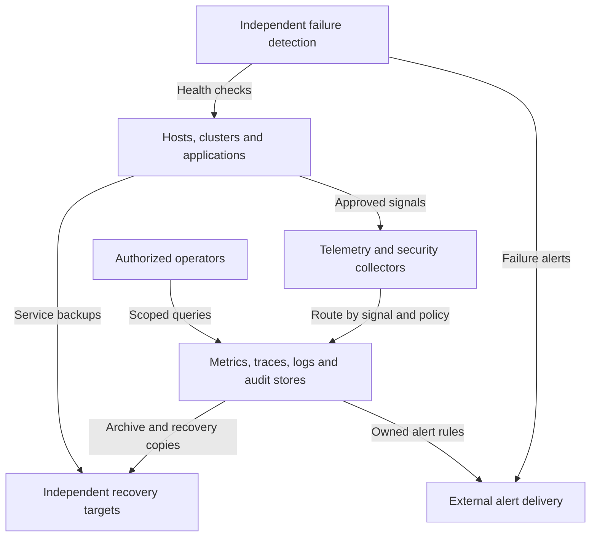

# Operations and workloads

Operations supplies independent visibility, inventory documentation, recovery and
workload governance. Every stateful resource has a recovery owner, regardless
of whether its monitoring is local or supplied by shared operational services.
These capabilities cover the whole [platform architecture](../README.md).

## Table of contents

- [Completed design](#completed-design)
- [Components and interfaces](#components-and-interfaces)
- [Design choices](#design-choices)
- [Design constraints](#design-constraints)
- [Detailed views](#detailed-views)
- [Realization](#realization)

## Completed design

Operational visibility combines service telemetry with failure detection outside
the observed cluster. Recovery copies remain available independently of the
services and dashboards that normally manage them.

NetBox documents approved inventory; Headlamp supplies scoped cluster operations.
Their interfaces complement telemetry without replacing tier-local bootstrap inputs
or independent recovery records. General telemetry can be Tier 1-owned; Tier 0
control visibility has an independently recoverable path. Syslog and audit evidence
from every tier remain in protected Tier 0 custody; shared analytics receives only
approved copies, with application-owner read scopes separate from security readers.

## Components and interfaces

| Component | Function and boundary |
| --- | --- |
| Inventory documentation | Describe deployed infrastructure; never replace tier-local bootstrap inputs |
| Cluster interface | Expose scoped cluster operations; not blanket infrastructure administration |
| Telemetry collectors | Receive, normalize and route signals under approved access policy |
| Protected log intake | Accept all tiers' security submissions without granting archive queries, editing or deletion |
| Signal backends | Store metrics, traces, logs and audit records according to purpose and retention |
| Recovery storage | Retain backups and restore evidence outside the service being recovered |
| Workload governance | Isolate consumers and authorize changes without transferring Tier 0 control |

| Boundary | Interface and connected function |
| --- | --- |
| Supplied to producers | Approved telemetry and security-event ingestion endpoints |
| Supplied to operators | Scoped inventory, cluster operations, signal queries and owned alert delivery |
| Supplied to recovery owners | Retained backups, archives and restoration evidence outside the protected service |
| Consumed from tier owners | Infrastructure records, workload scope, retention requirements and recovery responsibilities |
| Consumed from runtime and access services | Signals, backup streams, cluster APIs, authentication and service-local authorization |
| Consumed from independent arrangements | Recovery storage and failure detection outside the affected service or cluster |

## Design choices

| Decision | Alternatives | Consequence |
| --- | --- | --- |
| Telemetry placement | A: dedicated VM services; B: cluster services; C: existing service | [Telemetry design](telemetry.md) keeps signal roles independent of placement |
| Sharing | Central platform service; isolated project collectors/backends | Isolation follows access, retention and trust requirements |
| Recovery target | Dedicated backup service; approved external target; protected offsite copy | Storage availability alone is not tested restore |
| Log retention | NAS snapshots/backups with trusted administration; qualified retention locks | [Archive choices](log-retention.md) make deletion authority and growth recommendations explicit |
| Workload runtime | Linux VMs, image-based Linux, Kubernetes applications | Definitions and inventory stay tier-local; runtime changes need explicit lifecycle ownership |
| Workload execution | Reviewed operator action; bounded self-service | The latter needs the [request contract](../compute/provisioning.md), not unrestricted CI credentials |

NetBox, Headlamp and monitoring are reference implementations, not prerequisites
for creating the infrastructure on which they run.

## Design constraints

| Concern | Required property |
| --- | --- |
| Visibility | Failure detection remains available outside the observed cluster |
| Access and retention | Signal stores enforce the sensitivity and retention requirements of their sources |
| Recovery | Backups, custodians and recovery targets remain independent of the protected service |
| Governance | Workload requests cannot bypass tier ownership or infrastructure authorization |

Hardware custody and application-state recovery remain separate responsibilities.
A central dashboard alone is insufficient for independent failure detection.

## Detailed views

- [Runtime flows](../runtime-flows.md#data-visibility-and-recovery) connects service data, visibility and recovery across domains.
- [Telemetry design](telemetry.md) expands collection, signal backends, retention and placement alternatives.
- [Security logging](security-logging.md) owns append-only submission, segmented reads and the evidence durability contract.
- [Log archive choices](log-retention.md) compares NAS-backed recovery with retention locks and explains role separation as access grows.
- [Service boundaries](../service-boundaries.md) defines shared and isolated operational services.
- [Workload request contract](../compute/provisioning.md) connects governance to privileged execution.
- [Component allocation](../reference-platform.md#service-placement) locates inventory, cluster interfaces and supporting services.

## Realization

Implementation procedures: [foundational logging](../../deployment/stage-1-logging/README.md),
[independent monitoring](../../deployment/stage-4-control-services/monitoring.md),
[shared analytics](../../deployment/stage-5-delivery/analytics.md),
[operational services](../../deployment/stage-4-control-services/README.md#step-2-deploy-operational-services)
and [operational acceptance](../../deployment/stage-4-control-services/README.md#step-3-integrate-access-and-recovery).
Recurring work belongs in [administration](../../administration/README.md).
