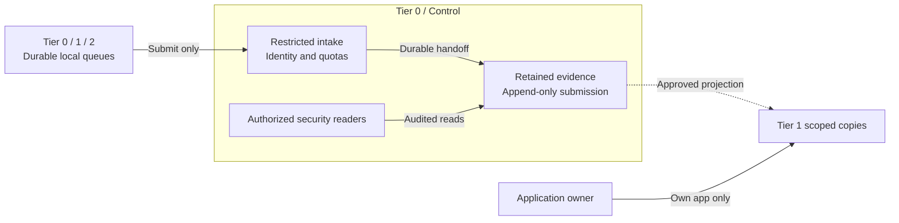

# Protected security logging

Syslog, audit and security events are a Tier 0 evidence capability, not an ordinary
Tier 1 dashboard service. All tiers submit approved records through restricted
intake. Only explicitly authorized system-administrator/security-reader roles
can investigate raw evidence. Producers cannot read, edit or delete it.

## Table of contents

- [Authority and flow](#authority-and-flow)
- [Segmented access](#segmented-access)
- [Offline-readable evidence](#offline-readable-evidence)
- [Durability and availability](#durability-and-availability)
- [Protected retention](#protected-retention)
- [Realization](#realization)
- [References](#references)

## Authority and flow

Submission rights are not filesystem, database or object-store credentials.
Receivers validate authenticated source identity, stamp tier/project ownership,
and reject attempts to claim another source's identity. Client-provided labels
alone never authorize a read scope. Rate/size limits and separate queues prevent
a compromised workload from exhausting the privileged evidence path.

System, authentication, infrastructure-change and audit records from every tier
follow this protected path. Application-log retention is selected per stream;
approved developer copies can be published without granting raw-archive access.
Metrics and traces use the separate [telemetry design](telemetry.md).
Offline custody has no online logging route; authorized evidence transfer is a ceremony operation.

## Segmented access

| Principal | Allowed operation | Explicitly denied |
| --- | --- | --- |
| Registered producer / local relay | Append new records to its assigned intake | Archive queries, changing existing records, deletion, another producer's namespace |
| Receiver / archive writer | Create retained records through a narrow service identity | Retention-policy administration, broad query access, modifying retained versions |
| Authorized system administrator / security reader | Read the approved security scope; export under policy | Routine modification/deletion of evidence; unlogged investigation |
| Application owner / developer | Read approved copies of that application's logs | Other applications, raw infrastructure/audit records and archive administration |
| Retention custodian | Govern approved retention/expiry under the selected custody model | Undocumented destructive authority; lock bypass where the chosen model forbids it |
| Tier 1 analytics administrator | Operate searchable copies | Authority over the Tier 0 evidence archive |

The reference publishes separately routed/indexed copies to Tier 1, with redaction
where required. OpenSearch role/index permissions enforce data access; Dashboards
tenants organize saved objects and are not by themselves log-data isolation. [1][2]
SSO authenticates the user; application authorization grants the selected scope.
Cross-tenant isolation is tested using hostile labels and direct API queries, not only UI views.

Application query roles have no ingest, update, delete, delete-by-query or management
rights over log records/indexes, and no retention or backup authority. Dashboard saved-object
permissions are separate from log-data permissions. A Tier 1 administrator may damage searchable copies,
but has no credentials or storage path that can erase the Tier 0 originals or their backups.
Reader roles remain separate from retention custodians even when one person holds both roles.

## Offline-readable evidence

The evidence format must survive loss of the running environment. An intact log-data
volume and an independently held recovery kit are sufficient for authorized inspection;
FreeIPA, the identity provider, Kubernetes, Vault and OpenSearch are not required.

| Retained material | Required property |
| --- | --- |
| Records | UTF-8 JSON Lines or documented syslog text segments, preserving original messages, authenticated source identity, tier/project scope and source/receive timestamps |
| Interpretation | Schema, source catalogue, timezone/clock notes and available sequence ranges stored with the records; no inventory service required |
| Verification | Segment manifests and integrity metadata; trusted verification material retained independently of the evidence volume |
| Recovery kit | Offline runbook, filesystem/volume layout, reader/decompression tools and separately protected decryption/recovery keys |

The receiver writes this portable representation as part of its durable evidence path,
not as an occasional export from a search database. Binary queues and search indexes
are not the only retained copy. Use native text/JSON templates and supported escaping
rather than constructing records from untrusted strings. [6]

Encryption remains required where the storage policy calls for it; offline readability
does not mean an unencrypted disk or unrestricted physical access. Recovery keys cannot
exist only inside the system being recovered. The contract covers an intact logical
volume, not an arbitrary member disk from a RAID or distributed storage pool.

[Backup policy](../../administration/compute/backup-restore.md#backup-policy) owns independent
copies and recovery objectives. [Offline investigation](../../administration/security-logging.md#offline-investigation)
owns preservation and read-only inspection. Tier 1 search indexes are rebuildable projections.

## Durability and availability

The objective is **no loss of accepted records within a declared failure envelope**,
not an unconditional promise that every emitted event can always be recovered.
The contract names where an event becomes accepted and which durable copies survive
before its sender may release it. Transport acknowledgement alone does not prove
replicated archive commitment. Duplicates may occur; preservation takes priority
over claiming exactly-once delivery.

| Boundary | Required property |
| --- | --- |
| Producer | Durable local spool, stable identity/sequence where supported, retry and measurable gaps; no premature acknowledgement of an unprotected event |
| Receiver | Redundant hosts and independent storage/power failure domains; authenticated transport, persistent queues and tested crash recovery |
| Commit | Explicit durability/flush/replication semantics; if a required copy is unavailable, retain the upstream event or apply the declared backpressure/fail-closed policy |
| Retention | Independently protected archive copies and recovery keys; receiver failover is not a backup |
| Capacity | Spool/archive sizing for peak rate and tolerated outage; alarms before exhaustion; per-source isolation |
| Detection | Missing-source/heartbeat, queue depth, write/replication failure, clock skew and restore checks; independent alert path |

A single receiver VM is a bootstrap configuration, **not the HA acceptance state**.
Two receivers alone are also insufficient: a VIP changes routing, not acknowledgement,
replication or storage durability. Supported source failover or dual submission needs
end-to-end sequence/count verification, including retries and duplicates.

UDP syslog cannot detect or repair datagram loss. [3] Plain TCP and disk-assisted
queues do not by themselves guarantee audit-grade crash durability; orderly-shutdown
queue persistence is distinct from protection against sudden power loss. [4]
Legacy sources use a nearby supported relay where possible, with the unprotected
first hop explicitly accepted as a residual gap. No downstream receiver can restore
an event that a source never emitted or persisted.

## Protected retention

Select [NAS-backed retention or storage-enforced locks](log-retention.md) according
to the trusted-administrator boundary. A homelab may trust the same person with
collector, NAS and recovery administration while using separate service/admin
credentials. That is a valid declared model, not WORM protection.

Append-only permissions do not make a VM disk or ordinary NAS share immutable
against its administrators. Protection from privileged deletion requires qualified
retention locks and governed keys; Object Lock modes have different bypass
powers. [5] Hashes/signatures detect alteration but do not prevent deletion.
Independent backups, offline readability and denied producer/query deletion remain
required under either choice. Failure and privilege limits must be recorded explicitly.

## Realization

[Foundational syslog](../../deployment/stage-1-logging/README.md) owns
bootstrap, receiver integration and acceptance. The initial implementation is a
dedicated syslog-ng OSE network receiver, alongside the untouched OS logger, with
independent trust, raw messages and portable local JSON records. rsyslog is a valid
alternative under the same contract; the choice does not establish reliability superiority.
The [receiver contract](../../reference/syslog-receiver.md) distinguishes supplied
local collection from archive/HA integration. [Monitoring](../../deployment/stage-4-control-services/monitoring.md)
adds critical health and alerts; [shared analytics](../../deployment/stage-5-delivery/analytics.md)
adds approved search copies. [Logging administration](../../administration/security-logging.md)
owns recurring access, gap, capacity and restore checks. The receiver does not
claim a lossless or immutable archive.

## References

Sources checked 2026-10-16.

1. [OpenSearch users, roles and index/document permissions](https://docs.opensearch.org/latest/security/access-control/users-roles/)
2. [OpenSearch Dashboards tenant scope](https://docs.opensearch.org/latest/security/multi-tenancy/tenant-index/)
3. [RFC 5426: UDP syslog reliability](https://www.rfc-editor.org/info/rfc5426/)
4. [rsyslog reliable forwarding and crash-durability limits](https://docs.rsyslog.com/doc/tutorials/reliable_forwarding.html)
5. [S3 Object Lock retention modes](https://docs.aws.amazon.com/AmazonS3/latest/userguide/object-lock.html)
6. [rsyslog text/JSON templates and safe encoding](https://docs.rsyslog.com/doc/configuration/templates.html)
