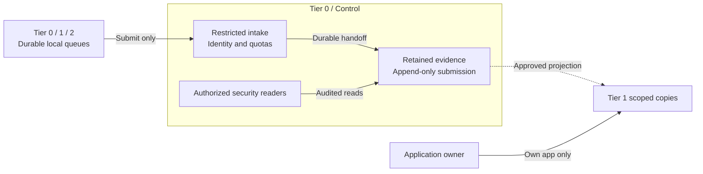

# Protected security logging

Syslog, audit and security events are a Tier 0 evidence capability, not an ordinary
Tier 1 dashboard service. All tiers submit approved records through restricted
intake. Only explicitly authorized system-administrator/security-reader roles
can investigate raw evidence. Producers cannot read, edit or delete it.

## Table of contents

- [Authority and flow](#authority-and-flow)
- [Segmented access](#segmented-access)
- [Durability and availability](#durability-and-availability)
- [Protected retention](#protected-retention)
- [Realization](#realization)
- [References](#references)

## Authority and flow

Submission rights are not filesystem, database or object-store credentials.
Receivers validate authenticated source identity, stamp tier/project ownership,
and reject attempts to claim another source's identity. Client-provided labels
alone never authorize a read scope. Rate/size limits and separate queues prevent
a compromised workload from exhausting the privileged evidence path.

System, authentication, infrastructure-change and audit records from every tier
follow this protected path. Application-log retention is selected per stream;
approved developer copies can be published without granting raw-archive access.
Metrics and traces use the separate [telemetry design](telemetry.md).
Offline custody has no online logging route; authorized evidence transfer is a ceremony operation.

## Segmented access

| Principal | Allowed operation | Explicitly denied |
| --- | --- | --- |
| Registered producer / local relay | Append new records to its assigned intake | Archive queries, changing existing records, deletion, another producer's namespace |
| Receiver / archive writer | Create retained records through a narrow service identity | Retention-policy administration, broad query access, modifying retained versions |
| Authorized system administrator / security reader | Read the approved security scope; export under policy | Routine modification/deletion of evidence; unlogged investigation |
| Application owner / developer | Read approved copies of that application's logs | Other applications, raw infrastructure/audit records and archive administration |
| Retention custodian | Govern approved retention and expiry with audited separation of duties | Unilateral early deletion or shortening a protected retention period |
| Tier 1 analytics administrator | Operate searchable copies | Authority over the Tier 0 evidence archive |

The reference publishes separately routed/indexed copies to Tier 1, with redaction
where required. OpenSearch role/index permissions enforce data access; Dashboards
tenants organize saved objects and are not by themselves log-data isolation. [1][2]
SSO authenticates the user; application authorization grants the selected scope.
Cross-tenant isolation is tested using hostile labels and direct API queries, not only UI views.

## Durability and availability

The objective is **no loss of accepted records within a declared failure envelope**,
not an unconditional promise that every emitted event can always be recovered.
The contract names where an event becomes accepted and which durable copies survive
before its sender may release it. Transport acknowledgement alone does not prove
replicated archive commitment. Duplicates may occur; preservation takes priority
over claiming exactly-once delivery.

| Boundary | Required property |
| --- | --- |
| Producer | Durable local spool, stable identity/sequence where supported, retry and measurable gaps; no premature acknowledgement of an unprotected event |
| Receiver | Redundant hosts and independent storage/power failure domains; authenticated transport, persistent queues and tested crash recovery |
| Commit | Explicit durability/flush/replication semantics; if a required copy is unavailable, retain the upstream event or apply the declared backpressure/fail-closed policy |
| Retention | Independently protected archive copies and recovery keys; receiver failover is not a backup |
| Capacity | Spool/archive sizing for peak rate and tolerated outage; alarms before exhaustion; per-source isolation |
| Detection | Missing-source/heartbeat, queue depth, write/replication failure, clock skew and restore checks; independent alert path |

A single receiver VM is a bootstrap configuration, **not the HA acceptance state**.
Two receivers alone are also insufficient: a VIP changes routing, not acknowledgement,
replication or storage durability. Supported source failover or dual submission needs
end-to-end sequence/count verification, including retries and duplicates.

UDP syslog cannot detect or repair datagram loss. [3] Plain TCP and disk-assisted
queues do not by themselves guarantee audit-grade crash durability; orderly-shutdown
queue persistence is distinct from protection against sudden power loss. [4]
Legacy sources use a nearby supported relay where possible, with the unprotected
first hop explicitly accepted as a residual gap. No downstream receiver can restore
an event that a source never emitted or persisted.

## Protected retention

Append-only service permissions are necessary but do not make a mutable VM disk
immutable against root, storage or hypervisor administrators. Use independently
enforced WORM/retention-lock storage and governed keys for the selected retention
period; test overwrite, deletion and retention-shortening denial.

Object Lock is one implementation example. Governance and compliance modes offer
different bypass powers; S3 API compatibility alone does not establish equivalent
enforcement. [5] Hashes/signatures can expose alteration but do not prevent deletion.
Hardware destruction, loss of encryption keys and correlated site loss remain
separate threats requiring independent copies and recovery custody.

## Realization

[Foundational syslog](../../deployment/stage-1-foundation/procedures/syslog.md) owns
bootstrap, receiver integration and acceptance. [Observability deployment](../../deployment/stage-4-control-services/procedures/observability.md)
adds approved search copies and monitoring. [Logging administration](../../administration/security-logging.md)
owns recurring access, gap, capacity and restore checks. No supplied VM baseline
claims to install a lossless or immutable archive.

## References

Sources checked 2026-10-16.

1. [OpenSearch users, roles and index/document permissions](https://docs.opensearch.org/latest/security/access-control/users-roles/)
2. [OpenSearch Dashboards tenant scope](https://docs.opensearch.org/latest/security/multi-tenancy/tenant-index/)
3. [RFC 5426: UDP syslog reliability](https://www.rfc-editor.org/info/rfc5426/)
4. [rsyslog reliable forwarding and crash-durability limits](https://docs.rsyslog.com/doc/tutorials/reliable_forwarding.html)
5. [S3 Object Lock retention modes](https://docs.aws.amazon.com/AmazonS3/latest/userguide/object-lock.html)
