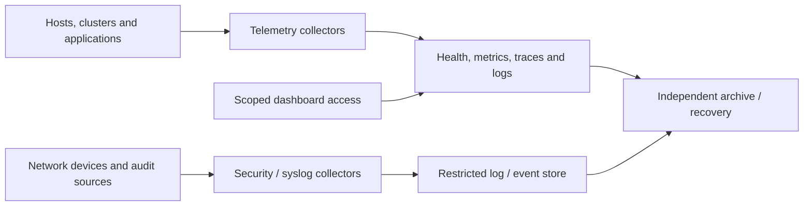

# Telemetry design

Telemetry separates collection, signal storage, live health and audit retention.
The design routes each signal to an appropriate backend rather than requiring
every function from one product. OpenTelemetry is the reference signal interface. [1]

## Table of contents

- [Flow and interfaces](#flow-and-interfaces)
- [Reference components](#reference-components)
- [Placement variants](#placement-variants)
- [Failure and retention requirements](#failure-and-retention-requirements)
- [References](#references)

## Flow and interfaces

Collectors provide the approved ingestion boundary. Backend administration is not
exposed to every telemetry source. Security records can have stricter access and
retention than application metrics. Archive writes do not grant storage administration.

## Reference components

| Function | Reference examples | Interface or purpose |
| --- | --- | --- |
| Collection/routing | OpenTelemetry Collector | Receive/process/export signals [1] |
| Live health | Netdata | Child-to-parent health visibility [2] |
| Durable metrics | VictoriaMetrics | Prometheus-compatible remote write [3] |
| Traces/APM | SigNoZ | Instrumented service traces and application diagnostics [4] |
| Logs/events | OpenSearch | Log, audit and event investigation [5] |
| Syslog/agent compatibility | rsyslog, syslog-ng, Fluent Bit, Vector | Selected source adapters; Fluent Bit is one telemetry agent option [6] |
| Archive | Object storage, NAS or approved external target | Retention, snapshots and independent recovery |

The examples are interchangeable only after their required protocol and operational
contracts are verified. Dashboard access uses service authorization; SSO alone does
not authorize all records. Alert ownership distinguishes immediate host health,
capacity, application faults and security events, with explicit notification routing.

## Placement variants

| Option | Shape | Consequence |
| --- | --- | --- |
| A | Dedicated VM collectors/backends | Independent service lifecycle and explicit host/network placement |
| B | Cluster-native services | Shared platform lifecycle; external monitoring still needed for cluster loss |
| C | Existing telemetry service | Interface, retention and recovery verified without duplicate backends |

Central and project-isolated instances are both valid. Isolation is justified by
air gaps, operator access, high-risk data or retention/deletion requirements.
Project/environment attributes support separation in a shared service but do not
replace authorization. Tier 0 control visibility must not depend exclusively on a
lower-tier backend; general platform telemetry can remain Tier 1-owned.

## Failure and retention requirements

The selected topology specifies collector loss behavior, storage retention,
restoration and external alert delivery. Ingestion and scoped queries are service
interfaces; successful ingestion alone does not establish failure detection.
Required health and backup coverage cannot depend on a shared dashboard being available.

The [telemetry VM procedure](../../deployment/stage-4-control-services/step-2d-telemetry-vm.md)
implements A's host foundation and identifies remaining service work. B/C are
project integrations with the same acceptance criteria.

## References

Sources checked 2026-10-08.

1. [OpenTelemetry signals](https://opentelemetry.io/docs/concepts/signals/)
2. [Netdata parent-child reference](https://learn.netdata.cloud/docs/netdata-parents/parent-child-configuration-reference)
3. [VictoriaMetrics Prometheus integration](https://docs.victoriametrics.com/victoriametrics/integrations/prometheus/)
4. [SigNoZ APM/tracing](https://signoz.io/docs/instrumentation/overview/)
5. [OpenSearch observability](https://docs.opensearch.org/latest/observing-your-data/)
6. [Fluent Bit](https://docs.fluentbit.io/manual)
