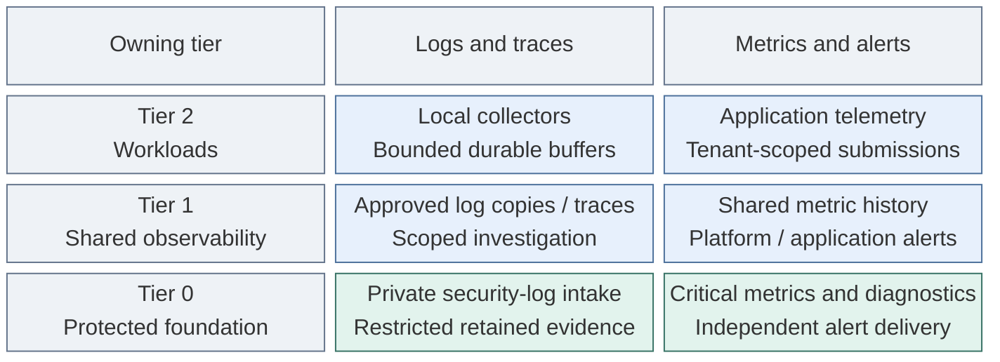

# Telemetry design

Telemetry combines independent Tier 0 visibility, one shared Tier 1 investigation
platform and lightweight Tier 2 collection. It does not require a complete stack
in every tier. Protected syslog and audit evidence belong to Tier 0; searchable
copies and application diagnostics do not replace that archive.

## Table of contents

- [Flow and interfaces](#flow-and-interfaces)
- [Reference components](#reference-components)
- [Deployment units](#deployment-units)
- [Placement variants](#placement-variants)
- [Failure and retention requirements](#failure-and-retention-requirements)
- [References](#references)

## Flow and interfaces

Every tier sends security/audit submissions to Tier 0. Ordinary application
telemetry goes to Tier 1; Tier 0 exports approved evidence/metric copies without
depending on their delivery. Tier 1/2 can submit
to narrow Tier 0 logging endpoints; they cannot query raw evidence or administer
the receivers. Submission endpoints are segregated from management APIs, with
source authentication, quotas and trusted provenance. The
[security-logging design](security-logging.md) owns archive access and durability.

Tier 0 collection, local investigation, rule evaluation and notifications remain
usable without Tier 1, OpenSearch or normal SSO. Tier 2 normally retains collection
during Tier 1 outages, not independent querying or alerts. A critical workload may
select local metric retention/evaluation without duplicating central analytics.

## Reference components

| Function | Reference examples | Interface or purpose |
| --- | --- | --- |
| Collection/routing | OpenTelemetry Collector | Supported agent/gateway pipelines; persistent exporter queues require explicit storage and retry configuration [1] |
| Foundational live diagnostics | Netdata agents and a Tier 0 parent | Native child/parent streaming, not an OTLP forwarding path [2] |
| Metrics history | VictoriaMetrics | Small Tier 0 critical dataset; separate Tier 1 shared backend [3] |
| Rule evaluation and notification | vmalert and Alertmanager | Tier 0 evaluates against its local dataset and uses independent notification delivery; Tier 1 owns platform/application alerts [4] |
| Logs, traces and application investigation | OpenSearch HA and Dashboards | One Tier 1 platform with supported ingestion pipelines; trace analytics includes Data Prepper [5] |
| Syslog and security evidence | rsyslog or another supported receiver; protected archive | Tier 0 authority; source/queue/retention contracts are defined separately in [security logging](security-logging.md) |

The examples are interchangeable only after their required protocol and operational
contracts are verified. A separate SigNoZ/ClickHouse, Grafana, Loki, Tempo or Zabbix
deployment is not part of this reference. Existing alternatives remain valid after
their interfaces, authorization and recovery contract are selected explicitly.

Netdata's native streaming and local dashboard are not an automatically self-hosted
enterprise fleet portal. Cloud-backed bearer authentication is not independent
recovery access. The selected release must be tested without Cloud/SSO, with
private access controls and a separately tested administrative recovery path. [2][6]
A Tier 0 parent primarily serves foundation diagnostics; lower-tier streaming
requires explicit intake approval and does not grant users a Tier 0 dashboard.

## Deployment units

| Owner | Logical unit | Hosting boundary |
| --- | --- | --- |
| Tier 0 | Security-log intake and retained evidence | Starts outside Kubernetes; receiver redundancy and protected storage are separate from a single VM |
| Tier 0 | Foundation monitoring | Netdata parent, critical metric history, evaluator and alert routing may be grouped; required cluster-outage detection remains outside that cluster |
| Tier 1 | Shared observability | OpenSearch/Dashboards and ingestion; shared metrics/evaluation/routing in the platform cluster or selected VM alternative |
| Each tier | Local collectors and exporters | Host agents or cluster workloads with scoped credentials; no central database in every workload cluster |

These are lifecycle groups, not one VM per box. Replicas, persistence, resource
limits and physical failure domains still follow measured capacity and availability.
The two metrics stores serve different failure contracts, not duplicate full datasets.

## Placement variants

| Option | Shape | Consequence |
| --- | --- | --- |
| A | Dedicated VM collectors/backends | Independent service lifecycle and explicit host/network placement |
| B | Cluster-native services | Shared platform lifecycle; external monitoring still needed for cluster loss |
| C | Existing telemetry service | Interface, retention and recovery verified without duplicate backends |

Central and project-isolated instances are both valid. Isolation is justified by
air gaps, operator access, high-risk data or retention/deletion requirements.
Project/environment attributes support separation in a shared service but do not
replace authorization. The reference combines A for foundational log intake with
B for shared analytics; it is not a choice between one globally shared VM stack
and one globally shared Kubernetes stack. Tier 0 evidence remains protected in
every variant, including when approved copies are searchable in Tier 1.

## Failure and retention requirements

| Failure | Required behavior |
| --- | --- |
| Tier 1 / OpenSearch unavailable | Tier 0 logging, critical history and alert delivery continue; remote copies queue only within defined capacity |
| Tier 0 cluster unavailable | External log intake and required cluster-loss detection remain available |
| Netdata parent unavailable | Supported agents retain configured local collection/history; centralized diagnostics may be unavailable |
| Tier 2 isolated | Collection can buffer within limits; normal shared querying and alerts may be unavailable |
| Identity provider unavailable | Tested privileged local access remains; no assumption that SSO sessions always survive |
| Collector disk full or retry limit reached | Visible failure and an explicit loss/backpressure policy; a persistent queue is not an unlimited archive [1] |

Tier 0 outages can still interrupt higher-tier foundational dependencies. Local
telemetry survives only where its compute, storage and credential dependencies survive.

Deployment begins with [foundational syslog](../../deployment/stage-1-logging/README.md),
then adds [independent monitoring](../../deployment/stage-4-control-services/monitoring.md),
[shared analytics](../../deployment/stage-5-delivery/analytics.md) and
[workload collection](../../deployment/stage-6-workloads/telemetry.md).
The [VM alternative](../../deployment/stage-4-control-services/step-2d-telemetry-vm.md)
provides host foundations only. Product installation and integrations remain project work.

## References

Sources checked 2026-10-16. Use documentation matching the selected releases.

1. [OpenTelemetry Collector resiliency](https://opentelemetry.io/docs/collector/resiliency/)
2. [Netdata parent-child reference](https://learn.netdata.cloud/docs/netdata-parents/parent-child-configuration-reference)
3. [VictoriaMetrics Prometheus integration](https://docs.victoriametrics.com/victoriametrics/integrations/prometheus/)
4. [vmalert evaluation and notification integration](https://docs.victoriametrics.com/victoriametrics/vmalert/)
5. [OpenSearch trace analytics and Data Prepper](https://docs.opensearch.org/latest/observing-your-data/trace/getting-started/)
6. [Netdata Agent access controls](https://learn.netdata.cloud/docs/netdata-agent/configuration/securing-agents/)
