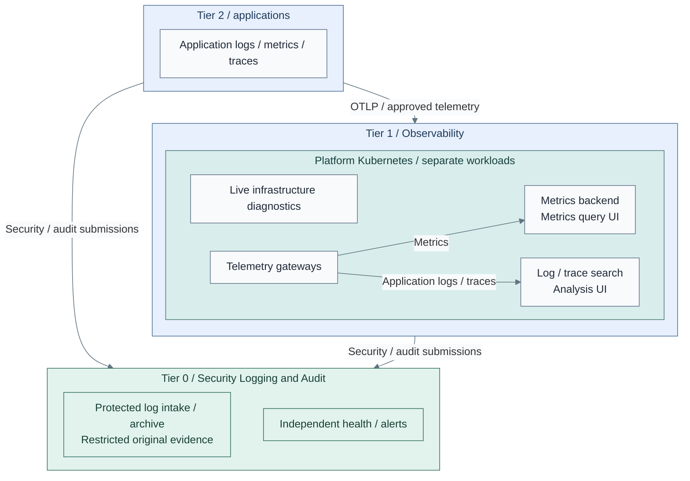

# Observability and telemetry

Observability uses **logs, metrics and distributed traces** to understand and
diagnose the running system. These are telemetry signals, not three mandatory
agents or VMs. A Collector can handle separate signal pipelines. [1]

**Security Logging and Audit** is the earlier Tier 0 capability: protected evidence
for accountability, investigation and recovery. Its primary purpose is traceability;
distributed tracing instead follows requests through services. Tier 1 observability
does not replace that evidence or acquire Tier 0 administrative authority.

## Table of contents

- [Flow and interfaces](#flow-and-interfaces)
- [Components and placement](#components-and-placement)
- [Infrastructure coverage](#infrastructure-coverage)
- [Independent scaling](#independent-scaling)
- [Availability and recovery](#availability-and-recovery)
- [Read boundaries](#read-boundaries)
- [Realization](#realization)
- [References](#references)

## Flow and interfaces

Application telemetry goes to Tier 1. Critical syslog and audit submissions from
every tier go directly to Tier 0; there is no second Tier 1 critical-syslog service.
Approved Tier 0 projections can be indexed for scoped search, never edited back
into the original archive. [Security logging](security-logging.md) owns that contract.

Correlation uses trusted service/resource identity, timestamps and request/trace IDs.
It does not require unrestricted database-to-database access. OTLP is the telemetry
transport, not a promise that every backend accepts the same protocol. [1][2]

## Components and placement

| Function | Reference | Placement |
| --- | --- | --- |
| Agent and gateway collection | OpenTelemetry Collector; separate pipelines for logs, metrics and traces | Tier-local agents; replicated Tier 1 gateways [2] |
| Metrics storage and querying | VictoriaMetrics with native VMUI; supported query frontend | Independent Tier 1 stateful workloads [3] |
| Log/trace processing and search | Data Prepper and OpenSearch | Independent Tier 1 ingestion/search workloads, included initially [4] |
| Analysis UI | OpenSearch Dashboards | Separate stateless Tier 1 workload; not another log store [4] |
| Rules and notification | vmalert and Alertmanager where selected | Shared application alerts in Tier 1; critical alerts remain independent in Tier 0 |
| Live diagnostics | Netdata agents and tier-scoped parents | Tier 1 Kubernetes for platform/workload diagnostics; independent Tier 0 parent for control infrastructure [5][13] |
| Original security evidence | syslog-ng OSE receivers and protected archive | Tier 0; independent of Tier 1 Kubernetes |

The normal runtime is the existing Tier 1 Kubernetes cluster. Collector,
VictoriaMetrics and OpenSearch have documented Kubernetes/operator deployment
paths. That supports the placement choice, not an automatic production-readiness
claim. Qualify releases, components, storage and upgrade/failure behavior. [6][7][8]

Netdata remains part of Observability, not only foundation monitoring. Its selected
metric path uses native child/parent streaming, separate from OTLP. An explicit
Prometheus scrape/export bridge can feed selected metrics into the Collector and
VictoriaMetrics; native streaming does not perform that forwarding automatically. [5][14]
A separate SigNoZ/ClickHouse, Grafana, Loki or Tempo deployment is not required.
Other products remain explicit alternatives, not additional default stacks.

## Infrastructure coverage

Observability covers the IT platform as well as applications. Collection stays in
the source-owning tier; a shared dashboard does not move infrastructure authority.

| Source | Required visibility | Ownership and boundary |
| --- | --- | --- |
| Virtualization | Proxmox node/guest health, cluster quorum, capacity and backup freshness | Tier 0 owns host diagnostics and read-only API collection |
| Hardware | BMC reachability, temperature, fans, power supplies and storage-controller health where exposed | Tier 0 polls supported Redfish/IPMI sensors; no power/reset privileges |
| Storage and network | Disk/pool health, latency, capacity, interface errors, link state and UPS power | Source owner selects supported collectors/API or SNMPv3 integrations |
| Runtime and services | Kubernetes node/pod/API health, service availability, certificate expiry and queues | Tier-local agents; independent Tier 0 checks for critical control services |

Tier 0 retains Proxmox/BMC credentials and critical diagnostics. Only approved,
filtered metrics reach Tier 1 through a Tier 0-owned exporter. No Tier 1 access
to management APIs, raw Tier 0 Netdata views or Functions follows from that export.
Security/audit events still use protected Tier 0 logging, not a second Netdata archive.

Netdata has **two diagnostic domains**, not two copies of every source:

| Domain | Sources and runtime | Failure boundary |
| --- | --- | --- |
| Infrastructure | Tier 0 host/BMC collectors and independent Tier 0 parent | Local diagnostics and critical alerts do not require Tier 1 or its Kubernetes cluster |
| Platform and workloads | Tier 1/2 agents, with Tier 1 Kubernetes parents | Shared operational diagnostics; parent redundancy is qualified within this domain |

There is no default native Netdata stream or parent replication between these domains.
Only the approved metric projection crosses into Tier 1 history/query services.
That derived copy is intentional; it is not another hardware poller, a raw Tier 0
diagnostic view or a failover parent for Tier 0. Configure each domain's own recovery.

The [infrastructure monitoring deployment](../../deployment/stage-8-observability/infrastructure-monitoring.md)
selects host versus API collection, sensor support and acceptance tests. Device
coverage is explicit: an absent or stale sensor is unknown, not evidence of health.

## Independent scaling

The components do **not** have equal resource needs. Kubernetes consolidation
shares a substrate, not one all-in-one application or one fixed VM resource ratio.

| Workload | Main capacity drivers | Scale independently |
| --- | --- | --- |
| Collector gateways | Signal rate, transformations, memory and queue pressure | Gateway replicas/resources; preserve metric single-writer and stateful routing rules [2] |
| Metrics backend | Active series, sample rate, query load, retention and disk I/O | Metrics storage/compute and query capacity |
| Search backend | JVM heap, shards, indexing, query load and disk I/O | Search node pools, shards and storage; retain quorum and replicas |
| Ingestion and UIs | Processing throughput versus interactive query/session load | Separate Data Prepper and UI resources/replicas |
| Live diagnostics | Monitored nodes, active charts, history and streaming connections | Netdata child collection and parent CPU/memory/data volumes, independent of search |

Give each workload its own resource budget, persistence, scheduling and scaling
policy. Reserve backend capacity and protect cluster control services; the compact
schedulable control-plane starter is not evidence of spare search capacity.
Use dedicated worker pools or stronger isolation when interference requires it.

The [VM alternative](../../deployment/stage-8-observability/step-1b-dedicated-vms.md)
also separates gateway, metrics and search roles. Co-hosting them in identical VMs
couples CPU, memory, I/O, maintenance and horizontal scaling, so it is not the reference.

## Availability and recovery

| Boundary | Required design |
| --- | --- |
| Gateways | Multiple instances, authenticated endpoints, bounded durable queues and tested endpoint failover; two pods alone do not prove safe replay [2] |
| Metrics | Replicate writes to both independent stores and fail reads over only to usable, sufficiently caught-up copies; do not split writes across single-node stores [3] |
| Search | Three cluster-manager-eligible nodes for one-node quorum tolerance, replica shards and independent failure domains [9] |
| Diagnostics | Child failover between independently persisted Netdata parents, parent synchronization and tested catch-up; not just extra chart replicas [15] |
| Placement | Spread replicas across physical failure domains, not only Kubernetes VM names; validate persistent-volume failure behavior |
| Backups | Independently retained restore points; service replicas are not backup |
| Loss limits | Declare queue capacity, accepted tail loss and recovery time; no zero-loss guarantee from OTLP acknowledgement or replica count |

A failure must leave sufficient surviving capacity, not just a running process.
Catch-up, rolling upgrades, resource exhaustion and restoration are acceptance cases.
A persistent queue depends on its volume surviving and on retry/exporter behavior. [10]

Tier 0 visibility stays usable without Tier 1, OpenSearch or normal SSO.
Tier 2 normally retains collection during Tier 1 outages, not independent querying or alerts.

## Read boundaries

OpenSearch can index approved application logs and scoped security projections.
The export identity has no Tier 0 write/delete, retention or backup authority.
Restrict what crosses the tier boundary before ingestion; Tier 1 search administration
must not enlarge its source scope.

Index permissions, document-level security and field-level security define reader
access. Document/field filters do not remove separately granted write privileges;
readers must have no update/delete or index-management permissions. [11][12]
Tier 1 index deletion never deletes Tier 0 originals. Dashboard tenants alone
are not the data-authorization boundary.

## Realization

[Security Logging and Audit](../../deployment/stage-2-logging/README.md) comes first.
[Independent monitoring](../../deployment/stage-6-secrets/monitoring.md)
keeps foundation visibility outside cluster outages.
[Observability deployment](../../deployment/stage-8-observability/README.md)
adds Netdata diagnostics, infrastructure coverage, gateways, both backends and UIs;
[workload collection](../../deployment/stage-10-lab-environments/telemetry.md)
connects applications.

Tier-owned native release inputs realize this design. Project GitOps folders are
adoption points, not a second owner of directly installed releases. Alternative
VM runtimes and operational qualification remain distinct from the Kubernetes realization;
the [implementation map](../../reference/implementation-support.md) records that boundary.

## References

Sources checked 2026-10-21; qualify documentation against selected releases.
Netdata deployment references checked 2026-10-22.

1. [OpenTelemetry signals](https://opentelemetry.io/docs/concepts/signals/)
2. [Collector gateway deployment and single-writer rules](https://opentelemetry.io/docs/collector/deploy/gateway/)
3. [VictoriaMetrics single-node HA and VMUI](https://docs.victoriametrics.com/victoriametrics/single-server-victoriametrics/)
4. [OpenSearch trace analytics and Data Prepper](https://docs.opensearch.org/latest/observing-your-data/trace/getting-started/)
5. [Netdata child/parent streaming](https://learn.netdata.cloud/docs/netdata-parents/parent-child-configuration-reference)
6. [OpenTelemetry Kubernetes Operator](https://opentelemetry.io/docs/platforms/kubernetes/operator/)
7. [VictoriaMetrics Kubernetes Operator](https://docs.victoriametrics.com/operator/)
8. [OpenSearch Kubernetes Operator](https://docs.opensearch.org/latest/install-and-configure/install-opensearch/operator/index/)
9. [OpenSearch voting and quorum](https://docs.opensearch.org/latest/tuning-your-cluster/discovery-cluster-formation/voting-quorums/)
10. [Collector resiliency](https://opentelemetry.io/docs/collector/resiliency/)
11. [OpenSearch document-level security](https://docs.opensearch.org/latest/security/access-control/document-level-security/)
12. [OpenSearch field-level security](https://docs.opensearch.org/latest/security/access-control/field-level-security/)
13. [Netdata Kubernetes Helm chart](https://learn.netdata.cloud/docs/netdata-agent/installation/kubernetes-helm-chart-reference)
14. [Netdata Prometheus export](https://learn.netdata.cloud/docs/exporting-metrics/prometheus)
15. [Netdata parent clustering and failover](https://learn.netdata.cloud/docs/netdata-parents/metrics-centralization-points/clustering-and-high-availability-of-netdata-parents)
