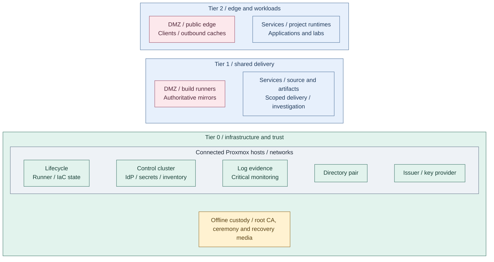

# Integrated reference platform

Tier 0 supplies infrastructure and trust; Tier 1 supplies shared delivery
services; Tier 2 owns public ingress, ordinary outbound caches, clients and workloads. This reference deployment shows the intended
placement. It is a design, not a claim that every service is automated.
The [deployment stages](../deployment/README.md) realize this result; their
order does not determine the structure of this document.

This view expands the services in the [capability map](README.md#functional-structure) into one
reference placement across all three tiers, including separately isolated Tier 0 custody. The
[runtime relationships](runtime-flows.md) connect those components during
normal service use, change and recovery. [Domain designs](README.md#technical-domains)
expand their internals; [variants](variants.md) record alternative realizations.

The reference fixes the hosting relationships below. Storage backends, capacity,
key providers, seal mechanisms and required availability are explicit domain
selections. A product name or replica count does not settle those choices.

## Table of contents

- [Service placement](#service-placement)
- [Connected functions](#connected-functions)
- [Access and automation](#access-and-automation)
- [Certificate trust](#certificate-trust)
- [Data and recovery](#data-and-recovery)
- [Implementation choices](#implementation-choices)
- [Design to deployment](#design-to-deployment)

## Service placement

Proxmox hosts the connected VMs and clusters across all tiers. Tiers identify
authority and resource ownership; VM and cluster boundaries identify runtime
placement. Physical host, storage and network failure domains are selected
separately. Offline custody remains Tier 0-owned but outside the connected platform.

Ordinary client workstations also belong to Tier 2 / DMZ, on a separate subnet
outside the server runtime boundary. Privileged operator devices and bootstrap
or jump VMs remain Tier 0 / Control.

This is a placement view, not a traffic diagram. A disconnected ceremony VM
on a connected hypervisor is not isolated from that hypervisor's administrators.
Keep root keys on offline media/devices and conduct ceremonies in a separately
controlled environment; a VM or VLAN label alone does not establish an air gap.

| Platform function | Reference component and placement | Interfaces or detailed design |
| --- | --- | --- |
| Compute, networking and data | Tier 0-operated Proxmox, host fabrics, selected storage and approved VM templates | [Runtime and failure domains](compute/runtime.md), [network attachments](networking/README.md) |
| Infrastructure lifecycle | Protected workstation and management VM/runner; independent tier-owned state | [Infrastructure acceptance](compute/provisioning.md) |
| Directory authority (IdM) | FreeIPA primary and replica on two dedicated VMs, outside Kubernetes | [Identity authority](identity/README.md) |
| Identity provider (IdP / SSO) | Keycloak inside the Tier 0 cluster, using the directory pair | [Service access](runtime-flows.md#service-access) |
| Offline trust authority | Offline root CA, ceremony environment and root recovery material in separate custody | [Certificate hierarchy](#certificate-trust) |
| Routine certificate issuance | OpenXPKI Community on a dedicated Tier 0 issuer VM, local database and portal, with selected key provider; separate FreeIPA identity CA | [Certificate authority](cryptography/certificate-authority.md) |
| Secrets | Vault inside the Tier 0 cluster; independent recovery/unseal material | [Secret service and seal](cryptography/vault-seal.md) |
| Tier 0 cluster services | Flux, CNI, DNS, SOPS bootstrap inputs, storage, cert-manager, ingress and CloudNativePG HA | [Kubernetes topology](compute/kubernetes.md); separate cluster owners and state |
| Inventory and scoped control UI | NetBox and Headlamp in Tier 0; bootstrap inputs retained independently | [Operations](operations/README.md) |
| Security evidence | Tier 0 private receivers and protected archive; all tiers submit, only authorized administrator/security roles read raw evidence | [Security logging](operations/security-logging.md) |
| Independent monitoring and Observability | Tier 0 critical health/alerts and Netdata diagnostics; separate Tier 1 Kubernetes gateway, metrics, OpenSearch and UI workloads; Tier 2 collection | [Telemetry](operations/telemetry.md) |
| Source and artifacts | GitLab and Harbor in the Tier 1 platform cluster | [Artifact authority and delivery](delivery/artifact-supply.md) |
| General builds and mirrors | Tier 1 DMZ runners and authoritative mirrors using scoped source/artifact access | [Application delivery](runtime-flows.md#application-delivery) |
| Application delivery | Tier 0 Flux; Tier 1 Argo CD or Spinnaker remains unselected | [Delivery controller patterns](delivery/controllers.md) |
| Service publication | Tier 2 public edge load balancers and the owning cluster/application ingress | [Delivery](delivery/README.md), [firewall policy](networking/firewall-policy.md) |
| Workload management | Rancher/Fleet where selected, scoped to workload clusters | [Ownership](tier-ownership.md) and [compute](compute/README.md) |
| Outbound supply | Tier 2 ordinary proxy/cache; Tier 1 authoritative mirrors; independent bootstrap/offline artifacts | [Delivery](delivery/README.md) |
| Workloads | Tier 2 applications on approved Kubernetes runtimes or VMs | [Runtime design](compute/runtime.md), [bounded requests](compute/provisioning.md) |
| Backup and restoration | Owner-specific backup targets, independent recovery records and protected copies | [Data and recovery](#data-and-recovery) |

The [cluster topology](compute/kubernetes.md) defines three independent tier APIs,
compact control planes and optional worker pools. [Controller patterns](delivery/controllers.md)
keep Tier 0 Flux separate from Tier 1 delivery and scoped Tier 2 application access.

Keycloak and NetBox use the database service. Vault has its own storage and
recovery design; the database service is not its storage backend by implication.
Database, cache, storage, and backup requirements remain service-specific.

Network purposes remain `management`, `identity`, `control_cluster`,
`cryptography`, `application`, `external_edge`, `delivery_edge` and the separate
`client` subnet as applicable. The [network catalog](networking/README.md#network-catalog)
owns reference VLANs;
full site allocations remain in inventory. A hosting boundary does not create
a new subnet or permitted connection.

## Connected functions

| Consumer | Provider | Purpose and boundary |
| --- | --- | --- |
| Users and applications | Named edge/application endpoints | Service traffic; no administrative subnet publication |
| OIDC-capable services | Identity provider, backed by directory authority | Authentication; each consumer retains its own authorization |
| Services and clusters | Online issuer and scoped secret endpoints | Certificate/credential consumption; no root-key access |
| Source review and general builds | Approved registry and source interfaces | Candidate publication and policy-controlled promotion |
| Selected application delivery controller | Approved source, registry and release policy | Reconciliation or pipeline-controlled application delivery within the granted scope |
| Tier-owned infrastructure definitions | Tier 0 acceptance and protected execution | Authorized VM/runtime lifecycle; definitions and state keep their owner |
| Stateful services | Selected database, volume, cache or object-storage provider | Explicit data ownership, service credentials and restoration contract |
| Platform and workload producers | Authorized telemetry/backup receivers | Scoped signal intake and protected copies; receiver administration is separate |

The [runtime views](runtime-flows.md) expand these connections into focused
diagrams. They show the steady-state operating paths, including authorized
changes, rather than a second installation sequence.

## Access and automation

| Path | Boundary |
| --- | --- |
| Client workstation to services | HTTPS and service RBAC; OIDC through the identity provider where supported |
| Directory pair to identity provider | Protected directory federation; no directory administration through clients |
| Privileged workstation to infrastructure | Scoped administration and independent bootstrap/recovery credentials |
| Cluster UI to Tier 0 Kubernetes | Privileged, scoped cluster access; not general client administration |
| Source control to protected runner | Proposed changes pass Tier 0 authorization before privileged execution |
| Tier 0 GitOps to source/registry | Read-only retrieval of approved revisions/artifacts; independently retained recovery copies |
| Tier 1 cluster management to Tier 2 | Workload-cluster scope only; no authority over Tier 0 |

The protected infrastructure runner is a Tier 0 management VM, separate from
general Tier 1 runners. Source control coordinates changes but does not own
infrastructure authority. See [infrastructure control](compute/provisioning.md)
for the acceptance policy and state handover.

## Certificate trust

The offline root signs intermediate CA certificates during an authorized
ceremony. Routine issuance and renewal use an online issuer, not the root.
Signed certificates move through controlled handoffs; there is no network route to root custody.

The [cross-tier trust map](cryptography/README.md#completed-design) places offline
custody and infrastructure authority in Tier 0. The [CA hierarchy](cryptography/certificate-authority.md#trust-hierarchy)
expands its sibling infrastructure and identity issuers; [enrollment and publication](cryptography/certificate-authority.md#enrollment-and-publication)
shows tier-local clients using the authorized online interfaces.

The [CA design](cryptography/certificate-authority.md) owns the OpenXPKI portal,
Community ACME adapter and separate FreeIPA certificate inventory. OpenXPKI is the
long-term issuer; Vault remains the secret service. A Vault PKI issuer remains an
explicit alternative using its own API [1], not the default migration destination.
Seal/unseal support and certificate signing remain different integrations [2].

Hardware is optional. The [key-protection variants](cryptography/hsm-selection.md)
include software custody, single USB, replicated gateways and network HSMs.
The [USB design](cryptography/usb-hsm.md) is one variant, not the entire
cryptography design. An offline backup of an online key is not an offline
root CA. Normal CI must never initialize keys or perform custody ceremonies.

## Data and recovery

Persistence is part of the result, not an installation detail. Each selected
service needs a data owner, storage/backup boundary and recoverable configuration.
The reference does not treat every stateful component as a consumer of one database.

| State | Reference ownership and dependency | Required recovery independence |
| --- | --- | --- |
| Infrastructure inventory and Terraform state | Owning tier, accessed only by its authorized executor | Tools, state and credentials remain available without hosted source control |
| Directory and DNS data | Dedicated Tier 0 directory pair | Restoration does not require the unavailable IdP or control cluster |
| Kubernetes control state and configuration | Owning cluster; approved desired state and bootstrap material | Control-plane recovery inputs survive the cluster |
| Keycloak and NetBox data | Selected database service and application-specific dependencies | Database state, app configuration and credentials are covered together |
| Vault data and seal/recovery material | Vault's explicitly selected storage and seal contract | Required unseal/recovery material remains independent of Vault |
| Source, artifacts and workloads | Tier 1 or Tier 2 service owner, according to actual resources | Required code, images and workload data survive the service hosting them |
| CA state and identities | Root/issuer/provider custodians; local OpenXPKI database, configuration and DataVault material | Signing, issuance history and revocation survive replacement without the cluster or secret service |
| Logs, audit records and backups | Owner-specific receivers, retention and protected copies | Loss of an observed service does not remove all detection and restoration paths |

Availability, replication and backup solve different failure cases. The
[data, visibility and recovery view](runtime-flows.md#data-visibility-and-recovery)
shows their relationships; [administration](../administration/recovery.md) owns
operating procedures and restore evidence.

## Implementation choices

Proxmox is the chosen hypervisor. Kubernetes is the cluster goal; Talos is
the current implementation, not a requirement of the model. Service products
above are reference choices. Existing VM-based service deployments remain
valid alternatives; moving them into Kubernetes requires deliberate data and
lifecycle migration, not a documentation refresh.

Review this design when a service gains cross-tier privileges, recovery starts
depending on a higher tier, or CA/key custody changes. Record site choices in
the project-owned design and recovery documents.

## Design to deployment

Architecture is organized by the finished function. The table links every
deployment capability to the part of the integrated result it contributes.
Detailed variants link to their own realization procedures inside the domains.

| Finished function | Contributing deployment guides |
| --- | --- |
| Infrastructure, network attachment and approved templates | [Compute foundation](../deployment/foundation/README.md) |
| Offline trust and online issuance | [Cryptographic trust](../deployment/stage-2-trust/README.md) |
| Directory, identity federation and the supporting cluster platform | [Identity](../deployment/stage-3-identity/README.md) |
| Protected syslog and audit evidence | [Foundational logging](../deployment/stage-1-logging/README.md) |
| Secrets, recovery custody and supporting control integrations | [Secrets](../deployment/stage-4-secrets/README.md) |
| Observability and scoped application diagnostics | [Tier 1 Observability](../deployment/stage-6-observability/README.md) |
| Shared delivery, published endpoints and protected execution handover | [Delivery and handover](../deployment/stage-5-delivery/README.md) |
| Approved project runtimes and application reconciliation | [Workload provisioning](../deployment/stage-7-workloads/README.md) |

The [support map](../reference/implementation-support.md) distinguishes supplied
automation from project integration. [Readiness](../deployment/readiness.md)
records demonstrated capability; selecting this reference does not establish it.

## References

Sources checked 2026-10-09.

1. [cert-manager: Vault issuer](https://cert-manager.io/docs/configuration/vault/)
2. [HashiCorp: Vault HSM support](https://developer.hashicorp.com/vault/docs/enterprise/hsm)
