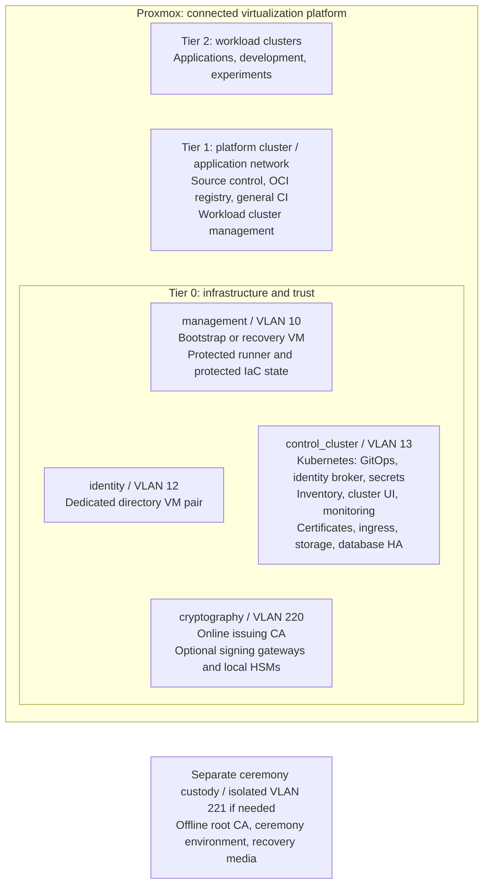
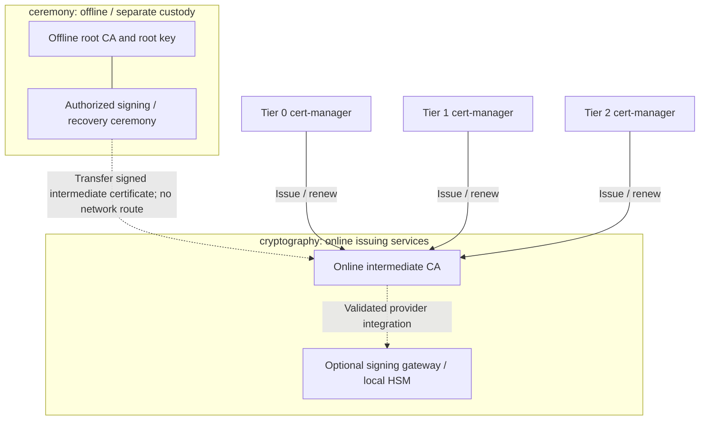

# Control platform design

Tier 0 supplies infrastructure and trust; Tier 1 supplies shared delivery
services; Tier 2 runs workloads. This reference deployment shows the intended
placement. It is a design, not a claim that every service is automated.
The [deployment stages](../deployment/README.md) identify the current entry
points and the work still required.

This is the component allocation of the [platform architecture](README.md).
Use [domain choices](README.md#technical-domains) for alternatives; the diagrams below are
one reference deployment, not a requirement to select every product or variant.

## Table of contents

- [Service placement](#service-placement)
- [Access and automation](#access-and-automation)
- [Certificate trust](#certificate-trust)
- [Implementation choices](#implementation-choices)

## Service placement

Proxmox hosts the connected VMs and clusters across all tiers. Network names
come from the [network map](networking/README.md); VLAN values are reference allocations.
Offline custody is shown outside the connected platform deliberately.

This is a placement view, not a traffic diagram. A disconnected ceremony VM
on a connected hypervisor is not isolated from that hypervisor's administrators.
Keep root keys on offline media/devices and conduct ceremonies in a separately
controlled environment; a VM or VLAN label alone does not establish an air gap.

| Capability | Reference deployment |
| --- | --- |
| Directory, DNS, Kerberos | FreeIPA primary and replica on two dedicated VMs, not Kubernetes workloads |
| Identity federation and OIDC | Keycloak inside the Tier 0 cluster, using the directory pair |
| Secrets | Vault inside the Tier 0 cluster in this target design; independent recovery/unseal material |
| Cluster platform | Flux, CNI, storage, cert-manager, ingress, SOPS bootstrap secrets, CloudNativePG HA |
| Operations | NetBox, Headlamp, monitoring/syslog/audit; retain independent recovery records |
| Shared delivery | Tier 1 GitLab, Harbor, general runners, and Rancher/Fleet where needed |

Keycloak and NetBox use the database service. Vault has its own storage and
recovery design; the database service is not its storage backend by implication.
Database, cache, storage, and backup requirements remain service-specific.

## Access and automation

| Path | Boundary |
| --- | --- |
| Client workstation to services | HTTPS and service RBAC; OIDC through the identity broker where supported |
| Directory pair to identity broker | Protected directory federation; no directory administration through clients |
| Privileged workstation to infrastructure | Scoped administration and independent bootstrap/recovery credentials |
| Cluster UI to Tier 0 Kubernetes | Privileged, scoped cluster access; not general client administration |
| Source control to protected runner | Proposed changes pass Tier 0 authorization before privileged execution |
| Tier 0 GitOps to source/registry | Read-only retrieval of approved revisions/artifacts; independently retained recovery copies |
| Tier 1 cluster management to Tier 2 | Workload-cluster scope only; no authority over Tier 0 |

The protected infrastructure runner is a Tier 0 management VM, separate from
general Tier 1 runners. Source control coordinates changes but does not own
infrastructure authority. See [infrastructure control](compute/provisioning.md)
for the acceptance policy and state handover.

## Certificate trust

The offline root signs intermediate CA certificates during an authorized
ceremony. Routine issuance and renewal use an online issuer, not the root.

The issuing service can be a dedicated CA or a supported PKI service. Its
integration is explicit: cert-manager's Vault issuer uses Vault's PKI API [1].
That does not make an arbitrary remote PKCS#11 gateway a Vault signing backend.
Seal/unseal support and certificate signing are different integration choices [2].

Hardware is optional. The [key-protection variants](cryptography/hsm-selection.md)
include software custody, single USB, replicated gateways and network HSMs.
The [USB design](cryptography/usb-hsm.md) is one variant, not the entire
cryptography design. An offline backup of an online key is not an offline
root CA. Normal CI must never initialize keys or perform custody ceremonies.

## Implementation choices

Proxmox is the chosen hypervisor. Kubernetes is the cluster goal; Talos is
the current implementation, not a requirement of the model. Service products
above are reference choices. Existing VM-based service deployments remain
valid alternatives; moving them into Kubernetes requires deliberate data and
lifecycle migration, not a documentation refresh.

Review this design when a service gains cross-tier privileges, recovery starts
depending on a higher tier, or CA/key custody changes. Record site choices in
the project-owned design and recovery documents.

## References

1. [cert-manager: Vault issuer](https://cert-manager.io/docs/configuration/vault/)
2. [HashiCorp: Vault HSM support](https://developer.hashicorp.com/vault/docs/enterprise/hsm)
